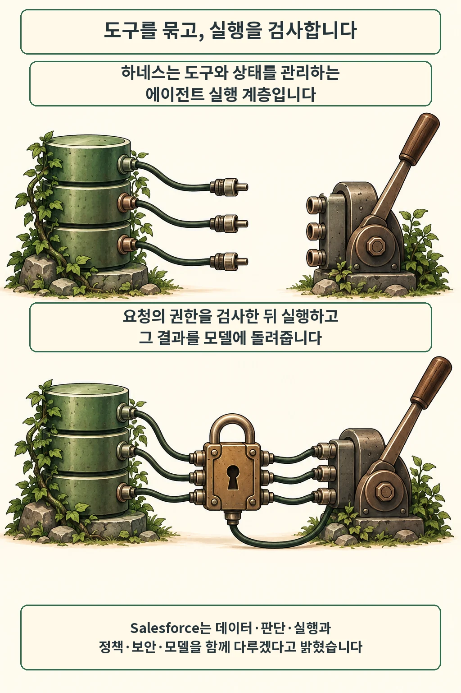
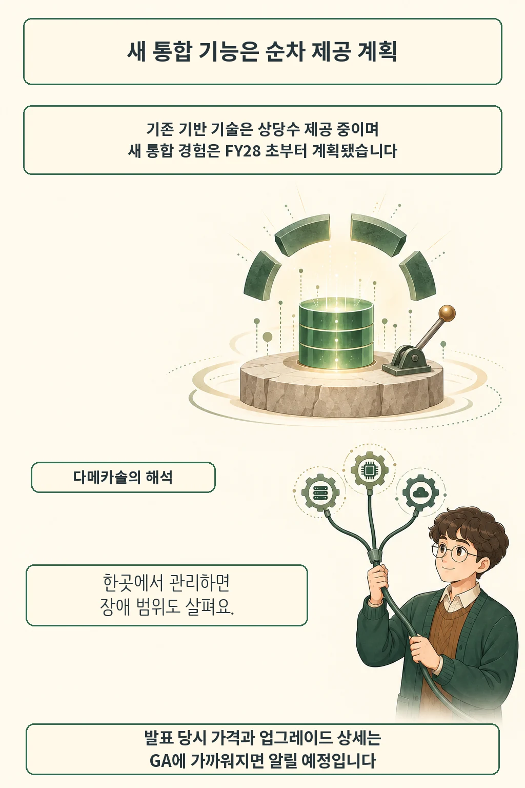

Salesforce가 2026년 9월 10일 **Enterprise AI Harness**와 **AI Control Plane** 구상을 발표했습니다. 에이전트의 실행과 관리를 공통 구조로 묶겠다는 계획인데요. 기반 기술 상당수는 이미 제공 중이며, 새로운 기능과 통합 경험은 회사 회계연도 기준 FY28 초부터 순차 제공할 예정입니다. [공식 발표](https://www.salesforce.com/news/stories/enterprise-ai-harness/)를 기준으로 핵심 내용을 정리했습니다.

글·해설: 다메카솔

Updated: 2026-09-11

## 핵심 내용

- **통합 실행·관리 구상**: Enterprise AI Harness와 AI Control Plane을 통해 데이터·판단·실행·정책·보안·모델을 하나의 공통 구조로 묶는 설계 방향을 제시했습니다.
- **현재 제공과 향후 출시 구분**: 기반 기술 상당수는 현재 제공 중이지만, 새로운 통합 경험은 Salesforce 회계연도 FY28 초부터 순차 제공될 예정입니다(가격·업그레이드 상세는 추후 안내).
- **도입 시 점검 포인트**: 공통 실행 계층이 생기면 정책 수정은 쉬워지지만 장애 영향 범위도 함께 커지므로, 재시도 상태 확인과 개별 시스템의 권한 거부를 분리해 시험해야 합니다.

## 하네스는 어디에 끼어들까요

모델이 도구 호출을 제안하더라도 누군가는 그 요청을 받아 실제 API로 보내고 결과를 챙겨야 합니다. Salesforce의 [하네스 설명](https://www.salesforce.com/agentforce/ai-agents/agent-harness/)은 바로 이 실행 계층에서 작업 상태를 보관하고 권한을 확인한 뒤, 도구 실행 결과를 다시 모델에 돌려주는 구조를 다룹니다.

이번 발표는 여기에 데이터·판단·실행·정책·보안·모델을 함께 묶어 내고, **AI Control Plane**을 통해 에이전트의 활동과 관리를 한곳에서 다루려는 구상을 담았습니다. 다만 두 자료 모두 Salesforce가 직접 작성한 문서이므로, 회사가 제시한 설계 방향과 실제 운영 환경에서 독립적으로 검증된 성과는 구분해서 읽을 필요가 있습니다.

## 지금 쓸 수 있는 것과 앞으로 더해질 것

발표문은 이미 제공 중인 기존 기반 기술과, **FY28 초**부터 순차 제공할 새 기능 및 통합 경험을 구분하고 있습니다(여기서 FY28은 Salesforce의 회계연도 표기이며 달력상의 2028년 출시일을 뜻하지는 않습니다).

가격과 업그레이드 상세 조건 역시 추후 안내 대상이어서, 2026년 9월 11일 확인한 공개 자료의 범위는 여기까지입니다. 따라서 실제 도입을 검토할 때는 같은 이름의 제품 묶음 안에서도 지금 당장 계약해 쓸 수 있는 기능과 향후 추가될 기능을 나누어 확인해야 합니다.

## 다메카솔의 해석: 관리가 모이면 장애도 함께 봐야 합니다

실행 계층을 한곳으로 모으는 설계를 볼 때는 변경의 영향 범위부터 따져 보게 됩니다. 에이전트마다 권한 검사를 따로 구현하면 정책이 바뀔 때 고쳐야 할 곳이 늘어나지만, 반대로 공통 검사 지점을 쓰면 수정 범위가 줄어드는 대신 그 지점의 장애가 여러 작업을 동시에 멈출 가능성도 생기기 때문입니다. 관리 편의성에는 그만큼의 운영 책임이 따라붙습니다.

이해를 돕기 위해 데이터 조회는 성공했는데 후속 변경 API 호출이 시간 초과된 가상 상황을 생각해 보겠습니다(Salesforce 제품에서 관찰한 실제 장애가 아니라 설명을 위해 만든 예시입니다). 이때 모델에게 단순히 “다시 해보라”고만 지시하면 이미 반영된 변경 작업을 중복 실행할 위험이 있습니다. 실행 계층이 요청 식별자와 처리 결과를 보관하고, 재시도 전에 이전 작업 상태를 먼저 확인하도록 설계해야 하는 이유가 여기에 있습니다.

또한 공통 관리 화면이 제공된다는 사실만으로 각 업무 시스템의 권한 검사가 모두 끝났다고 단정해서도 곤란합니다. 앞서 [Claude 평가 사고 재분석](/posts/claude-cyber-incidents-alignment-assessment/)에서 살핀 것처럼 설명과 실제 실행 경계에는 차이가 있을 수 있으므로, 도입 전 **정상 완료**, **권한 거부**, **실행 계층 장애** 세 가지 경로를 각각 시험해 보는 편이 안전합니다. 앞으로 공개될 통합 기능이 이 경계를 어디까지 책임질지가 남은 확인 과제입니다.

## 출처

- [Salesforce — Enterprise AI Harness 발표 (2026-09-10)](https://www.salesforce.com/news/stories/enterprise-ai-harness/): 발표 범위와 제공 계획.
- [Salesforce — Agent Harness 설명](https://www.salesforce.com/agentforce/ai-agents/agent-harness/): 실행 계층 개념. 날짜 표기 없음, 2026-09-11 확인.

이 글의 본문과 이미지는 생성형 AI로 제작했습니다. 기획과 편집 기준은 다메카솔이 정했습니다.
