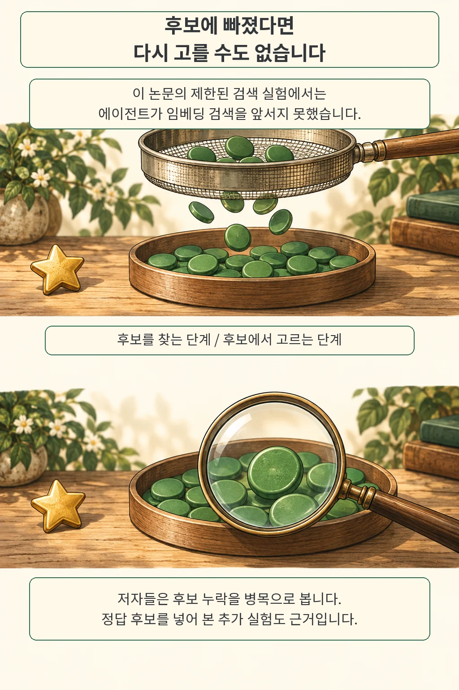

**논문 검색 결과는 잔뜩 쌓이는데, 정작 다음 실험에 가져올 결정적인 아이디어는 잘 보이지 않을 때가 있습니다.** ScholarCatalyst는 바로 이 간극을 파고들어, 단순히 키워드나 주제가 비슷한 문헌을 넘어 연구를 실제로 진전시키는 데 영감을 준 선행 논문(촉매 논문)을 얼마나 찾아내는지 평가한 벤치마크입니다.

*글·해설: 다메카솔*

원문 확인·작성: 2026년 10월 4일

## 핵심 내용

- **원 논문 저자가 직접 검증한 ‘촉매 논문’**: 연구 207건의 실제 저자 184명이 참여해, 자신의 연구를 진전시키는 데 실제로 도움을 주었거나 줄 수 있었던 선행 논문을 중심 연구 질문 207개·세부 질문 687개(총 894개 질문, 전체 후보 문헌 190,896편) 위에서 직접 검토·기록했습니다.
- **반복 검색 에이전트와 단일 임베딩 검색의 비교**: 원 논문 발표 이전 시점의 로컬 문헌(제목·초록)만 허용한 실험에서, 상위 20개 결과 내 정답 포함 비율(Recall@20, 중심/세부 질문 순)은 Gemini-Embedding-2 단일 검색(**0.38 / 0.46**)이 GPT-4.1 도구 호출 에이전트(**0.37 / 0.43**)나 o3 기반 deep research 에이전트(**0.33 / 0.38**)보다 오히려 높거나 비슷했습니다.
- **1차 후보 검색과 재정렬 단계의 분리**: 질문 100개에서 누락됐던 정답 논문을 20개 후보 목록 안에 인위적으로 섞어 넣자 강한 재정렬 모델의 성능이 크게 올라, 후속 추론보다 앞단의 **후보 검색(retrieval) 누락**이 핵심 병목임을 보여 주었습니다.

Sohyeon Kim 등의 **ScholarCatalyst: A Benchmark for Retrieving Papers That Inspire New Research**(2026년 10월 1일 제출 arXiv v1 프리프린트)를 바탕으로 정리했습니다.

## 비슷한 논문과 도움이 되는 논문 사이

연구자는 전혀 다른 분야의 방법론을 빌려 오거나 기존 연구의 한계점에서 새로운 실험 아이디어를 얻곤 합니다. 단순히 같은 전문 용어가 얼마나 자주 등장하는지만으로는 이런 영감의 연결 고리를 포착하기 어렵습니다. 저자들은 이처럼 새로운 연구를 진전시키는 데 실질적인 밑거름이 된 선행 문헌을 **촉매 논문(catalyst paper)**이라고 부릅니다.

무엇이 진짜 도움이 됐는지는 원 논문을 쓴 저자에게 직접 물었습니다. 연구진이 자동으로 생성한 초기 질문과 후보 목록을 실제 저자 184명(연구 207건)이 검토·수정하며 각 문헌의 도움 여부와 이유를 남겼고, 이를 통해 중심 연구 질문 207개와 세부 분야 질문 687개(총 894개 질문) 및 전체 후보 문헌 190,896편으로 이루어진 평가셋을 구축했습니다.

또한 연구 당시의 탐색 환경을 근사하기 위해, 주 실험에서는 각 원 논문의 발표 시점 이후에 나온 문헌을 제외하고 에이전트의 외부 웹 검색이나 원 논문 직접 열람을 차단했습니다(실제 연구 프로젝트의 정확한 착수 시점까지 모두 복원한 것은 아니지만, 미래 정보 유출을 막기 위한 시간 경계입니다).

## 검색을 더 반복하면 나아졌을까

그렇다면 LLM 에이전트가 검색 도구를 여러 번 반복 호출하며 추론하면 촉매 논문을 더 잘 찾아낼까요? 원문 Table 3에서 보고된 **Recall@20**(저자가 도움이 된다고 표시한 논문 중 상위 20개 결과 안에 들어온 비율)은 아래와 같습니다.

| 검색·에이전트 구성 | 중심 질문 Recall@20 (207개) | 세부 질문 Recall@20 (687개) | 실행 환경 및 조건 |
| --- | ---: | ---: | --- |
| **Gemini-Embedding-2 (단일 검색)** | **0.38** | **0.46** | 제목·초록 기반 로컬 문헌 임베딩 검색 |
| GPT-4.1 도구 호출 에이전트 | 0.37 | 0.43 | Gemini-Embedding-2를 검색 도구로 호출 (부족한 순위는 관찰 후보·검색기 결과로 보충) |
| o3 기반 deep research 에이전트 | 0.33 | 0.38 | 동일한 로컬 검색 도구를 사용한 다단계 탐색 |

*참고: 각 구성은 모델과 실행 예산이 서로 다르므로 수치 차이 전체를 단일 요인의 효과로 단정할 수는 없습니다.*

눈에 띄는 점은 에이전트가 추론과 도구 호출을 여러 차례 거듭했음에도 기본 임베딩 검색기를 앞서지 못했다는 사실입니다. 저자들은 원인을 좁히기 위해 질문 100개를 뽑아, 1차 검색된 후보 20개 중 일부를 기존에 누락됐던 정답 논문으로 교체한 뒤 목록 크기를 유지한 채 순위만 다시 매기는 진단 실험을 수행했습니다. 이때는 더 강한 재정렬(reranking) 모델이 뚜렷한 점수 향상을 보여, 그림 속 접시 밖에 남은 별처럼 **애초에 1차 후보 목록에 들어오지 못한 논문을 후속 추론만으로 건져 올리기 어렵다**는 점을 확인했습니다.

## 다메카솔의 해석: 검색 실패를 두 군데에서 살피기

RAG나 문헌 탐색 파이프라인의 품질을 개선할 때는 최종 답변 점수만 볼 것이 아니라 **1차 후보 검색 단계에서 필요한 근거가 들어왔는지(후보 재현율)**부터 분리해 기록해야 합니다. 후보 목록 자체가 비어 있다면 질의 확장이나 문서 분할·색인 방식을 고쳐야 하고, 후보 안에는 들어왔는데 최종 선택에서 밀렸다면 재정렬기나 프롬프트 판단 기준을 손봐야 하기 때문입니다.

모델 교체 실험에서도 마찬가지입니다. 1차 검색 후보를 고정해 둔 채 재정렬·생성 모델만 바꾼 비교와, 검색 쿼리 생성부터 다시 수행한 비교를 나누어 기록해야([에이전트 평가에서 실행 설정을 함께 기록하는 이유](/posts/agent-evaluation-system-configuration/)) 성능 변화의 진짜 원인을 설명할 수 있습니다.

물론 이 벤치마크의 정답 목록은 이미 완성된 2025~2026년 컴퓨터과학·AI 분야 연구를 사후에 돌아보며 구축한 것이라, 당시 저자들이 미처 검토하지 못한 후보 문헌 중에도 또 다른 유용한 논문이 남아 있을 수 있습니다. 후보 누락을 줄이는 기술과 더불어, **아직 정답지에 적히지 않은 낯선 분야의 아이디어가 실제로 유용한지 어떻게 평가할 것인가**가 다음 과제로 남습니다.

## 출처

- [ScholarCatalyst 논문 v1](https://arxiv.org/abs/2610.02202v1) — 질문·자료 구성은 §3, 결과는 Table 3, 추가 진단 실험은 §4.4·부록 D.2, 한계는 §5.
- [저자 프로젝트 페이지](https://ohmyksh.github.io/project/ScholarCatalyst/) — 과제 설명과 저자 판단 예시.
- [공식 코드, 확인한 리비전](https://github.com/stanford-iris-lab/ScholarCatalyst/tree/56eafcf878d12fd1036a5578d9630e665329221e) — 검색·평가 실행 경로 확인(벤치마크 직접 재실행은 수행하지 않음).
- [공식 데이터, 확인한 리비전](https://huggingface.co/datasets/ScholarCatalyst/ScholarCatalyst/tree/a5a73467500ada90db4e7641e0697a9591e41a4e) — 저자 판단 기반 공개 데이터셋(해당 저장소 라이선스 조건 적용).

이 글의 본문과 이미지는 생성형 AI로 제작했습니다. 기획과 편집 기준은 다메카솔이 정했습니다.
