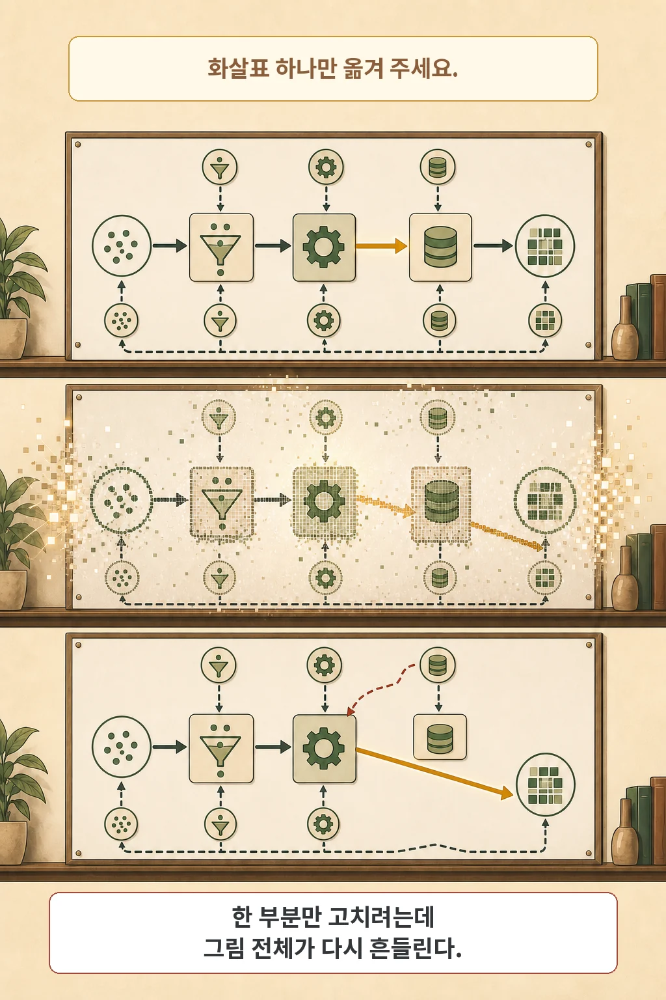
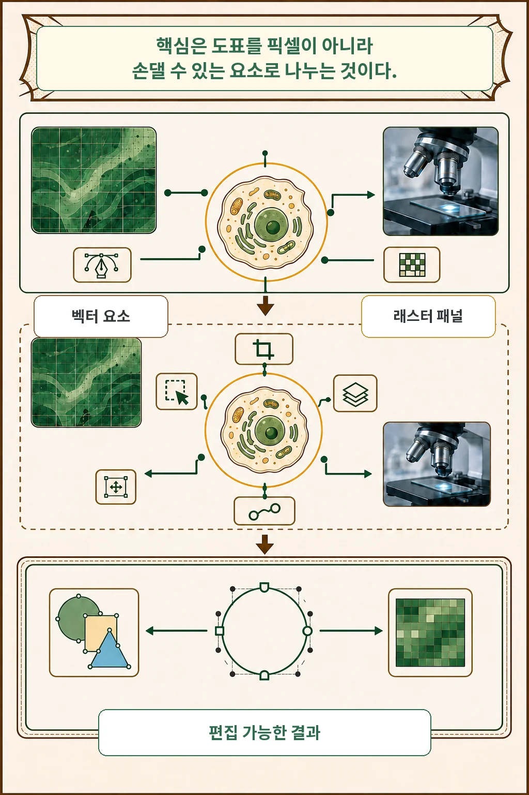
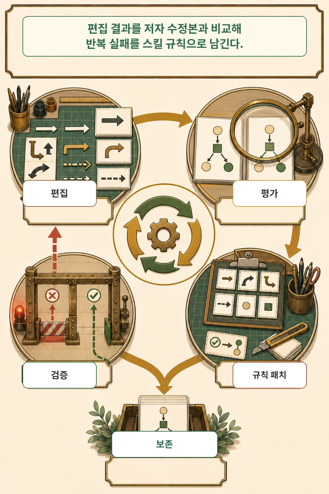

논문이나 설계 문서의 아키텍처 도표를 AI로 고칠 때, "화살표 하나만 옆 박스로 옮겨 달라"고 부탁했다가 그림 전체가 새로 그려진 경험이 있으실 겁니다. 요청하지 않은 글꼴과 정렬, 색상까지 흐트러지는 이유는 기존 이미지 편집 AI가 도표를 개별 객체가 아니라 평면 픽셀 한 장으로 다루기 때문이죠.

글·해설: 다메카솔

KAUST·Microsoft Research·NTU 연구진의 「SciDiagramEdit」은 이 한계를 겨냥한 시스템 논문입니다. 도표를 수정 가능한 SVG 코드로 분해한 뒤, 실제 arXiv 개정 이력에서 반복되는 실패를 텍스트 스킬 규칙으로 축적해 편집 정확도를 끌어올렸거든요.

## 픽셀 재생성 대신 벡터 요소만 타깃 편집하기

과학 도표는 라벨, 화살표, 박스, 플롯이 논리 관계로 얽힌 구조물입니다. 상용 래스터 편집기는 그림을 매끈하게 다시 그려 주지만, 국소 수정에도 선 굵기나 위첨자, 라벨이 슬그머니 바뀌곤 합니다.

연구진은 AutoFigure-Edit 파이프라인으로 도표를 두 층으로 나누는 하이브리드 SVG 표현을 택했습니다.

- **네이티브 SVG 벡터 요소**: 텍스트 라벨, 화살표, 박스처럼 논리 관계를 담는 도형은 주소 지정이 가능한 SVG 코드로 변환합니다.
- **임베디드 `<image>` 래스터 패널**: 실험 사진이나 밀도 높은 히트맵처럼 벡터화가 어려운 영역만 잘라 끼워 넣습니다.

이렇게 분리하면 에이전트가 특정 오타나 화살표 좌표만 정확히 고칠 수 있습니다. 작업 중에는 헤드리스 Chromium 렌더러(`render-svg`)와 기하 검사 도구(`layout-lint`)로 결과를 확인하고, 산출물도 SVG로 남아 사람이 후속 편집을 이어가기 수월합니다.

## arXiv 개정 이력 364쌍에서 편집 스킬을 키우는 루프

벡터로 분해해도 편집 지시가 다양해 고정 프롬프트만으로 예외를 다 다루기는 어렵습니다. 연구진은 arXiv 개정 전후 도표 364쌍을 23개 분야에서 모으고, 수정 의도와 논리 일관성을 검증할 원자적 체크리스트 2,628개를 붙여 벤치마크를 구축했습니다.

라벨 변경과 요소 추가가 전체 편집의 약 44%를 차지할 만큼 실무 개정 작업이 많았습니다. 연구진은 데이터를 학습·검증·테스트로 나누고, 세 에이전트가 협력해 스킬 문서를 진화시키는 루프를 돌렸습니다.

1. **Editor (편집)**: `SKILL.md`와 필요한 `workflows/` 규칙을 읽으며 Python 도구로 SVG를 수정합니다.
2. **Judge (평가)**: 체크리스트 통과율(`r_sem`)과 저자 수정본 대비 블라인드 미감 판정(`r_aes`)을 곱셈(`r_aes * r_sem`)으로 채점합니다.
3. **Coach (규칙 패치)**: 실행 기록과 점수, 저자 수정본을 대조해 문서를 덮어쓰지 않고 모듈형 규칙만 증분 패치합니다.

보상을 평균이 아니라 곱셈으로 둔 설계가 핵심인데요. 의미만 맞고 배치가 엉성한 SVG가 점수를 얻지 못하도록 미감 관문을 먼저 세워 둔 셈이죠. 패치는 검증 세트 점수가 오를 때만 상위 3개 후보군(frontier)에 편입되고, 기각된 시도는 이력에 남겨 반복 실패를 막습니다.

실제로 어떤 규칙이 쌓이는지 사례를 볼까요? 예를 들어 네 개의 세로 패널을 정사각형 격자로 재배치할 때, 초기 에이전트는 패널은 옮기고도 SVG `viewBox`를 그대로 두어 사방에 빈 여백을 남겼습니다. Coach가 구조 재배치 뒤 `viewBox`를 조이라는 규칙을 패치하자 여백이 사라졌고, 두 라벨을 맞바꿀 때 앞선 수정이 덮어씌워지는 실수도 임시 플레이스홀더와 `x` 좌표 앵커 규칙으로 해결했습니다.

## 자동 평가와 사람 평가가 보여 준 트레이드오프

테스트 세트에서 단일 패스 SVG 편집기와 상용 래스터 편집기를 비교한 결과는 두 접근의 트레이드오프를 분명히 드러냅니다.

| 비교 대상 | 의미 체크리스트 | 의미 승률 | 미감 IAA/ISTA | 미감 승률 |
| --- | ---: | ---: | ---: | ---: |
| GPT-Image-1.5 (래스터) | 0.516 | 0.347 | 50.77 / 46.60 | 0.349 |
| GPT-Image-2 (래스터) | 0.882 | 0.778 | 49.60 / 45.78 | 0.637 |
| AutoFigure-Edit (GPT-5.5, SVG) | 0.844 | 0.573 | 44.87 / 41.37 | 0.400 |
| **SciDiagramEdit (GPT-5.5 + 스킬)** | **0.932** | 0.756 | 47.93 / 45.58 | 0.515 |
| 저자 수정본 (Target GT) | — | — | 48.25 / 46.49 | — |

SciDiagramEdit은 의미 체크리스트에서 가장 높은 점수를 기록했고, 같은 백본의 단일 패스 SVG 편집보다 미감 승률도 크게 끌어올렸습니다. 다만 자동 미감 승률만 보면 최상위 래스터 편집기에는 아직 못 미치는데요. 가령 세로 배치를 가로 행으로 바꿀 때도 래스터 모델은 마감은 매끈하지만 화살표가 엉뚱한 패널에 꽂힌 반면, SciDiagramEdit은 연결 정확도와 텍스트 비겹침을 함께 지켰습니다.

가중치를 재학습하지 않고도 진화된 스킬이 다른 백본으로 옮겨 간다는 점도 주목할 만합니다. 전이 실험과 테스트 표본 30건 대상 블라인드 사용자 평가(연구원 5명 참여) 결과는 두 가지로 요약됩니다.

- **백본 간 전이**: GPT-5.5에서 진화시킨 스킬을 GPT-5.3·GPT-5.4에 적용해도 의미·미감 승률이 모두 올라 자체 진화 스킬과 비슷한 효과를 냈습니다.
- **사용자 선호도**: GPT-Image-2 대비 미감 54%·의미 59%, AutoFigure-Edit(GPT-5.5) 대비 미감 63%·의미 68%로 두 축 모두 과반의 선택을 받았습니다.

## 다메카솔의 해석: 재학습 대신 스킬을 패치하는 설계

실무 관점에서 이 논문의 핵심은 가중치를 다시 학습하지 않고도 실패 경험을 모듈형 텍스트 규칙으로 축적해 품질을 높일 수 있다는 점입니다. 문서나 도표 편집 에이전트를 설계한다면 세 가지 원칙을 참고해 볼 수 있습니다.

1. **상태를 코드로 유지하기**: 평면 이미지로 굽기 전에 SVG·HTML·Markdown 트리 상태를 유지해야 국소 수정과 공동 편집이 수월합니다.
2. **정확도와 완성도를 함께 게이트하기**: 변경 체크리스트 외에 삭제 뒤 빈 여백이나 텍스트 겹침 같은 시각 회귀 관문을 따로 두어야 합니다.
3. **트리거 단위로 증분 패치하기**: 프롬프트 전체를 갈아엎으면 기존 규칙이 유실되므로 `workflows/`처럼 분리해 패치하는 편이 안전합니다.

도입 전에 감안할 실무 제약도 분명합니다. 현재 벤치마크는 명시적 수정 지시를 주로 다루어, 번호 변경 뒤 남은 옛 노드를 지우거나 논문 맥락에서 암묵적 의도를 추론하는 작업에서는 누락이 생깁니다. 데이터의 상당수가 머신러닝 네 분야에 몰려 있고 사용자 평가 규모가 작은 데다, 전체 실험 API 비용만 약 2만 달러에 달했거든요. 개별 팀이 루프를 처음부터 돌리기보다 논문이 공개를 예고한 스킬 규칙을 출발점으로 삼아 도메인 실패만 소규모로 패치하는 전략이 현실적입니다.

## 함께 읽을 AI 시스템 글

- [워크플로우를 지식으로 자산화하는 방법론](/posts/workflow-as-knowledge/)
- [LLM 에이전트 스킬 주입과 회귀 방어 전략](/posts/llm-agent-skill-regression-tax/)

## 출처

- [SciDiagramEdit: Learning to Edit Scientific Diagrams from Paper Revisions, arXiv:2607.15272](https://arxiv.org/abs/2607.15272)

이 글은 논문 원문을 바탕으로 정리했으며 실험을 별도 재현하지 않았고, 본문 만화는 이해를 돕기 위해 새로 구성했습니다.

이 글의 본문과 이미지는 생성형 AI로 제작했습니다. 기획과 편집 기준은 다메카솔이 정했습니다.
