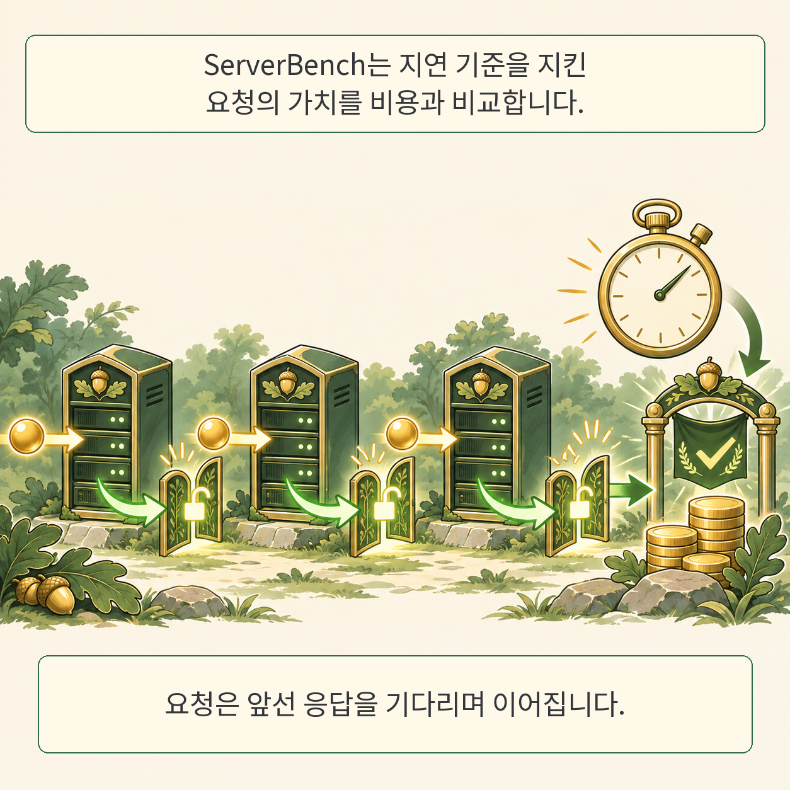

AI 코딩 에이전트에게 LLM 서빙 서버 최적화를 맡기면, 겉보기 처리량(throughput)만 끌어올린 코드를 내놓기 쉽습니다. 그런데 실제 서비스에서는 요청을 많이 처리해도 응답이 정해진 시간 안에 도착하지 않으면 충분한 가치를 내기 어렵거든요. **ServerBench**는 에이전트가 만든 서빙 서버 전체를 지연시간·비용·정확성 기준으로 함께 검증하는 벤치마크입니다.

글·해설: 다메카솔

## 이어지는 요청과 지연시간 조건

기존 벤치마크는 비슷한 길이의 요청을 독립적으로 던져 단순 속도 배율만 따졌습니다. 요청끼리 얽히지 않으면 정적 배치만으로도 점수가 꽤 나와, 연속 배치나 페이징 어텐션 같은 실전 기법의 차이가 잘 드러나지 않죠. 실제 코딩 에이전트 작업은 앞선 응답이 도착해야 다음 턴이 출발하는 의존 구조가 기본입니다.

ServerBench는 기록된 코딩 세션을 폐쇄 루프(closed-loop)로 재생해 이 의존성을 살립니다. 앞선 응답이 늦어지면 다음 요청도 밀리고, 제한 시간 안에 끝내는 전체 작업량도 줄어드는 셈이죠. 프롬프트 본문만 프라이버시를 위해 재구성하되, 요청 길이와 공유 접두사, 병렬 서브에이전트 분기는 그대로 유지합니다.

점수(`dollars per dollar`)는 SGLang 기준 설정의 `p90` 응답 지연(TTFT·TPOT) 목표치를 지킨 요청의 토큰 가치만 골라 GPU 비용으로 나눈 값입니다. 예컨대 지연 기준을 충족한 요청의 토큰 가치가 3.65달러로 집계되었고 같은 구간의 GPU 비용이 0.83달러였다면, 최종 점수는 4.40점으로 계산되어 기준을 지킨 효율만 반영됩니다. 동시 세션 수만 늘려 총량을 불리더라도 지연 통과율이 떨어지면 점수는 내려가죠.

제출된 서버는 개발 환경과 분리된 새 컨테이너에서 세 단계 독립 검증을 거쳐야 점수를 받습니다.

- **새 시드(held-out seed) 재현**: 인터넷이 차단된 개발 샌드박스를 벗어나 새 환경에 서버를 올리고, 개발에 쓰지 않은 세션 시드로 재생합니다.
- **완전성·정확성 검사**: 프롬프트 누락 여부, 지정 출력 길이, 스트리밍 일관성을 확인하고 원본 체크포인트 대비 생성 품질과 정답 정확도를 검증합니다.
- **사후 코드·행동 검토**: 검토 에이전트와 사람이 코드와 실행 기록을 점검해 모델 연산을 우회하는 편법이 없는지 가려냅니다.

## 33개 제출 결과에서 드러난 격차

연구진은 코딩 에이전트 모델 11개를 세 가지 모델·GPU 조합에 투입해 총 33개 제출 결과를 비교했습니다. 각 에이전트는 최소한의 Transformers 서버에서 출발해 엔진 구현과 동시 세션 수를 함께 설계하며 기준 엔진(SGLang·vLLM)에 맞섰죠.

- **실험 조건**: 조합별 8시간 개발(비정상 실패 시 최대 1회 재실행) 뒤 1,800초 본 재생으로 평가했으며, 기준선은 SGLang v0.5.19와 vLLM v0.28.0입니다.
- **전체 분포**: 33개 중 22개가 독립 검증을 통과했고, 그중 13개가 가장 강한 기준 구현을 넘었습니다(세 조건 모두 통과 6개, 모두 초과 3개).

| 배치 조건 (모델·GPU) | 최고 기준 구현 (`$/$`) | 최고 에이전트 성과 (`$/$`) | 기준 대비 배수 |
| --- | --- | --- | --- |
| Gemma-4-E4B-it (`1× L40`) | vLLM `0.61` (`c=8`) | Claude Sonnet 5.5 `2.97` (`c=32`) | `4.87배` |
| Qwen3.5 9B (`2× L40`) | SGLang `1.62` (`c=1`) | Claude Opus 5.5 `4.40` (`c=16`) | `2.71배` |
| Qwen3.8 27B INT4 (`2× L40`) | vLLM `1.47` (`c=1`) | Claude Opus 5.5 `2.64` (`c=8`) | `1.80배` |

조합마다 한 번의 개발 실행만 수행한 기록인 만큼, 이 비율을 반복 실험의 일반 성공 확률로 일반화하기보다는 설계 역량 차이를 보여 주는 사례로 읽어야 합니다. 상위권 에이전트는 처리 용량을 먼저 넓힌 뒤 동시성을 맞췄고, 실제로 Qwen 중형 모델에서는 총 토큰 가치보다 지연 기준 통과율에서 앞선 제출물이 최종 점수를 역전했거든요.

## 짧은 테스트가 놓치는 경계 고장 사례

검증에서 탈락한 사례들을 보면 개발 중 짧은 시험과 실제 워크로드 사이의 간극이 뚜렷합니다. 제출 시점에 부하나 긴 문맥에서 자연 종료(`EOS`) 검사를 실행한 경우가 33개 중 5개뿐이었죠.

- **긴 입력의 진입 정지**: `Qwen3.8-Max-0902` 모델은 TPOT를 지키려고 진입 제어 규칙을 조인 뒤 짧은 프롬프트와 11건 재생을 통과했지만, 최종 평가의 315K 토큰 입력에서 실행에 진입하지 못하고 멈췄습니다.
- **반복 요청의 캐시 충돌**: `Kimi K3`는 수치 오류를 고친 뒤 새 엔진에서 긴 프롬프트 단독 실행에는 성공했으나, 같은 접두사를 캐시에 두 번째로 넣는 순간 예외가 재발했습니다. 상태 재사용으로 중복 계산을 줄이는 원리는 [Flide의 상태 분기](/posts/flide-exact-state-forking/)와도 맞닿아 있지만, 여기서는 연속 요청 속 안정성을 묻습니다.
- **가벼운 조건과 가짜 입력의 착시**: 무작위 문자열로 투기적 디코딩을 시험해 이득이 없다고 본 사례와 달리, 실제 재생 응답으로 잰 에이전트는 스텝당 2.09~2.34개 토큰 수락 효과를 확인했습니다. 반면 유난히 가벼운 시드에 맞춰 동시성을 높인 제출물은 최종 시드에서 통과율이 76.0%에서 16.8%로 떨어지며 점수가 2.99에서 0.48로 급락했죠.

반면 Gemma 조건에서 Claude Opus 5.5는 선점과 캐시 복구를 추가한 뒤 일부러 캐시 풀을 줄여 해당 경로를 강제 실행했습니다. 덕분에 미초기화 캐시 슬롯(`NaN`) 버그를 잡아내, 3건 모두 실패하던 스트레스 시험을 수정 후 모두 통과시켰습니다.

## 결과를 실무에 적용하기 전에

연구 결과를 현업에 적용하기 전에는 실험 범위의 한계부터 짚어야 합니다. 평가는 L40 GPU 세 배치와 단일 코딩 세션 기록에 한정되어 있어, 실제 서비스의 불규칙한 오픈 루프 트래픽이나 다른 가속기 환경에 그대로 옮기기는 어렵거든요.

짧은 300초 관찰 창이 본 평가보다 평균 1.42~1.70배 높은 점수를 내는 편향도 나타났습니다. 고정 단가로 계산한 토큰 가치 역시 개발 API 비용과 운영비를 뺀 효율 지표이므로, 실제 사업 수익과는 구분해서 해석해야 합니다.

공식 저장소 코드로 자체 검증을 돌려 보려면 실행 환경 준비도 필요합니다. 공식 코드는 Linux, NVIDIA GPU, Docker와 약 200GB의 디스크 여유 공간을 요구합니다.

이런 제약을 감안하더라도 LLM 서빙 엔진을 최적화할 때 적용할 수 있는 검증 원칙은 분명합니다.

1. **바뀐 경로를 일부러 실행하기**: 진입 제한·선점·캐시 복구처럼 새로 만든 코드는 캐시 풀 축소나 경계 길이 입력으로 강제로 실행해 봅니다.
2. **단독 실행 대신 연속 상태 확인하기**: 첫 요청 한 건만 보지 말고, 같은 접두사를 반복 캐싱하거나 선점 후 재개할 때 상태가 유지되는지 점검합니다.
3. **수정 뒤 가혹 조건 재검증하기**: 버그를 고친 뒤에는 단축 테스트로 넘기지 말고, 처음 장애가 났던 조건을 수정 직후 다시 통과하는지 확인해야 합니다.

## 출처

- [ServerBench 원문 v1](https://arxiv.org/abs/2611.06841v1): Xinrui Zhong 외, 2026년 11월 4일 공개, §3–5와 한계(Limitations) 절.
- [ServerBench 공식 코드](https://github.com/Infini-AI-Lab/Server-Bench): 실행 환경 요구 사항 확인, 확인일 2026년 11월 5일.

이 글은 논문 원문과 공식 저장소 문서를 바탕으로 정리한 해설이며 벤치마크를 직접 재현하지 않았고, 본문 이미지는 개념 전달을 위해 새로 구성했습니다.

이 글의 본문과 이미지는 생성형 AI로 제작했습니다. 기획과 편집 기준은 다메카솔이 정했습니다.
