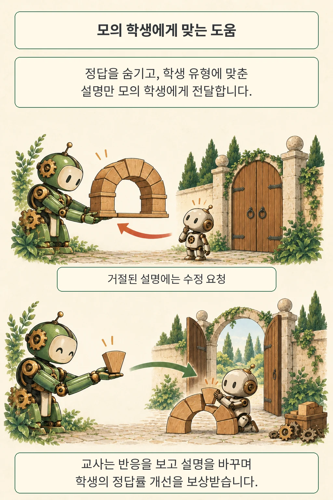

글·해설: 다메카솔

AI 튜터를 훈련할 때는 정답을 맞혔는지뿐 아니라 **학생이 어떤 방식의 설명에 반응하는지**도 보상에 반영할 수 있습니다. Sherpa 연구진은 서로 다른 교수법을 요구하는 모의 학생 환경을 만들고, 교사 모델이 대화 도중 상대의 반응을 살피며 설명 방식을 조정하도록 강화학습을 적용했습니다. 학습 지원 챗봇을 만드는 개발자에게는 학생 시뮬레이터의 설계가 교사 모델의 행동까지 바꾼다는 점이 핵심입니다.

## 핵심 내용

- **두 단계 게이트가 있는 모의 학생**: 최종 정답을 바로 알려 주는 발화와 학생의 선호 교수법에 맞지 않는 발화를 걸러 내어, 통과한 설명만 학생의 대화 문맥에 반영하고 거절 시 수정 피드백을 돌려줍니다.
- **미지의 학생 유형에 대한 적응 훈련**: MATH 문제(훈련 759개·평가 528개)에서 Qwen3-8B 교사와 고정된 Qwen3-1.7B 학생으로 훈련한 결과, 7개 학생 유형 평균 정답률이 기본 모델 48.6%에서 Sherpa DP 69.0%로 올랐습니다.
- **선호도 상승과 세부 지표의 절충**: MathTutorBench 설명 선호율(52.5% → 79.2%)과 현직 고교 교사 96명의 블라인드 선호도(동률 제외 79.6%)는 크게 높았으나, 첫 오류 위치 찾기(37.1 → 30.3)와 소크라테스식 질문 BLEU(25.3 → 21.9)는 낮아졌습니다.

## Sherpa는 학생의 반응을 어떻게 만들었을까

모의 학생 프롬프트에 역할 설명만 적어 두면, 교사 모델이 상대의 반응을 살피는 대신 누구에게나 똑같이 친절하고 긴 풀이를 보내도 높은 점수를 받기 쉽습니다. 저자들은 이 지름길을 막기 위해 **학생 모델에 전달될 교사 발화를 먼저 심사하는 두 가지 검사(게이트)**를 두었습니다.

1. **정답 노출 차단 검사**: 중간 계산이나 일부 풀이 단계는 허용하되, 최종 정답을 그대로 알려 주는 발화를 차단합니다.
2. **선호 교수법 부합 검사**: 다음 소목표를 짚어 달라는 학생이나 두 가지 풀이를 비교해 달라는 학생처럼, 해당 모의 학생에 설정된 교수법 요구에 맞는지 확인합니다.

두 검사를 모두 통과한 설명만 학생 모델의 대화 기록에 들어가고, 거절된 발화는 기록에서 제외된 채 교사 모델에 수정 요청 피드백만 돌아갑니다. 교사 모델은 현재 학생이 어떤 선호 유형인지 미리 알지 못하는 상태에서 이 피드백을 단서 삼아 다음 설명을 조정합니다(논문 속 여섯 가지 선호 유형과 제약 없는 유형은 현실의 모든 학생을 분류한 표라기보다, 적응형 지도를 훈련하기 위해 구성한 텍스트 수학 대화 환경입니다).

## 보상은 설명 뒤에 풀린 문제에서 나온다

훈련 과정에서 학생 모델(Qwen3-1.7B)의 가중치는 고정돼 있고, 갱신되는 쪽은 교사 모델(Qwen3-8B)입니다. 교사는 먼저 혼자 볼 참조 풀이를 준비한 뒤 최대 10턴 동안 학생과 대화하고, 대화가 끝난 뒤 학생이 그 대화 기록을 참고해 원래 문제를 다시 풀었을 때의 정답률(8회 샘플링 평균) 개선을 보상으로 받습니다.

저자들은 MATH 데이터셋에서 교사는 풀 수 있고 학생은 도움을 받아야 나아질 수 있는 문제를 골라 훈련 759개와 평가 528개를 구성했습니다. 일곱 가지 학생 유형 중 네 유형만 훈련에 쓰고 나머지 세 유형은 평가에만 등장시켜 처음 보는 선호 유형에도 적응하는지 확인했으며, 평가 시의 설명 검사와 정답 판정에는 Qwen3.8-27B-FP8을 사용했습니다. 모델 이름뿐 아니라 문제 선별과 판정기 구성을 함께 봐야 한다는 점은 앞서 다룬 [AI 에이전트 평가의 구성 조건](/posts/agent-evaluation-system-configuration/)과도 맞닿아 있습니다.

## 모의 시험과 사람 선호에서 각각 확인한 것

논문이 보고한 주요 성과와 세부 지표의 절충은 아래 세 가지 평가로 나뉩니다.

| 평가 항목 | 기본 Qwen3-8B | Sherpa DP | 평가 조건 및 해석 시 유의점 |
| --- | ---: | ---: | --- |
| 모의 학생 시험 정답률 (Table 1) | 48.6% (95% 구간 46.1–51.0%) | **69.0%** (95% 구간 66.8–71.2%) | 선별된 528문제·7개 모의 유형·문제당 8회 풀이(대화 기록 포함) |
| MathTutorBench 설명 생성 (Table 2) | 52.5% | **79.2%** | 4개 응답 생성 과제에서 평가 모델(Ped-RM)이 기준 응답보다 선호한 비율 평균 |
| 현직 고교 교사 블라인드 선호 | 187건 선택 | **728건 선택 (79.6%)** | 교사 96명이 320쌍(80개 CoMTA 대화 × 4개 요청)을 각 3회씩 총 960회 판정(동률 45건 제외 시 728/915) |
| 오류 위치 찾기 / 소크라테스 질문 (Table 2) | **37.1** / **25.3** | 30.3 / 21.9 | 첫 오류 단계 식별 micro-F1 및 기준 질문 대비 BLEU에서는 기본 모델보다 하락 |

표에서 보듯 모의 학생의 문제 해결과 전반적인 설명 선호도는 뚜렷하게 올랐지만, 학생의 첫 번째 오류 지점을 정확히 짚어 내는 점수와 소크라테스식 짧은 유도 질문의 표면 유사도(BLEU)는 오히려 낮아졌습니다. 한 가지 보상 신호로 설명 스타일을 최적화할 때 다른 교습 하위 능력이 함께 변할 수 있음을 보여 주는 대목입니다.

## 대화가 끝난 뒤의 학습은 남은 질문

이번 모의 시험에서 학생 모델은 **방금 나눈 수업 대화 기록을 옆에 펼쳐 둔 채로 같은 문제를 다시 풀었습니다.** 대화 중 받은 힌트를 잘 활용해 당장 문제를 풀어내는 것과, 시간이 지난 뒤 대화 기록 없이 새로운 문제를 혼자 힘으로 풀어내는 장기 학습·전이 효과는 별도의 검증이 필요한 영역입니다. 또한 실제 학생은 자신의 학습 선호를 명확한 거절 피드백으로 표현하지 못하는 경우가 많다는 점도 시뮬레이터 환경과의 차이로 남습니다.

## 다메카솔의 해석: 학습 챗봇에는 서로 다른 시험이 필요하다

교육용 AI 튜터를 설계하고 평가할 때는 **대화 직후의 설명 만족도, 힌트를 함께 보며 푼 정답률, 그리고 대화 기록을 치운 뒤 새 문제를 혼자 푸는 독립 수행률**을 분리해 측정해야 합니다. 만족도만 쫓으면 정답에 가까운 친절한 해설지로 기울기 쉽고, 대화 기록을 포함한 직후 정답률만 높이면 학생이 힌트를 그대로 베껴 쓰는 경로까지 보상을 받기 때문입니다.

시뮬레이터 로그를 분석할 때도 정답 노출로 차단된 비율, 선호 교수법 불일치로 거절된 비율, 설명을 다 듣고도 학생 모델이 계산을 틀린 비율을 나누어 기록해 두면 교사 모델이 실제로 어떤 능력을 학습했는지 훨씬 투명하게 파악할 수 있습니다. **설명을 좋게 평가한 학생이 며칠 뒤 처음 보는 문제 앞에서도 그 풀이를 자기 힘으로 재현할 수 있을지**, 그 다음 단계의 시험지가 함께 준비돼야 합니다.

## 출처

- Weixian Xu, Yanzhe Zhang, Zora Zhiruo Wang, Changyu Chen, Diyi Yang, [Sherpa: Teaching LLMs to Teach Adaptively, arXiv:2610.08778v1](https://arxiv.org/abs/2610.08778v1). 2026년 10월 6일 제출된 프리프린트입니다.
- [원문 PDF](https://arxiv.org/pdf/2610.08778v1): §2의 훈련·검사 구조, Table 1–3, 부록 B.1–B.4의 평가 조건을 대조했습니다.
- [저자 공식 코드와 모델 안내](https://github.com/SALT-NLP/Sherpa): 2026년 10월 7일 기준 공개 README와 모델 컬렉션 링크를 확인했으며, 모델 훈련이나 평가 재실행은 수행하지 않았습니다.

발행·자료 확인일: 2026년 10월 7일.

이 글의 본문과 이미지는 생성형 AI로 제작했습니다. 기획과 편집 기준은 다메카솔이 정했습니다.
