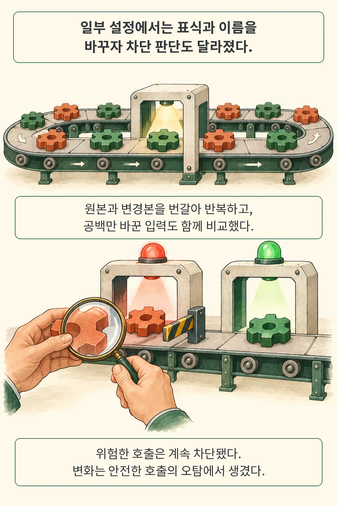

**안전성 검사기의 높은 벤치마크 점수만으로는 그 AI가 행동의 위험을 제대로 이해했는지 단정하기 어렵습니다.** 평가 데이터에 붙은 구분 표식이나 도구 이름만 보고도 정답을 꽤 높은 비율로 맞힐 수 있기 때문인데, 그렇다고 데이터에 이런 단서가 있다는 사실만으로 검사기가 편법을 썼다고 결론 내릴 수도 없습니다. 단서가 정답을 얼마나 예측하는지, 그리고 실제 검사기 판단을 실제로 움직이는지를 단계별로 나누어 시험해야 합니다.

글·해설: 다메카솔

## 핵심 내용

- **세 단계로 나눈 검증**: 데이터셋의 표면 단서(도구 이름·명령 길이)만으로 정답을 맞힐 수 있는지(예측 가능성), 검사기 판단이 단서와 함께 움직이는지(관찰적 연관), 같은 입력에서 단서 표현만 바꿨을 때 판정이 달라지는지(개입 민감도)를 분리해 평가했습니다.
- **표면 단서와 집계 단위의 착시**: 도구 이름별 다수 정답만 외운 규칙도 AgentDojo-Traj 내 교차검증에서 F1 0.901을 기록했지만 미지의 도메인에서는 0.495로 떨어졌고, AgentHarm-Traj에서는 단계 단위(F1 0.902)냐 상호작용 단위(F1 0.719)냐에 따라 점수가 크게 달라졌습니다.
- **짝 비교에서 드러난 오탐 변화**: AgentDojo-Traj 64단계에서 외부 자료 표식이나 도구 별칭만 바꿨을 때 위험 호출은 모두 그대로 차단됐으나, Claude Haiku 4.5의 안전 사례 오탐률은 표식 변경 시 −8.33%p, 별칭 변경 시 +11.46%p 흔들렸습니다.

도구 호출 앞에 AI 안전성 검사기를 두는 개발자라면 위험 차단 못지않게 정상 요청을 막는 오탐(false positive)도 중요한 운영 지표입니다. Kontext의 Hasan Demirkiran과 Jens Ernstberger가 발표한 「Shortcut Sensitivity in Agent-Safety Evaluations」(2026년 10월 15일 arXiv v1 공개, NeurIPS 2026 TAE·AIWILD 워크숍 채택 기재)는 검사기 성적표 뒤에 숨은 단서 민감도를 어떻게 분해해 볼 수 있는지 잘 보여 줍니다.

## 정답을 맞히는 단서와 판단의 원인은 다릅니다

저자들은 벤치마크의 지름길(shortcut) 문제를 세 단계 질문으로 나눕니다. 첫 단계는 행동 맥락을 읽는 대신 명령 길이나 도구 이름만 보고 정답을 맞히는 단순 규칙을 만들어 **데이터 자체에 이용하기 쉬운 규칙성이 있는지** 확인하는 일이고, 두 번째 단계는 같은 정답 집단 안에서 특정 표식이 붙은 자료를 검사기가 실제로 더 자주 차단하는지 살피는 **관찰 단계**입니다.

세 번째 단계에서는 요청과 행동 내용을 유지한 채 외부 자료 표식의 문구나 도구 이름만 바꾸어 **같은 사례의 판정이 달라지는지(짝 비교)** 시험합니다. 다만 바뀐 문구 자체가 출처의 위험도를 더 명확히 알려 주는 등 안전성 판단에 필요한 의미까지 바꿨을 수도 있으므로, 세 단계가 각각 답할 수 있는 범위를 구분해 읽어야 합니다. ([원문 §2](https://arxiv.org/html/2610.22243v1#S2))

| 질문 단계 | 확인할 수 있는 것 | 다음에 추가로 따져볼 것 |
| --- | --- | --- |
| 1. 단서만으로 정답을 맞히는가 | 데이터에 내재한 예측 가능한 규칙성 | 도메인이 바뀌어도 유지되는가 |
| 2. 단서와 차단 판단이 함께 움직이는가 | 검사기 출력과의 관찰된 연관관계 | 함께 달라진 다른 맥락 조건이 있는가 |
| 3. 단서를 바꾸면 같은 사례의 판단이 달라지는가 | 해당 입력 변형에 대한 민감도 | 변형이 안전성 판단에 필요한 의미까지 바꿨는가 |

디버깅할 때 오류 로그에 특정 헤더가 자주 보인다는 관찰만으로는 원인을 단정할 수 없고, 다른 조건을 고정한 채 헤더만 바꿔 봐야 원인을 좁힐 수 있는 것과 같은 이치입니다.

## 도구 이름을 외우면, 낯선 분야에서는 어떨까

데이터 자체의 규칙성과 집계 단위가 점수에 미치는 영향은 세 가지 실험에서 뚜렷하게 드러납니다. ([원문 §3.2·4.1–4.3, 부록 D](https://arxiv.org/html/2610.22243v1#S4))

- **도구 이름 암기와 도메인 일반화(AgentDojo-Traj)**: 1,220단계에서 상호작용 단위로 묶어 교차검증했을 때, 도구 이름별 다수 정답만 외운 단순 규칙(배포용 검사기가 아닌 진단용 기준선)의 F1은 **0.901**에 달했습니다. 그러나 특정 도메인 전체를 시험용으로 떼어 내자(기존 도구 이름과 겹치는 행이 17.3%뿐인 환경) F1이 **0.495**로 급락했습니다.
- **명령 길이 단서(LinuxArena)**: 중복을 제거한 셸 명령 이력 576개(10개 환경, 공격 176개·정상 400개)에서는 완료된 이력의 평균 명령 길이가 짧을수록 공격으로 분류하는 단순 진단의 AUC가 **0.910**이었습니다(실시간 검사기가 길이만 본다는 증거가 아니라 데이터셋 분포의 특징입니다).
- **집계 단위에 따른 지표 변화(AgentHarm-Traj)**: 197개 상호작용에 속한 731단계에서 공개 TS-Guard의 예측을 그대로 두고 집계 단위만 바꾸자, 위험한 상호작용이 평균적으로 더 많은 단계를 포함하고 있어 단계 균등 가중(F1 **0.902**)과 상호작용 균등 가중(F1 **0.719**)의 차이가 크게 벌어졌습니다. 반면 양·음성 재현율을 같은 비중으로 보는 균형정확도는 0.754에서 0.776으로 소폭 올라, 운영 기준이 ‘호출 1회’인지 ‘업무 1건’인지에 따라 지표를 함께 봐야 함을 보여 줍니다.

## 같은 입력의 표식을 바꾸자 오탐이 달라졌습니다

짝 비교 실험에서는 표식이 있는 AgentDojo-Traj 자료 중 64단계(4개 도메인 × 안전 8개·위험 8개, 원래 상호작용 58개에서 추출)를 고정해 다섯 가지 조건을 비교했습니다. 사전 관찰 이후 고정한 표본이라 무작위 대표표본이나 사전등록 연구는 아니지만, 개입 결과를 보고 사례를 다시 고르지 않도록 대상을 먼저 못 박았습니다.

비교한 다섯 조건은 원본, 외부 자료 표식 변경(`INFORMATION` → `UNTRUSTED_EXTERNAL_CONTENT`), 도구 이름을 의미 없는 별칭으로 변경(표본 내 일관 적용), 두 변경의 결합, 그리고 바깥 JSON 공백만 바꾼 대조 조건입니다. 순서 효과를 줄이려고 조건을 세 번씩 번갈아(모두 960회) 호출했을 때, **64단계 전체에서 원본 대비 차단 확률 변화**는 아래와 같았습니다. ([원문 표 2·§5](https://arxiv.org/html/2610.22243v1#S5))

| 모델 설정 | 표식 표현 변경 (탐색적 95% 부트스트랩 범위) | 도구 별칭 변경 (탐색적 95% 부트스트랩 범위) |
| --- | --- | --- |
| Claude Haiku 4.5 | **−8.33%p** (−15.05 ~ −2.49%p) | **+11.46%p** (+2.69 ~ +20.59%p) |
| GPT-5.6 Luna | **0.00%p** (−3.13 ~ +3.17%p) | **+1.04%p** (−2.08 ~ +4.41%p) |

여기서 가장 중요한 사실은 **모든 위험 호출은 조건을 바꿔도 100% 그대로 차단됐다**는 점입니다. 즉 표의 변화량은 공격 허용률이 아니라 **기존 안전 정답 사례에 대한 오탐(차단)의 증감**에서 나왔습니다. Haiku(사전 관찰에서 안전 사례의 표식 연관이 가장 커서 선택된 설정)는 공백 변경 대조군 효과를 뺀 뒤에도 표식 문구와 낯선 도구 별칭에 뚜렷하게 흔들렸고, Luna에서는 같은 크기의 효과가 나타나지 않았습니다(양자화된 Q8/MLX TS-Guard 재현본은 표식 변경 64쌍 중 3쌍에서 판정을 바꿨으며, 원래 BF16/vLLM 경로 전체로 일반화할 수는 없습니다).

## 이 실험이 말할 수 있는 범위

표식 이름을 `UNTRUSTED_EXTERNAL_CONTENT`로 바꾸면 외부 자료의 불신 출처 성격이 더 분명해지고, 반대로 익숙한 도구 이름을 낯선 별칭으로 가리면 검사기의 불확실성이 커질 수 있습니다. 저자들은 변형 전후의 안전성 의미가 완전히 동일하다는 맹검 인간 검증을 수행하지 않았으므로, 위 결과는 모든 변형이 부당한 편법 사용이라는 증명이 아니라 **표식 문구와 도구 명명 규칙에 따라 검사기 오탐률이 민감하게 달라질 수 있다**는 증거로 읽어야 합니다.

또한 이 연구는 기록된 텍스트 이력을 심사했을 뿐 실제 환경에서 도구를 실행하거나 적응형 공격자의 우회 능력을 측정하지는 않았습니다. 이 글을 쓰면서 고정된 저자 저장소 커밋의 수치 검증 스크립트를 실행해 공개 집계표와 논문 본문 수치가 일치함을 직접 확인했으나, 원시 모델 응답은 저장소에 포함돼 있지 않아 모델 재호출 없는 원시 응답 단위의 재계산은 별도 과제로 남습니다. ([저자 코드와 제공 범위](https://github.com/hasandemirkiran/shortcut-sensitivity-agent-safety-evaluations/tree/07b4fbe9de731f76c19bda781888db5f4c6123e7))

## 다메카솔의 해석: 점수 옆에 무엇을 남길까

안전성 검사기나 가드레일 모델을 업데이트할 때는 전체 F1 점수 옆에 **집계 단위별(호출 단계별 vs 업무 세션별) 오탐 분포**를 나란히 남겨야 합니다. 호출 단계가 긴 일부 작업이 전체 지표를 지배하면 짧고 중요한 정상 업무가 막히는 현상이 평균 점수 뒤에 가려지기 쉽기 때문입니다.

회귀시험 역시 두 갈래로 나누어 설계하면 유용합니다. 기존 도구 이름과 프롬프트 템플릿을 유지한 시험으로 배포 직후의 회귀를 잡고, 도메인이나 도구 이름 체계를 분리한 시험으로 새 기능 추가 시 오탐이 급증하지 않는지 살피는 방식입니다. 이는 [에이전트 평가에서 시스템 구성 전체를 기록해야 하는 이유](/posts/agent-evaluation-system-configuration/)나 여러 서비스 맥락이 얽히는 [X-AgentRed의 서비스 간 위험 평가](/posts/x-agentred-cross-service-risk/)와도 이어지는 실무 원칙입니다.

다음에 높은 안전성 벤치마크 성적표를 만났을 때는 한 가지를 더 물어보고 싶습니다. **업무의 실제 위험도는 그대로 둔 채 구분자 문구와 도구 이름, 그리고 집계 단위를 바꿔도 그 성적표의 결론은 흔들리지 않을까요?**

## 출처

- Hasan Demirkiran, Jens Ernstberger, [Shortcut Sensitivity in Agent-Safety Evaluations, arXiv:2610.22243v1](https://arxiv.org/abs/2610.22243v1), 2026-10-15.
- [원문 PDF](https://arxiv.org/pdf/2610.22243v1): §2–6, 표 1·2, §8 및 부록 B–D.
- [저자 코드·프로토콜·집계 결과](https://github.com/hasandemirkiran/shortcut-sensitivity-agent-safety-evaluations/tree/07b4fbe9de731f76c19bda781888db5f4c6123e7): 고정 revision의 공개 수치 검사를 실행해 논문 집계와의 일치를 확인했습니다.

자료 확인 및 작성: 2026-10-18.

이 글의 본문과 이미지는 생성형 AI로 제작했습니다. 기획과 편집 기준은 다메카솔이 정했습니다.
