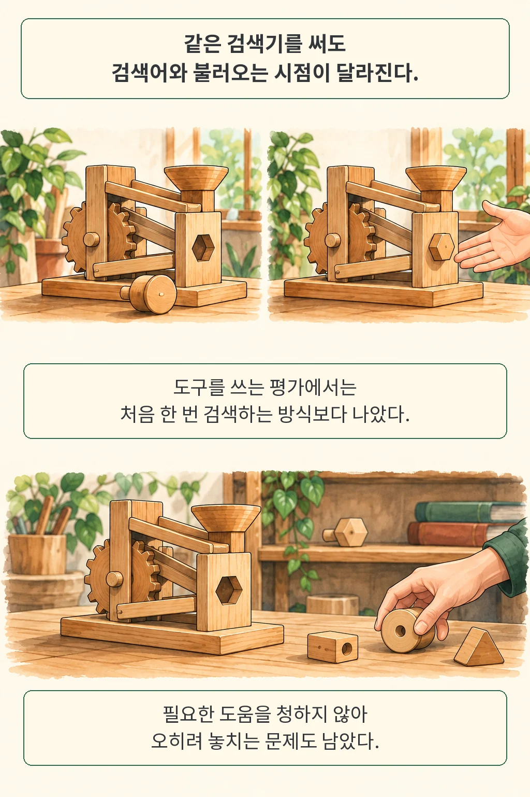

AI 에이전트에 연결할 스킬이 수천 개로 늘어나면, 매번 어떤 지침을 문맥에 실을지가 숙제가 됩니다. 처음부터 다 넣자니 컨텍스트가 금세 무거워지고, 첫 질문만으로 미리 고르자니 작업 도중 새로 필요한 절차를 놓치기 쉽거든요. **SkillBrowser** 연구는 추론 중 스스로 스킬을 검색해 읽는 구조를 제안하며, 그 효과와 도움 요청 누락 위험을 함께 짚습니다.

글·해설: 다메카솔

## 스킬이 늘수록 '언제 읽힐지'가 중요해집니다

여기서 스킬은 작업 절차 지침과 선택적인 스크립트·참고 자료의 묶음입니다. 호출 결과를 받는 도구와 달리, 스킬 지침은 문맥에 직접 들어가 이후 판단에 영향을 줍니다.

이름과 설명 목록만 먼저 보여 주는 방식도 라이브러리가 커지면 목록 자체가 부담이 됩니다. 첫 요청으로 몇 개만 검색하면 목록은 줄지만 작업 중 드러난 필요를 놓치기 쉽고, 불필요한 스킬이 기존 풀이를 해치는 현상도 [스킬 주입의 성능 회귀를 다룬 글](/posts/llm-agent-skill-regression-tax/)에서 살펴봤습니다. Jin Ye 등 연구진이 2026년 10월 공개한 [SkillBrowser 논문 v1](https://arxiv.org/abs/2610.23554v1)(ACL Rolling Review 제출 프리프린트)은 검색 시점과 검색어 구성을 추론 흐름 안으로 옮깁니다.

## 필요한 절차가 드러나면 그때 검색합니다

SkillBrowser는 별도 판정기를 매 단계 두는 대신, 에이전트가 추론하다 필요를 느낀 순간 외부 저장소를 조회하게 합니다.

- **Meta-Skill**: 문제 풀이 대신 외부 스킬 저장소 접근법만 알려 주는 고정 지침입니다. 자기 부족함을 정확히 감지한다고 가정하지는 않습니다.
- **SkillGrep**: 스킬을 능력·사용 조건·예시 질문 등 여러 관점으로 색인하고 어휘·의미 검색을 결합합니다.
- **맥락 검색어와 무응답 처리**: 검색어에 현재 작업 맥락, 필요 능력, 입출력 조건, 피해야 할 조건을 담습니다. 받은 지침을 읽고 작업을 이으며, 맞는 후보가 없으면 결과를 내지 않는 처리도 포함됩니다.

예를 들어 긴 자료 처리 요청을 풀다가 특정 라이브러리의 반복자 조합이 필요하다는 사실을 알게 된 상황을 떠올려 볼까요? 처음 요청 전체로 미리 검색하기보다, 작업 중 드러난 그 사용법을 검색어로 던지는 편이 목적에 가까워집니다.

## 도구 사용 평가는 올랐지만, 모든 과제에서 이기지는 않았습니다

저자들은 고정 저장소 환경에서 여러 모델과 과제를 시험했습니다. 결과 표에 앞서 평가 규모와 분모 기준을 확인해 두면 수치를 정확히 읽기가 수월해집니다.

- **평가 구성**: SRA-Bench 6개 하위 벤치마크, 5개 모델, 고정 후보 스킬 26,262개.
- **분모 기준**: 최초 5개 데이터셋의 원천 문제는 3,970개지만 각 모델의 유효 예측 분모와는 다릅니다. ToolQA는 모델당 유효 도구 사용 궤적 100개 기준이며, 합산 500개는 고유 문제가 아니라 모델-문제 조합 수입니다.

아래는 원문 표 2·11(모델당 유효 궤적 100개) 기준 같은 검색기(SkillGrep)의 **Static SkillGrep**, **SkillBrowser**, 벤치마크 지정 지침을 바로 주는 **정답 스킬 직접 제공**의 ToolQA 정확도 비교입니다.

| 모델 | 처음 요청에서 검색 | SkillBrowser | 정답 스킬 직접 제공 |
| --- | ---: | ---: | ---: |
| Qwen3-8B | 17% | 44% | 51% |
| Qwen3.6-Plus | 27% | 57% | 76% |
| GLM-5.1 | 39% | 51% | 73% |
| GPT-5.4-mini | 32% | 43% | 71% |
| Gemini-3.1-Flash-Lite | 18% | 61% | 70% |

ToolQA에서는 다섯 모델 모두 처음 요청 검색보다 높고 정답 스킬 직접 제공보다는 낮았습니다. 다만 다른 과제에서는 손실도 함께 보고됐거든요. 검색어 구성과 로딩 시점이 함께 바뀌므로 상승분 전체를 "덜 읽은 효과"만으로 분리하기 어렵고, 정답 스킬 직접 제공 역시 관련성을 통제한 참조 조건일 뿐 모든 과제의 상한은 아닙니다.

## 불필요한 도움은 줄였지만, 필요한 요청을 놓치기도 합니다

저자들은 결과를 더 살피기 위해 문제를 두 사후 진단 집단으로 나눴습니다. 스킬 없이 틀렸지만 정답 스킬로 맞힌 문제가 **스킬이 도움 된 집단**, 두 조건 모두 맞힌 문제가 **스킬이 불필요했던 집단**인 셈이죠. 모델 실행 결과로 사후에 나눈 기준이며, 두 조건 모두 틀린 경우와 정답 스킬 때문에 틀린 경우는 빠집니다.

| 진단 집단 | 표본 | Static SkillGrep | SkillBrowser | 해석 |
| --- | ---: | ---: | ---: | --- |
| Qwen3-8B · 불필요 (4개 벤치마크) | 1,216건 | 85.4% | 95.2% | 기존 풀이 보호 |
| GPT-5.4-mini · 도움 됨 | 145건 | 72.4% | 46.2% | 도움 요청 누락 위험 |

사후 결과에 의존한 구분이라 전체 업무 성공률이나 검색 생략만의 인과효과로 일반화하기보다, 기존 풀이 보호와 도움 누락 사이의 트레이드오프를 살피는 지표로 읽는 편이 적절합니다. 실제 검색 반복 횟수도 함께 짚어 볼 필요가 있는데요.

- **ToolQA 검색 빈도**: 500개 모델-문제 궤적 중 383개가 검색했고, 검색마다 호출은 1회, 후보 로딩은 5개였습니다.
- **정답 스킬 포함**: 383회 검색 가운데 278회에 정답 스킬이 포함됐습니다.

대부분 단 한 번의 검색으로 끝났기 때문에, 여러 차례 검색어를 고쳐 가며 필요한 스킬을 끝내 찾는 다단계 탐색 능력까지 입증됐다고 보기는 어렵습니다.

## 지연 시간과 변하는 저장소, 신뢰성은 별도 과제입니다

적게 읽으면 무조건 빨라질 것 같지만, 검색어를 만들고 조회해 지침을 읽는 데도 시간이 듭니다. 논문의 시간 측정 결과를 보면 GLM-5.1 기준 SkillBrowser는 LLM Selection보다 여섯 벤치마크 모두 지연이 높았고, 입출력 합산 토큰은 세 곳에서 낮고 세 곳에서 높았습니다. LLM Selection 지연에는 미리 계산한 BM25 검색 시간이 빠져 동일 조건 비교로 보기도 어려워, 논문 수치만으로 속도나 비용의 보편적 이득을 기대하기는 아직 이른 편입니다.

고정 저장소로 평가한 만큼 스킬이 수시로 추가·삭제·수정되는 환경이나 세션을 넘는 지속 재사용도 시험 범위 밖이었습니다. 스킬과 관련 파일의 변경 관계는 [에이전트 플러그인의 변경 관계를 다룬 글](/posts/agent-plugin-coevolution-maintenance/)에서 이어 볼 수 있습니다. 잘 찾아온 지침이라도 내용이 틀리거나 위험할 수 있으므로, 선택적 로딩 자체가 신뢰성 검토나 실행 권한 검사를 대신해 주지는 못합니다.

## 다메카솔의 해석: 검색 성공만큼 도움 요청 누락을 봐야 합니다

스킬 시스템을 평가할 때 검색 결과가 관련 있어 보이는지만 살피면 중요한 질문 하나가 남습니다. 정작 도움을 받아야 할 순간에 에이전트가 검색을 시작했는가라는 질문이죠. SkillBrowser는 검색을 추론 흐름 안으로 옮기는 설계와 함께, 판단을 모델에 맡겼을 때 도움을 놓치는 실패도 드러냅니다.

선택적 로딩을 비교할 때는 전체 정확도와 함께 기존 풀이를 해치는 회귀 비율, 필요한 스킬을 부르지 않은 누락 비율, 전체 처리 시간을 나란히 보는 편이 좋습니다. 불러오는 스킬 수를 줄였다는 사실보다, 어떤 작업이 나아졌고 어떤 도움을 놓쳤는지를 함께 확인해야 설계의 득실이 또렷해집니다.

## 출처

- [SkillBrowser: Selective Skill Exposure for Scalable Skill-Using Agents, arXiv:2610.23554v1](https://arxiv.org/abs/2610.23554v1), Jin Ye·Yifan Jiang·Lan-zhe Guo, 2026-10-16 제출(ACL Rolling Review 제출 표기 프리프린트).
- [논문 PDF: 4~5절, 표 2·3·11~14, 부록 B·C·E·F와 한계](https://arxiv.org/pdf/2610.23554v1).
- [논문 HTML](https://arxiv.org/html/2610.23554v1). 원문과 자료 접근 상태 확인: 2026-10-19.

이 글은 arXiv 프리프린트 원문 표와 설명을 대조해 정리했으며(2026-10-19 확인 기준 원문·메타데이터에서 전용 코드·데이터 링크 미확인), 모델 실행을 독립 재현하지 않았습니다. 만화는 논문 그림을 복제하지 않고 새로 구성한 설명용 장면이며, 한글은 별도로 합성했습니다.

이 글의 본문과 이미지는 생성형 AI로 제작했습니다. 기획과 편집 기준은 다메카솔이 정했습니다.
