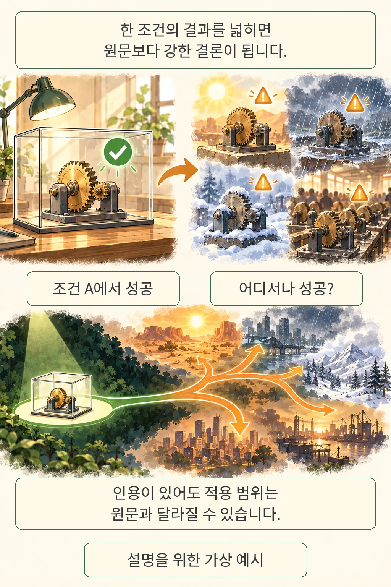

글·해설: 다메카솔

AI 리서치 보고서에 출처가 달려 있어도, 결론의 범위와 확신까지 뒷받침되는 것은 아닙니다. **SmoothScore** 논문은 여러 문서의 조건과 반론이 종합 과정에서 사라져, 근거보다 단정적인 결론이 만들어지는 현상을 측정합니다. 핵심 질문은 “인용이 있나”에서 한 걸음 더 나아갑니다. **“그 인용들이 이 정도로 강한 결론을 허용하나?”**

## 출처가 있는데도 과장이 생기는 이유

설명을 위한 가상 예시를 들어 보겠습니다. 어떤 도구가 **조건 A에서 성공했다**는 실험을 인용한 뒤, 보고서가 **어디서나 성공한다**고 결론 내렸다면 어떨까요. 인용한 실험은 실제일 수 있지만 적용 범위가 달라졌습니다. 이 예시는 논문의 실험 사례가 아니라, 범위 확대를 설명하기 위한 재구성입니다.

저자들은 이런 현상을 *smoothing*이라고 부릅니다. 여러 근거를 종합한 결론에서 일부 지지는 찾을 수 있지만, 전체 근거를 놓고 보면 범위나 확신이 지나치게 커지는 문제입니다. 아예 존재하지 않는 출처를 만드는 경우만 찾으면 이런 오류를 놓칠 수 있습니다. [논문 §2.1](https://arxiv.org/html/2610.35793v1#S2.SS1)

논문은 세 가지 반복 유형을 제시합니다. 각각 검증된 기법을 합치면 장점도 그대로 합쳐진다고 단정하는 **뒷받침 없는 결합**, 특정 조건의 결과를 일반화하는 **범위 확대**, 남아 있는 쟁점을 최종 결론처럼 닫는 **성급한 결론 확정**입니다. 공통점은 매끄러운 문장 속에서 근거의 경계가 잘 보이지 않는다는 것입니다.

## 찬성과 반대를 같은 쟁점에 놓는다

SmoothScore는 보고서에서 결론에 해당하는 주장을 뽑고, 보고서가 인용한 문서들을 다시 살핍니다. 지지 근거를 찾는 단계와 반박·제한·조건을 찾는 단계를 따로 둔 뒤, 같은 쟁점끼리 묶습니다. 예컨대 성능을 말하는 근거는 성능끼리, 적용 조건을 말하는 근거는 조건끼리 비교하도록 정리합니다.

마지막 평가자는 결론의 강도와 범위가 모인 근거에 맞는지 1~5점으로 판단합니다. **점수가 높을수록 더 큰 왜곡**이며, 저자들은 3점 이상을 중요한 조건이 빠진 주장, 4점 이상을 심하게 왜곡된 주장으로 집계합니다. 문헌이 몇 편씩 찬성했는지를 세는 다수결도, 주장이 참일 확률도 아닙니다. 근거가 같은 상황에 적용되는지와 결론을 얼마나 고쳐야 하는지를 봅니다.

추출·구조화에는 GPT-5-mini, 최종 평가에는 GPT-5를 사용했습니다. 부록은 모든 단계의 추론 강도를 medium, 샘플링을 기본값으로 명시합니다. 따라서 점수 자체도 자동 평가자의 판단이라는 경계를 갖습니다. [논문 §2.2·부록 A.1/B.7](https://arxiv.org/html/2610.35793v1)

## 무엇을 얼마나 비교했나

실험은 7개 시스템과 4개 데이터셋을 사용했습니다. ResearcherBench 65문항과 ScholarQA-CS2 전문가 작성 25문항은 전체를 썼습니다. DeepResearch Bench II는 영어 66문항 중 18개, ResearchRubrics는 101문항 중 17개를 여러 문헌의 종합이 필요한 질문으로 골랐습니다. 모든 질문 유형을 대표하는 표본은 아닙니다.

아래는 **ResearcherBench에 한정한** 결과입니다. 표본은 평가된 보고서 수와 그 보고서에서 추출한 주장 수이며, 점수는 주장 단위 평균입니다. 대괄호는 논문이 보고한 95% 신뢰구간입니다.

| 실험 시스템 | 보고서 / 주장 | 평균 점수 [95% CI] |
| --- | --- | --- |
| Luna 5.6 + Websearch | 65 / 443 | 1.95 [1.85, 2.06] |
| Sol 5.6 + Websearch | 64 / 430 | 1.93 [1.81, 2.05] |
| Sonnet 5 + Websearch | 65 / 435 | 2.52 [2.42, 2.61] |
| Opus 5.5 + Websearch | 65 / 445 | 2.36 [2.28, 2.44] |
| QUEST | 63 / 404 | 2.50 [2.35, 2.65] |
| DR Tulu | 65 / 408 | 2.57 [2.47, 2.67] |
| Gemini Deep Research | 64 / 434 | 3.27 [3.21, 3.34] |

출처: [논문 Table 1](https://arxiv.org/html/2610.35793v1#S4.T1). 시스템마다 생성한 보고서·주장·참조 문서가 다릅니다. 이 비교를 모델의 모든 능력에 대한 순위로 확대하면, 이 논문이 지적하는 범위 확대를 그대로 반복하게 됩니다.

부록의 실험 모델 식별자는 `gpt-5.6-luna`, `gpt-5.6-sol`, `claude-sonnet-5`, `claude-opus-5-5`, `deep-research-preview-04-2026`, `rl-research/DR-Tulu-8B`, `QUEST-35B-RL`입니다. 이는 논문에 쓰인 구성의 기록이며, 현재 서비스 전체에 대한 평가가 아닙니다.

## 원문과 지시를 함께 줬을 때

별도 실험은 ResearcherBench **61문항**에서 Luna와 Sonnet 5의 보고서를 다시 생성했습니다. 기존 웹검색 보고서가 인용한 문서 전문을 문맥에 넣는 조건, 결론을 근거의 범위에 맞추라는 보정 지시를 더하는 조건, 둘을 함께 적용하는 조건을 비교했습니다. 원문 제공 조건에서는 웹검색을 껐습니다.

| 조건 | Luna 평균 (주장 수) | Sonnet 5 평균 (주장 수) |
| --- | --- | --- |
| 기존 웹검색 | 1.95 (416) | 2.54 (407) |
| 웹검색 + 보정 지시 | 1.88 (397) | 2.23 (391) |
| 인용 원문 제공 | 1.80 (390) | 2.38 (394) |
| 인용 원문 + 보정 지시 | 1.52 (378) | 1.78 (367) |

출처: [논문 Table 6](https://arxiv.org/html/2610.35793v1#S6.T6). 높은 점수가 더 큰 왜곡을 뜻합니다. 주장이 조건마다 새로 추출되므로 주장 수가 달라집니다. 앞 표의 65문항 실험과도 표본이 다릅니다.

저자들은 두 조치를 함께 적용했을 때 3점 이상 주장 비율이 Luna에서 약 29%→12%, Sonnet 5에서 약 61%→25%로 줄었다고 요약합니다. 원문만 주거나 지시만 더한 경우보다 감소가 컸습니다. **해당 두 시스템과 선별된 질문에서 얻은 결과**이며, 모든 리서치에서 과장이 사라진다는 보장은 아닙니다.

## 점수도 검토 대상이다

사람 평가자 두 명이 같은 73개 주장을 검토한 실험에서 정확한 점수 일치는 58%, 1점 이내 일치는 96%였습니다. 자동 평가자와 사람 평가자 1의 일치는 각각 56%, 93%였습니다. 특히 자동 평가가 3점 이상으로 표시한 주장 중 사람 평가자 1도 3점 이상을 준 비율은 62%였습니다. **1점 이내 일치 93%를 정답률 93%라고 읽으면 안 됩니다.** 중요한 조건 누락의 경계에서도 판단 차이가 남습니다. [논문 §5.1·Table 3](https://arxiv.org/html/2610.35793v1#S5.SS1)

평가 범위에도 한계가 있습니다. 이 방법은 보고서가 인용한 문서를 기준으로 삼습니다. 인용 목록 밖의 중요한 연구까지 모두 찾았다는 뜻은 아닙니다. 자동 추출 단계가 놓친 근거, 선별한 질문의 성격, 모델과 검색 결과의 변화도 결과 해석에 고려해야 합니다. 이는 방법과 실험 범위에서 읽어야 할 제한입니다.

## 다메카솔의 해석

이 연구에서 실무로 가져올 만한 질문은 **“결론에 필요한 조건이 끝까지 남아 있나?”**입니다. 보고서에서 가장 강하게 말하는 문장 하나를 고른 뒤, 원문에서 적용 조건과 반대 근거를 같이 찾아보는 것이 좋겠습니다. “가장 좋다”면 어떤 비교에서인지, “해결했다”면 무엇이 남아 있는지를 묻는 식입니다. 이는 논문을 바탕으로 한 편집상의 제안이며, 여기서 별도로 효과를 검증한 절차는 아닙니다.

[SemantEq가 다룬 명제의 충실성](/posts/semanteq-faithful-formalization/)은 형식적으로 통과한 명제가 원래 문제를 보존했는지 묻습니다. 이번 연구는 보고서의 결론이 원문의 조건을 보존했는지 묻습니다. 또한 [도구 출력의 근거 바꿔치기](/posts/tool-output-evidence-substitution/)처럼 근거 자체가 오염되는 문제와도 구별해야 합니다. 서로 다른 단계의 실패를 한 점수로 묶기보다, 어느 연결이 끊겼는지 확인할 필요가 있습니다.

## 논문과 공개 상태

- Tiasa Singha Roy, Manya Wadhwa, Greg Durrett, **Quantifying Claim Smoothing by LLM Research Agents**, arXiv:2610.35793v1.
- 제출: 2026년 10월 26일 17:29:48 UTC. 본문 확인: 2026년 10월 27일. 33쪽 프리프린트이며 PDF는 심사 중이라고 표시합니다. 동료심사 통과를 확인한 논문은 아닙니다.
- 논문 초록은 코드와 데이터를 연결하지만, 확인 시점의 저자 저장소에는 README만 있었고 파이프라인·데이터는 공개 예정으로 안내했습니다. 공개 코드 실행과 결과의 독립 재현은 하지 않았습니다.

## 출처

1. [arXiv 메타데이터와 버전 이력](https://arxiv.org/abs/2610.35793v1)
2. [논문 PDF](https://arxiv.org/pdf/2610.35793v1) · [HTML 원문과 부록](https://arxiv.org/html/2610.35793v1)
3. [확인한 저자 저장소 revision](https://github.com/tiasa2/SmoothScore/tree/c77a61e75577ca095187cad9f0ac8dd1cf72c103)

이 글의 본문과 이미지는 생성형 AI로 제작했습니다. 기획과 편집 기준은 다메카솔이 정했습니다.
만화는 원문의 개념을 새로 구성한 설명이며 논문 그림을 복제하지 않았습니다.
