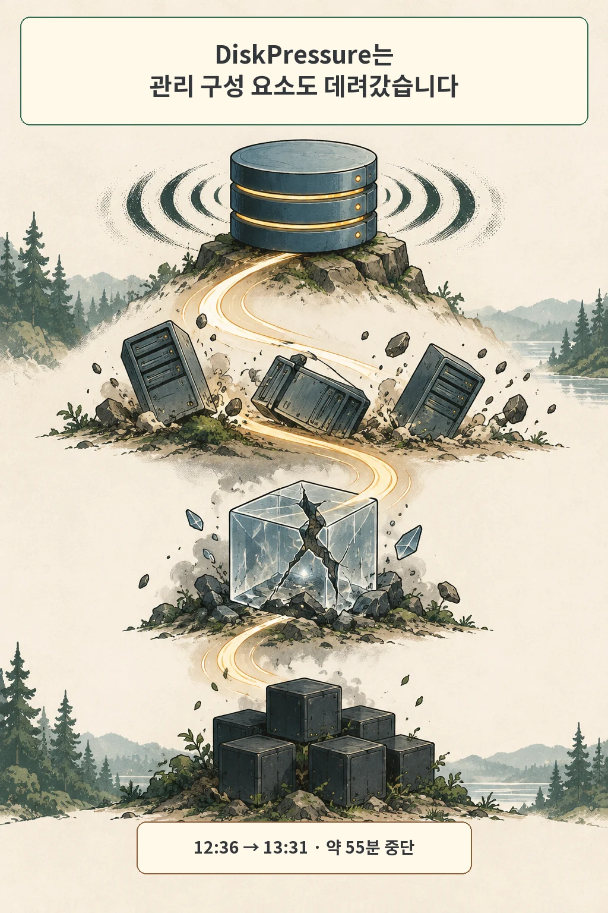
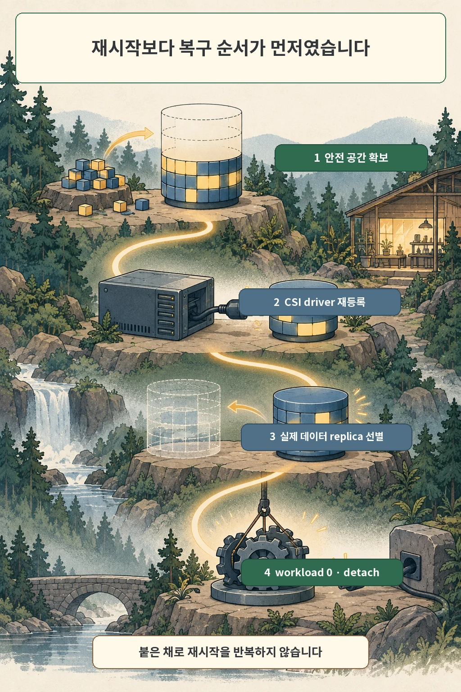

디스크 여유 공간이 빠듯할 때 가장 먼저 떠올리는 해결책은 커다란 옛 스냅숏을 지우는 작업입니다. 그런데 Longhorn에서는 스냅숏을 지워 용량을 비우려다 오히려 노드가 가득 차며 서비스까지 멈추는 역전 현상이 벌어지곤 하죠. 2026년 7월 홈랩 장애 기록을 바탕으로 병합 중 임시 공간이 왜 늘어나는지와 `DiskPressure` 이후 안전 복구 순서를 정리합니다.

글·해설: 다메카솔

## 핵심 내용

- **병합 중 임시 공간 상승**: Longhorn 스냅숏 삭제·purge는 레이어 병합(coalesce)을 거치므로 작업 중 최고 사용량 기준으로 여유 공간을 잡아야 합니다.
- **제어면까지 번진 DiskPressure**: 디스크 압박으로 Longhorn 핵심 Pod들이 퇴거되며 볼륨이 `faulted`에 빠졌고 오브젝트 스토리지가 약 55분간 중단됐습니다.
- **4단계 복구 순서**: 응급 공간 확보 → `CSINode` 등록 확인 → 유효 replica salvage → 워크로드 detach 완결 순으로 복구했습니다.

## 지우면 줄어든다는 계산에 빠진 중간 상태

스냅숏 두 개를 합쳐 약 180GB를 지우면 그만큼 빈 공간이 돌아올 것이라 여겼던 게 처음 판단이었습니다. 정리가 끝난 결과만 셈했을 뿐, 기존 스냅숏 레이어와 새로 병합된 파일이 디스크에 공존하는 중간 상태는 계산에 넣지 않았거든요. Longhorn 공식 문서도 스냅숏 삭제와 purge 시 병합(coalesce) 과정에서 추가 임시 공간이 들며, 경우에 따라 볼륨의 명목 크기(nominal volume size)만큼 여유 공간이 필요할 수 있다고 경고합니다.

| 항목 | 2026-07-20 관측 기록 | 비고 |
| --- | --- | --- |
| 시작 시 노드 여유 공간 | 71GB | 정리 작업 전 잔여 공간 |
| 정리 대상 스냅숏 크기 | 109.7GB · 70.7GB | 합계 약 180GB 규모 |
| 병합 중 추가 증가량 | 약 +45GB | 노드 사용률 95% 도달 |
| 장애 및 서비스 중단 | 12:36 ~ 13:31 (약 55분) | 12:37 `DiskPressure` 진입 |

예를 들어 109.7GB와 70.7GB짜리 두 스냅숏 레이어를 합치는 상황을 떠올려 보면 이유가 분명해집니다. 기존 블록을 안전하게 지우려면 유효 데이터를 모은 새 결과 레이어를 먼저 써 내려가야 하므로, 병합이 끝날 때까지 양쪽 파일이 디스크 공간을 함께 점유하거든요.

당시 기록에서도 작업 도중 약 45GB가 추가로 쓰이면서 시작 여유 공간 71GB를 금세 위협했습니다. 데이터 배치나 sparse file 여부, replica 수, 엔진 버전에 따라 최고점은 달라질 수 있지만, 당시 조건에서 71GB가 부족했다는 점만은 분명했죠.

## DiskPressure는 정리 작업만 멈추지 않았습니다

낮 12시 37분 노드가 `DiskPressure` 상태에 들어가자, Longhorn manager·instance manager·CSI plugin·engine image Pod까지 줄줄이 퇴거(eviction) 대상에 포함됐습니다. Kubernetes kubelet은 `nodefs`나 `imagefs`의 여유 공간·inode 신호가 임계값을 넘으면 자원을 회수하고 필요 시 Pod를 퇴거시키는데요. 기본 hard threshold는 문서에 정의돼 있지만 실제 기준은 kubelet 설정에 따르므로, 당시 패치 버전과 설정이 남지 않은 상태에서 사용률 95%를 고정 임계값으로 일반화하기보다는 개별 노드의 한계치로 보는 편이 정확합니다.

결국 병합 중이던 볼륨이 `faulted` 상태로 전환됐고, 이를 쓰던 오브젝트 스토리지가 약 55분간 중단되며 백업·아카이브 작업도 멈췄습니다. 한 노드의 용량 부족이 제어면과 서비스 장애로 번진 흐름을 다섯 단계로 정리했습니다.

1. **임시 공간 소모**: 스냅숏 병합이 기존 레이어 외에 추가 디스크 공간을 점유했습니다.
2. **노드 압박 진입**: 가용 공간이 한계에 닿아 노드가 `DiskPressure`에 들어갔습니다.
3. **제어면 퇴거**: Longhorn 핵심 관리 Pod들이 노드에서 퇴거됐습니다.
4. **볼륨 격리**: 병합 중이던 볼륨이 `faulted` 상태에 빠졌습니다.
5. **서비스 중단**: 오브젝트 스토리지가 12시 36분부터 13시 31분까지 멈췄습니다.

개별 컴포넌트 로그만 따로 떼어 보면 우연히 겹친 장애처럼 보이기 쉽지만, 작업 시각과 압박·퇴거·볼륨 상태를 한 시간축에 나란히 놓아야 이 인과가 비로소 한눈에 들어오는 셈이죠.

## 공간을 만들었다고 바로 워크로드를 올리지 않았습니다

여유 공간을 조금 되찾았다고 곧장 Pod를 재기동하면 attach 충돌이 반복되기 쉽습니다. 당시 복구는 공간 확보부터 재시작까지 다음 네 단계를 순서대로 밟아 진행했습니다.

- **1단계 — 응급 여유 공간 확보**: 종료된 Pod와 중복 데이터를 지워 약 10GB를 비우고, 비상 조치로 `ext4` reserved blocks를 5%에서 1%로 낮춰 약 19GB를 추가 확보했습니다. 이 조정은 급한 불을 끄는 비상 처방일 뿐 평소 용량 계획의 대안으로 쓰기는 어렵습니다.
- **2단계 — CSI 드라이버 등록 확인**: 로그에 `CSINode <node> does not contain driver driver.longhorn.io` 오류가 남아 있어 바로 앱을 올리지 않았습니다. node-driver registrar와 kubelet 등록 경로가 정상이어야 `CSINode` 항목이 채워지므로, Longhorn manager와 CSI Pod를 먼저 정상화해 드라이버 등록부터 확인했습니다.
- **3단계 — 유효한 replica 선별 및 salvage**: 모든 replica가 `faulted`일 때 쓰는 salvage는 데이터가 남은 replica를 선택해 되살리는 작업입니다. 경로와 실제 데이터를 확인한 뒤 빈 고스트 replica를 제거하고 데이터가 남은 replica의 `spec.failedAt`을 비워 복구 후보로 지정했습니다.
- **4단계 — 워크로드 detach 완결 후 재기동**: 워크로드 레플리카를 0으로 내려 볼륨 detach를 먼저 끝냈습니다. 어정쩡하게 붙은 채 재시작하면 복구 흐름과 다시 얽히므로, 완전히 분리된 것을 확인한 뒤 재기동해 파일시스템을 되살렸습니다.

## 다음 병합에는 최고점과 중단 조건을 적습니다

이 장애 이후 홈랩에서는 큰 스냅숏 병합 전 `여유 공간 ≥ 병합 대상 + 20%`를 로컬 중단 기준(stop rule)으로 두었습니다. 물론 이는 장애 경험을 바탕으로 세운 보수적 휴리스틱일 뿐 Longhorn 공식 최소 비율과 무관하므로, 실제 환경에서는 볼륨 특성에 맞게 여유분을 조정하는 편이 좋습니다.

사전 점검(preflight)에서는 다음 다섯 가지를 차례대로 확인합니다.

- **소규모 사전 측정**: 작은 정리 작업으로 병합 중 실제 디스크 증가 폭을 먼저 가늠합니다.
- **압박 신호 확인**: `nodefs`와 `imagefs` 중 어느 경로가 임계값에 가까운지 살핍니다.
- **중복 작업 분리**: 백업, 리빌드(rebuild), 볼륨 확장이 병합과 겹치지 않게 분리합니다.
- **시계열 기록**: 시작 여유 공간, 예상 최고점, 즉시 중단 임계값을 함께 기록합니다.
- **대안 경로 선택**: 여유가 부족하면 병합을 멈추고 디스크 증설이나 새 볼륨으로의 파일시스템 수준 이관을 택합니다.

공간을 되찾는 작업조차 먼저 쓸 임시 공간이 있어야 안전하게 끝납니다. 정리 후 예상치만 계산하지 말고, 작업 중 최고점과 중단 임계값을 미리 적어 두어야 클러스터 전체의 연쇄 장애를 막을 수 있습니다.

## 함께 읽을 글

- [직접 만들지 않은 스냅숏이 쌓였습니다: Longhorn actualSize를 읽는 법](/posts/orphaned-snapshots-actual-size/): 이번 장애 직전, actualSize와 system snapshot을 어떻게 구분했는지 설명합니다.
- [애플리케이션 복제와 스토리지 복제는 무엇이 다른가](/posts/application-storage-replication-layers/): 볼륨과 애플리케이션의 복구 계층을 분리합니다.

## 출처

- 개인 인프라 변경 기록, 2026-07-20
- 개인 운영 노트 — Longhorn 병합과 DiskPressure
- [Longhorn 1.13: Volume Size](https://longhorn.io/docs/1.13.0/nodes-and-volumes/volumes/volume-size/)
- [Longhorn: Space Consumption Guidelines](https://longhorn.io/kb/space-consumption-guideline/)
- [Kubernetes: Node-pressure Eviction](https://kubernetes.io/docs/concepts/scheduling-eviction/node-pressure-eviction/)
- [Kubernetes API: CSINode v1](https://kubernetes.io/docs/reference/kubernetes-api/storage-resources/csi-node-v1/)
- [Longhorn 1.13: Recovering Volumes after Unexpected Detachment](https://longhorn.io/docs/1.13.0/high-availability/recover-volume/)

2026년 7월 20일 k3s 3노드 홈랩 운영 기록(반올림 관측값, 식별 정보 익명화)을 2026년 10월 3일 공식 문서와 대조해 정리했으며, 다른 kubelet 설정과 스토리지 버전에서는 임계값과 복구 동작이 다를 수 있습니다.

이 글의 본문과 이미지는 생성형 AI로 제작했습니다. 기획과 편집 기준은 다메카솔이 정했습니다.
