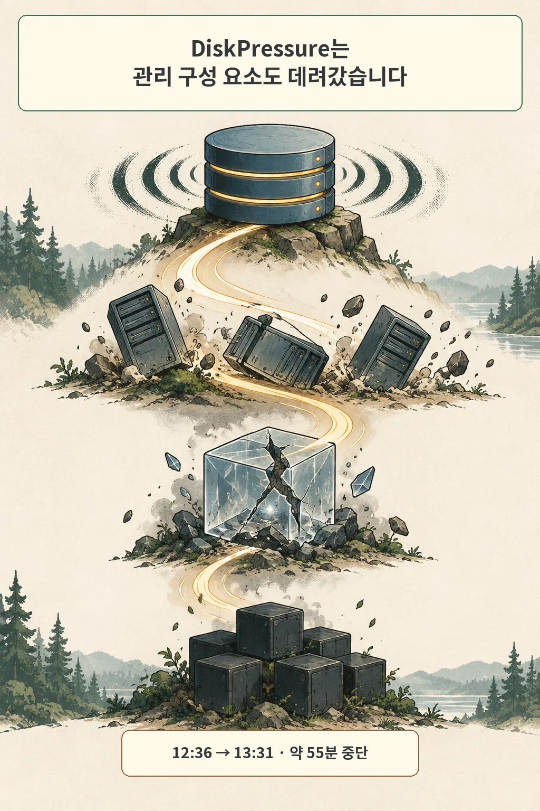
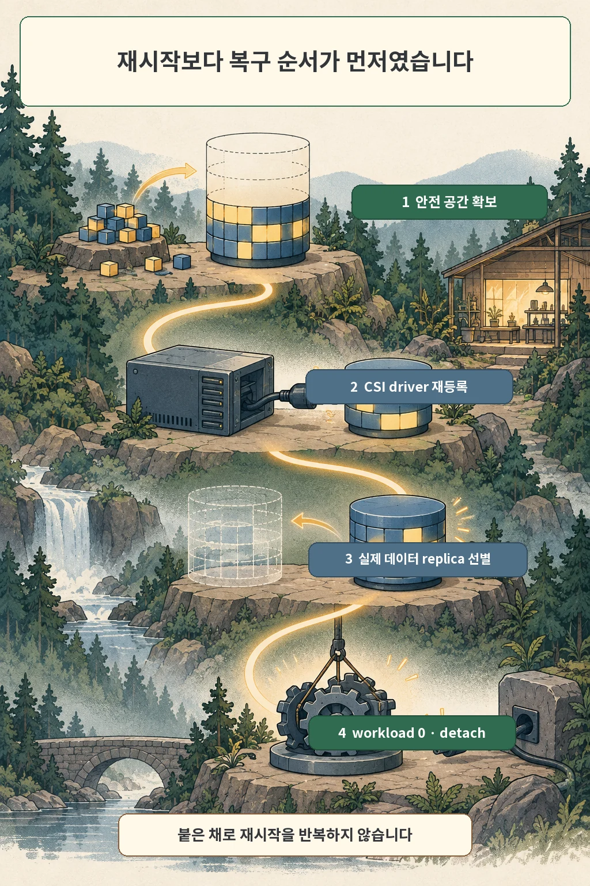

글·해설: 다메카솔

2026년 7월 20일, 여유 공간이 71GB 남은 노드에서 109.7GB와 70.7GB로 기록된 스냅숏 두 개의 정리를 시작했습니다. 약 180GB를 지우는 작업이니 당연히 여유 공간이 늘어날 거라고 생각했는데요. 막상 병합이 시작되자 디스크 사용량은 오히려 약 **45GB** 더 늘어나면서 노드가 **95%**까지 차올랐습니다.

> 이 글은 2026년 7월 20일의 개인 인프라 변경 기록과 운영 노트를 2026년 10월 3일 Longhorn 1.13·Kubernetes 공식 문서와 다시 대조해 썼습니다. 용량은 당시 기록의 반올림 관측값이며 정확한 Longhorn 패치 버전과 kubelet eviction 설정은 보존되지 않았습니다. 실제 볼륨 이름, 사설 주소, 호스트명과 네임스페이스는 공개용 역할명으로 바꿨습니다.

## 핵심 내용

- **병합 중 임시 공간 상승**: Longhorn 스냅숏 삭제·purge는 단순 메타데이터 삭제가 아니라 레이어 병합(coalesce) 과정을 거치므로, 정리 완료 후가 아니라 작업 중 최고 사용량을 기준으로 여유 공간을 잡아야 합니다.
- **제어면까지 번진 DiskPressure**: 노드 디스크 압박으로 Longhorn 핵심 Pod들이 퇴거되면서 병합 중이던 볼륨이 `faulted` 상태에 빠졌고, 오브젝트 스토리지가 약 55분간 중단됐습니다.
- **단계적 복구 순서**: 여유 공간 확보 → `CSINode` 드라이버 등록 확인 → 실제 데이터가 남은 replica 선별 및 salvage → 워크로드 스케일 다운(detach 완결) 후 재기동 순서로 복구했습니다.

## 지우면 줄어든다는 계산에는 중간 상태가 없었습니다

처음 머릿속으로 했던 계산은 단순했습니다. 큰 스냅숏 두 개를 지우면 그만큼의 빈 공간이 곧장 돌아올 것이라 여겼던 것인데요. 정리가 모두 끝난 뒤의 최종 상태만 보았을 뿐, 기존 스냅숏 레이어와 새로 병합된 결과 파일이 한동안 동시에 존재하는 **작업 중 최고점**은 계산에 넣지 않았습니다.

Longhorn 공식 문서는 스냅숏 삭제와 purge가 단순한 메타데이터 삭제가 아니라고 설명합니다. 스냅숏 파일을 병합(coalesce)하는 동안 추가 공간이 필요하며, 상황에 따라 볼륨의 명목 크기(nominal volume size)만큼 여유 공간이 필요할 수도 있습니다. 이는 고정된 증가 비율을 보장하는 설명이 아니라, 작업 전에 임시 여유 공간을 별도로 확보하라는 경고입니다.

당시 운영 기록에는 병합 작업 중 약 45GB가 추가로 사용됐다고 남아 있습니다. 물론 데이터 배치나 sparse file 여부, replica 수, 엔진과 버전에 따라 최고점은 달라질 수 있으므로 이 숫자를 모든 Longhorn 환경의 고정 비율로 일반화할 수는 없습니다. 다만 당시 사건에서 **71GB라는 시작 여유 공간이 충분하지 않았다**는 점만은 분명했습니다.

## DiskPressure는 정리 작업만 멈추지 않았습니다

낮 12시 37분, 노드는 결국 `DiskPressure` 상태에 들어갔습니다. 변경 기록을 보면 Longhorn manager, instance manager, CSI plugin, engine image Pod가 줄줄이 퇴거(eviction) 대상에 포함됐는데요. 스냅숏 병합을 수행하고 볼륨을 노드에 연결하는 스토리지 관리 구성 요소까지 함께 흔들린 것입니다.

Kubernetes의 kubelet은 `nodefs`나 `imagefs`의 여유 공간·inode 신호가 임계값을 넘으면 먼저 노드 자원을 회수하고, 그래도 부족하면 Pod를 퇴거시킵니다(공식 문서에 기본 hard threshold가 정의되어 있지만 실제 값은 kubelet 설정에 따라 달라지며, 당시 정확한 설정값이 남아 있지 않으므로 “사용률 95%가 Kubernetes의 고정 임계값”이라고 단정하지는 않습니다).

결국 병합 중이던 볼륨은 `faulted` 상태가 됐고, 그 볼륨을 쓰던 오브젝트 스토리지는 12시 36분부터 13시 31분까지 **약 55분간 중단**되면서 백업과 아카이브 작업도 영향을 받았습니다. 한 노드의 용량 부족이 스토리지 제어면과 애플리케이션 장애로 번진 연쇄 순서는 다음과 같습니다.

1. **임시 공간 소모**: 스냅숏 병합(merge)이 추가 디스크 공간을 사용했습니다.
2. **노드 압박 진입**: 노드가 `DiskPressure` 상태에 들어갔습니다.
3. **제어면 퇴거**: Longhorn 핵심 관리 Pod들이 퇴거됐습니다.
4. **볼륨 격리**: 병합 중이던 볼륨이 `faulted` 상태로 전환됐습니다.
5. **서비스 중단**: 해당 볼륨을 사용하는 오브젝트 스토리지 서비스가 멈췄습니다.

개별 컴포넌트 로그만 따로 떼어 보면 마치 여러 장애가 우연히 동시에 터진 것처럼 보이지만, 작업 시작 시각·노드 압박·Pod 퇴거·볼륨 상태·서비스 실패를 하나의 시간축 위에 나란히 놓고 나서야 비로소 이 고장 사슬이 한눈에 들어왔습니다.

## 공간을 만들었다고 바로 워크로드를 올리지 않았습니다

복구는 네 단계를 순서대로 밟아 진행했습니다.

- **1단계 — 응급 여유 공간 확보**: 먼저 종료된 Pod와 중복 데이터를 정리해 약 10GB를 확보하고, 비상 조치로 `ext4` 파일시스템의 reserved blocks 비율을 5%에서 1%로 낮춰 약 19GB를 추가로 확보했습니다(reserved blocks 조정은 루트 파일시스템의 숨통을 틔우기 위한 응급 처치였을 뿐 평상시 용량 계획을 대신하는 방법은 아닙니다).
- **2단계 — CSI 드라이버 등록 확인**: 여유가 생겼다고 곧장 애플리케이션을 올리지 않았습니다. 로그에 `CSINode <node> does not contain driver driver.longhorn.io` 오류가 남아 있었기 때문인데, `CSINode`의 드라이버 항목은 CSI node-driver registrar와 kubelet 등록 경로가 정상이어야 채워집니다. 이에 관련 Longhorn manager와 CSI Pod를 먼저 정상화하고 드라이버 등록부터 확인했습니다.
- **3단계 — 유효한 replica 선별 및 salvage**: 볼륨에는 실제 데이터가 없는 고스트 replica와 데이터가 남아 있는 replica가 함께 보였습니다. 모든 replica가 `faulted`일 때 쓰는 salvage 기능은 아무 replica나 무작정 되살리는 버튼이 아니므로, 경로와 실제 데이터를 확인한 뒤 고스트 replica는 제거하고 데이터가 남은 replica의 `spec.failedAt`을 비워 복구 후보로 선택했습니다.
- **4단계 — 워크로드 detach 완결 후 재기동**: 마지막으로 워크로드 레플리카를 0으로 내려 볼륨 detach를 먼저 끝냈습니다. 볼륨이 어정쩡하게 붙은 채로 Pod 재시작을 반복하면 attach 상태와 복구 작업이 다시 충돌할 수 있기 때문입니다. 깨끗하게 detach된 것을 확인한 뒤 워크로드를 다시 올렸고 파일시스템도 정상으로 돌아왔습니다.

## 다음 병합에는 최고점과 중단 조건을 적습니다

이 사건 이후 홈랩에서는 대형 스냅숏 병합 전에 `여유 공간 ≥ 병합 대상 + 20%`를 로컬 중단 기준(stop rule)으로 두었습니다. 물론 이 수치는 2026년 7월 장애를 겪은 뒤 정한 보수적인 운영 휴리스틱일 뿐 Longhorn 공식 최소 비율이 아니며, 다른 버전이나 데이터 배치에 그대로 적용할 수는 없습니다.

실제 작업 전 사전 점검(preflight)에서는 단순 비율 하나보다 다음 다섯 가지를 구체적으로 확인합니다.

- 작은 정리 작업으로 **병합 중 실제 용량 증가 폭**을 먼저 가늠합니다.
- `nodefs`와 `imagefs` 가운데 **어느 신호가 압박을 유발하는지** 확인합니다.
- 진행 중인 백업, 리빌드(rebuild), 볼륨 확장이 **서로 겹치지 않게** 분리합니다.
- **시작 여유 공간, 작업 중 예상 최고점, 즉시 중단 임계값**을 같은 시계열에 기록합니다.
- 예상 최고점 대비 여유가 부족하면 병합을 멈추고 **디스크를 증설하거나 새 볼륨으로 파일시스템 수준 이관**을 선택합니다.

공간을 되찾는 정리 작업조차 먼저 쓸 임시 공간이 필요합니다. 삭제가 끝난 뒤의 숫자만 계산하지 않고, 작업 중 사용량 최고점이 어디까지 오를지와 어느 지점에서 즉시 멈출지를 함께 정해 두어야 안전합니다.

## 함께 읽을 글

- [직접 만들지 않은 스냅숏이 쌓였습니다: Longhorn actualSize를 읽는 법](/posts/orphaned-snapshots-actual-size/): 이번 장애 직전, actualSize와 system snapshot을 어떻게 구분했는지 설명합니다.
- [애플리케이션 복제와 스토리지 복제는 무엇이 다른가](/posts/application-storage-replication-layers/): 볼륨과 애플리케이션의 복구 계층을 분리합니다.

## 출처

- 개인 인프라 변경 기록, 2026-07-20
- 개인 운영 노트 — Longhorn 병합과 DiskPressure
- [Longhorn 1.13: Volume Size](https://longhorn.io/docs/1.13.0/nodes-and-volumes/volumes/volume-size/)
- [Longhorn: Space Consumption Guidelines](https://longhorn.io/kb/space-consumption-guideline/)
- [Kubernetes: Node-pressure Eviction](https://kubernetes.io/docs/concepts/scheduling-eviction/node-pressure-eviction/)
- [Kubernetes API: CSINode v1](https://kubernetes.io/docs/reference/kubernetes-api/storage-resources/csi-node-v1/)
- [Longhorn 1.13: Recovering Volumes after Unexpected Detachment](https://longhorn.io/docs/1.13.0/high-availability/recover-volume/)

공식 문서는 2026년 10월 3일 다시 확인했습니다. 검증 환경은 2026년 7월의 k3s 3노드 홈랩과 Longhorn입니다. 다른 kubelet 설정과 스토리지 버전에서는 임계값과 복구 동작이 다를 수 있습니다.

이 글의 본문과 이미지는 생성형 AI로 제작했습니다. 기획과 편집 기준은 다메카솔이 정했습니다. 만화 이미지는 텍스트 없는 원화에 결정적 레터링을 합성해 만들었습니다. 공식 로고·UI·문서 도표 등 외부 이미지 자산은 사용하지 않았습니다.
