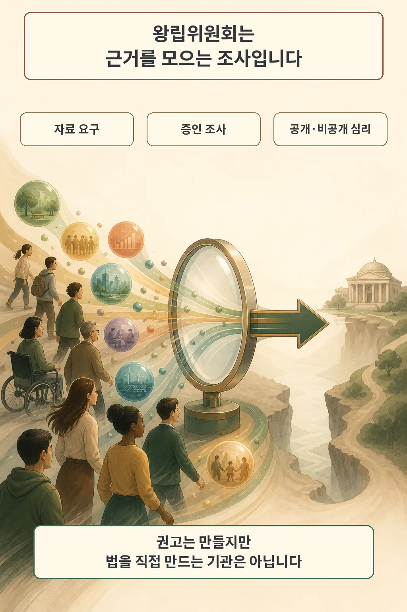

‘왕립위원회(Royal Commission)’라는 표현을 들으면 당장 AI 서비스에 새 규제가 적용되는 건 아닌지부터 확인하게 됩니다. 하지만 남호주 정부가 2026년 8월 10일 발표한 조치는 금지나 의무 부과가 아니라, AI 기술의 사용과 관련 정책을 따져 묻는 공식 조사의 시작입니다. 강제 조사 권한으로 현장의 근거를 먼저 모은 뒤 후속 정책을 설계하겠다는 뜻이죠.

글·해설: 다메카솔

## 핵심 내용

- **조사 위원회 출범 예고**: 남호주 정부는 2026년 10월 1일 활동을 시작해 2027년 7월 1일까지 보고서를 내는 AI 왕립위원회 설치를 발표했으며, 세부 조사범위와 위원 인선은 앞으로 확정됩니다.
- **강제 조사권과 입법의 분리**: `Royal Commissions Act 1917`에 따라 증인 출석과 자료 제출을 요구할 수 있지만, 위원회 결론은 권고 형태이므로 실제 규제는 정부·의회의 별도 절차를 거쳐야 합니다.
- **조사 영역과 제외 대상 구분**: 교육·일자리·보건을 비롯한 공공서비스·창작 산업·전력망 영향을 다루는 반면, 데이터센터 시설 자체의 인프라는 이번 조사 중심에서 빠졌습니다.

## 남호주가 결정한 것은 규제가 아니라 조사 절차입니다

이번 발표에서 실제로 확정된 내용과 앞으로 채워야 할 빈칸을 나란히 놓고 보면 뉴스의 성격이 훨씬 선명해집니다. 남호주 총리 Peter Malinauskas는 위원회 설치와 기본 목표 일정만 제시했을 뿐, 누가 무엇을 어디까지 조사할지는 아직 열어 두었거든요.

| 구분 | 내용 및 일정 | 현재 상태 |
| --- | --- | --- |
| **위원회 설치 결정** | AI 기술 사용과 정책을 다루는 왕립위원회 출범 (2026년 8월 10일 발표) | 확정 |
| **예상 활동 기간** | 2026년 10월 1일 개시 → 2027년 7월 1일까지 정부 보고서 제출 예정 | 정부 예상 일정 |
| **세부 조사범위** | 구체적 과제를 담은 terms of reference 공개 (향후 4~6주 내) | 미확정 |
| **위원단 구성** | 국제 탐색을 거쳐 위원 3명 선임 진행 | 미확정 |

이처럼 일정의 뼈대는 잡혔지만 핵심 기준은 아직 정해지지 않은 상태입니다. Malinauskas 총리 역시 이번 조사가 AI의 이익을 키우고 원치 않는 영향을 줄이기 위한 과정이라고 설명했을 뿐, 특정 기술이나 서비스를 금지하는 규제안을 내놓지는 않았습니다.

그렇다고 의견만 모으고 끝나는 단순 자문 회의로 보기에는 조사 권한이 훨씬 큽니다. 남호주 현행 법령(`Royal Commissions Act 1917`)은 왕립위원회에 일반 연구 조직보다 강력한 조사 수단을 부여하거든요. 위원회는 공개나 비공개 청문회를 열어 증거를 청취하고, 증인 출석과 내부 자료 제출을 공식 요구할 수 있습니다. 정해진 조사범위 안에서는 기업과 기관의 실제 운영 실태를 꽤 깊이 들여다볼 수 있는 셈이죠.

다만 조사 권한이 강하다고 해도 위원회의 역할은 어디까지나 조사와 권고 단계까지입니다. 위원회가 내놓는 최종 결과물은 정부에 제출하는 보고서와 정책 권고에 해당하므로, 실제 규제나 기업 의무가 생기려면 정부가 권고를 채택하고 의회가 입법 절차를 밟는 단계가 따로 남습니다.

## 실무자가 구분해야 할 조사 범위와 기존 정책

정부가 예고한 조사 영역을 보면 초점이 '물리적 인프라'보다 '사회 현장의 AI 활용'에 맞춰져 있다는 점이 드러납니다. 교육과 기술 역량, 일자리 변화, 보건을 포함한 공공서비스, 창작 산업, 그리고 전력망에 미치는 영향이 주요 대상이며 기업과 노동조합, 산업단체, 기술회사, 연구자가 두루 참여할 예정입니다. 반면 Malinauskas 총리는 AI를 떠받치는 데이터센터 시설 자체는 조사 대상에서 제외한다고 선을 그었으므로, 이번 발표를 데이터센터의 물·전력·입지 규제로 확대 해석하기에는 무리가 있습니다.

예를 들어 남호주 지역의 학교나 의료 기관에 AI 기반 업무 도구를 공급하려는 제품 팀을 떠올려 볼까요. 당장 서비스 출시가 막히는 상황은 아니더라도, 앞으로 공개될 세부 조사범위와 청문회 논의에 따라 공공·교육 분야의 데이터 활용이나 안전 기준 요구가 구체화될 수 있습니다. 특히 남호주에는 이미 시행 중인 정부용 AI 윤리 정책과 LLM 사용 지침이 있고, 남호주 Office for AI가 현재 개발 중인 책임 있는 AI 사용 정책(Responsible Use of AI Policy)도 별도로 진행 중입니다.

따라서 제품이나 정책 대응을 준비하는 실무자라면 세 가지 흐름을 층위별로 나눠 보는 편이 좋습니다. 당장 참고해야 할 기준은 이미 시행 중인 정부 AI 윤리·LLM 지침이고, 단기 변화는 Office for AI가 만들고 있는 책임 있는 AI 정책에서 확인하게 됩니다. 내년 중반을 목표로 진행되는 왕립위원회 보고서는 그 이후의 중장기 법제화 방향을 가늠할 질문과 증거의 출발점으로 이해하면 혼선을 줄일 수 있습니다.

## 출처

- [ABC News — Royal commission into artificial intelligence launched in South Australia](https://www.abc.net.au/news/2026-08-10/artificial-intelligence-royal-commission-announced-in-sa/107017502)
- [South Australian Legislation — Royal Commissions Act 1917](https://www.legislation.sa.gov.au/lz?path=%2Fc%2Fa%2Froyal+commissions+act+1917)
- [Office for AI — Policies, standards, and guidelines](https://ai.sa.gov.au/ai-knowledge-centre/policies%2C-standards-and-guidelines)

발표 보도와 남호주 법령·정책 문서를 바탕으로 정리했으며, 별도 법률 해석이나 현지 실사는 포함하지 않았습니다.
이 글의 본문과 이미지는 생성형 AI로 제작했습니다. 기획과 편집 기준은 다메카솔이 정했습니다.
