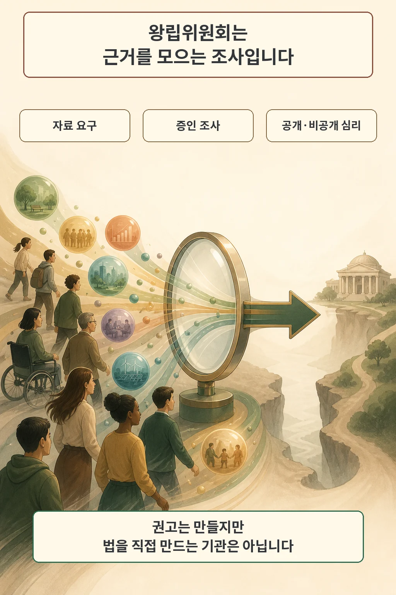
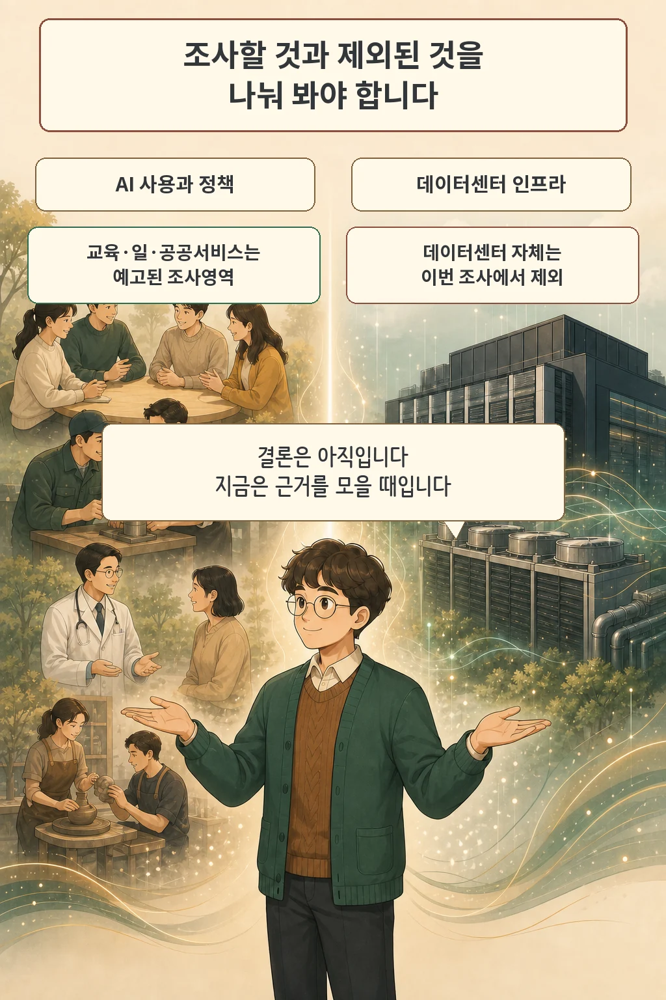

‘왕립위원회(Royal Commission)’라는 이름을 들으면 곧바로 새 규제가 시행된다는 인상을 받기 쉽지만, 남호주 정부가 2026년 8월 10일 발표한 조치는 그보다 앞 단계인 공식 조사 절차의 개시입니다. AI 기술이 사회 현장에 미치는 영향과 관련 정책을 강제 조사 권한으로 먼저 들여다보겠다는 결정입니다.

글·해설: 다메카솔

## 핵심 내용

- **조사 위원회 설치 결정**: 2026년 10월 1일 활동을 시작해 2027년 7월 1일까지 정부에 보고서를 제출할 예정이며, 향후 4~6주 내 세부 조사범위 발표 및 위원 3명 선임이 진행됩니다.
- **강제 조사 권한과 입법의 분리**: `Royal Commissions Act 1917`에 따라 증인 출석과 자료 제출을 요구할 수 있으나, 최종 결과는 정부에 내는 보고서와 권고이므로 실제 법제화는 정부·의회의 후속 절차를 거쳐야 합니다.
- **조사 범위 구분**: 교육·일자리·보건 등 공공서비스·창작 산업·전력망 영향을 다루며, 데이터센터 시설 자체의 입지·인프라 규제는 이번 조사 중심에서 제외됐습니다.

## 남호주가 결정한 것은 조사입니다

8월 10일 발표로 확정된 사안은 AI 왕립위원회를 설치한다는 결정과 기본 일정입니다. 남호주 총리 Peter Malinauskas는 위원회가 2026년 10월 1일 공식 출범해 2027년 7월 1일까지 정부에 최종 보고서를 제출할 것으로 예상한다고 밝혔습니다. 구체적인 조사범위(terms of reference)는 앞으로 4~6주 안에 발표하고, 국제 탐색을 거쳐 세 명의 위원을 선임할 계획입니다.

남호주 법(`Royal Commissions Act 1917`)은 왕립위원회에 일반 자문기구보다 훨씬 강한 조사 수단을 부여합니다. 위원회는 공개 또는 비공개로 증거를 청취하고 증인 출석과 자료 제출을 요구할 수 있어, 정해진 조사범위 안에서 사실관계와 이해관계자의 입장을 깊이 있게 확인할 수 있습니다. 다만 그 결과물은 정부에 제출하는 보고서와 정책 권고이므로, 권고가 나왔다고 해서 법률이나 규제가 자동으로 발효되지는 않으며 정부의 정책 채택과 의회의 입법 절차가 별도로 남습니다.

## 조사 대상과 제외 대상을 나눠야 합니다

정부가 예고한 조사 영역은 AI가 실제로 쓰이는 사회 현장입니다. 교육과 기술 역량, 일자리, 보건을 포함한 공공서비스, 창작 산업, 그리고 전력망에 미치는 영향을 살피며 기업·노동조합·산업단체·기술회사와 연구자가 참여하게 됩니다. 반면 Malinauskas 총리는 이번 위원회가 AI를 떠받치는 물리적 시설보다 AI의 활용을 조사한다고 선을 그었으므로, 데이터센터의 물·전력·입지 규제까지 이번 발표로 결정됐다고 넓혀 읽을 근거는 없습니다.

아울러 남호주에는 이미 시행 중인 정부용 AI 윤리 정책 및 LLM 사용 지침이 있고, 남호주 Office for AI가 현재 개발 중인 책임 있는 AI 사용 정책이 따로 있습니다. 기존 행정 지침, 현재 개발 중인 정책, 그리고 내년 중반에 나올 왕립위원회의 미래 권고를 서로 다른 단계로 구분해 지켜봐야 합니다.

## 출처

- [ABC News — Royal commission into artificial intelligence launched in South Australia](https://www.abc.net.au/news/2026-08-10/artificial-intelligence-royal-commission-announced-in-sa/107017502)
- [South Australian Legislation — Royal Commissions Act 1917](https://www.legislation.sa.gov.au/lz?path=%2Fc%2Fa%2Froyal+commissions+act+1917)
- [Office for AI — Policies, standards, and guidelines](https://ai.sa.gov.au/ai-knowledge-centre/policies%2C-standards-and-guidelines)

이 글의 본문과 이미지는 생성형 AI로 제작했습니다. 기획과 편집 기준은 다메카솔이 정했습니다.
