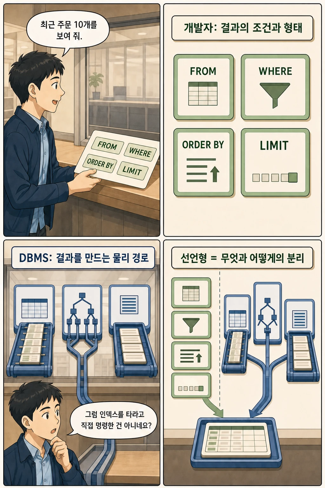
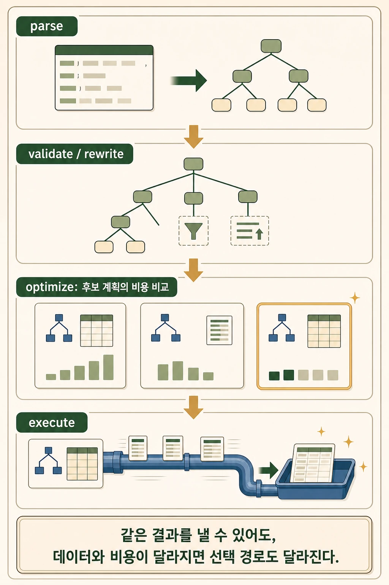
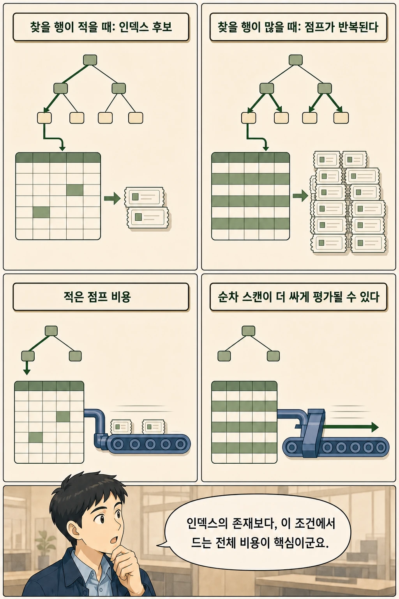
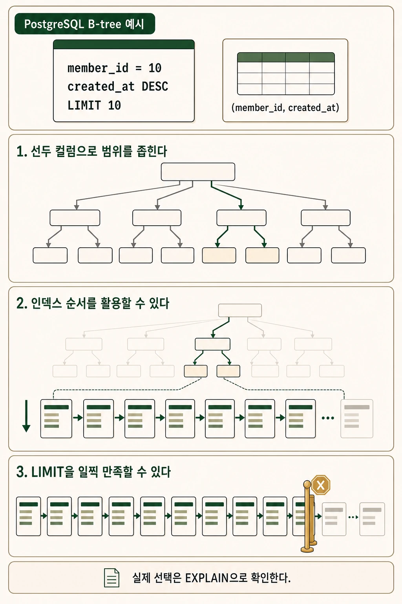

테이블에 인덱스를 걸어 두었는데도 쿼리가 느리고, `EXPLAIN` 실행 계획에는 테이블 전체를 훑는 풀 스캔(`Seq Scan`)이 떠서 당황한 적 있으실 겁니다. 인덱스를 만들어 줬는데 DB 엔진이 의도를 무시하는 것처럼 보이기 쉽거든요. 하지만 이는 SQL이 원하는 결과만 적어 두는 **선언형(Declarative) 언어**이고, 실제 탐색 경로는 옵티마이저가 비용을 따져 결정하기 때문에 벌어지는 정상적인 동작입니다.

글·해설: 다메카솔


## 핵심 요약

- **선언(What)과 실행(How)의 분리**: 개발자는 `WHERE`·`ORDER BY`·`LIMIT`로 결과 조건만 적고, 물리적 실행 경로는 옵티마이저가 결정합니다.
- **풀 스캔 선택 이유**: 조건에 맞는 행 비율이 커지면 인덱스의 랜덤 I/O가 순차 스캔보다 비싸져 옵티마이저가 풀 테이블 스캔을 고릅니다.
- **복합 인덱스 설계**: 필터와 정렬 컬럼 순서를 쿼리에 맞추면 탐색 범위 축소, 별도 `Sort` 생략, `LIMIT` 조기 종료를 함께 얻을 수 있습니다.
- **실행 계획 검증**: 선언형 추상화가 물리 비용을 없애 주지는 않으므로, 운영 규모 데이터에서 `EXPLAIN`으로 선택 경로를 확인해야 합니다.

## 개발자가 선언하는 것, DBMS가 결정하는 것

서비스 백엔드에서 흔히 쓰는 최근 주문 목록 페이징 쿼리를 하나 떠올려 볼까요?

```sql
SELECT *
FROM orders
WHERE member_id = 10
ORDER BY created_at DESC
LIMIT 10;
```



이 SQL에서 개발자가 명시한 것은 최종 결과의 조건과 형태뿐입니다. `orders` 테이블에서 10번 회원의 주문을 골라(`WHERE`) 생성 시각 내림차순으로 정렬한 뒤(`ORDER BY`) 상위 10건만 반환하라(`LIMIT`)고 목적지만 선언한 셈이죠.

반면 어느 디스크 블록부터 읽을지, B-tree 루트 노드에서 어떻게 내려갈지 같은 물리 실행 절차는 문장에 담기지 않습니다. 자바나 C++처럼 처리 순서를 직접 지시하는 명령형(Imperative) 언어와 달리, SQL은 **"무엇(What)"을 얻을지만 선언하고 "어떻게(How)" 가져올지는 DBMS에 맡기는 구조**입니다.

## 옵티마이저가 실행 계획을 고르는 네 단계



SQL이 DBMS에 전달되면 내부 플래너와 옵티마이저가 네 단계를 거쳐 가장 비용이 낮은 실행 계획을 세웁니다.

1. **구문 파싱(Parse)**: SQL 문법을 검사해 엔진이 다룰 내부 트리 구조로 바꿉니다.
2. **검증·재작성(Validate / Rewrite)**: 테이블과 컬럼 유효성을 확인하고, 같은 결과를 유지하는 범위에서 쿼리를 단순화합니다.
3. **비용 최적화(Optimize)**: 여러 물리 실행 후보의 예상 비용을 비교해 가장 저렴한 계획 1개를 채택합니다.
4. **실행(Execute)**: 채택된 계획에 따라 디스크나 버퍼 캐시에서 데이터를 읽어 결과를 반환합니다.

성능을 가르는 핵심은 세 번째 비용 최적화 단계입니다. 옵티마이저는 수집해 둔 테이블 통계(행 수, 컬럼별 고유값 분포, 카디널리티)를 토대로 여러 후보 경로의 예상 비용을 계산합니다. 순차 스캔(`Sequential Scan`), 인덱스 스캔(`Index Scan`), 정렬(`Sort`) 노드, `LIMIT` 조기 종료 가능성까지 비교해 총비용이 가장 낮은 경로를 고릅니다.

## 인덱스가 있어도 풀 테이블 스캔을 고르는 이유



실무에서 가장 흔한 오해는 인덱스를 만들면 쿼리가 무조건 인덱스를 탈 것이라는 기대입니다. 같은 쿼리와 인덱스라도 조건에 걸리는 행 비율(선택도)에 따라 옵티마이저의 계산은 크게 달라지거든요.

예를 들어 전체 100만 건이 쌓인 주문 테이블에서 결제 완료(`status = 'PAID'`) 데이터를 조회한다고 가정해 보겠습니다.

```sql
SELECT *
FROM orders
WHERE status = 'PAID';
```

| 일치 행 수 (전체 100만 건 기준) | 선택도 | 주요 I/O 패턴 | 유리한 스캔 방식 |
| --- | --- | --- | --- |
| 100건 | 0.01% | 인덱스로 100건 위치만 골라 접근 | **인덱스 스캔(Index Scan)** |
| 90만 건 | 90% | 인덱스 탐색 후 본문 블록 90만 번 랜덤 액세스 | **순차 스캔(Sequential Scan)** |

일치 행이 100건뿐이라면 인덱스를 타고 필요한 위치만 골라 읽는 편이 훨씬 빠릅니다. 반면 90만 건이 조건에 걸린다면 인덱스를 거친 뒤 본문 블록으로 90만 번 점프하는 **랜덤 I/O** 부담이 디스크를 연속으로 읽는 **순차 I/O** 비용을 크게 웃돌게 됩니다.

결국 풀 테이블 스캔은 엔진이 인덱스를 무시한 결과가 아니라, 현재 데이터 분포에서 더 저렴한 경로를 고른 판단입니다. 인덱스는 강제 실행 명령이 아니라 옵티마이저가 검토하는 선택지에 가깝죠.

## 복합 인덱스로 필터와 정렬, LIMIT 비용 줄이기



앞서 살펴본 최근 주문 10건 조회 쿼리는 필터와 정렬 조건을 하나의 복합 인덱스 컬럼 순서에 맞춰 주면 I/O와 정렬 비용을 함께 줄일 수 있습니다.

```sql
CREATE INDEX idx_orders_member_created
ON orders (member_id, created_at DESC);
```

이 복합 인덱스가 쿼리 패턴과 맞물리면 세 가지 이점이 동시에 작동합니다.

1. **필터 범위 축소**: 선두 컬럼인 `member_id = 10`에 해당하는 B-tree 구간으로 바로 진입해 불필요한 행 스캔을 피합니다.
2. **별도 `Sort` 생략**: 해당 구간의 리프 노드가 이미 `created_at DESC` 순서로 배치되어 있어, 메모리나 디스크 임시 공간을 잡아 따로 정렬하는 단계를 건너뛸 수 있습니다.
3. **`LIMIT` 조기 종료(Early Exit)**: 정렬된 인덱스 구간에서 위쪽 10건만 읽는 즉시 스캔을 멈추고 결과를 반환합니다.

## EXPLAIN으로 실제 실행 계획 확인하기

인덱스를 만든 뒤에는 옵티마이저가 실제로 그 경로를 골랐는지 확인해야 합니다. PostgreSQL이나 MySQL에서는 쿼리 앞에 `EXPLAIN`을 붙여 실행 계획을 바로 볼 수 있습니다.

```sql
EXPLAIN
SELECT *
FROM orders
WHERE member_id = 10
ORDER BY created_at DESC
LIMIT 10;
```

복합 인덱스가 의도대로 선택되면 PostgreSQL은 아래와 비슷한 형태의 실행 계획을 출력합니다.

```text
Limit  (cost=0.43..12.10 rows=10 width=64)
  ->  Index Scan using idx_orders_member_created on orders
        (cost=0.43..116.90 rows=100 width=64)
        Index Cond: (member_id = 10)
```

이 출력에서 먼저 살펴볼 지점은 두 가지입니다.

- **`Sort` 노드가 사라졌는지**: 별도 정렬 노드가 보이지 않는다면 인덱스 정렬 순서를 그대로 활용해 CPU와 메모리 정렬 연산을 건너뛰었다는 뜻입니다.
- **`Limit`이 최상단에 걸려 있는지**: 후보 전체를 훑지 않고 10건이 차는 순간 스캔을 중단해 디스크 I/O를 최소화하고 있음을 보여 줍니다.

## 다메카솔의 해석: 추상화 뒤의 물리 비용 관리하기

SQL의 선언형 모델 덕분에 개발자는 디스크 블록 탐색이나 정렬 알고리즘을 직접 구현하는 부담에서 벗어났습니다. 그렇다고 추상화가 그 아래의 물리적 I/O와 연산 비용까지 없애 주는 것은 아니죠. 선언형 언어의 장점을 살리면서 쿼리 성능을 지키려면 실무에서 다음 세 가지 기준을 챙겨 두는 편이 좋습니다.

1. **카디널리티와 조회 패턴 기준의 선두 컬럼 배치**: `WHERE` 절 컬럼마다 인덱스를 늘리기보다, 고유값 비율(선택도)이 높은 필터 컬럼을 복합 인덱스 앞쪽에 두고 정렬 컬럼을 뒤에 배치합니다.
2. **대량 변경 직후 테이블 통계 최신화**: 대규모 데이터 이관이나 야간 배치 뒤에는 통계가 실제 분포와 어긋나 엉뚱한 풀 스캔을 타기 쉽습니다. 주기적인 `ANALYZE`로 통계를 갱신해 두어야 옵티마이저 추정이 정확해집니다.
3. **운영 규모 데이터에서 `EXPLAIN ANALYZE` 검증**: 로컬 환경의 10건 남짓한 더미 데이터에서는 비용 차이가 작아 풀 스캔이 나오기 쉽습니다. 수백만 건 이상 데이터가 쌓인 스테이징 환경에서 `EXPLAIN ANALYZE`로 실제 실행 시간과 I/O 병목을 확인해야 합니다.

## 함께 읽을 DB 핵심 원리

- [데이터베이스 정규화와 3대 이상 현상](/posts/database-normalization-anomalies/): 올바른 엔티티 분리와 데이터 무결성
- [트랜잭션 ACID와 Commit/Rollback의 내부 동작](/posts/transaction-acid-commit-rollback/): 동시성 제어와 WAL 로그

## 출처

- [PostgreSQL Documentation — Using EXPLAIN](https://www.postgresql.org/docs/current/using-explain.html)
- [PostgreSQL Documentation — Indexes and ORDER BY](https://www.postgresql.org/docs/current/indexes-ordering.html)
- [PostgreSQL Documentation — Multicolumn Indexes](https://www.postgresql.org/docs/current/indexes-multicolumn.html)

PostgreSQL 공식 문서의 실행 계획과 인덱스 동작 원리를 바탕으로 정리했으며, 본문의 SQL과 실행 계획 출력은 개념 이해를 돕기 위한 예시입니다.

이 글의 본문과 이미지는 생성형 AI로 제작했습니다. 기획과 편집 기준은 다메카솔이 정했습니다.
