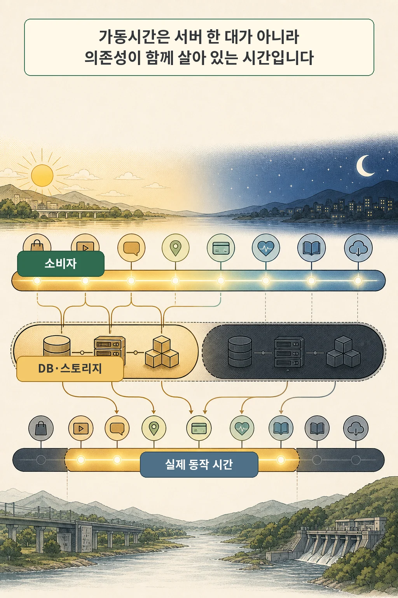
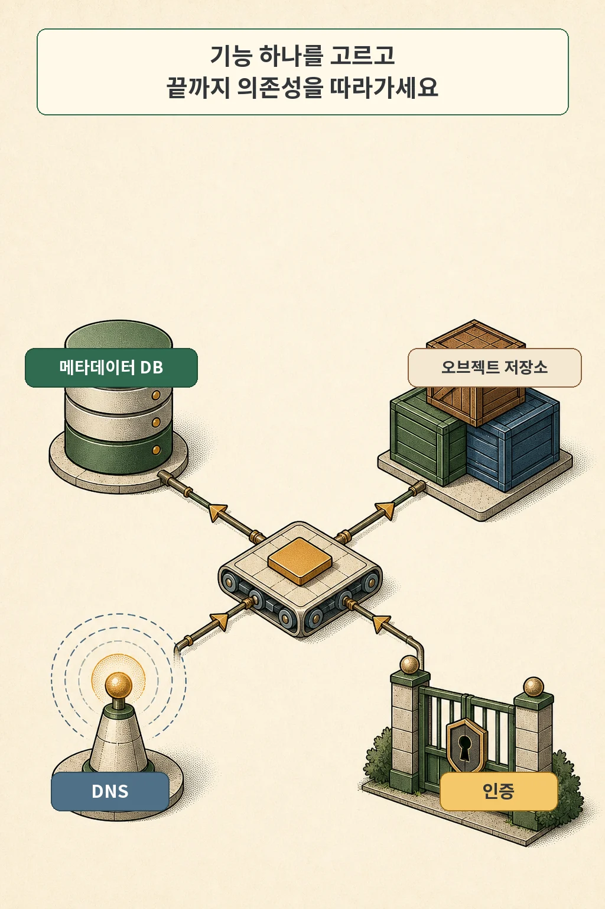
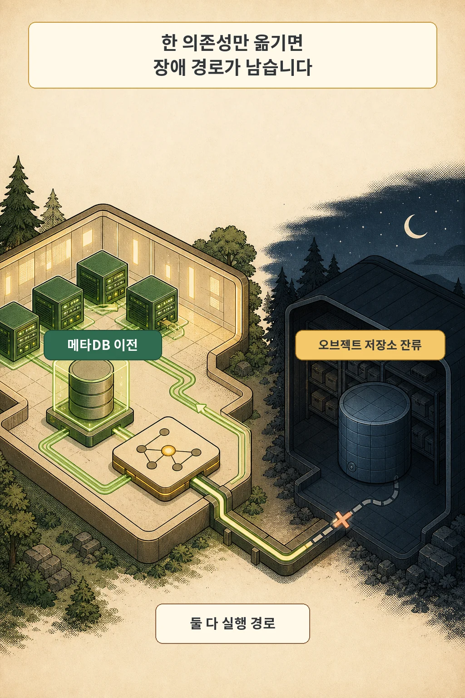

애플리케이션 프로세스가 24시간 멀쩡히 떠 있는데도 밤만 되면 배치 작업이나 파일 저장이 줄줄이 실패하는 일이 있습니다. Synology NAS에서 학습용 k3s를 돌리던 때 저도 소음 때문에 밤마다 NAS를 껐다가, 그 위의 Airflow 메타데이터 DB와 S3 호환 오브젝트 스토리지가 함께 사라지면서 똑같은 장애를 겪었거든요. **실질 가동시간은 필수 의존성이 모두 살아 있는 시간으로 제한되니**, 사용자 기능 하나의 실행 경로로 배치 계층을 나누는 기준부터 살펴볼까요?

글·해설: 다메카솔

## 가동시간은 겹치는 시간창입니다

프로세스가 하루 종일 살아 있어도 로그인에는 인증과 사용자 DB가, 파일 업로드에는 DNS·메타데이터 DB·오브젝트 스토리지가 함께 열려 있어야 합니다. 하나라도 필요한 순간에 멈추면 기능은 그대로 중단되죠.

결국 가동시간은 개별 서버의 업타임이 아니라 필수 의존성들의 **공통 시간창** 문제입니다. 소비자가 24시간 켜져 있어도 DB가 주간에만 돌면 기능의 가동시간은 DB에 묶입니다. 낮에만 쓰는 개발 환경이라면 의존성도 주간에 맞추면 충분하며, 핵심은 기대 이용 시간과 실행 경로의 가동시간을 일치시키는 데 있습니다.

## 사용자 기능 하나로 의존성 그래프 그리기

“Airflow 운영”처럼 제품 단위로 적으면 의존성이 흐려집니다. 대신 “새 원본 파일 하나를 수집해 저장한다”처럼 결과를 판정할 수 있는 기능 하나를 골라 호출 경로를 끝까지 따라가야 합니다.

Airflow 공식 문서는 메타데이터 DB가 task·DAG·variable 상태를 저장하며 동작에 필수적이라고 설명합니다. 하지만 task 출력이 별도 오브젝트 스토리지에 쓰인다면 DB 접속만으로 성공을 장담하기 어렵고, Kubernetes 워크로드가 Service를 이름으로 찾는다면 DNS 역시 선행 의존성이 됩니다.

| 의존성 | 필요 시간창 | 중단 시 현상 | 확인 방법 |
| --- | --- | --- | --- |
| DNS | 요청 처리 전체 | 연결 전 이름 해석 실패 | 새 Pod에서 Service 조회 |
| 인증·비밀정보 | 로그인·접속·갱신 | 로그인·토큰 갱신 실패 | 새 세션으로 인증 재실행 |
| 메타데이터 DB | 스케줄·실행·조회 | task 상태 기록·조회 실패 | 새 작업 생성 후 상태 확인 |
| 오브젝트 스토리지 | task 읽기·쓰기 | 업로드·다운로드 실패 | 새 객체 쓰기와 다시 읽기 |
| 외부 API | 해당 stage 실행 | 일부 단계 재시도·실패 | 제한된 입력으로 요청 재현 |

표를 채울 때는 연결 문자열 외에 이름 해석 위치, 자격 증명 갱신 시점, 성공 판정 전 끝나야 할 저장까지 함께 짚어야 합니다. DNS 캐시나 열린 DB 커넥션 때문에 기존 Pod는 잠시 정상처럼 보여도 새 연결부터 실패할 수 있거든요.

## DB만 옮기는 안으로 부족했던 이유

홈랩에서 처음 검토한 방안은 메타데이터 DB만 상시 가동 장비로 옮기는 것이었습니다. 하지만 task 저장 경로를 따라가 보니 야간에 꺼지는 NAS의 S3 호환 오브젝트 스토리지가 그대로 남아 있었죠. 장비별 전원 대신 DAG 한 번이 지나는 전체 경로로 이전 범위를 다시 잡은 이유입니다.

실무 마이그레이션에서도 DB만 옮기고 객체·파일 저장 경로, DNS·인증·비밀정보, 특정 단계의 queue·cache·registry, 실패 알림·재시도가 호출하는 외부 시스템을 놓치기 쉽습니다. 완료 기준은 **새 입력부터 결과 다시 읽기까지 예전 경로를 전혀 쓰지 않는 상태**로 잡고, 설정 검색·네트워크 관측·end-to-end 요청으로 확인하는 편이 안전합니다.

## 상시 실행·예약 지원·복구 보관 3계층 분리

의존성 목록이 나왔다면 장비가 아니라 역할 기준으로 세 계층으로 나눕니다.

| 계층 | 대표 대상 | 가동 원칙 | 검증 질문 |
| --- | --- | --- | --- |
| 상시 실행 | 라이브 DB·오브젝트 스토리지, DNS·인증 | 필요 시간창과 일치 | 새 요청이 끝까지 성공하는가? |
| 예약 지원 | 백업 NAS, 배치 서버, 점검 도구 | 작업 창 기동·미실행 재처리 | 놓친 예약을 언제 재실행하는가? |
| 복구·보관 | 분리 백업, 오프사이트·콜드 사본 | 라이브 경로와 분리 | 운영 데이터 없이 복구되는가? |

이 기준이면 백업 NAS를 밤에 꺼도 되는 조건이 분명해집니다. 꺼진 동안 앱이 읽고 쓰면 이미 라이브 의존성이지만, 예약 백업 전용이고 예약 창·기동 실패 탐지·재시도·정기 복원 시험을 갖췄다면 24시간 켜 둘 이유가 줄어들거든요.

복제(replica)와 백업도 역할이 다릅니다. replica는 서비스를 이어 가는 사본이라 잘못된 삭제까지 복제될 수 있고, 백업은 삭제·손상·랜섬웨어·실수 뒤 과거 시점으로 돌아가는 사본이라 복원 중 요청이 멈춥니다. Longhorn 복제, DB 장애 조치, 3-2-1 백업 정책은 각각 별도 설계로 다뤄야 합니다.

## Kubernetes 리소스와 RTO·RPO의 경계

**StatefulSet**은 안정적인 네트워크 식별자와 지속 스토리지, 순서 있는 배포·확장을 돕지만 스토리지 자체와 DB 복제·장애 조치·백업은 따로 설계해야 합니다. **PodDisruptionBudget(PDB)**도 노드 drain 같은 자발적 축출에서 동시 중단 Pod 수를 제한할 뿐이며, 공식 문서 역시 상시 가동을 보장하지 않는다고 명시합니다. 노드 전원 상실, 하드웨어·스토리지 장애, 앱 오류는 별도 대책이 필요한 셈이죠.

replica를 늘릴 때는 개수보다 **공유 장애 경계**를 먼저 봅니다. Kubernetes 다중 zone 장애 도메인 원칙은 홈랩에서 다른 노드가 같은 멀티탭이나 단일 스위치를 쓰는지, 볼륨이 같은 NAS 디스크 풀에 있는지, DNS·인증이 단일 VM에 묶였는지로 점검할 수 있습니다. 무조건 이중화하기보다 고장 한 번에 함께 사라지는 범위를 파악해 감당 여부를 정하는 기준입니다.

복구 목표도 장비보다 질문이 먼저입니다. NIST SP 800-34는 **RTO**를 허용 불가 영향 전 최대 중단 시간으로, **RPO**를 장애 전 데이터를 되살릴 시점으로 정의합니다.

예를 들어 개인 사진 업로드는 밤새 멈춰도 마지막 사본만 지키면 돼 데이터 보존(RPO)이 우선되고, 수집 pipeline은 10분만 멈춰도 입력을 놓치지만 원본을 다시 받을 수 있다면 실행 연속성과 재처리(RTO) 비중이 커지죠. 목표를 정했다면 실제 복원 시간과 시점을 시험하고, 복구 역시 **공통 선행 서비스 → 상태 서비스 → 소비자** 순서로 올려야 합니다.

## 설계 초안과 실제 기능 검증은 따로 계획합니다

문서가 없는 홈랩이라면 초안 작성과 중단 시험을 단계별로 분리합니다.

- **설계 초안**: 기능 선정 → 호출 경로·시간창 기록 → 3계층 배치 → 공유 장애 경계 표시 → RTO·RPO 기준 정리
- **중단 시험**: 영향 범위·관측 방법·복구 순서·중단 권한을 정한 별도 계획으로 수행

시험할 때 Pod 상태만 보면 오판하기 쉬운데요. Kubernetes에서 Pod phase `Running`은 노드에 배치돼 모든 컨테이너가 생성됐고 적어도 하나가 실행·시작·재시작 중이라는 뜻에 그칩니다. `Ready` 역시 readiness 검사에 DB·오브젝트 저장이 빠졌다면 사용자 경로 성공을 대변하기 어려우므로, 같은 입력을 넣고 결과를 다시 읽는 합성 점검으로 닫아야 합니다.

전원을 끄기 어렵다면 작은 테스트 namespace와 합성 데이터로 방화벽이나 Service endpoint를 차단해 실패 경로부터 관찰할 수 있습니다. 이때 시험 기능, 중단 대상, 탐지 신호, 중단 지점, 복구 순서, 복구 증거(새 입력·DB 기록·객체 읽기), 실제 소요 시간·데이터 시점(RTO·RPO 비교)을 남겨 두면 장애 대응 기준표가 됩니다.

참고로 DB를 24시간 켜 두는 것과 고가용성은 층위가 다릅니다. 상시 가동은 계획된 전원 시간의 문제이고, 고가용성은 단일 장비·볼륨 장애에도 서비스를 이어 가는 구조의 문제거든요. 제가 홈랩에서 먼저 고친 것도 장비 수가 아니라 배치 기준이었으며, 이 설계가 출발한 배경은 [홈랩 쿠버네티스 구축기 1편: RAM은 32GB인데 Airflow DAG가 계속 실패한 이유](/posts/why-homelab-kubernetes/)에서 이어집니다.

> **정정 (2026-07-28)**: 초판은 메타데이터 DB를 상시 가동 장비로 실제 옮긴 뒤에도 문제가 남은 것처럼 썼고, Pod의 `Running` 상태를 단순히 컨테이너가 떠 있는 상태로 설명했습니다. 현재 글은 DB 이전이 검토 단계였다는 사실과 Kubernetes Pod phase의 정확한 범위를 반영해 고쳤으며, 가동시간 설계 초안 작성과 실제 중단 시험을 분리했습니다.

## 출처

- [Apache Airflow 3.3.0: Architecture Overview](https://airflow.apache.org/docs/apache-airflow/stable/core-concepts/overview.html)
- [Kubernetes: Pod Lifecycle](https://kubernetes.io/docs/concepts/workloads/pods/pod-lifecycle/)
- [Kubernetes: DNS for Services and Pods](https://kubernetes.io/docs/concepts/services-networking/dns-pod-service/)
- [Kubernetes: StatefulSets](https://kubernetes.io/docs/concepts/workloads/controllers/statefulset/)
- [Kubernetes: Specifying a Disruption Budget](https://kubernetes.io/docs/tasks/run-application/configure-pdb/)
- [Kubernetes: Running in multiple zones](https://kubernetes.io/docs/setup/best-practices/multiple-zones/)
- [NIST SP 800-34 Rev. 1](https://nvlpubs.nist.gov/nistpubs/legacy/sp/nistspecialpublication800-34r1.pdf)

홈랩 사례는 당시 상세 로그와 타임스탬프가 남아 있지 않아 설계 맥락 중심으로 정리했으며, 기술 설명은 2026년 7월 24일 확인한 공식 문서를 기준으로 작성했습니다.

이 글의 본문과 이미지는 생성형 AI로 제작했습니다. 기획과 편집 기준은 다메카솔이 정했습니다.
