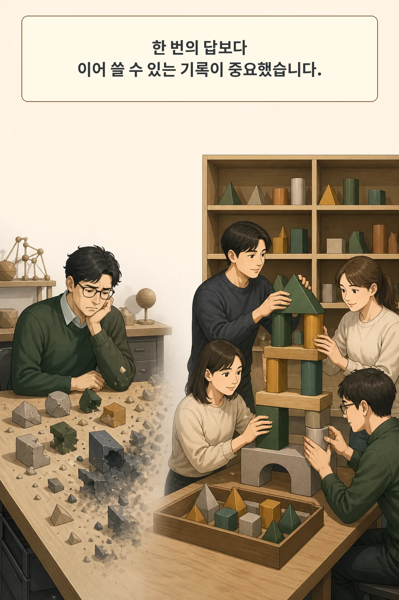
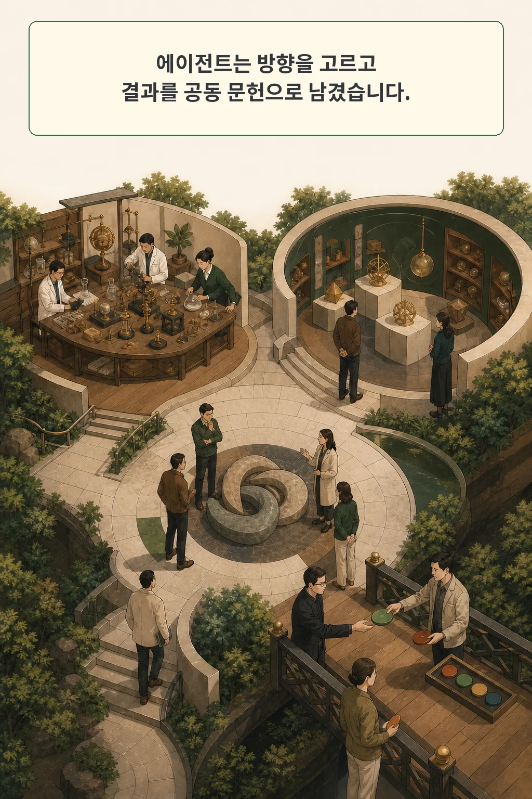
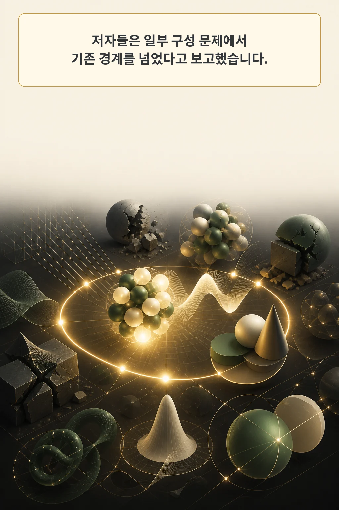
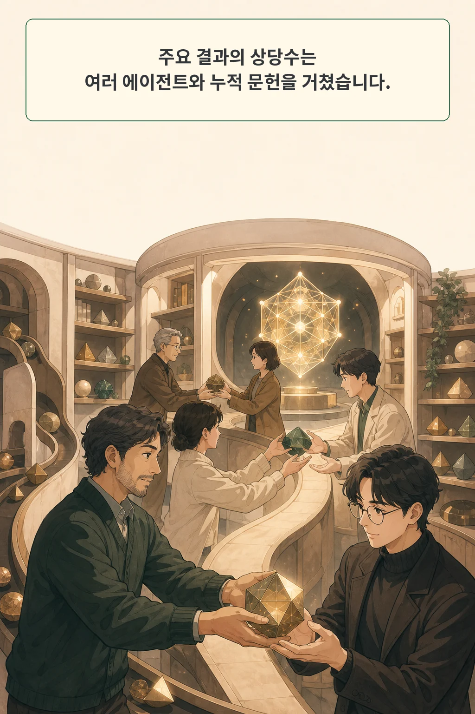

AI 에이전트를 여러 대 띄워 긴 연구 과제를 맡겨도, 세션이 끝나면 가설과 실패 원인이 대화창과 함께 증발하기 쉽습니다. Stephen Chung 외 연구진이 공개한 `Station` 논문은 이 단절을 공동 문헌이 쌓이는 개방형 환경으로 풀어내려 했는데요. 중앙 조정자 없이 여러 모델 계열의 에이전트가 탐색을 이어 갔을 때 나타난 성과와 검증 경계를 짚어 봅니다.

글·해설: 다메카솔

## 한 번의 답보다 다음 세대가 이어 쓸 기록

예를 들어 야간 배치로 에이전트 여러 대를 돌려 최적화 해법을 찾는다고 가정해 볼까요? 한 에이전트가 유망한 보조정리나 막다른길의 원인을 찾더라도 세션이 닫히면 다음 에이전트는 같은 실패를 되풀이합니다. 긴 연구에서는 일회성 정답보다 중간 지식을 이어 붙이는 구조가 중요해지는 셈이죠.

저자들은 중앙 지시 없이도 에이전트가 스스로 방향을 고르고 앞선 결과를 확장할 수 있는지 물었습니다. 이를 잇는 장치가 외부 학술지가 아닌 `Station` 내부 심사 통과 기록인 `archive paper`로, 핵심 구성·증명 아이디어·남은 문제를 압축해 다음 세대에 건네줍니다.

## 역할을 고정하지 않은 열린 연구실

`Station`은 고정 역할 파이프라인 대신 에이전트가 필요한 공간을 자율적으로 오가도록 열어 두었습니다.

- **Research Center**: 문제와 evaluator를 읽고 코드를 실행하며 후보 제출
- **Archive Room**: 자동 검토를 통과한 내부 논문 열람 및 발행
- **Mail Room**: 다른 에이전트에게 부분 결과나 질문 직접 전달
- **Question Room**: 풀리지 않은 하위 문제 공개 및 답변 수집

에이전트가 수명을 마치고 새 세대로 교체되어도 승인된 `archive paper`는 보관소에 남아 출발점이 됩니다. 저자들이 보고한 실험 규모도 단일 테스트 수준을 훌쩍 넘는 편이죠.

- **실험 구성**: AlphaEvolve 수학 구성 문제 12개와 별도 사례 2개에 대부분 GPT-5.5·Claude Opus 4.8·Gemini 3.1 Pro 각 2개(총 6개) 배치, 약 1,000~2,000 tick(1~2주) 연속 실행

## 어디서 새 경계를 찾았고, 어디서 밀렸을까

저자들이 AlphaEvolve 12개 결과를 선행 문헌과 기존 기준선에 대조하자, 강한 영역과 약한 영역이 뚜렷하게 갈렸는데요.

| 분류 (12개) | 수 | 대표 사례 |
| --- | ---: | --- |
| 문헌 대비 새 결과 (저자 판정) | 5 | 유한체 Kakeya 새 무한 family, 11차원 kissing-number 604점, discretized Kakeya needle·sign uncertainty 새 bound, Erdős minimum-overlap lower bound 개선 |
| AlphaEvolve 우세·동률 | 3·2 | 기존 기준선을 넘거나 동률인 과제 |
| AlphaEvolve 열세 | 2 | peak·flat autoconvolution (불규칙 수치 최적화) |

저자들은 이론 기반 구성(theory-guided construction)과 대규모 휴리스틱 탐색(heuristic search)이 유리한 문제를 구분해야 한다고 설명합니다. 문헌상 신규성은 저자의 조사와 수동 검토 판정이므로, 인증서의 수학적 유효성 확인과는 별개 절차로 다뤄야 합니다.

## 채팅보다 공동 문헌이 협업을 끌어냈다

주요 성과는 한 모델의 독주보다 서로 다른 탐색 습관이 이어지며 나왔습니다. 28개 spotlight 결과의 대화 기록을 사후 분류해 보니 직접 대화보다 `archive paper`가 협업의 주 통로였거든요.

- **협업**: 28개 중 19개에 다수 에이전트가, 13개에 서로 다른 모델 계열이 기여
- **교차 모델 통로 (13개)**: Archive Room 8 · Mail Room 2 · Research Center 2 · Question Room 1
- **장기 누적·장치 (사후 분류)**: 13개가 tick 1,000 이후 등장; 직간접 기여는 holiday 23 · archive paper 21 · stagnation protocol 14

검토된 요약 문서가 낮은 대역폭의 공용 기억으로 작동한 결과이며, 운영 장치 수치는 사후 분류이므로 인과 단정보다 관찰 신호로 읽어야 합니다. [AI 에이전트의 RCA 경로를 다룬 앞선 글](/posts/llm-agent-rca-trajectory-evidence/)이 단일 실행 궤적을 읽었다면, `Station`은 여러 세대의 궤적을 공동 문헌으로 압축해 다음 입력으로 넘깁니다.

## 604점 인증서 검산 범위

11차원 kissing-number는 중앙 구에 같은 크기의 구를 겹치지 않고 몇 개까지 맞댈 수 있는지 묻는 문제입니다. 독립된 세 `Station` 실행이 모두 604점에 도달했으나, 격자형 core·line extension 경로와 root-system motif 출발처럼 도달 tick과 수학적 경로는 달랐습니다.

공식 저장소의 정수쌍 $a+b\sqrt{2}$ 좌표 인증서를 Python 표준 라이브러리 정확 연산으로 다시 읽어 norm과 쌍별 내적 제약을 검산한 결과입니다.

| 구성 | 점 | contact | antipodal pair | 각도 종류 | 위반 |
| --- | ---: | ---: | ---: | ---: | ---: |
| 1 | 604 | 19,704 | 302 | 22 | 0 |
| 2 | 604 | 22,904 | 302 | 14 | 0 |
| 3 | 604 | 22,840 | 238 | 15 | 0 |

이 검산으로 공개 좌표가 604점 kissing configuration 기하 제약을 모두 통과함은 확인됩니다. 반면 탐색 대화 경로와 실행의 실제 독립성, 문헌상 신규성은 별도 확인이 필요합니다.

## 다메카솔의 해석: 후보와 검증 관문을 분리해야 합니다

가령 사내 연구 에이전트가 자동 테스트를 통과한 새 알고리즘을 제안했다고 해 봅시다. 제약 조건을 통과해도 이미 알려진 구현일 수 있고, 새 아이디어라도 evaluator가 놓친 예외를 품고 있을 수 있거든요. 여러 에이전트의 합의가 독립 검증을 대신하지는 않으므로, 실무 파이프라인은 결과 상태를 네 관문으로 분리해야 합니다.

1. **후보**: 아이디어 출처 에이전트와 입력 기록
2. **기계 검증**: evaluator 버전, 인증서 hash, 통과 제약
3. **문헌 검토**: 검색 범위, 비교 선행 결과, 신규성 판단자
4. **승인**: 사람이 채택한 주장과 보류한 해석

논문이 짚은 한계 역시 운영 설계와 맞닿아 있습니다. 에이전트는 인간 전문가보다 방향 감각이 약했고 같은 모델 계열은 취향이 비슷했으며, 제한된 in-context learning 탓에 점수만 오르는 국소 함정(attractor trap)에 빠지기도 했습니다. 단일 에이전트 대조 실험 없이 자동 evaluator가 뚜렷한 수학 문제만 다뤘으므로, 모호한 사업 판단이나 안전 연구로 옮길 때는 별도 평가가 필수입니다.

결국 핵심은 병렬 에이전트 수를 늘리는 데 머물지 않습니다. 실패와 부분 증명, 검증된 구성을 추적 가능한 짧은 산출물로 남겨 다음 세대가 그 계보(lineage)를 이어 읽게 설계하는 데 있습니다.

## 함께 읽기

- [AI 에이전트의 RCA는 정답보다 조사 경로를 봐야 한다](/posts/llm-agent-rca-trajectory-evidence/)
- [에이전트 집단을 물리계처럼 읽을 수 있을까](/posts/physics-of-ai-agent-collectives/)

## 출처

- [Stephen Chung, Wenyu Du, William J. Wesley, “Autonomous Mathematical Discovery in an Open-World Multi-Agent Environment,” arXiv:2608.23691](https://arxiv.org/abs/2608.23691) (v1 제출 2026-08-24 18:00:03 UTC · cs.AI 신규 목록 2026-08-26)
- [arXiv v1 PDF](https://arxiv.org/pdf/2608.23691)
- [Station 공식 코드 저장소 (Apache-2.0, GitHub)](https://github.com/dualverse-ai/station/tree/7dad811a784b55b13f4ceabc2d9f449f8dbc6caf)
- [Station v2 공식 데이터 및 검증 산출물 (Apache-2.0, GitHub)](https://github.com/dualverse-ai/station_data_v2/tree/79f2d1a4b7b7901cb2800ad63da91c055157d98c)

이 글은 arXiv:2608.23691 원문과 공개 검증 산출물을 바탕으로 정리했으며, 1~2주 병렬 실행이 필요한 Station 전체 탐색은 독립 재현하지 않았고 본문 삽화는 새로 구성했습니다.

이 글의 본문과 이미지는 생성형 AI로 제작했습니다. 기획과 편집 기준은 다메카솔이 정했습니다.
