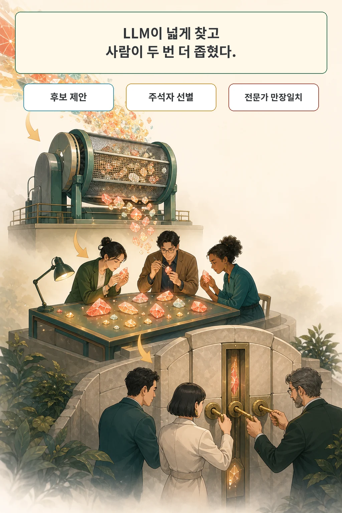
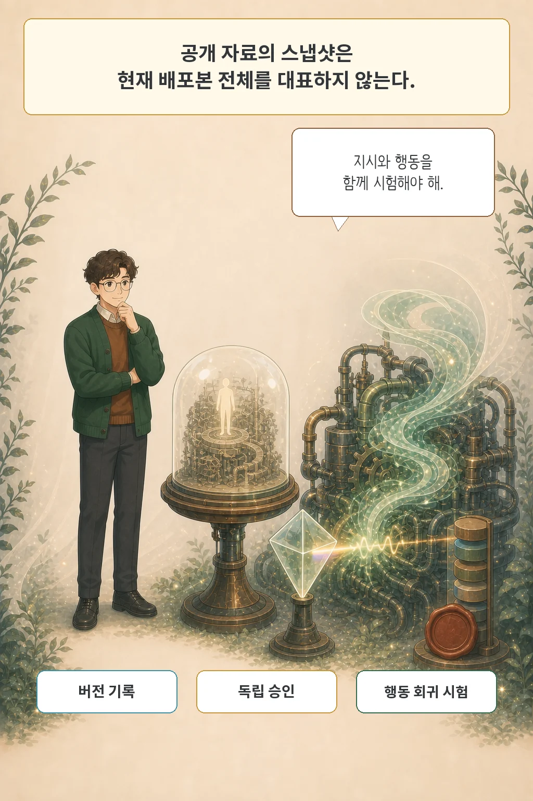

2026년 7월 30일, 스탠퍼드·CMU·MIT 등 다기관 연구진은 상용 AI 제품의 **시스템 프롬프트(system prompt)**가 사용자의 이익과 안전을 얼마나 보호하고 있는지 감사한 **AISPA** 논문을 공개했습니다. 공개 저장소에서 수집한 88개 제품의 프롬프트 스냅샷을 8개 보호 영역으로 분석한 결과, 보호 지시 자체는 널리 들어가 있었지만 8개 영역을 모두 갖춘 사례는 소수였고, 한 프롬프트 안에 사용자를 돕는 조항과 기만·조작을 유도하는 조항이 나란히 들어 있는 경우도 적지 않았습니다.

글·해설: 다메카솔

## 핵심 내용

- **사용자 중심 8대 감사 차원**: 정체성 투명성, 정보 진실성, 개인정보 보호, 도구·행동 안전, 사용자 주도권과 조작 방지, 위험 요청 처리, 피해 예방, 공정성·포용·중립성의 8개 렌즈로 시스템 프롬프트 내 개별 지시 구간을 사용자 보호(`+1`)와 사용자 침해(`-1`), 회색지대로 분류했습니다.
- **88개 제품 프롬프트 감사 결과**: 고유 지시 구간 1,818개(세부 항목 2,420개) 중 보호 항목은 2,346개, 문제 항목은 74개(회색지대 44개 별도)였습니다. 88개 제품 중 87개에 보호 지시가 하나 이상 있었으나 **8개 차원을 모두 덮은 제품은 21개**에 그쳤고, **34개 제품에는 사용자를 해칠 수 있는 문제 지시가 하나 이상 포함**되었습니다.
- **표본과 해석의 경계**: 분석 대상 88개는 기업의 공식 최신 배포본이 아니라 공개 GitHub 저장소 6곳에 유출·공유된 스냅샷이며, 텍스트 조항의 유무를 감사한 것이므로 실제 모델의 런타임 행동 준수 여부와는 구분해서 읽어야 합니다.

## 사용자는 답을 보지만 지시는 뒤에 남는다

시스템 프롬프트는 사용자가 입력한 질문보다 먼저 모델에 전달되어 제품의 정체성, 답변 범위, 거절 기준, 도구 사용 규칙, 우선순위를 정합니다. 사용자는 화면에 찍힌 최종 답변만 볼 뿐, 그 답을 뒤에서 밀어낸 숨은 지시가 무엇인지는 직접 확인하기 어렵습니다.

기존 보안 연구가 주로 “외부 공격자가 시스템 프롬프트를 탈취하거나 무력화할 수 있는가”를 물었다면, AISPA는 반대로 **“개발자가 적어 둔 시스템 프롬프트 자체가 사용자의 이익을 지키는가”**를 묻습니다. 사실을 말하라는 조항과 AI 정체를 숨기라는 조항, 도구 실행 전 확인을 받으라는 조항과 오류를 숨기고 성공한 것처럼 답하라는 조항은 똑같은 기반 모델도 전혀 다른 제품으로 만듭니다.

## 여덟 렌즈와 3단계 합의 절차

AISPA는 시스템 프롬프트를 다음 여덟 가지 사용자 보호 차원으로 검사합니다.

1. **정체성 투명성**: AI임을 숨기거나 사람 행세를 하지 않는가
2. **정보 진실성**: 근거 없는 날조나 거짓 확신을 막는가
3. **개인정보 보호**: 민감 정보 수집·저장을 제한하는가
4. **도구·행동 안전**: 외부 도구 실행 시 권한과 확인 절차를 지키는가
5. **사용자 주도권과 조작 방지**: 사용자의 판단을 조종하거나 과도한 자율 실행을 강행하지 않는가
6. **위험 요청 처리**: 불법·유해 요청 거절 기준이 명확한가
7. **피해 예방**: 자해·폭력 등 심각한 위해를 예방하는가
8. **공정성·포용·중립성**: 편향이나 차별적 응답을 억제하는가

감사 단위는 프롬프트 전체가 아니라 한 가지 행동 지시를 담은 연속 텍스트 구간입니다. 단순히 “사용자 선호를 저장한다”처럼 제품의 기본 기능을 정의하는 문장은 감사에서 제외하고, 거기에 “민감한 개인정보는 저장하지 않는다”는 조건이 붙을 때 개인정보 보호 조항(`+1`)으로 기록합니다.

분류의 정확도를 높이기 위해 연구진은 LLM과 사람 검토를 결합한 3단계 절차를 거쳤습니다.

- **1단계 (LLM 광역 탐색)**: Claude 4.6 Opus가 8개 차원별 후보 구간과 근거를 넓게 추출합니다(놓치는 구간을 줄이기 위한 임시 라벨).
- **2단계 (주석자 6명 독립 검토)**: 훈련된 주석자 6명이 후보를 수용하거나 기각합니다(무작위 20개 구간 보정 시 쌍별 합의도 0.933).
- **3단계 (전문가 3명 만장일치 심사)**: 특히 사용자를 해칠 수 있는 문제 지시(`-1`) 라벨은 잘못된 비판이 제품 평판에 미칠 영향을 고려해 **전문가 3명이 전원 동의한 경우에만** 최종 유지했습니다. 따라서 보고된 `-1` 건수는 보수적인 하한선(lower bound)에 가깝습니다.

## 보호 조항과 문제 조항은 함께 있었다

최종 감사 결과를 항목 단위와 제품 단위로 정리하면 다음과 같습니다.

| 구분 | 측정 지표 | 결과 수치 | 비고 |
| --- | --- | --- | --- |
| **항목 단위** (고유 구간 1,818개 → 세부 항목 2,420개) | 사용자 보호 항목 (`+1`) / 문제 항목 (`-1`) / 회색지대 | **2,346개** / **74개** / **44개** | 회색지대(사람처럼 행동, 대화 종료 회피, 안전 설정 해제 허용, 무제한 콘텐츠 정책 등)는 설계 상충으로 별도 분류 |
| **제품 단위** (총 88개 제품 프롬프트) | 보호 지시 1개 이상 포함 / 8대 차원 모두 충족 / 문제 지시(`-1`) 1개 이상 포함 | **87개** / **21개** / **34개** | 보호 문장이 하나 있다는 사실과 전 영역 보호가 충분하다는 판단은 다름 |
| **연도별 추세** (2024년 vs 2025년 표본) | 평균 프롬프트 길이 / 제품당 평균 보호 항목 수 | **약 9,000자 → 30,000자 이상** / **15.0개 → 38.4개** | 2026년 표본은 4개뿐이어서 시계열 추세 비교에서는 제외 |

보호 조항이 들어 있는 제품(87개) 중에서도 정작 8개 영역을 빈틈없이 덮은 제품은 21개뿐이었고, 전체의 약 39%인 34개 제품에서는 사용자를 기만하거나 안전을 해칠 수 있는 문제 지시가 보호 조항과 한 프롬프트 안에 공존했습니다.

## 프롬프트 감사의 한계와 데이터 출처 경계

이 결과를 읽을 때는 두 가지 한계를 분명히 그어야 합니다.

첫째, **지시문 감사는 행동 감사를 대신하지 못합니다.** 프롬프트에 “절대 사실을 지어내지 말라”고 적혀 있어도 모델이 실제 대화에서 이를 100% 지키는지는 별도의 런타임 행동 평가로 확인해야 합니다.

둘째, **수집 표본의 출처와 버전 차이입니다.** 연구진이 분석한 88개 프롬프트는 공개 GitHub 저장소 6곳(예: `TheBigPromptLibrary` 등)에 유출되거나 커뮤니티가 공유한 자료입니다. 88개 중 50개는 복수 저장소에서 교차 확인(그중 22개는 70% 이상 일치)되었으나 38개는 단일 저장소 출처이며, 추출 시점이나 도구 정의 포함 여부에 따라 현재 상용 서비스에 배포된 실제 버전과 다를 수 있습니다. 저자들이 공개한 [System Prompt Index](https://systempromptindex.com/) 웹 페이지에서는 88개 프롬프트와 2,420개 감사 항목, 대화형 도구를 볼 수 있지만, 분석 코드와 원문 전체를 내려받는 공식 저장소 링크는 논문과 사이트에서 확인되지 않았습니다.

## 다메카솔의 해석: 시스템 프롬프트를 정책 아티팩트로 운영하기

실무에서 시스템 프롬프트는 단순한 튜닝 문자열이 아니라 제품 정책을 담은 핵심 코드로 다뤄야 합니다.

1. **버전 기록**: 누가 어떤 사용자 보호 조항을 추가·수정·삭제했는지 변경 이력(diff)과 사유를 남깁니다.
2. **독립 승인**: 지표 상승이나 기능 목표를 위해 프롬프트를 작성한 담당자와 사용자 위험을 감사하는 검토자를 분리합니다.
3. **행동 회귀 시험**: 문장이 적혀 있는지에 그치지 않고 실제 멀티턴 대화와 도구 호출에서 보호 조항이 작동하는지 테스트로 검증합니다.
4. **비공개 제3자 감사 활용**: 영업 비밀이나 보안 때문에 시스템 프롬프트 원문을 대중에 공개하기 어렵다면, 논문 저자들의 제안처럼 독립된 감사 주체가 비공개로 사전 점검하고 준수 여부만 인증하는 구조도 현실적인 대안이 됩니다.

## 논문 정보

| 항목 | 내용 |
| --- | --- |
| 제목 | AISPA: User-Centric System Prompt Auditing for Large Language Model Applications |
| 저자 | Xiangning Lin, Shenzhe Zhu, Shu Yang 외 23명 |
| arXiv v1 제출 | 2026-07-30 17:58:58 UTC |
| 분야 | cs.AI, cs.CL, cs.CY, cs.HC |
| 유형 | empirical (공개 저장소 6곳에서 수집한 AI 제품 시스템 프롬프트 88개 감사) |

## 출처

- [논문 초록과 메타데이터, arXiv:2607.28617](https://arxiv.org/abs/2607.28617)
- [논문 원문 PDF](https://arxiv.org/pdf/2607.28617)
- [저자 공식 System Prompt Index](https://systempromptindex.com/)
- [논문이 사용한 공개 자료 저장소 예시: The Big Prompt Library](https://github.com/0xeb/TheBigPromptLibrary)
- [관련 글: 스킬을 더했는데 왜 더 못해질까, Regression Tax가 측정한 것](/posts/llm-agent-skill-regression-tax/)
- [관련 글: EU AI Act 투명성 지침, 무엇을 언제 공개해야 할까](/posts/eu-ai-act-transparency-guidelines/)

이 글의 본문과 이미지는 생성형 AI로 제작했습니다. 기획과 편집 기준은 다메카솔이 정했습니다.
