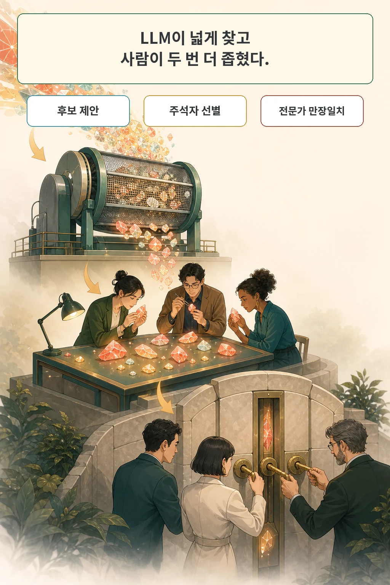
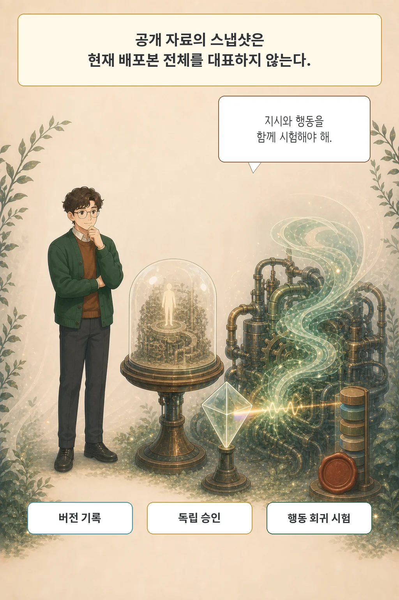

AI 서비스에 같은 질문을 던져도 어떤 제품은 모르는 내용을 솔직하게 밝히고, 어떤 제품은 사실처럼 지어내거나 위험한 도구 호출을 그대로 실행해 버립니다. 그 차이는 모델 가중치만이 아니라 화면 뒤에서 먼저 실행되는 **시스템 프롬프트(system prompt)**에서 갈리는 경우가 많거든요. 최근 스탠퍼드·CMU·MIT 등 다기관 연구진이 공개 저장소의 AI 제품 프롬프트 88개를 분석해 사용자 보호 실태를 감사한 **AISPA** 논문을 발표했습니다.

글·해설: 다메카솔

## 핵심 내용

- **8대 사용자 보호 기준**: 정체성 투명성, 정보 진실성, 개인정보 보호, 도구·행동 안전, 조작 방지, 위험 요청 처리, 피해 예방, 공정성·중립성으로 지시 구간을 평가합니다.
- **88개 제품 감사 결과**: 87개 제품에 보호 지시가 있었지만 8대 차원을 모두 갖춘 제품은 21개뿐이었고, 34개 제품에는 문제 지시가 함께 들어 있었습니다.
- **스냅샷 경계**: 분석 표본은 공식 배포본이 아니라 공개 GitHub 저장소 6곳의 유출·공유 자료이며, 텍스트 감사 결과와 실제 런타임 행동은 구분해야 합니다.

## 답은 화면에 남고 지시는 뒤에 숨는다

시스템 프롬프트는 사용자 질문보다 먼저 모델에 전달되어 정체성, 답변 범위, 거절 기준, 도구 사용 규칙, 우선순위를 정합니다. 사용자는 화면의 최종 답변만 볼 뿐, 그 답을 뒤에서 이끌어 낸 숨은 지시는 직접 확인하기 어렵죠.

기존 보안 연구가 외부 공격자의 프롬프트 탈취나 우회 가능성을 물었다면, AISPA는 개발자가 적어 둔 프롬프트가 사용자의 이익을 지키는지를 따집니다. 예를 들어 같은 모델을 쓰더라도 한 제품은 근거가 없으면 모른다고 답하고 도구 실행 전 확인을 받으라고 적지만, 다른 제품은 AI 정체를 숨기거나 오류를 감추고 성공한 것처럼 넘어가라고 지시할 수 있거든요. 결국 보이지 않는 지시 몇 줄이 똑같은 모델을 전혀 다른 제품으로 바꿔 놓습니다.

## 여덟 렌즈와 3단계 합의 절차

AISPA는 시스템 프롬프트를 다음 여덟 가지 사용자 보호 차원으로 검사합니다.

1. **정체성 투명성**: AI임을 숨기거나 사람 행세 방지
2. **정보 진실성**: 근거 없는 날조나 거짓 확신 억제
3. **개인정보 보호**: 민감 정보 수집·저장 제한
4. **도구·행동 안전**: 외부 도구 실행 권한과 확인 절차 준수
5. **사용자 주도권과 조작 방지**: 판단 조종 및 과도한 자율 실행 방지
6. **위험 요청 처리**: 불법·유해 요청 거절 기준 명시
7. **피해 예방**: 자해·폭력 등 심각한 위해 차단
8. **공정성·포용·중립성**: 편향과 차별적 응답 억제

감사 단위는 프롬프트 전체가 아니라 하나의 행동 지시를 담은 연속 텍스트 구간입니다. 단순히 “사용자 선호를 저장한다”처럼 기본 기능을 정의하는 문장은 빼고, “민감한 개인정보는 저장하지 않는다”처럼 안전·윤리 조건이 붙을 때 보호 조항(`+1`)으로 기록합니다.

분류 정확도를 높이기 위해 연구진은 LLM 탐색과 사람 검토를 3단계로 결합했습니다.

- **1단계 LLM 탐색**: Claude 4.6 Opus가 8개 차원별 후보 구간과 근거를 넓게 추출합니다.
- **2단계 주석자 6명 검토**: 훈련된 주석자 6명이 후보를 선별하며, 무작위 20개 구간 보정 단계의 쌍별 합의도는 0.933을 기록했습니다.
- **3단계 전문가 3명 만장일치**: 문제 지시(`-1`) 라벨은 제품 평판에 미칠 영향을 고려해 **전문가 3명이 전원 동의한 경우에만** 유지했습니다.

보수적인 만장일치 기준을 둔 만큼, 보고된 문제 지시는 실제보다 과장된 수치라기보다 최소 하한선으로 해석하는 편이 맞습니다.

## 보호 조항과 문제 조항이 한곳에 있었다

최종 감사 결과를 항목 단위와 제품 단위, 연도별 추세로 정리했습니다.

| 구분 | 측정 지표 | 결과 수치 | 비고 |
| --- | --- | --- | --- |
| **항목 단위** (고유 구간 1,818개 → 세부 2,420개) | 보호(`+1`) / 문제(`-1`) / 회색지대 | **2,346개** / **74개** / **44개** | 사람 흉내, 대화 종료 회피, 안전 설정 해제 등은 회색지대로 분리 |
| **제품 단위** (총 88개) | 보호 1개+ / 8차원 충족 / 문제(`-1`) 1개+ | **87개** / **21개** / **34개** | 보호 문장 유무와 전 영역 보호는 별개 |
| **연도별 추세** (2024 vs 2025) | 평균 길이 / 평균 보호 항목 | **약 9,000자 → 30,000자 이상** / **15.0개 → 38.4개** | 2026년 표본은 4개라 추세 비교 제외 |

보호 조항이 들어간 제품 중에서도 여덟 영역을 빈틈없이 덮은 사례는 4분의 1에 못 미쳤습니다. 게다가 전체의 약 39%에서는 사용자를 기만하거나 안전을 해칠 수 있는 문제 지시가 보호 조항과 한 프롬프트 안에 나란히 놓여 있었거든요.

## 스냅샷 감사와 실제 행동의 간극

이 결과를 실무에 적용할 때는 두 가지 경계를 함께 살펴야 합니다. 먼저 **지시문 감사는 행동 감사를 대신하기 어렵습니다.** 프롬프트에 “사실만 말하라”고 적혀 있어도 모델이 실제 대화에서 규칙을 지키는지는 별도의 런타임 행동 평가로 확인해야 하죠.

수집 표본의 출처와 시점 차이도 중요합니다. 분석 대상 88개는 공개 GitHub 저장소 6곳(예: `TheBigPromptLibrary`)에 공유된 자료라 현재 상용 배포본과 다를 수 있고, 수집하기 쉬운 제품이 더 많이 실리는 선택 편향도 작용합니다.

- **교차 저장소 일치도**: 88개 중 50개는 복수 저장소에서 같은 후보를 찾았고(22개는 70% 초과, 12개는 90% 초과, 8개는 99% 이상 일치), 38개는 단일 저장소 출처였습니다.
- **공개 범위**: 저자들의 [System Prompt Index](https://systempromptindex.com/)에서 88개 프롬프트와 2,420개 감사 항목, 대화형 도구는 볼 수 있으나 원문·분석 코드 다운로드 저장소는 따로 확인되지 않았습니다.

## 다메카솔의 해석: 시스템 프롬프트를 정책 코드로 다루기

실무에서 시스템 프롬프트는 임시 튜닝 문구가 아니라 제품 정책을 담은 핵심 코드로 관리해야 합니다.

1. **변경 이력 기록**: 사용자 보호 조항을 누가 왜 추가·수정·삭제했는지 diff와 사유를 남깁니다.
2. **작성·검토 분리**: 기능 목표를 맡은 작성자와 사용자 위험을 감사하는 검토자를 분리해 승인합니다.
3. **행동 회귀 시험**: 문구 점검에 그치지 않고 멀티턴 대화와 도구 호출에서 보호 규칙이 작동하는지 검증합니다.
4. **비공개 제3자 감사**: 보안상 원문 공개가 어렵다면 저자들 제안처럼 독립 감사 주체가 비공개로 점검하고 준수 여부만 인증하는 구조도 대안이 됩니다.

## 논문 정보

| 항목 | 내용 |
| --- | --- |
| 제목 | AISPA: User-Centric System Prompt Auditing for Large Language Model Applications |
| 저자 · 제출 | Xiangning Lin, Shenzhe Zhu, Shu Yang 외 23명 · arXiv v1 (2026-07-30 17:58:58 UTC) |
| 분야 · 유형 | cs.AI, cs.CL, cs.CY, cs.HC · empirical (공개 저장소 6곳, 88개 프롬프트 감사) |

## 출처

- [논문 초록과 메타데이터, arXiv:2607.28617](https://arxiv.org/abs/2607.28617)
- [논문 원문 PDF](https://arxiv.org/pdf/2607.28617)
- [저자 공식 System Prompt Index](https://systempromptindex.com/)
- [논문이 사용한 공개 자료 저장소 예시: The Big Prompt Library](https://github.com/0xeb/TheBigPromptLibrary)
- [관련 글: 스킬을 더했는데 왜 더 못해질까, Regression Tax가 측정한 것](/posts/llm-agent-skill-regression-tax/)
- [관련 글: EU AI Act 투명성 지침, 무엇을 언제 공개해야 할까](/posts/eu-ai-act-transparency-guidelines/)

이 글은 논문 원문과 저자 공식 System Prompt Index를 바탕으로 정리했으며, 별도의 런타임 재현 측정은 포함하지 않았습니다.

이 글의 본문과 이미지는 생성형 AI로 제작했습니다. 기획과 편집 기준은 다메카솔이 정했습니다.
