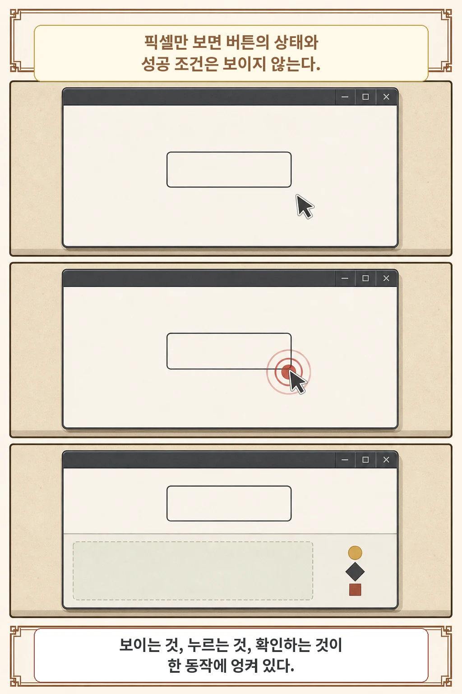
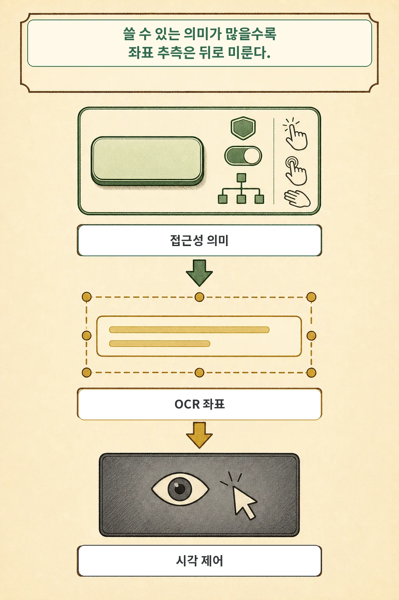
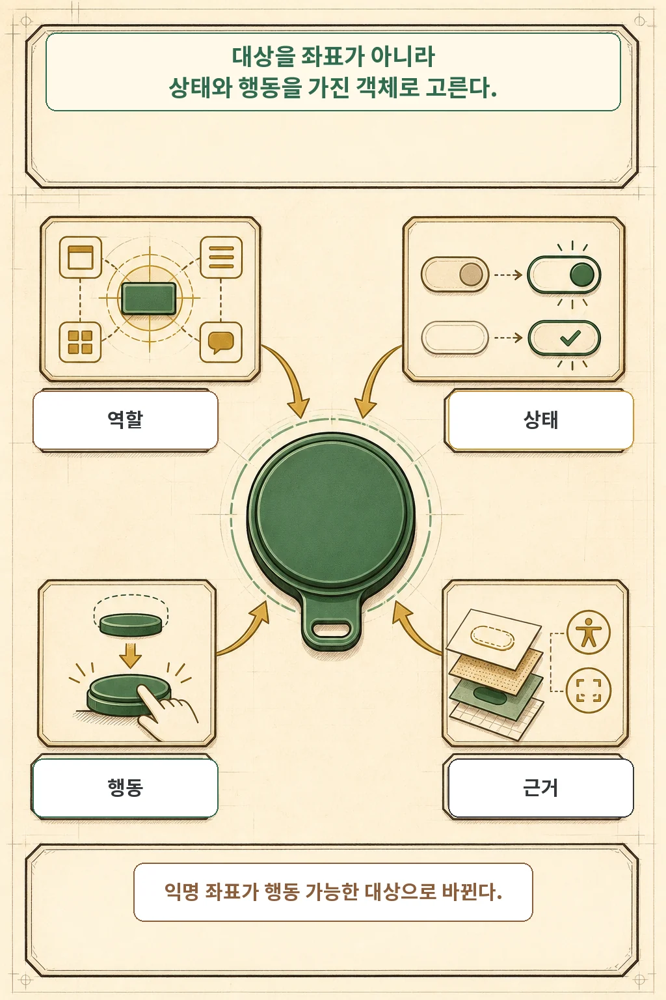
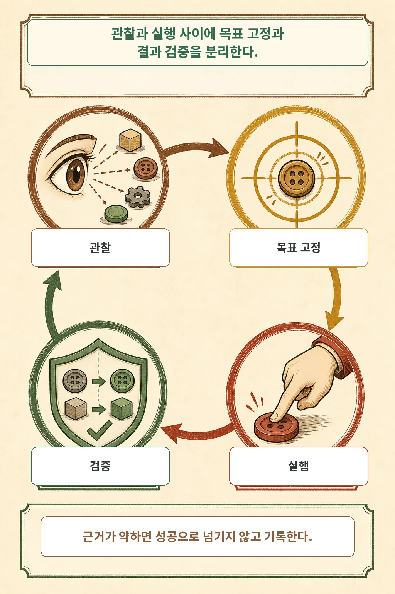

데스크톱 화면을 직접 조작하는 Computer Use 에이전트를 붙여 보면, 버튼을 몇 픽셀 빗맞히거나 아직 비활성화(Disabled)된 버튼을 계속 누르는 모습을 자주 보게 됩니다. 실패한 뒤에도 좌표가 틀린 건지, 앱 응답이 늦은 건지, 이미 처리된 건지 원인을 가르기 어렵죠.

글·해설: 다메카솔

시스템 논문 「Tactile: Giving Computer-Using Agents Hands and Feet」는 OS 접근성 트리(Accessibility Tree)를 1순위로 읽고 OCR과 시각 제어를 단계적으로 결합하는 오픈소스 MCP 도구 계층을 제안했습니다. 새 모델을 학습하는 대신, 에이전트에게 구조화된 UI 상태와 검증 가능한 실행 도구를 쥐여 주는 접근입니다.

## 스크린샷 기반 GUI 조작이 실패하는 이유



사람은 화면을 볼 때 버튼이 지금 눌릴 수 있는 상태인지와 클릭 뒤 어떤 변화가 나올지 함께 파악합니다. 반면 순수 비전(VLM) 에이전트는 '보내기'라는 글자를 읽더라도 활성 여부나 포커스 대상, 네이티브 실행 지원 여부를 픽셀만으로 판별하기 어렵습니다.

- **대상의 모호함**: 캡처 압축이나 Retina 배율 환산 과정에서 텍스트가 뭉개지고 클릭 좌표가 어긋납니다.
- **상태 정보 부재**: 회색 비활성 버튼이나 로딩 중인 컨트롤을 색감만으로 구분하기 어려워 헛클릭을 반복합니다.
- **검증 루프 단절**: 클릭 뒤 모달이 닫혔는지 확인할 기준이 따로 없어 실패 원인을 추적하기 어렵습니다.

결국 대상 선택과 실행, 결과 확인이 클릭 한 번에 엉켜 있으니 장애가 나도 어디를 고쳐야 할지 막막해집니다.

## 접근성 우선(Accessibility-first) 3단계 사다리



그렇다고 시각 모델을 완전히 버리고 접근성 API만 쓰기에는 현실의 데스크톱 앱에 트리가 비어 있거나 오래된 노드가 섞인 구간이 많거든요. Tactile은 증거 신뢰도에 따라 세 층의 운영 사다리를 타고 내려가는 방식을 택했습니다.

1. **1순위, OS 접근성 의미(Accessibility API)**: macOS Accessibility API(Windows는 초기 지원 단계의 UI Automation)에서 역할·상태·`AXPress` 같은 네이티브 액션을 조회해 마우스 이동 없이 OS 이벤트로 실행합니다.
2. **2순위, OCR 좌표**: 접근성 정보가 부족하거나 웹뷰 비중이 큰 영역에서는 로컬 OCR로 텍스트 바운딩 박스와 중심점을 뽑아 출처 라벨과 함께 타깃팅합니다.
3. **3순위, 시각 제어(Visual Fallback)**: 타임라인·캔버스·아이콘 전용 위젯처럼 접근성과 텍스트 근거가 모두 약한 구간에서만 스크린샷 좌표 예측으로 내려갑니다.

에이전트는 플랫폼 API를 직접 다루지 않고 표준 MCP 도구(`get_app_state`, `click`, `type_text` 등)로 이 사다리를 일관되게 호출합니다.

## 좌표 `(x, y)` 대신 행동 가능한 UI 객체로 묶기



핵심 관찰 도구인 `get_app_state`는 관찰 모드(`ax`, `ax_ocr`, `ax_ocr_visual`)에 맞춰 여러 신호를 압축한 **UI 후보 객체**로 정리하며, 모든 좌표를 macOS 좌상단 화면 포인트로 정규화해 Retina 배율 혼선을 줄입니다. 아래 예시는 후보 객체가 담는 핵심 계약 구조를 요약한 형태입니다.

```json
{
  "target": "Submit Button",
  "source": "Accessibility_API",
  "state": { "visible": true, "enabled": true, "focused": false },
  "supported_actions": ["Native_Press", "Click"],
  "verification_hint": "Check if Dialog Closed"
}
```

예를 들어 논문에 기록된 Zoom 회의 예약 사례에서는 초기 화면의 필터링된 접근성 후보가 52개였지만, 예약 대화상자와 날짜 선택기가 열리면서 요소가 최대 468개까지 불어났는데요. Tactile은 가시성과 활성 상태 기준으로 핵심 후보만 추려 모델에 넘기고, 원본 전체 상태는 별도 트레이스 로그에 남겨 사후 디버깅을 지원합니다.

## 관찰·목표 고정·실행·검증의 4단계 통제 루프



후보를 확보한 뒤에는 단발성 클릭으로 끝내지 않고 네 단계 통제 루프로 실행과 확인을 분리합니다.

1. **관찰(Observe)**: 활성 앱의 접근성 노드와 OCR, 필요시 시각 정보를 모아 상태 요약을 구성합니다.
2. **목표 고정(Target/Ground)**: 출처와 상태가 가장 분명한 UI 후보를 실행 단계와 분리해 선택합니다.
3. **실행(Act)**: 안전한 네이티브 OS 이벤트를 우선 호출하고, 불가피할 때만 좌표 클릭이나 키보드 입력으로 내려갑니다.
4. **검증(Verify)**: 실행 직후 화면과 상태 트리를 재조회해 대화상자 닫힘 같은 변화를 확인하고, 근거가 약하면 성공으로 넘기지 않고 기록합니다.

## macOSWorld 예비 평가와 적용 한계

저자들은 macOSWorld 계열 과제를 100단계 안에 끝내는 비율(`Success@100`)로 예비 평가를 진행했습니다. Codex 채점 표본과 96개 교차 에이전트 하위집합을 함께 보면, 접근성 구조가 살아 있는 과제에서 개선 폭이 훨씬 뚜렷한 편입니다.

| 평가 구분 | 에이전트 | 기본 | Tactile 결합 | 변화 |
| --- | --- | --- | --- | --- |
| 전체 채점 표본 | Codex | 41.06% | 50.00% | +8.94%p |
| AX 지원(AX-adapted) | Codex | 45.22% | 55.26% | +10.04%p |
| AX 제한(Limited-AX) | Codex | 27.78% | 33.33% | +5.55%p |
| 96개 교차(상한) | Codex | 38.54% | 50.00% | +11.46%p |
| 96개 교차(상한) | Claude Code | 33.33% | 43.75% | +10.42%p |
| 96개 교차(상한) | OpenCode | 33.33% | 40.62% | +7.29%p |
| 96개 교차(상한) | Goose | 41.67% | 43.75% | +2.08%p |

다만 96개 교차 에이전트 하위집합의 결합 점수는 학습된 라우팅 정책이 아니라 기본(no-skill)·암묵적·명시적 호출 중 과제별 최선 결과를 취한 상한(upper bound)입니다. 현재 구현과 평가가 macOS 중심이며, CapCut 타임라인이나 WeChat 미디어 영역처럼 시각 비중이 큰 앱에서는 폴백 비용과 좌표 모호성이 다시 커진다는 한계도 감안해야 합니다.

## 다메카솔의 해석, RPA와 AI 에이전트가 만나는 지점

사내 업무 자동화(RPA)나 데스크톱 에이전트를 설계할 때 Tactile이 남기는 실무 기준은 세 가지로 압축됩니다.

- **시각 모델 남용 줄이기**: 매 스텝 화면 전체를 VLM에 보내면 토큰 비용과 지연 시간이 급증하므로, OS 접근성 메타데이터를 1차 인터페이스로 쓰고 시각 모델은 의미가 빈 구간에만 투입해야 합니다.
- **웹·앱 접근성(a11y)이 곧 에이전트 호환성**: `button`, `aria-label` 같은 표준 접근성 속성을 충실히 갖춘 화면일수록 스크린 리더 사용자뿐 아니라 AI 에이전트도 오동작 없이 조작할 수 있습니다.
- **실행 직후 상태 검증 내재화**: DOM이나 접근성 트리 변화를 바로 확인하고 미확인 상태를 별도로 남기는 루프가 있어야 무한 클릭 장애를 막을 수 있습니다.

## 함께 읽을 AI 시스템 글

- [AI 코딩 에이전트 작업 공간 격리(Orca)와 권한 통제](/posts/orca-ai-coding-agent-workspaces/)
- [LLM 에이전트 스킬 주입과 회귀(Regression Tax) 방어 전략](/posts/llm-agent-skill-regression-tax/)

## 출처

- [Tactile: Giving Computer-Using Agents Hands and Feet, arXiv:2607.14443](https://arxiv.org/abs/2607.14443)
- [Tactile Official GitHub Repository](https://github.com/yliust/Tactile)

이 글은 arXiv v1 논문 원문과 공식 저장소 문서를 바탕으로 정리했으며, 별도 실행이나 성능 재현은 포함하지 않았고 본문 그림과 표는 새로 구성했습니다.

이 글의 본문과 이미지는 생성형 AI로 제작했습니다. 기획과 편집 기준은 다메카솔이 정했습니다.
