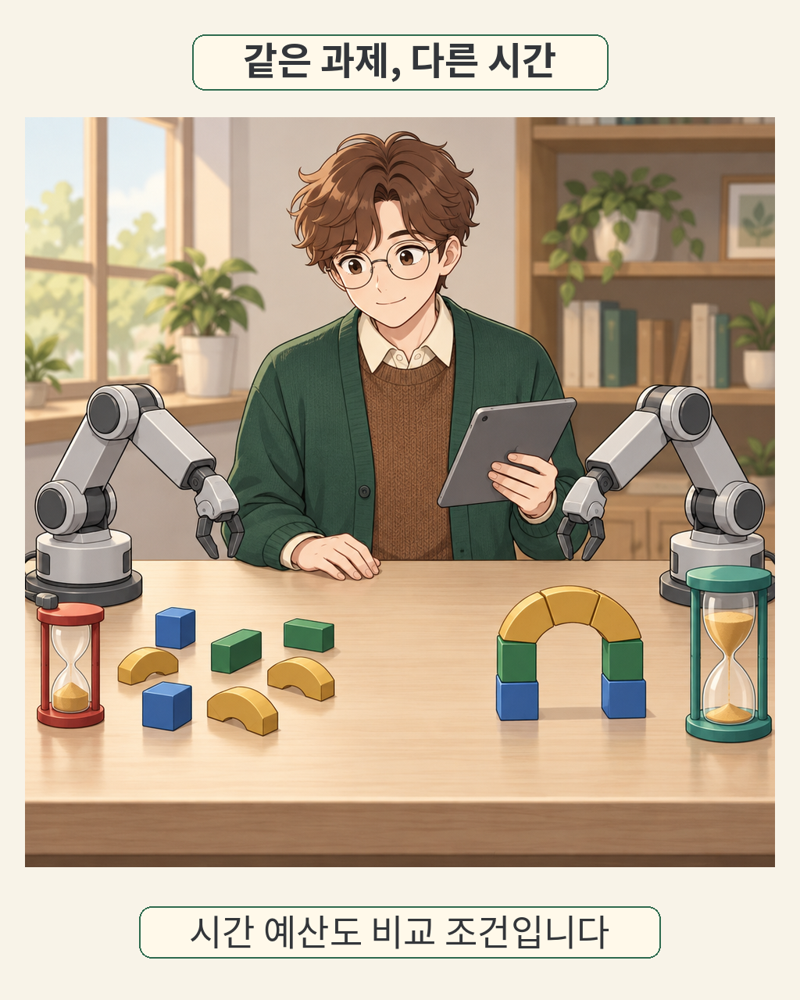

Terminal-Bench 2.0과 2.1에서 같은 에이전트의 점수가 달라진 이유는 과제와 채점기가 수정되었기 때문입니다. 논문 「Benchmarks as Software」의 저자들은 TB2.0의 89개 과제 중 28개에서 문제를 찾아 수정한 TB2.1을 공개했습니다. 코딩 에이전트 성능표를 읽을 때 벤치마크 버전과 실행 조건을 함께 살펴봐야 하는 이유입니다.

글·해설: 다메카솔

그림은 원리를 설명하는 가상의 장면이며, 논문의 실제 실험 장면이나 측정값이 아닙니다.

## 지시문이 빠뜨린 조건을 채점기가 요구한다면

좋은 답을 만들었는지와 채점기를 통과했는지는 언제나 같은 질문이 아닙니다. 지시문과 채점기가 어긋나거나, 외부 패키지와 API가 바뀌거나, 실행 자원이 부족하면 점수가 원래 측정하려던 능력에서 멀어질 수 있습니다. 논문은 이런 간극을 벤치마크 유지보수 부채로 설명합니다.

query-optimize 과제가 구체적인 예입니다. 채점기는 데이터베이스 파일을 바이트 단위까지 보존하도록 요구했지만, 원래 지시문에는 그 제약이 빠져 있었습니다. 저자들은 이를 지시문에 명시하는 방식으로 고쳤습니다. 단순히 채점을 느슨하게 한 사례로 읽으면 수정의 의미를 놓치게 됩니다.

## 같은 에이전트도 벤치마크 버전에 따라 점수가 달라졌다

저자들은 동일한 19개 에이전트를 TB2.0과 TB2.1의 기본 프로토콜로 다시 평가했습니다. 전체적인 순위 순서는 대체로 유지됐지만, 개별 에이전트 점수는 최대 12%p까지 움직였습니다. 여기서 %p는 두 정확도의 차이를 나타내며, 상대적인 증가율을 뜻하지 않습니다.

핵심은 모든 에이전트가 좋아졌다는 결론이 아닙니다. 채점기가 놓치던 유효한 해법을 인식하면 점수가 오를 수 있고, 잘못 통과시키던 해법을 거르면 내려갈 수도 있습니다. 따라서 서로 다른 벤치마크 버전의 점수를 바로 붙여 모델의 능력 차이라고 해석하기는 어렵습니다.

## 시간 예산도 측정 조건이다

별도 실험에서 저자들은 제한 시간을 원래의 최대 32배까지 늘렸습니다. 벤치마크 가이드라인을 의도적으로 벗어난 조건이며, 비용 때문에 일부 에이전트에만 적용했습니다. 32배는 상한이므로 작업이 끝나면 조기에 종료할 수 있었습니다.

TB2.1에서 같은 GPT 5.4 모델을 Codex와 Terminus-2 하네스로 실행한 비교에서는, 기본 시간 제한에서 컸던 성능 격차가 시간을 늘리자 대부분 사라졌습니다. 하네스는 모델을 둘러싸고 도구 호출과 실행을 관리하는 프로그램입니다. 저자들은 이 결과가 해당 조건에서의 속도 차이를 시사한다고 해석합니다. 모든 모델이나 하네스에 그대로 일반화할 근거는 아닙니다.

가장 큰 예산 조건에서도 소형 모델은 타임아웃이 남는 예외였습니다. 나머지 구성에서 타임아웃이 거의 사라진 뒤에도 실패가 남았다는 점은, 시간만 늘리면 모든 과제가 풀린다는 결론과 구분해야 합니다.

이 그림도 가상의 설명입니다. 같은 능력을 가정한 로봇이라도 주어진 시간이 다르면 완성 상태가 달라질 수 있음을 보여 줍니다.

## 성능표를 읽는 독자가 확인할 것

다음은 논문의 버전 관리와 예산 민감도 논의에서 도출한 다메카솔의 해석입니다.

- 벤치마크 버전이 같은지 확인합니다.
- 모델을 실행한 하네스와 도구 구성이 같은지 확인합니다.
- 시간과 자원 예산이 같은지 확인합니다.

위 결과는 원저자들의 평가이며, 이 글에서 벤치마크를 독립 재현한 결과는 아닙니다. TB2.1 역시 저자들이 말하는 지속적 유지보수의 한 시점입니다. 점수 차이를 해석하기 전에 무엇을 어떤 조건으로 측정했는지 묻는 것이 이 글의 실용적인 결론입니다.

## 출처

- [Benchmarks as Software: Terminal-Bench and the Case for Continuous Benchmarks](https://arxiv.org/abs/2611.08417v1) — arXiv v1, 2026-11-05
- [Terminal-Bench 2.1 공식 저장소](https://github.com/harbor-framework/terminal-bench-2-1)

이 글의 본문과 이미지는 생성형 AI로 제작했습니다. 기획과 편집 기준은 다메카솔이 정했습니다.
