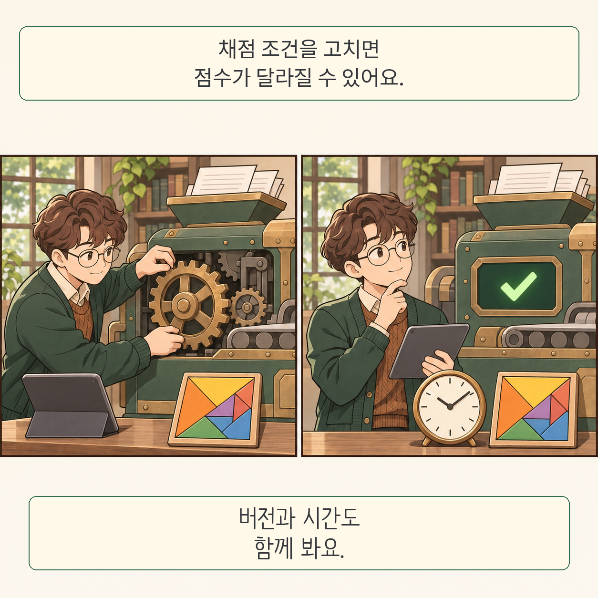

Terminal-Bench 2.1 연구는 AI 성능표의 점수가 채점 코드와 실행 조건에도 좌우된다는 사실을 보여줍니다. 정답을 틀렸다고 처리하거나, 실행 환경이 깨지면 모델의 능력과 다른 실패를 셉니다.

글·해설: 다메카솔

## 시험도 유지보수가 필요하다

연구진은 사용자 신고와 실행 기록을 모으고, 기준 해답을 다시 돌려 결함을 확인했습니다. 에이전트가 수정안을 제안하되 유지보수자가 검토하는 절차입니다. 조건과 채점의 불일치, 변한 외부 의존성, 부족한 실행 자원을 구분합니다.

## 점수 변화가 곧 능력 향상은 아니다

19개 에이전트를 TB2.0과 TB2.1에서 비교한 순위 상관은 0.958로 높았습니다. 그래도 개별 점수는 최대 12퍼센트포인트, 순위는 최대 세 계단 움직였습니다. 채점 버전이 달라진 비교를 모델 학습의 성과로 읽어서는 안 됩니다.

## 시간도 시험 조건이다

과제의 기본 시간 제한을 최대 32배까지 늘린 실험에서는 일부 하네스 격차가 줄었습니다. 하네스는 모델이 도구를 쓰도록 연결하는 실행 프로그램입니다. 시간이 늘어도 끝내 풀지 못한 과제는 남았습니다.

## 어디까지 확인했나

감사 도구가 수정 대상 집합을 만드는 데 참여했으므로, 그 집합과 잘 맞는다는 결과는 독립적인 결함 발견 성능과 다릅니다. 이 글은 벤치마크를 직접 재현하지 않았습니다.

다메카솔의 해석: 비교표에는 모델 이름과 함께 벤치마크 버전, 하네스, 시간 예산을 적어야 판단하기 쉽습니다. [ServerBench의 서버 평가](/posts/serverbench-qualified-serving/)가 구현의 검증을 묻는다면, 이번 연구는 시험 자체의 검증을 묻습니다.

## 출처

- [논문 v1](https://arxiv.org/abs/2611.08417v1), 2026년 11월 5일 공개, §3–8.
- [공식 코드](https://github.com/harbor-framework/terminal-bench-2-1). 확인일 2026년 11월 6일. README의 수정 과제 수와 논문의 감사 대상 수는 다르게 기재되어 있어 합쳐 쓰지 않았습니다.

이 글의 본문과 이미지는 생성형 AI로 제작했습니다. 기획과 편집 기준은 다메카솔이 정했습니다.
