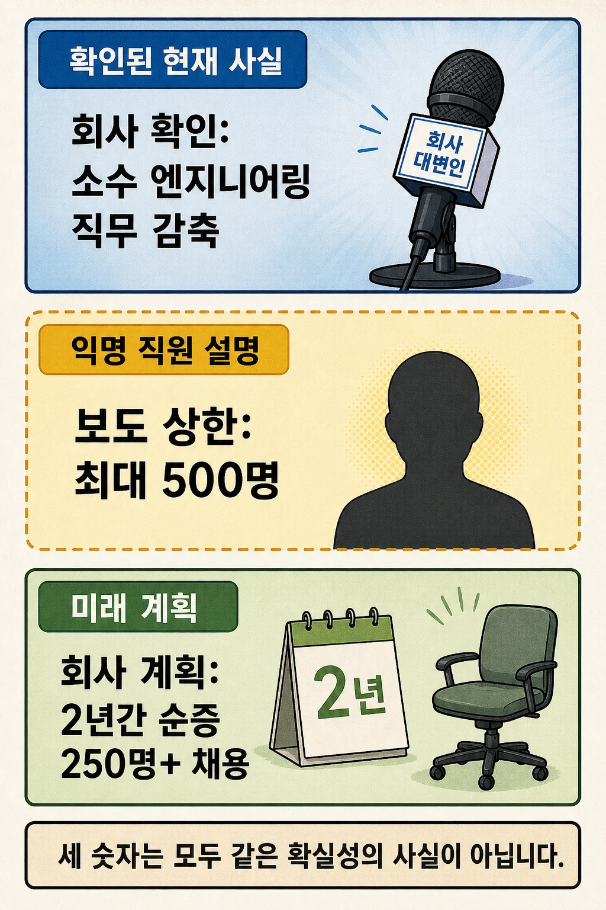
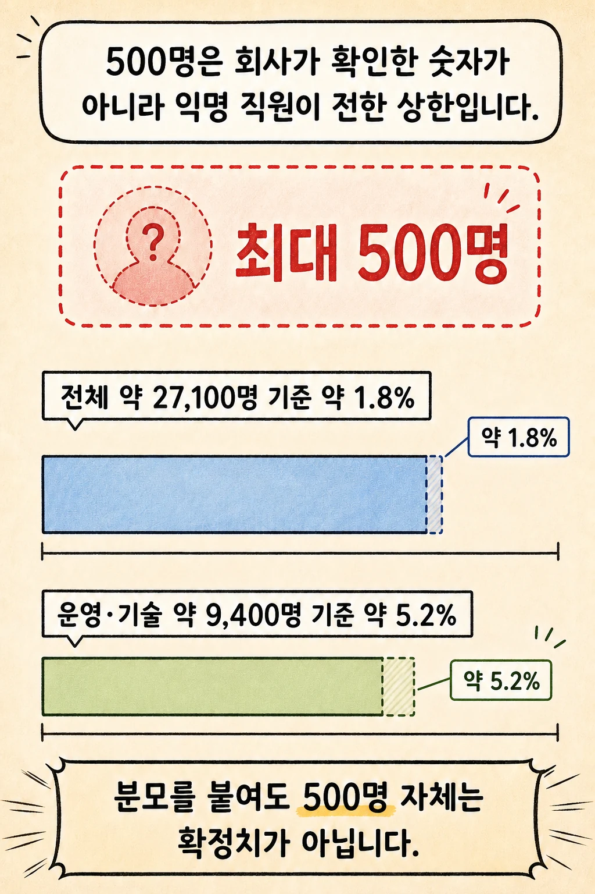
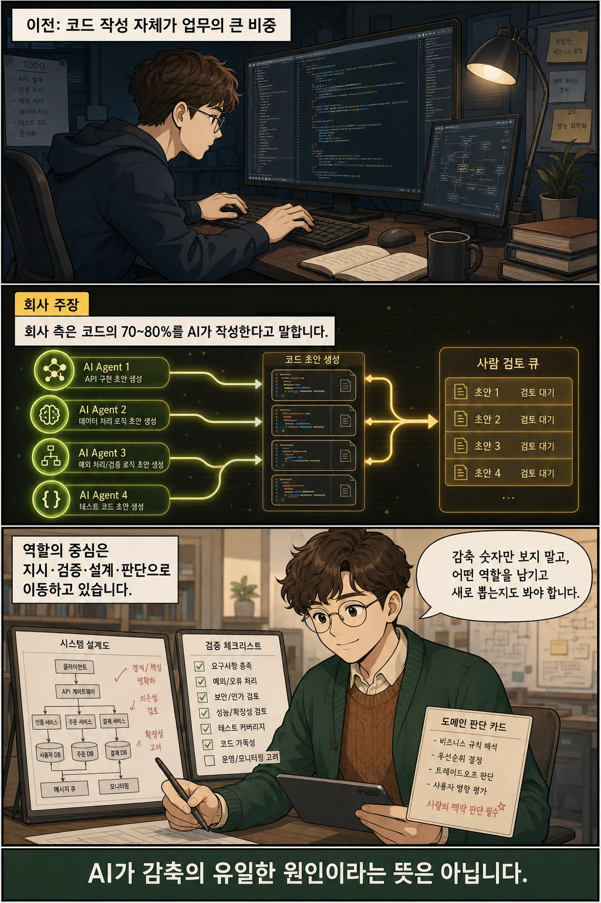

"AI 코딩 도입으로 톰슨로이터가 엔지니어 500명을 구조조정했다"는 헤드라인만 보면, 코드 자동화가 곧바로 대규모 해고로 이어진 것처럼 읽히기 쉽습니다. 그런데 2026년 7월 13일 Reuters 보도를 뜯어보면 공식 확인과 익명 제보, 앞으로의 채용 계획이 한 기사 안에 섞여 있거든요. 실제로 확인된 사실이 어디까지이고, 이번 재편이 개발자 역할 변화와 어떻게 맞물리는지 정리해 보겠습니다.

글·해설: 다메카솔

## 세 숫자는 같은 무게의 사실이 아니다

이번 뉴스가 자극적으로 소비된 이유는 확실성이 서로 다른 정보가 한 문장에 묶였기 때문입니다. 톰슨로이터(Thomson Reuters)는 Reuters News의 모회사이지만, 별도 보도자료로 감축 인원을 공개한 상태는 아니므로 출처와 시점별로 구분해 읽어야 합니다.

| 구분 | 보도 및 공식 내용 | 확실성과 시점 |
| --- | --- | --- |
| 회사 대변인 확인 | 법률·세무·규제 전환에 맞춘 엔지니어링 소수 직무 감축 | 현재 진행(공식 확인) |
| 익명 직원 제보 | 전 세계 기술 부문 대상, 최대 500명 감축 가능성(회의 전언) | 미확정 보도 상한 |
| 회사 공식 계획 | 시니어·AI 중심 엔지니어링 직무 250개 이상 순증 채용 | 향후 2년 미래 계획 |

'최대 500명'은 기술 부문 직원 회의에 참석했다는 익명 직원이 전한 미확정 상한선이며, '250명 이상 순증(Net-new) 채용' 역시 앞으로 2년에 걸쳐 추진할 계획입니다. 따라서 두 숫자를 단순 계산으로 맞붙이기보다 각 출처와 조건을 함께 챙겨 봐야 합니다.

## 최대 500명에 조직 분모를 붙여 보면

인력 조정 보도를 읽을 때는 분자만 떼어 보기보다 조직 전체 크기를 함께 놓아야 규모 감각이 잡힙니다. 톰슨로이터 2025년 연차보고서에 기록된 인원을 분모로 두면 Reuters 계산 기준 비율은 아래 범위로 나옵니다.

- **전체 직원 기준(2025년 말 약 27,100명)**: 상한 500명 가정 시 약 1.8%
- **운영·기술(Operations & Technology) 조직 기준(약 9,400명)**: 상한 500명 가정 시 약 5.2%

연차보고서 인원 자체가 반올림된 근사치인 데다 분자에 놓인 500명도 아직 미확정 상한에 머물러 있습니다. 이 비율은 대략적인 규모를 가늠하는 참고선으로 두고, 실제 감축 인원과 250명 채용 이행 여부는 후속 공개를 확인해야 합니다.

## 감축과 AI 중심 채용이 동시에 나오는 배경

톰슨로이터 대변인은 고객의 법률·세무·규제 업무 기대가 달라지면서 핵심 영역에 역량을 집중하는 과정이라고 설명했습니다. 이 흐름은 2026년 6월 최고운영기술책임자(CTO)가 공개한 기고 「The AI Era is Here」와도 이어지는데요. 회사 측은 사내 엔지니어가 다루는 코드의 70~80%를 AI가 작성한다고 밝히며, 엔지니어의 무게중심이 에이전트 지시와 결과 검토, 아키텍처 결정으로 옮겨 갈 것이라고 내다봤습니다.

물론 70~80%는 외부 감사를 거친 수치가 아니라 회사 임원 기고에 담긴 자체 설명이며, 공개 자료만으로 AI를 이번 감축의 유일한 원인으로 단정하기도 어렵습니다. 다만 기존 구현 직무를 조정하면서 시니어·AI 중심 인력을 순증 채용하려는 구도는 조직이 원하는 역량의 방향을 분명히 보여 줍니다.

예를 들어 법률이나 세무 데이터를 처리하는 백엔드 팀에서 AI 코딩 도구로 새 API와 테스트 초안을 반나절 만에 뽑아내는 상황을 떠올려 볼까요? 보일러플레이트나 단순 CRUD 코드를 작성하는 시간은 크게 줄어들지만, 도메인별 규제 예외와 권한 경계, 동시성 오류까지 AI가 자동으로 보장해 주지는 않습니다. 결국 배포 직전 단계에서 생성된 코드를 걸러 내고 시스템 안전성을 판단하는 검토 부담이 사람 쪽으로 집중되는 셈이죠.

## 다메카솔의 해석: 직무 재편 앞에서 점검할 4가지 역량

이번 사례는 개발자 일자리가 통째로 사라진다기보다, 팀 안에서 가치 있게 평가받는 업무 비중이 이동하는 흐름에 가깝습니다. 코드를 직접 작성하는 비중이 줄수록 실무에서는 아래 네 가지 역량이 차이를 만듭니다.

1. **초안 생성에서 코드 리뷰·검증으로** — AI가 작성한 코드의 엣지 케이스, 동시성 버그, 보안 취약점을 짚어내고 병합 기준을 지키는 안목
2. **단일 모듈에서 시스템 아키텍처 설계로** — DB, 메시지 큐, 클라우드 인프라와 여러 AI 도구·에이전트가 맞물린 흐름의 트레이드오프를 설계하는 힘
3. **범용 구현에서 도메인 전문성으로** — 법률·세무·금융처럼 오류 비용이 큰 영역의 규칙을 해석해 코드와 검증 조건에 녹여 내는 판단력
4. **작성 속도에서 운영 책임과 거버넌스로** — 장애 발생 시 근본 원인(RCA)을 규명하고 배포 권한과 재발 방지책을 세우는 오너십

감축 보도와 채용 계획이 나란히 들릴 때는 자극적인 총량 숫자보다, 조직이 어떤 역할을 줄이고 어떤 역량을 새로 구하는지 함께 살펴보는 편이 실무 판단에 도움이 됩니다. AI 시대 일의 의미와 인간의 사고 주도권을 더 넓게 보려면 [AI가 일하는 시대, 노동과 소외의 의미 재정의](/posts/ai-work-meaning-alienation-action/)와 [AI에게 생각을 맡기면 인간은 덜 생각하게 될까](/posts/ai-thinking-cognitive-offloading-philosophy/)도 함께 읽어 볼 만합니다.

## 출처

- [Reuters News — Thomson Reuters to cut 'small number' of engineering jobs (2026-07-13)](https://www.investing.com/news/stock-market-news/thomson-reuters-to-cut-small-number-of-engineering-jobs-4789191)
- [Thomson Reuters — Annual Report 2025 (2026-03-05)](https://ir.thomsonreuters.com/static-files/d4676c84-359c-42c3-9f84-8c62552d49a2)
- [Thomson Reuters — The AI Era is Here (2026-06-04)](https://insight.thomsonreuters.com/sea/legal/posts/the-ai-era-is-here)

이 글은 Reuters 보도와 Thomson Reuters의 공식 연차보고서·임원 기고를 바탕으로 정리했으며 별도의 사내 조사나 수치 검증은 포함하지 않았고, 만화 그림은 이해를 돕기 위해 새로 구성했습니다.
이 글의 본문과 이미지는 생성형 AI로 제작했습니다. 기획과 편집 기준은 다메카솔이 정했습니다.
