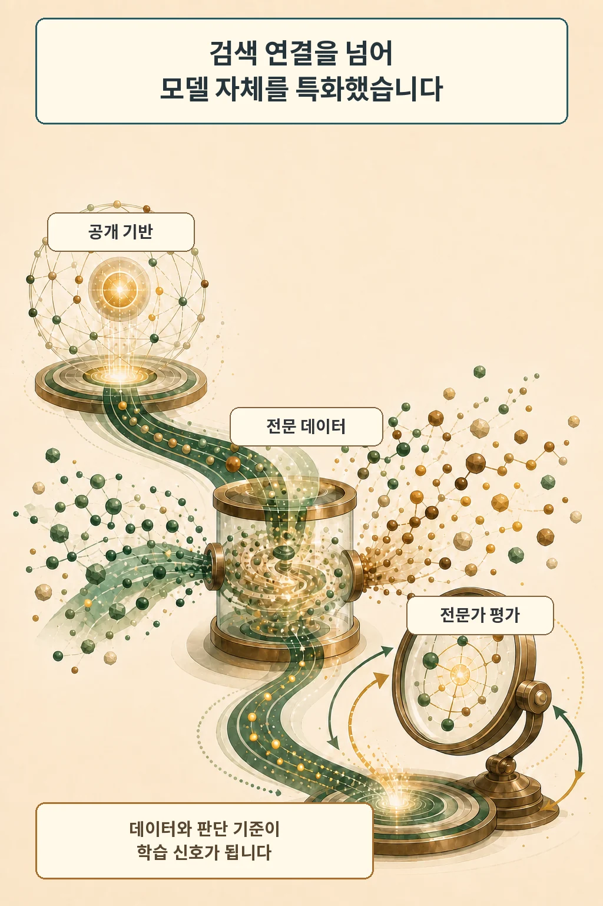

톰슨로이터는 인력과 연산 자원을 포함해 4천만 달러를 들여 첫 자체 대규모 언어 모델 `Thomson`을 만들었다고 2026년 8월 24일 밝혔습니다. 법률·세무·규제 업무에 쌓인 방대한 자료와 현업 전문가의 판단을 검색 보조에만 머물지 않고 모델 학습 신호로 직접 넣은 점을 핵심 차별점으로 내세웠습니다. [C001][C004]

## 핵심 내용

- **공개 기반 위 도메인 학습**: Imperial College London의 `Snowdon` 오픈웨이트 모델을 출발점으로 삼고, Westlaw·Practical Law·Checkpoint·Reuters 자료(현재 10% 미만 사용)와 현업 전문가의 채점 기준을 학습에 반영했습니다. [C002][C003]
- **자사 인용 사실성 평가**: Westlaw·Practical Law를 이용한 자체 deep research 평가에서 인용 사실성 점수 0.83을 기록해 비교 대상인 두 범용 모델(0.65, 0.68)을 앞섰다고 보고했습니다. [C005][C006]
- **첫 제품 배치**: 독립 API가 아니라 `CoCounsel Legal`의 표 형태 다문서 검토 기능(`Tabular Analysis`)에 먼저 적용되며, 학술·비상업용 소형 오픈웨이트 버전 공개도 예고했습니다. [C007][C008][C009]

## 공개 기반 위에 전문 지식을 다시 학습했습니다

`Thomson`은 밑바닥부터 모든 기반 모델을 새로 만든 결과가 아닙니다. 개발팀은 현재 Imperial College London의 `Snowdon` 오픈웨이트 모델을 출발점으로 삼아 톰슨로이터 자료를 이용한 연속 사전학습(continued pre-training)과 후속 학습을 더했으며, 기반 모델 자체는 공개 생태계의 발전에 맞춰 교체할 수 있게 설계했습니다. [C002]

회사가 공개한 범위에서는 Westlaw, Practical Law, Checkpoint, Reuters 자료의 10% 미만이 지금까지 학습에 쓰였습니다. 단순히 데이터 양만 늘린 작업도 아니라서, 현업 전문가들이 어려운 법률 과제의 채점 기준을 직접 만들고 서로 다른 답변 가운데 어떤 것이 특정 관할과 고객 상황에 더 맞는지 평가해 반영했습니다. [C003]

이 구조는 일반적인 검색 증강 생성(RAG)과 다른 차원의 비용을 요구합니다. RAG가 질문 시점에 관련 문서를 찾아 컨텍스트로 붙인다면, `Thomson`은 데이터 혼합과 전문가 판단을 모델 가중치와 후속 학습 신호에 직접 새겨 넣습니다. 그만큼 검색 인덱스를 준비하는 일에 더해 학습 데이터 권리, 평가 기준, 범용 능력 보존까지 함께 관리해야 합니다. [C002][C003][C011]

## 성능 수치는 회사 평가로 읽어야 합니다

톰슨로이터는 `Thomson`이 여러 법률·일반 과제에서 최신 범용 모델과 경쟁 가능하다고 주장합니다. 엔지니어링 블로그 글에서는 Westlaw·Practical Law를 이용한 deep research 평가에서 각 주장에 붙은 인용이 실제 근거가 되는지를 측정한 인용 사실성 점수가 0.83이었고, 비교한 두 범용 모델은 각각 0.65와 0.68이었다고 보고했습니다. [C005][C006]

눈에 띄는 수치이지만 아직 독립 재현 결과로 다루기는 이릅니다. 공식 페이지는 기술 보고서를 안내하고 있으나 같은 날 올라온 엔지니어링 글은 전체 보고서가 앞으로 공개될 예정이라고 적었고, 외부 연구자 평가도 현재 진행 중입니다. 구체적인 평가 데이터와 비교 모델 설정, 도구 접근 조건이 모두 공개되어야 성능 차이의 실질적인 범위를 판단할 수 있습니다. [C005]

## 첫 배치는 CoCounsel의 문서 검토 기능입니다

고객이 `Thomson`을 만나는 첫 장소는 `CoCounsel Legal`의 다문서 표 검토 기능인 `Tabular Analysis`입니다. 다만 `CoCounsel` 전체가 단일 모델로 바뀐 것은 아니며, 제품은 작업 특성에 따라 여러 모델을 조합해 쓰고 다른 에이전트 기능에는 Anthropic의 Claude Agent SDK도 함께 활용합니다. [C007]

제품 출시와 모델 직접 제공도 구분해서 봐야 합니다. 2026년 8월 25일 현재 `Thomson`을 독립 상품이나 일반 API로 구매할 수는 없고 `CoCounsel` 기능 안에서 먼저 경험하게 되며, 고객 데이터를 `Thomson` 학습에 사용하지 않는다는 방침 역시 회사의 현재 제품 약속입니다. [C008][C010] 아울러 학술·비상업 용도의 소형 오픈웨이트 버전을 공개하고 외부 평가를 넓히겠다고 발표했지만, 8월 25일 09:00 KST 기준 공식 Hugging Face 모델 목록에는 아직 `Thomson`이 올라오지 않아 발표 계획과 실제 다운로드 가능 상태를 구분할 필요가 있습니다. [C009]

## 다메카솔의 해석

이번 사례가 보여 주는 변화는 ‘전문 문서를 많이 가진 회사가 자체 모델도 만들었다’는 수준에서 끝나지 않습니다. 사내 지식을 검색 결과로만 공급하던 단계에서 데이터 혼합 비율 설계, 현업 판단의 채점 기준화, 모델 후속 학습까지 핵심 역량을 내부로 옮긴 것입니다. 외부 범용 모델의 가격이나 로드맵에 대한 의존을 줄이는 대신, 데이터 권리와 평가 체계를 직접 운영할 책임은 한층 커집니다. [C011]

비슷한 접근을 검토하는 개발팀이라면 벤치마크 순위보다 세 가지를 먼저 점검해야 합니다. 전문가의 암묵적 판단을 일관된 평가 기준으로 바꿀 수 있는지, 도메인 학습 뒤에도 기본 지시 준수와 일반 추론 능력이 유지되는지, 그리고 실제 제품에서 인용과 결과를 다시 검증할 수 있는지입니다. `Thomson`의 실질적인 기술력을 가늠할 다음 판단 지점은 전체 기술 보고서와 소형 모델이 실제로 공개된 뒤가 될 것입니다. [C002][C003][C005][C009][C011]

## 출처

- [Thomson Reuters, Thomson Reuters Leverages its World-Class Data Assets to Launch Its Own Frontier Model (2026-08-24)](https://www.thomsonreuters.com/en/press-releases/2026/august/thomson-reuters-leverages-its-world-class-data-assets-to-launch-its-own-frontier-model)
- [Thomson Reuters, Thomson: a purpose-built foundation model for professionals (2026-08-25 확인)](https://www.thomsonreuters.com/en/thomson-llm)
- [Thomson Reuters Institute, How we built Thomson (2026-08-24)](https://www.thomsonreuters.com/en-us/posts/innovation/how-we-built-thomson/)
- [Thomson Reuters, Next Generation of CoCounsel Legal (2026-08-20)](https://www.thomsonreuters.com/en/press-releases/2026/august/thomson-reuters-launches-next-generation-of-cocounsel-legal-the-ai-ecosystem-built-for-legal-professionals)
- [Thomson Reuters verified Hugging Face organization (2026-08-25 확인)](https://huggingface.co/thomsonreuters/models)

글·해설: 다메카솔

이 글의 본문과 이미지는 생성형 AI로 제작했습니다. 기획과 편집 기준은 다메카솔이 정했습니다.
