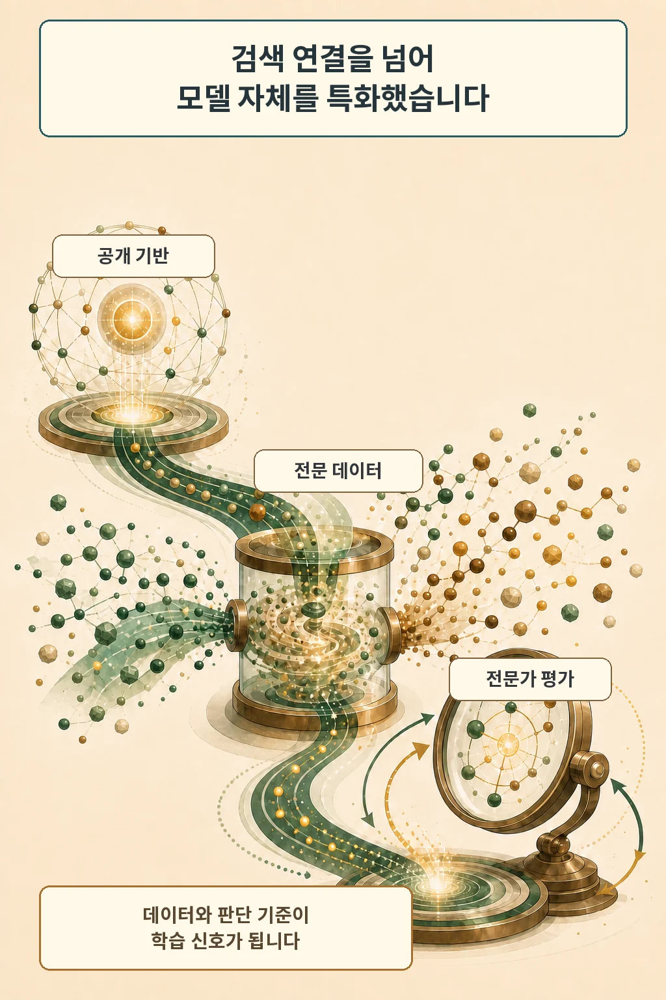

사내 전문 문서를 AI에 연결할 때 대부분은 검색 증강 생성(RAG)부터 떠올립니다. 그런데 톰슨로이터는 인력과 연산 자원을 포함해 4천만 달러를 들여 첫 자체 언어 모델 `Thomson`을 학습했다고 2026년 8월 24일 발표했습니다. 전문 데이터와 전문가 판단을 검색이 아닌 학습 신호로 넣은 이번 시도가 어디까지 열려 있는지 살펴볼까요?

글·해설: 다메카솔

## 핵심 내용

- **공개 기반 도메인 학습**: Imperial College London의 `Snowdon`에 4대 전문 자료(10% 미만)와 전문가 채점 기준을 결합했습니다.
- **자사 인용 사실성 평가**: Westlaw·Practical Law를 연결한 deep research 평가에서 0.83을 기록해 두 범용 모델(0.65, 0.68)을 앞섰다고 보고했습니다.
- **제한된 제품 배치**: `CoCounsel Legal`의 `Tabular Analysis`에 먼저 적용됐으며, 독립 API와 소형 오픈웨이트 배포는 예고 단계입니다.

## 검색을 넘어 학습 신호로 들어간 전문 지식

`Thomson`은 백지부터 새로 만든 모델이 아니라 Imperial College London의 `Snowdon` 오픈웨이트 모델을 출발점으로 삼았습니다. 여기에 자사 자료로 연속 사전학습(continued pre-training)과 후속 학습을 더했고, 공개 생태계가 발전하면 기반 코어 자체도 교체할 수 있게 설계했죠.

학습에는 Westlaw, Practical Law, Checkpoint, Reuters 자료의 10% 미만이 쓰였습니다. 현업 전문가가 까다로운 법률 과제의 채점 기준을 직접 만들고, 관할과 고객 상황에 맞는 답변을 가려 학습 신호에 반영한 점이 특징입니다.

예를 들어 사내 판례와 규정을 연결한 계약 검토 도우미를 만든다고 가정해 봅시다. 일반 RAG는 질문 시점에 문서를 찾아 프롬프트에 붙이지만, `Thomson`은 어떤 근거를 우선할지와 관할별 판단 기준을 모델 가중치에 직접 새깁니다. 검색 인덱스에 더해 데이터 권리, 채점 기준, 범용 능력 보존까지 함께 관리해야 하는 셈이죠.

## 발표 수치와 외부 검증 사이의 경계

톰슨로이터는 `Thomson`이 법률·일반 과제에서 최신 범용 모델과 겨룰 만한 성능을 냈다고 설명합니다. 엔지니어링 블로그 글에서는 Westlaw·Practical Law를 결합한 deep research 평가에서 인용이 실제 근거로 이어지는지 따진 인용 사실성 점수를 공개했는데요. 자사 측정 기준으로 비교 대상 범용 모델 두 종을 앞서는 결과를 냈습니다.

| 항목 | 공개 자료 기준 내용 | 실무 확인 경계 |
| --- | --- | --- |
| **기반·규모** | `Snowdon` 기반, 4대 자료 10% 미만 | 인력·연산 4천만 달러, 코어 교체 가능 |
| **인용 사실성** | `Thomson` 0.83 vs 범용 모델 0.65·0.68 | Westlaw·Practical Law 결합 자사 평가 |
| **검증 상태** | 제품 페이지에 기술 보고서 안내 | 전체 보고서 예정·외부 평가 진행 중 |
| **제품·접근** | `CoCounsel Legal` `Tabular Analysis` | 독립 API 미제공, Claude Agent SDK 병용 |
| **공개·보안** | 고객 데이터 학습 미사용 방침 | 소형 오픈웨이트 2026-08-25 09:00 KST Hugging Face 미등재 |

눈에 띄는 수치이지만 아직 독립 재현 결과로 보기는 이릅니다. 같은 날 나온 엔지니어링 글에서도 전체 기술 보고서는 추후 공개 예정이며 외부 연구자 평가가 진행 중이라고 밝혔거든요. 평가 데이터와 비교 모델 설정, 도구 접근 조건이 공개되어야 성능 차이를 정확히 판단할 수 있습니다.

## CoCounsel 배치와 실제 접근 상태

고객이 `Thomson`을 만나는 첫 화면은 `CoCounsel Legal`의 다문서 표 검토 기능인 `Tabular Analysis`입니다. 다만 `CoCounsel` 전체가 단일 모델로 바뀐 구조는 아니어서, 작업에 따라 여러 모델을 조합하고 다른 에이전트 기능에는 Anthropic의 Claude Agent SDK도 함께 씁니다.

모델 출시와 직접 제공도 구분해서 봐야 합니다. 2026년 8월 25일 현재 `Thomson`은 독립 상품이나 일반 API로 열리지 않아 `CoCounsel` 안에서 먼저 쓰게 되며, 고객 데이터를 학습에 사용하지 않는다는 방침을 내세웠습니다. 학술·비상업용 소형 오픈웨이트 모델 역시 같은 날 오전 기준 공식 Hugging Face 목록에서는 확인되지 않아 배포 시점을 지켜봐야 합니다.

## 다메카솔의 해석

이번 사례는 사내 지식을 검색으로만 공급하던 단계에서 데이터 혼합, 전문가 채점 기준화, 모델 후속 학습까지 내부로 끌어온 변화입니다. 외부 모델 의존도를 낮추는 대신 데이터 권리와 평가 체계를 직접 운영할 책임은 커지거든요.

비슷한 접근을 검토하는 팀이라면 벤치마크 순위보다 세 가지를 먼저 점검해야 합니다.

1. **전문가 기준화**: 현업 전문가의 암묵적 판단을 일관된 채점 기준으로 바꿀 수 있는지 확인합니다.
2. **일반 능력 보존**: 도메인 학습 뒤에도 기본 지시 준수와 일반 추론 성능이 유지되는지 측정합니다.
3. **제품 내 검증**: 실제 화면에서 인용과 결과를 원문 근거와 대조할 수 있는 절차를 둡니다.

결국 `Thomson`의 실질적인 기술력은 전체 기술 보고서와 소형 모델이 공개된 뒤에야 가늠할 수 있을 전망입니다.

## 출처

- [Thomson Reuters, Thomson Reuters Leverages its World-Class Data Assets to Launch Its Own Frontier Model (2026-08-24)](https://www.thomsonreuters.com/en/press-releases/2026/august/thomson-reuters-leverages-its-world-class-data-assets-to-launch-its-own-frontier-model)
- [Thomson Reuters, Thomson: a purpose-built foundation model for professionals (2026-08-25 확인)](https://www.thomsonreuters.com/en/thomson-llm)
- [Thomson Reuters Institute, How we built Thomson (2026-08-24)](https://www.thomsonreuters.com/en-us/posts/innovation/how-we-built-thomson/)
- [Thomson Reuters, Next Generation of CoCounsel Legal (2026-08-20)](https://www.thomsonreuters.com/en/press-releases/2026/august/thomson-reuters-launches-next-generation-of-cocounsel-legal-the-ai-ecosystem-built-for-legal-professionals)
- [Thomson Reuters verified Hugging Face organization (2026-08-25 확인)](https://huggingface.co/thomsonreuters/models)

톰슨로이터 공식 발표·제품 문서·엔지니어링 글을 바탕으로 정리했으며, 별도 성능 재현이나 실행 측정은 포함하지 않았습니다.
이 글의 본문과 이미지는 생성형 AI로 제작했습니다. 기획과 편집 기준은 다메카솔이 정했습니다.
