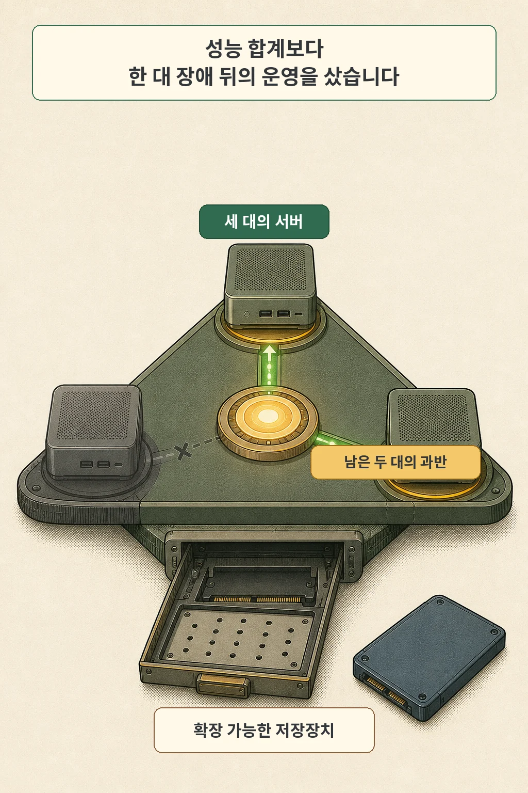
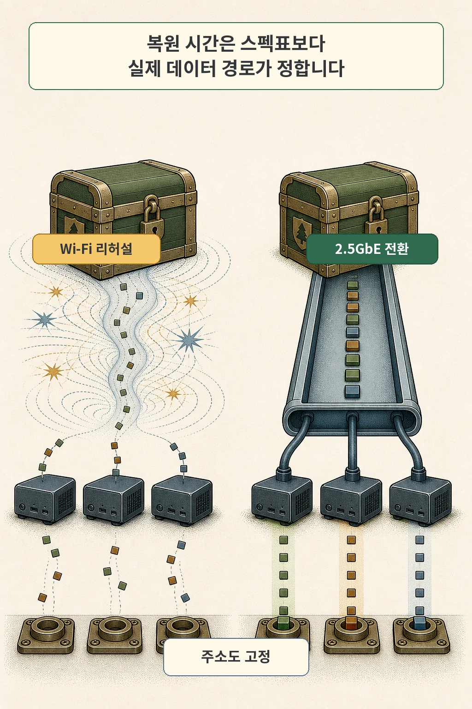
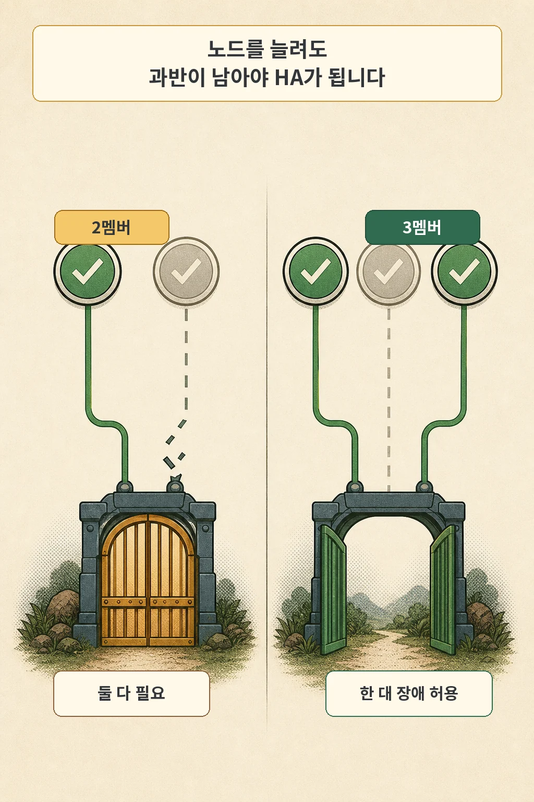

미니PC 세 대를 마련해 k3s 클러스터를 올렸다면 가장 먼저 고가용성부터 안심하게 됩니다. 그런데 첫 점검으로 `kubectl get svc -A`를 실행했을 때 오류 없이 화면이 비어 있다면 어떻게 받아들이시겠어요? 실제로 마주친 그 빈 출력은 새 클러스터가 깨끗해서가 아니라, 자동화가 엉뚱한 로컬 클러스터에서 자격을 꺼내기 직전이라는 위험 신호였습니다.

글·해설: 다메카솔

## 1편에서 남은 두 제약과 미니PC 선택

기존에는 시놀로지 NAS에서 학습용 k3s를 운영했습니다. RAM은 32GB로 충분했지만 CPU 코어가 부족했고, 밤에 소음 때문에 NAS를 끄면 Airflow 메타데이터 DB와 오브젝트 스토리지까지 함께 멈추곤 했죠. 연산 병목과 가동시간 제약이 한 장비에 묶여 있던 셈입니다.

그래서 24시간 켜 둘 수 있는 미니PC 세 대로 실행 계층을 옮겼습니다. 선택한 모델은 GMKtec M5 Ultra였는데, 이번에는 RAM 총량보다 한 대가 빠진 뒤의 제어면, 복원 경로, 저장장치 확장성을 함께 따져 봤거든요. 핵심 사양과 선택 기준은 아래 표로 정리했습니다.

| 항목 | 노드당 구성 | 선택 기준 |
| --- | --- | --- |
| 모델·수량 | GMKtec M5 Ultra × 3대 | 24시간 상시 가동 |
| CPU | Ryzen 7 7730U (8코어 16스레드) | NAS 연산 병목 해소 |
| 메모리·디스크 | RAM 32GB, NVMe 512GB | 로컬 상태 수용 |
| 네트워크·확장 | 듀얼 2.5G Ethernet, M.2 2280 슬롯 2개 | 복원 대역·증설 여지 |



제조사 사양에 담긴 듀얼 유선 포트와 두 개의 확장 슬롯이 특히 유용했습니다. 세부 비교 기준은 [홈랩 미니PC 고르는 법: CPU·RAM보다 NIC와 M.2 슬롯을 먼저 볼 때](/posts/homelab-mini-pc-nic-m2-selection/)에서 다뤘습니다.

## 복원 리허설에서 드러난 WiFi 병목

처음에는 세 노드를 WiFi로 연결해 클러스터를 세웠습니다. 구성은 순조로웠지만 대용량 데이터베이스 복원 리허설에서 무선 구간의 한계가 곧바로 드러났죠.

- **WiFi 실측 (84GB 복원)**: 당시 리허설에서 완료까지 **88분**이 걸렸습니다.
- **유선 2.5GbE 추산**: 당시 계획 기록에는 **35~55분**으로 추산돼 있으며, 동일 조건 재측정값이 아닌 추정치입니다.



리허설 뒤에는 세 노드를 유선으로 옮기고 IP 주소도 고정했습니다. 사양표만 볼 때는 가려지던 백업 원본, 네트워크, 대상 디스크의 이동 경로가 실제 복구 시간을 결정짓는다는 교훈을 얻었습니다.

## 세 대여야 했던 이유와 쿼럼 계산 범위

embedded etcd는 새 상태를 확정할 때 전체 멤버 중 과반(quorum)의 동의를 요구합니다. 예를 들어 두 대 구성에서 한 대가 멈추면 남은 노드는 한 대뿐이라 과반 합의를 잇기 어렵습니다. 반면 세 대 구성에서는 한 대가 빠져도 남은 두 대가 과반을 유지하므로 합의가 이어지죠.

| 멤버 수 | 과반 기준 | 장애 허용 수 | K3s embedded etcd HA |
| --- | --- | --- | --- |
| 2대 | 2대 동의 | 0대 | 미충족 (1대 중단 시 정지) |
| 3대 | 2대 동의 | 1대 | 충족 (최소 홀수 구성) |



K3s 공식 문서가 embedded etcd HA 구성에 세 대 이상의 홀수 server node를 요구하는 이유도 여기에 있습니다. 다만 이번 기록에서 확인한 범위는 3서버 구성 조건과 쿼럼 계산까지이며, 실제 노드를 끄고 API 응답·워크로드 지속·복구 시간을 잰 장애 조치 시험 결과는 포함돼 있지 않습니다. 세 대를 물리적으로 배치한 사실과 전체 HA 검증 완료는 분명히 별개의 문제입니다.

같은 멀티탭, 스위치, 단일 스토리지처럼 노드가 공유하는 요소는 여전히 공통 장애 지점으로 남습니다. 멤버 수별 계산과 확장·교체 순서는 [etcd 쿼럼은 왜 홀수 노드가 필요한가](/posts/etcd-quorum-odd-members/)에서 이어집니다.

## 빈 출력의 함정과 엉뚱하게 향한 요청

클러스터를 만든 뒤 상태를 확인하려고 아래 명령을 실행했습니다.

```bash
kubectl get svc -A
```

명령은 오류 없이 끝났지만 서비스 목록은 텅 비어 있었습니다. 새 홈랩이 비어 있어서가 아니라 WSL의 기본 `kubectl` 컨텍스트가 다른 프로젝트의 로컬 `kind` 클러스터를 가리키고 있었거든요. `kubeconfig`의 `context`는 `cluster`, `user`, `namespace` 참조를 묶으며 `current-context`가 기본 대상을 정합니다.


가령 여러 테스트 환경을 오가다 예전 컨텍스트가 남아 있다면, 명령이 성공했다는 사실만으로 의도한 클러스터에 붙었다고 단정하기 어렵습니다. 오히려 오류 없는 정상 종료가 의심을 늦추는 함정이 됩니다.

## 자격 추출 직전, 세 가지 지문으로 막은 사고

더 아찔했던 건 조회 다음 단계였습니다. 이어지는 자동화가 방금 조회한 클러스터에서 ServiceAccount JWT를 꺼내 홈랩 Vault 인증 설정에 넣을 참이었거든요. 다행히 반영 전에 대상 착오를 발견해 인증 장애는 피했지만, 읽기 대상 오류가 곧바로 쓰기 오염으로 번질 뻔한 순간이었습니다.


그날 이후 자격 추출이나 쓰기 전에는 `context`, API 서버, 예상 노드를 함께 확인하는 3단계 규칙을 세웠습니다.

```bash
kubectl config current-context
kubectl cluster-info
kubectl get nodes -o name
```

| 확인 대상 | 불일치 시 조치 |
| --- | --- |
| context 이름 | 다음 단계 진행 보류 |
| API 서버 또는 인증서 지문 | 자격 추출·쓰기 즉시 중단 |
| 예상 노드 집합 | 대상 클러스터 재확인 |
| namespace·0건 허용 조건 | 기본값으로 판정 금지 |

이 홈랩에서는 운영 클러스터의 `kubeconfig`를 로컬에 합치지 않고 SSH로 노드에 들어가 `sudo k3s kubectl`을 쓰는 정책을 택했습니다. 다른 환경에서는 별도 `kubeconfig` 분리, 명시적 `--context` 지정, 최소 권한 계정, CI 격리로 같은 안전장치를 둘 수 있습니다. 어느 방식을 쓰든 `current-context` 하나만 믿고 쓰기 단계로 넘어가지 않는 것이 핵심입니다.

장비는 처음 세운 미니PC 세 대 그대로지만 기본 컨텍스트를 믿던 습관은 버렸습니다. 지금은 쿼럼을 계산할 때 허용 장애 수를 함께 적고, 복원 계획을 짤 때 데이터 경로를 먼저 그리며, 자격과 쓰기 앞단에서는 반드시 대상 지문부터 대조하는 편입니다.

## 자주 묻는 질문

### k3s embedded etcd 구성은 반드시 세 대가 필요한가요?

HA 서버 클러스터라면 K3s 공식 문서는 세 대 이상의 홀수 server node를 요구합니다. 반면 단일 server, 외부 datastore 연동, agent만 추가하는 구성은 조건이 다릅니다.

### `--context` 플래그만 붙이면 충분한가요?

실수를 크게 줄여 주지만 context 이름이 잘못 매핑됐거나 `kubeconfig` 파일 자체가 바뀔 수 있습니다. 자격 추출이나 변경 작업 전에는 API 서버 주소와 예상 노드 같은 독립 지문까지 함께 확인하는 편이 안전하죠.

## 함께 읽을 개념 글

- [etcd 쿼럼은 왜 홀수 멤버가 유리한가](/posts/etcd-quorum-odd-members/): 2멤버와 3멤버의 장애 허용 차이를 계산합니다.
- [kubectl context만 믿지 않고 클러스터 지문 확인하기](/posts/kubectl-context-cluster-fingerprint/): 위험한 쓰기 전에 kubeconfig, API server와 노드를 검증합니다.
- [홈랩 미니 PC를 고를 때 NIC와 M.2 슬롯을 먼저 보는 이유](/posts/homelab-mini-pc-nic-m2-selection/): 복원 경로와 확장성을 장비 선택 기준으로 바꿉니다.

## 출처

- [K3s: High Availability Embedded etcd](https://docs.k3s.io/datastore/ha-embedded)
- [etcd FAQ: failure tolerance](https://etcd.io/docs/v3.2/faq/)
- [Kubernetes: The kubectl command-line tool](https://kubernetes.io/docs/concepts/overview/kubectl/)
- [Kubernetes: Kubeconfig v1 API](https://kubernetes.io/docs/reference/config-api/kubeconfig.v1/)
- [Kubernetes: kubectl cluster-info](https://kubernetes.io/docs/reference/kubectl/generated/kubectl_cluster-info/)
- [GMKtec: NucBox M5 Ultra](https://www.gmktec.com/products/gmktec-nucbox-m5-ultra-amd-ryzen-7-7730u-mini-pc)

이 글의 홈랩 사례와 수치는 2026년 7월 기록을 바탕으로 2026년 7월 25일 공식 문서·제조사 사양과 대조해 정리했으며, 내부 JWT·kubeconfig·사설 주소와 호스트명은 공개하지 않았습니다.

이 글의 본문과 이미지는 생성형 AI로 제작했습니다. 기획과 편집 기준은 다메카솔이 정했습니다. 만화 이미지는 텍스트 없는 원화에 결정적 레터링을 합성해 만들었습니다. 공식 로고·UI·제품 화면·문서 도표 등 외부 이미지 자산은 사용하지 않았습니다.
