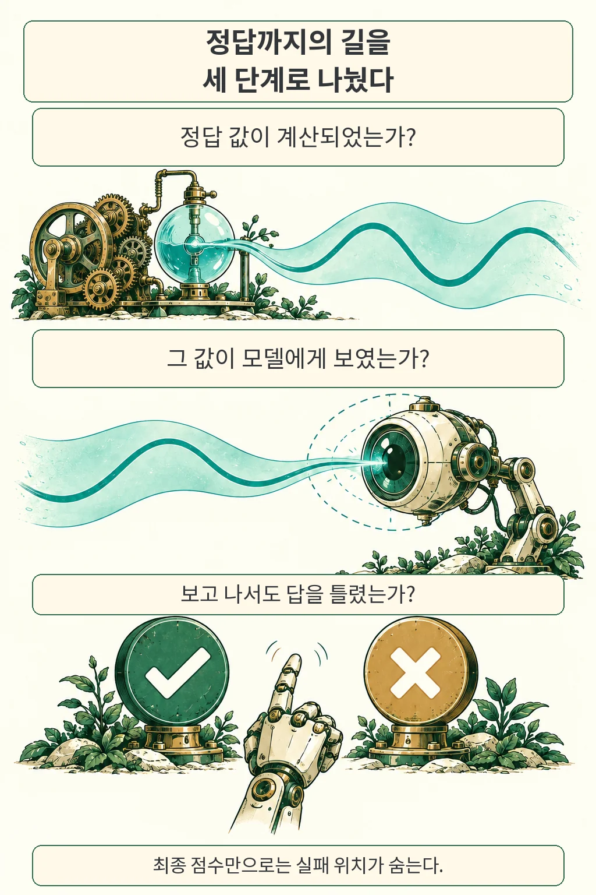

AI 에이전트가 도구로 정답 값까지 계산하고도 최종 답변에서 틀릴 수 있습니다. 긴 출력을 문맥 대신 파일에서 읽게 하면 토큰은 줄지만, 모델이 어느 파일을 근거로 택하느냐에 따라 결과가 갈리거든요. 2026년 10월 공개된 *Same Simulation, Different Evidence*는 계산과 답변 사이의 읽기 경로를 추적했습니다.

글·해설: 다메카솔

## 같은 결과를 어떻게 건네줄까

긴 결과를 파일로 빼 필요한 부분만 읽게 하면 문맥은 줄지만, 정보가 파일에 있다는 사실과 모델이 읽었다는 사실 사이에는 선택이 끼어들죠. 앞서 다룬 [SkillBrowser의 필요한 스킬 찾기](/posts/skillbrowser-selective-skill-exposure/)가 작업 절차를 언제 불러올지 살폈다면, 이번 연구는 도구가 만든 결과 중 무엇을 근거로 삼는지 추적합니다.

- **평가셋**: 지구화학 시뮬레이터 PHREEQC 3.8.6·고정 `phreeqc.dat`로 원래 200문항을 재실행해 답이 유일한 19개 설정·158개 객관식 문항(숫자 답 137문항)을 남겼습니다. 제외된 42문항은 오답·수치 불안정성·문구 결함을 작성자가 확인했습니다.
- **제약**: 파일 읽기·쓰기·목록 확인과 시뮬레이터 실행 도구를 쓰며 최대 24단계 안에 답을 파일로 제출합니다.

여러 문항이 같은 설정을 공유해 158개 독립 실험으로 보기 어렵고, 재실행 검증은 과학적 타당성 심사와 다릅니다.

| 방식 | 초기 전달 | 후속 읽기 |
| --- | --- | --- |
| Raw100k | 보고서 본문(앞뒤 최대 100,000문자) | 필요 시 추가 읽기 |
| TOC | 섹션 목차와 시작 줄 번호 | 필요한 줄 직접 읽기 |

100,000은 토큰이 아닌 문자 수이며 두 방식의 파일 접근 권한은 같습니다. 전체 실험에서는 반환 방식 안내 프롬프트도 달라져 뒤에서 계산을 고정한 비교를 추가했습니다.

## 계산 결과가 다른 근거로 바뀌는 순간

PHREEQC는 정식 보고서 `result.out`에 값을 쓰지만, 에이전트가 `SELECTED_OUTPUT`으로 원하는 항목만 별도 파일에 뽑을 수도 있습니다. 이 파일도 시뮬레이터 출력이므로 모델이 지어낸 숫자는 아닙니다.

평가 선택지는 정식 보고서 자릿수에 맞춰져 있는데, 별도 파일에는 더 긴 소수가 찍히거든요. 예를 들어 보고서 값이 `2.751`, 별도 출력이 `2.75065`일 때 모델이 후자를 셋째 자리에서 반올림하지 않고 잘라 `2.750`을 고르면 계산은 맞았어도 이웃한 오답을 택하는 셈이죠.

저자들은 정식 보고서 대신 자체 설정 출력을 근거로 삼는 현상을 ‘근거 대체(evidence substitution)’라 부릅니다. 정밀도가 높아서 생긴 문제가 아니라, 어느 출력과 자릿수를 쓸지 연결이 모델 판단에 맡겨져 어긋난 사례입니다.

## 최종 정확도와 실패 위치는 다른 정보를 준다

158문항 반복 실행을 문항별로 합친 TOC − Raw100k 정확도 차이(저자 보고, 단위 pp는 퍼센트포인트)입니다. 단일 대표 실행 비교가 아닌 문항별 합산 수치입니다.

| 모델 | 합산 차이 | 95% 부트스트랩 | 비고 |
| --- | ---: | --- | --- |
| GPT-5.1 | −11.3pp | −18.0 ~ −4.9 | Holm 유의(p=0.005) |
| GPT-5.2 | −7.9pp | −14.9 ~ −0.9 | 비유의(p=0.128)·19설정 0 포함 |
| GPT-5.4 | +0.2pp | −5.5 ~ +5.7 | 0 포함 |
| Claude Opus 4.6 | −0.6pp | −3.8 ~ +2.5 | 0 포함 |
| Claude Sonnet 4.6 | −0.5pp | −3.8 ~ +3.2 | 0 포함 |

Holm 보정 뒤 유의한 하락은 GPT-5.1뿐이지만, 나머지 세 모델에서 순손실이 잡히지 않았다고 동등성이 입증된 것은 아니므로 중간 단계를 쪼개 봐야 합니다.

- **재실행 규모**: 완전 로그 5,773개 경로의 시뮬레이터 호출 11,007건 재실행
- **세 단계**: ① 정답 값 생성 → ② 모델 노출 → ③ 본 뒤 정답 제출(분모가 ‘값을 본 경우’라 전체 정확도와 다름)

숫자 137문항·단일 로그 inline 기준의 GPT-5.4 분석에서는 검색형 전달의 계산 개선과 근거 활용 손실이 서로 상쇄됐습니다. 최종 점수가 비슷해도 중간 손실은 남을 수 있는 셈이죠. 위 합산 표와 분모가 달라 직접 가감할 수 없고, Shapley 분해도 관측 차이 배분이지 독립 인과효과로 보기는 어렵습니다.

- **GPT-5.2 고정 재생**: inline 첫 실행(종료 코드 0) 직후 131개 숫자 문항을 고정하고 추가 실행을 막은 채 동일 파일·이력으로 3회 쌍별 반복하자 TOC가 직접 전달보다 **−9.4pp**(95% 구간 **−14.5 ~ −4.6pp**) 낮았습니다. 계산 변수를 분리했지만 inline 체크포인트 부분집합 결과입니다.

## ‘반올림을 잘하라’보다 기준 출력을 지정했을 때

그렇다면 이런 읽기 단계의 실패는 어떻게 줄일 수 있을까요? 저자들은 TOC 조건에 정식 보고서 `result.out`을 답의 기준으로 지정해 해당 구역을 읽게 하는 안내(TOC+Report)와, 100,000문자 이내 보고서는 직접 넣고 긴 보고서만 목차로 넘기는 Hybrid 방식을 시험했습니다. 두 개입은 값을 본 뒤 답으로 옮기는 실패를 줄였지만, 기준 파일 없이 반올림만 지시한 조건에서는 문제가 그대로 남았습니다.

| TOC+Report 모델 | 전체 TOC 대비 | 별도 통제 대비 |
| --- | ---: | ---: |
| GPT-5.1 | +6.3pp | +7.9pp |
| GPT-5.2 | +7.9pp | +3.5pp |
| GPT-5.4 | +7.8pp | — |

개선 폭은 비교 기준에 따라 달라지므로 기준을 빼놓고 숫자만 읽으면 같은 실험도 모순처럼 보일 수 있습니다. 또한 inline 대비 잔여 격차가 남은 GPT-5.1 사례처럼 읽기 회복만으로 모든 오류가 사라지지는 않는 편입니다.

## 어디까지 적용할 수 있을까

이 결과를 모든 검색형 에이전트로 확대하기 전에 실험 제약을 짚어야 합니다.

- **과제·채점**: 단일 지구화학 과제군(PHREEQC)이며 선택지 자릿수에 민감한 평가입니다.
- **디코딩·제외**: Claude는 temperature 0·확장 사고 비활성, GPT·Gemini는 추론 강도 미지정 API 기본값을 썼습니다. Gemini는 미제출·해석 불가 사례가 많아 후속 분석에서 제외됐기에 공급사 역량 비교로 일반화하기 어렵습니다.
- **로그·판정**: 반복 횟수와 로그 범위가 고르지 않고 긴 출력 33문항은 수정 목차 실행을 여러 TOC 반복에서 공유했으며, 시점별 API 변화도 모델링하지 않았습니다. 검토한 58개 숫자 경로 중 자동·수동 판정 일치는 52개였고 같은 숫자가 다른 위치에 우연히 나타날 수 있습니다.

### 다메카솔의 해석

실무에서 챙길 질문은 “긴 결과를 파일로 뺄까”보다 **“답에 필요한 근거가 실제로 전달되고 쓰였는가”**에 가깝습니다. [에이전트 평가의 구성 조건](/posts/agent-evaluation-system-configuration/)을 남길 때도 모델명과 점수뿐 아니라 생성 결과·읽은 파일·제출 답의 연결을 함께 기록해 두면 고칠 지점을 구체적으로 찾을 수 있거든요.

운영 로그나 API 응답에서도 기준 출력과 표현 정밀도를 명시하는 방식을 시험해 볼 만합니다. 효과는 업무별 평가로 확인해야겠지만, 검색형 전달을 쓰더라도 모델이 접근 가능한 정보와 실제로 읽어 근거로 삼은 정보를 구분해 추적해야 합니다.

## 출처

- Ke Zhang 외, [Same Simulation, Different Evidence: Where Retrieved Tool Output Costs LLM Agents Accuracy, arXiv:2610.26836v1](https://arxiv.org/abs/2610.26836v1). 2026-10-19 17:57:41 UTC 제출, 2026-10-20 확인.
- [원문 PDF](https://arxiv.org/pdf/2610.26836v1): §2 실험 조건, 표 1 정확도, §4 고정 재생과 실패 위치, 표 5 개입, §9 한계.
- [원문 HTML](https://arxiv.org/html/2610.26836v1): 같은 버전의 본문과 부록.

이 글은 원문 PDF·HTML·메타데이터의 보고 수치를 대조해 정리했으며, 모델 실험이나 PHREEQC 실행은 독립 재현하지 않았고 확인한 원문에서는 공식 코드·데이터 저장소 링크를 찾지 못했습니다.

이 글의 본문과 이미지는 생성형 AI로 제작했습니다. 기획과 편집 기준은 다메카솔이 정했습니다.
