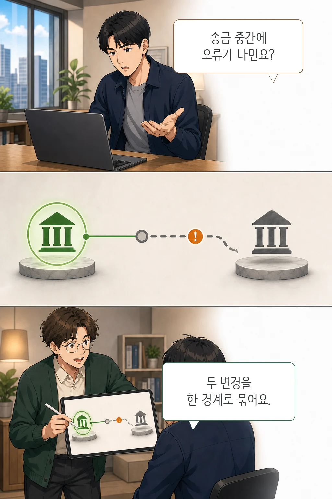
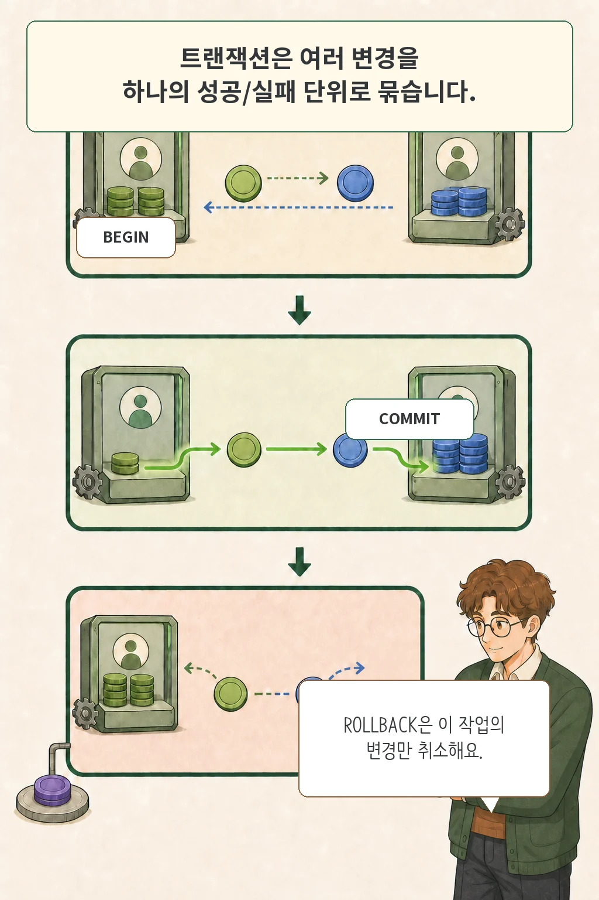
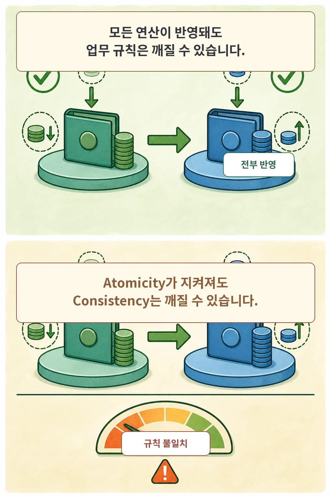
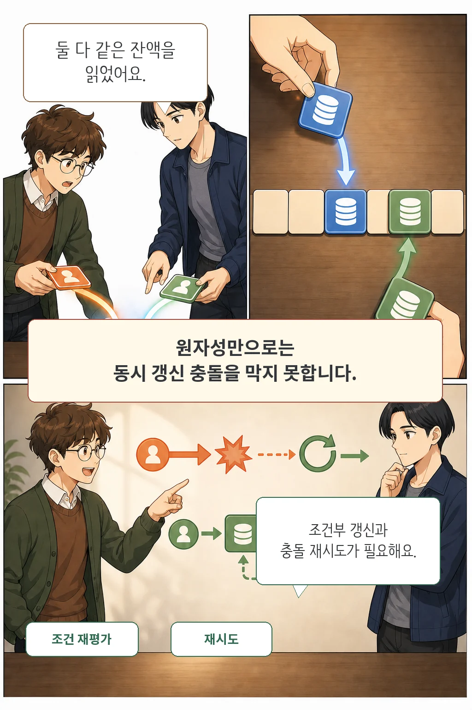
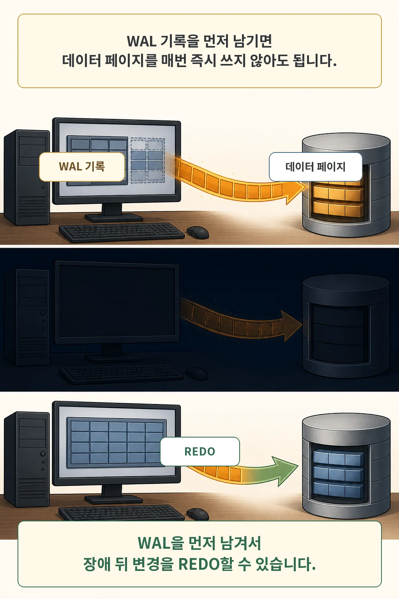

송금 로직에서 내 계좌 출금은 끝났는데 상대방 계좌 입금 직전에 서버가 멈추면 어떻게 될까요? 돈은 빠져나갔는데 받는 쪽 잔액은 그대로인 심각한 불일치가 남습니다. 데이터베이스의 **트랜잭션(Transaction)**은 이처럼 쪼개지면 곤란한 여러 연산을 **"전부 반영하거나 아예 없던 일로 되돌리는(All or Nothing)" 하나의 실행 경계**로 묶어 줍니다.

글·해설: 다메카솔

## 핵심 요약

트랜잭션은 여러 SQL 연산을 하나의 원자적 경계로 묶으며, **ACID 네 속성**은 각각 다른 장애에 대응합니다.

| 속성 | 막는 실패 | 핵심 메커니즘 | 실무 경계 |
| --- | --- | --- | --- |
| **원자성(Atomicity)** | 출금 뒤 입금 전 장애 | `BEGIN`–`COMMIT`/`ROLLBACK` | 현재 트랜잭션 변경만 취소 |
| **일관성(Consistency)** | 제약·합계 규칙 위반 | `CHECK`·`UNIQUE`·`FK` 등 제약 | 도메인 규칙은 앱 로직과 병행 |
| **격리성(Isolation)** | 동시 갱신 분실(Lost Update) | 격리 수준, 조건부 `UPDATE`, 락 | 엔진별 기본 격리·재시도 확인 |
| **지속성(Durability)** | 커밋 직후 전원 차단 | WAL 선기록(Flush)·REDO 복구 | `synchronous_commit` 해제 시 유실 위험 |

## 트랜잭션은 성공과 실패의 원자적 경계입니다



송금처럼 두 계좌 잔액을 함께 바꾸는 작업은 출금과 입금이 반드시 한 묶음으로 움직여야 합니다. PostgreSQL에서는 트랜잭션을 열지 않으면 각 문장이 자동 커밋(autocommit)으로 실행되므로, 여러 변경을 묶을 때는 `BEGIN`으로 경계를 열어 두어야 하죠. 경계 안의 연산이 모두 끝나면 `COMMIT`으로 영구 확정하고, 예외가 생기면 `ROLLBACK`으로 중간 변경을 폐기합니다.

```sql
BEGIN;

-- 1. 보내는 계좌 출금
UPDATE account
SET balance = balance - :amount
WHERE id = :from_id;

-- 2. 받는 계좌 입금
UPDATE account
SET balance = balance + :amount
WHERE id = :to_id;

COMMIT;
```



실무에서 자주 헷갈리는 지점은 `ROLLBACK`의 적용 범위입니다. 롤백은 DB 전체를 과거 시점으로 되돌리는 기능이 아니라, **현재 세션의 트랜잭션이 시도한 쓰기 연산만 취소하는 명령**이거든요. 다른 트랜잭션이 이미 커밋한 데이터는 롤백 영향 없이 그대로 유지됩니다.

## 원자성과 일관성은 무엇이 다를까요

면접이나 설계 리뷰에서 자주 혼동하는 개념이 **원자성(Atomicity)**과 **일관성(Consistency)**입니다. 원자성은 작업이 반쪽짜리로 남지 않고 전부 완료되거나 전부 취소되는 **실행 단위의 규칙**이고, 일관성은 트랜잭션 전후로 허용된 규칙을 지키는 **데이터 상태의 규칙**입니다.



예를 들어 A 계좌에서 100원을 차감하고 B 계좌에 90원만 입금하는 버그가 코드에 있다고 가정해 볼까요? 두 `UPDATE` 쿼리가 끝까지 실행되어 커밋되었다면 **원자성은 충족**된 상태입니다. 반면 "두 계좌 잔액의 총합은 보존되어야 한다"는 비즈니스 불변식은 깨졌으므로 **일관성은 위반**된 결과가 됩니다.

PostgreSQL은 `CHECK`, `NOT NULL`, `UNIQUE`, `PRIMARY KEY`, `FOREIGN KEY` 같은 제약 조건을 어기는 갱신이 들어오면 오류를 일으켜 일관성을 방어합니다. 다만 계좌 합계 보존 같은 도메인 규칙은 DB가 스스로 알기 어려우므로 스키마 제약과 앱 로직을 함께 맞춰야 합니다.

## 트랜잭션 경계만으로 막기 어려운 동시성: 격리성

트랜잭션을 걸어 두면 여러 요청이 동시에 같은 행을 고칠 때 생기는 충돌까지 해결될까요? 실제로는 동시 쓰기가 겹치는 순간부터 **갱신 분실(Lost Update)** 같은 정합성 문제가 드러납니다.

가령 두 요청이 동시에 잔액 100원을 조회한 뒤 각각 50원을 차감해 계산된 값으로 `UPDATE`하면, 늦게 도착한 트랜잭션이 먼저 반영된 결과를 덮어써 버립니다. 출금은 두 번 일어났는데 최종 잔액은 50원으로 남는 사고로 이어지는 셈이죠.



PostgreSQL 공식 문서에서도 설명하듯 동시성 충돌을 다루려면 적절한 **격리 수준(Isolation Level)**과 잠금·갱신 기법을 병행해야 합니다. 실무에서는 아래 세 가지 방식을 상황에 맞게 조합합니다.

1. **원자적 조건부 업데이트(Atomic Update)**: 값을 읽어 덮어쓰는 대신 `UPDATE` 조건 안에서 잔액을 검증합니다. PostgreSQL의 `READ COMMITTED`에서는 동시 갱신이 겹칠 때 최신 커밋 행으로 `WHERE` 조건을 재평가합니다.
   ```sql
   UPDATE account
   SET balance = balance - :amount
   WHERE id = :from_id AND balance >= :amount;
   ```
2. **비관적 락(Pessimistic Lock)**: `SELECT ... FOR UPDATE`로 행을 선점해 다른 트랜잭션의 접근을 대기시킵니다.
3. **낙관적 락(Optimistic Lock)**: `version` 컬럼으로 충돌을 감지하고, 실패 시 앱에서 최신 상태를 다시 읽어 재시도(Retry)합니다.

## 전원이 꺼져도 커밋이 남는 이유: 지속성과 WAL

`COMMIT` 성공 응답을 받았다는 건 DB 서버 전원이 불시에 꺼져도 데이터가 보존된다는 약속입니다. 그렇다고 매번 무거운 테이블 데이터 파일(Data Page) 전체를 디스크에 즉시 동기화(fsync)하면 랜덤 I/O 병목으로 처리량(TPS)이 급격히 떨어집니다. 그래서 DB 엔진은 성능과 안정성을 함께 잡기 위해 **WAL(Write-Ahead Logging)**을 사용합니다.



1. 실제 테이블 데이터 파일에 기록하기 전에 변경 이력을 가벼운 순차 로그(WAL)에 먼저 기록합니다.
2. WAL이 영구 저장소에 완전히 반영(Flush)된 시점에 클라이언트에 `COMMIT` 성공을 반환합니다.
3. 서버 전원이 차단되더라도 재부팅 시 WAL을 순서대로 재생(REDO)해 데이터 파일의 불일치를 복구합니다.

이때 커밋 옵션에 따른 경계도 기억해야 합니다. PostgreSQL 공식 문서의 비내구성 설정 안내처럼 지연을 줄이려고 `synchronous_commit`을 끄면, 커밋 직후 OS 충돌 시 최근 트랜잭션 일부가 유실될 위험이 생기거든요. 기본 커밋 설정을 바꿀 때는 엔진별 동작과 허용 손실 범위를 먼저 확인하는 편이 안전합니다.

## 다메카솔의 해석: 백엔드 설계에서 트랜잭션 경계 잡기

결제나 주문 도메인에서 `@Transactional`을 붙이는 일은 출발점일 뿐, 운영 안정성은 트랜잭션 범위와 잠금 전략에 달려 있습니다. 서비스가 커질수록 아래 세 가지 트레이드오프를 초기에 정리해 두어야 합니다.

1. **트랜잭션 범위 최소화**: 외부 PG사 API 호출이나 메일 발송 같은 네트워크 I/O를 트랜잭션 안에 두면 DB 커넥션 점유가 길어집니다. 트래픽이 몰릴 때 커넥션 풀 고갈(Connection Pool Exhaustion)로 이어지므로 외부 연동은 경계 밖으로 빼야 합니다.
2. **트래픽에 맞춘 격리 전략**: 요청량이 높은 서비스에서는 `SERIALIZABLE` 같은 무거운 격리 수준을 일괄 적용하기보다 `READ COMMITTED` 기반에 원자적 조건부 쿼리나 낙관적 락을 조합하는 쪽이 처리량(Throughput) 확보에 유리합니다.
3. **분산 환경의 한계 인식**: MSA처럼 여러 서비스와 DB로 나뉜 환경에서는 단일 RDBMS의 ACID 트랜잭션으로 묶기 어렵습니다. 이때는 Saga 패턴, Outbox 패턴, 보상 트랜잭션(Compensating Transaction)으로 결과적 일관성(Eventual Consistency)을 확보해야 합니다.

## 함께 읽을 DB 핵심 원리

- [데이터베이스 정규화와 3대 이상 현상](/posts/database-normalization-anomalies/): 데이터 무결성을 위한 스키마 설계 원칙
- [SQL 선언형 모델과 옵티마이저의 실행 계획](/posts/sql-declarative-language/): DB 엔진이 인덱스를 선택하는 알고리즘

## 출처

- [PostgreSQL Documentation — BEGIN & Transactions](https://www.postgresql.org/docs/current/sql-begin.html)
- [PostgreSQL Documentation — ROLLBACK](https://www.postgresql.org/docs/current/sql-rollback.html)
- [PostgreSQL Documentation — Constraints](https://www.postgresql.org/docs/current/ddl-constraints.html)
- [PostgreSQL Documentation — Transaction Isolation](https://www.postgresql.org/docs/current/transaction-iso.html)
- [PostgreSQL Documentation — Write-Ahead Logging (WAL)](https://www.postgresql.org/docs/16/wal-intro.html)
- [PostgreSQL Documentation — Non-Durable Settings](https://www.postgresql.org/docs/current/non-durability.html)

이 글은 PostgreSQL 공식 문서를 바탕으로 트랜잭션 동작 원리를 정리했으며, 별도 벤치마크 측정은 포함하지 않았습니다.

이 글의 본문과 이미지는 생성형 AI로 제작했습니다. 기획과 편집 기준은 다메카솔이 정했습니다.
