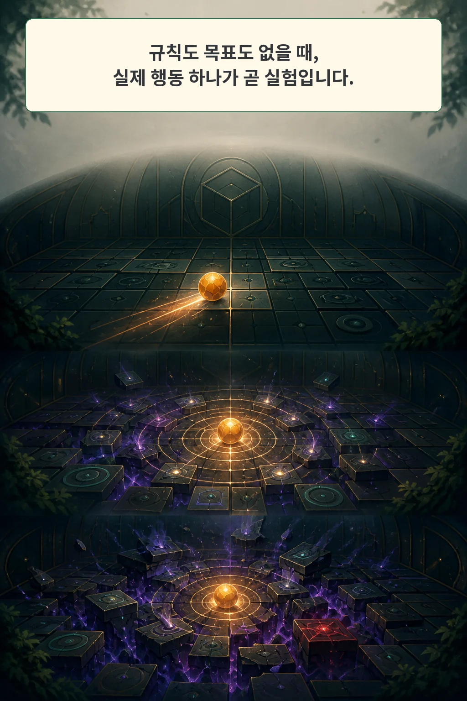
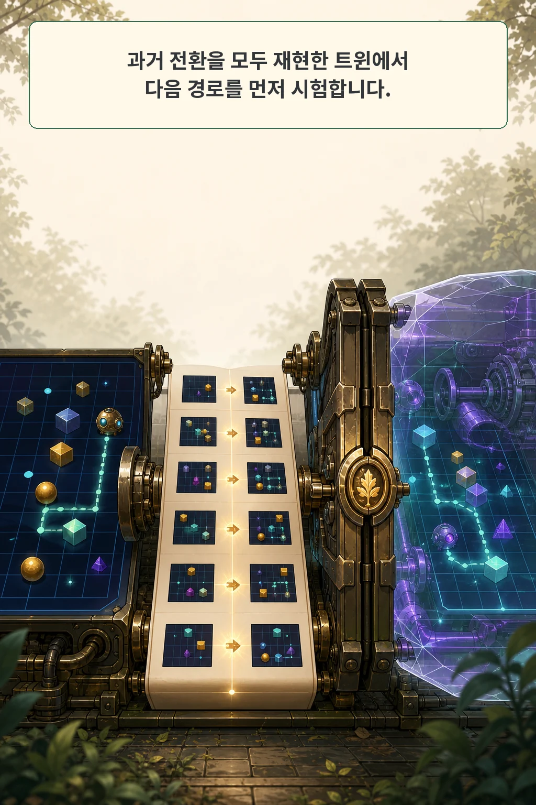
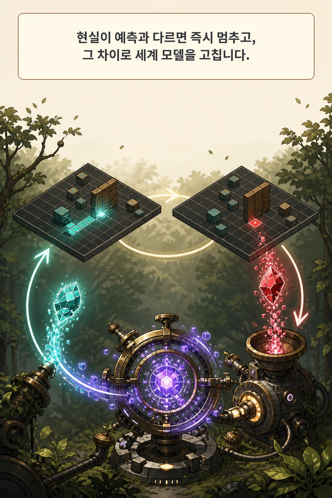
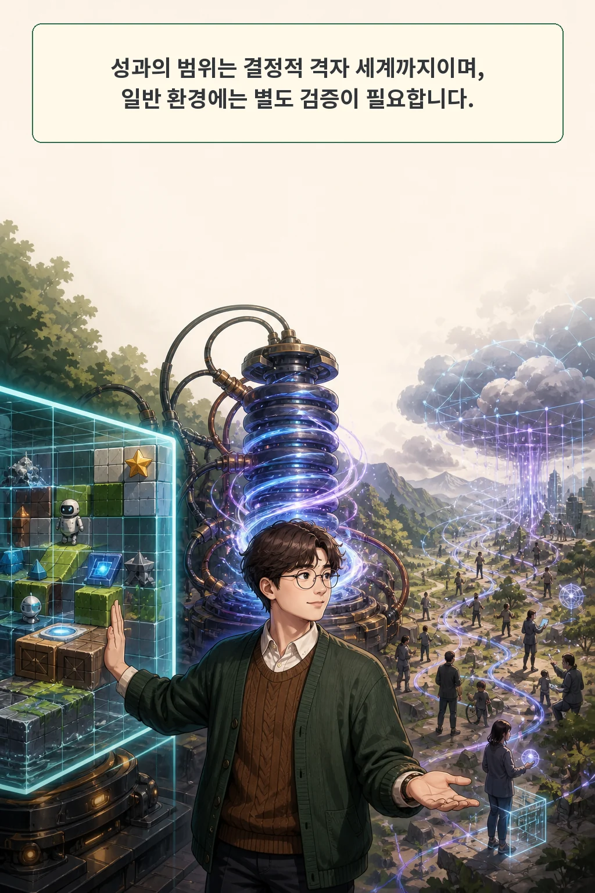

`Twin`의 핵심 산출물은 정답 행동 하나가 아니라 실행 가능한 게임 엔진입니다. 에이전트가 낯선 게임의 규칙을 Python 코드로 옮기고, 지금까지 관찰한 장면을 모두 재현한 복사본 안에서 다음 수를 먼저 시험하는 구조입니다. **「Twin: Playing an Unknown Game with a Test-Time Digital Twin」**은 이 방식을 ARC-AGI-3 공개 게임에서 평가해, 같은 기본 모델을 그대로 둔 채 하네스(harness)만 바꿔도 행동 효율이 크게 달라진다는 점을 보여 주었습니다.

글·해설: 다메카솔

## 핵심 내용

- `Twin`은 관찰한 환경 전환을 실행 가능한 Python 월드 모델(`step`, `goal_reached`)로 옮깁니다.
- 하네스는 과거 전환이 단 한 셀이라도 재현되지 않으면 실제 행동을 차단합니다.
- 같은 GPT-5.6 Sol 기본 모델 비교에서 `Twin` 하네스는 93.3점(23/25 게임 완료), 일반 Codex 하네스는 61.1점(13/25 게임 완료)을 기록했습니다.
- 행동 효율 점수에는 25개 실행에 쓰인 26억 처리 토큰과 91.4시간의 추론 비용이 반영되지 않습니다.
- 직접 검증 범위는 결정적인 $64 \times 64$ 이산 격자이며, 연속·확률적·잠재 상태 환경에는 별도 검증이 필요합니다.

## 규칙도 목표도 없는 환경에서 행동한다는 것



ARC-AGI-3 게임은 $64 \times 64$ 색 격자를 보여 주지만 버튼의 의미나 승리 조건을 전혀 설명하지 않습니다. 에이전트는 현재 화면과 가능한 행동 목록만 받고 행동을 제출한 뒤에야 다음 화면과 레벨 완료 신호를 볼 수 있습니다.

이 벤치마크가 비싸게 치는 자원은 실제 게임에 제출한 행동 횟수입니다. 첫 플레이 인간보다 적은 행동으로 레벨을 끝낼수록 점수가 높아지고, 그 과정에서 쓴 코드 작성·추론·내부 시뮬레이션 비용은 점수 계산에서 빠집니다. 그래서 `Twin`은 실제 환경에서 시행착오를 반복하기보다 점수에 잡히지 않는 테스트타임 계산을 길게 써서 한 번의 실제 행동을 준비하며, 매 행동 뒤 관찰할 수 있는 환경 동역학과 성공하기 전까지 양성 예시가 없는 숨은 목표를 분리해 다룹니다.

## 실행 가능한 복사본을 만들고 과거를 재생한다



에이전트가 유지하는 디지털 트윈은 두 개의 Python 함수로 요약됩니다.

```python
step(grid, action) -> grid
goal_reached(grid) -> bool
```

`step`은 현재 격자와 행동을 받아 다음 격자를 예측하고, `goal_reached`는 특정 상태가 승리 목표인지 판정합니다. 처음의 `step`은 아무 변화도 만들지 않는 항등 함수에 가깝지만, 실제 행동에서 반례가 들어올 때마다 규칙을 덧붙여 진화합니다.

여기서 하네스의 강력한 통제선이 `Validate` 단계입니다. 새 행동을 내기 전에 지금까지 기록한 모든 `이전 상태-행동-다음 상태` 쌍을 트윈이 다시 계산해, 단 한 셀이라도 맞지 않으면 코드가 수리될 때까지 실제 행동 제출을 막습니다([워크플로 판단과 실행 권한을 분리해 기록하는 방법](/posts/workflow-as-knowledge/)이 의미 계보에 초점을 둔다면, `Twin`은 실행 전 환경 재현을 기계적 문턱으로 둡니다). 과거 기록이 모두 일치하면 `Plan` 단계가 트윈 안에서 너비 우선 탐색(BFS, 기본 깊이 8·노드 20,000개, 목표 탐색 시 깊이 14·노드 30,000개)을 돌려 찾은 경로를 현실에 한 동작씩 제출하고, 예측과 실제 화면이 어긋나는 첫 순간에 즉시 멈춰 코드를 고칩니다.



과거는 정확히 재현하지만 목표까지의 경로가 없을 때는 `Explore` 단계가 작동합니다. 도달 가능한 상태 중 과거 프레임에서 이미 참이었던 후보(승리가 아님이 확인된 상태)를 버리고 실제 행동 비용이 가장 작은 후보를 임시 목표로 삼아 시험합니다. 즉 과거를 재현하지 못하는 **동역학 벽**은 코드 수리로 풀고, 목표 경로가 없는 **목표 벽**은 가설 탐색으로 푸는 이원화 구조입니다.

## 같은 기본 모델에서도 하네스가 결과를 바꿨다

ARC-AGI-3 공개 게임 25개(183개 레벨)에서 기본 모델(GPT-5.6 Sol), 파일 브리지, 샌드박스를 고정하고 `Twin` 하네스 유무만 비교한 실험 결과는 다음과 같습니다.

| 시스템 | 행동 효율 점수 | 완료 게임 | 완료 레벨 | 처리 토큰 및 비용 비교 |
| --- | ---: | ---: | ---: | --- |
| 같은 기본 모델의 Codex 하네스 | 61.1 | 13/25 | 148/183 | 기준선 |
| **Twin 하네스** | **93.3** | **23/25** | **179/183** | 전체 토큰 2.4배, 행동당 토큰 4.7배 (총 26억 토큰·91.4시간) |

세부 분석에서 드러난 강점과 한계도 뚜렷합니다.

- **인간 대비 행동 효율과 미관측 전환 예측**: 완료한 179개 레벨 중 158개에서 첫 플레이 인간보다 적은 행동을 썼고(완료 23개 게임 평균 인간 행동 수의 0.61배), 방문 상태에서 실제로 고르지 않았던 행동을 사후 엔진에 넣어 본 19,583개 쌍(순서 민감 게임 제외) 중 68.6%에서 다음 프레임 전체(exact frame)를 정확히 맞혔습니다.
- **목표 판정의 낮은 정밀도**: 완료된 179개 레벨 중 156개에서 첫 보상 전에 목표 가설을 맞혔지만, 매 행동 전 `goal_reached` 판정을 모두 세면 재현율(recall) 0.771에 정밀도(precision)는 0.214에 그쳤습니다. 승리가 아닌 상태에 불이 켜지는 거짓 양성이 잦아 경로가 일찍 끊기고 추가 행동을 쓰게 만들었으며, 미완료 게임 2개(`sc25`, `sp80`) 역시 동역학 복원보다 숨은 목표 파악이 더 어렵다는 점을 보여 주었습니다.
- **막대한 테스트타임 계산 비용**: 25개 실행에 총 26억 처리 토큰(게임별 510만~6억 2,500만 토큰, 실제 행동 1회당 평균 약 22만 4천 토큰)과 벽시계 추론 시간 91.4시간이 들었습니다. 행동 효율이 높다는 결과와 서비스 운영 비용이 낮다는 말은 전혀 다른 이야기입니다.

공식 GitHub 저장소(MIT 라이선스)에 하네스와 프롬프트·테스트가 공개되어 있으나 전체 실행을 재현하려면 ARC-AGI-3 환경과 호스팅된 GPT-5.6 Sol(random seed 비노출)이 필요하므로, 이번 검토에서는 원문·TeX와 공식 코드 구조를 교차 검증했습니다.

## 결정적 격자의 경계와 다메카솔의 해석



과거 전환 완전 재생(exact replay)이 강력하게 작동한 이유는 $64 \times 64$ 이산 격자에서 두 프레임의 셀 비교가 값싸고 결정적이기 때문입니다. 반면 긴 이력에만 남는 잠재 상태나 연속 센서, 확률적 API, 사람이 개입하는 운영 환경에서는 같은 입력이 항상 같은 출력을 내지 않으므로 이 방식을 그대로 옮길 수 없습니다.

그럼에도 운영 설계로 가져갈 핵심 원칙은 월드 모델 자체보다 **행동을 멈추게 하는 검증 경계**입니다. 작고 결정적인 환경이라면 `Twin`처럼 과거 전환 전체를 재생하는 강한 게이트를 걸고, 외부 API와 사람이 섞인 환경에서는 권한 제한, 멱등성(idempotency), 체크포인트, 롤백, 첫 불일치 시 즉시 중단 게이트를 단계별로 분리해 배치해야 합니다. 월드 모델의 예측은 행동 후보를 좁히는 데 쓰고, 실제 실행 허용 여부는 별도의 검증 게이트가 결정하게 만드는 것입니다.

## 논문 정보

| 항목 | 내용 |
| --- | --- |
| 제목 | Twin: Playing an Unknown Game with a Test-Time Digital Twin |
| 저자 | Alexy Skoutnev, Kirill Acharya, Gaston Longhitano, Madeleine Udell, Kevin Ellis, Iddo Drori |
| arXiv v1 제출 | 2026-08-14 17:06:00 UTC (2026-08-17 cs.AI 목록 등장) |
| 분야 | Artificial Intelligence (cs.AI) |
| 이 글의 분류 | systems paper |

## 출처

- [Twin: Playing an Unknown Game with a Test-Time Digital Twin — arXiv:2608.14490](https://arxiv.org/abs/2608.14490)
- [공식 arXiv PDF](https://arxiv.org/pdf/2608.14490)
- [저자 프로젝트와 25개 실행 재생](https://arc-agi-3-twin.vercel.app/)
- [공식 MIT 코드 저장소](https://github.com/Alexyskoutnev/TWIN-ARC-AGI-3)

이 글의 본문과 이미지는 생성형 AI로 제작했습니다. 기획과 편집 기준은 다메카솔이 정했습니다. 논문 그림과 게임 화면은 복제하지 않고, claim ledger에 근거해 자체 시각 언어로 재구성했습니다.

Updated: 2026-08-17
