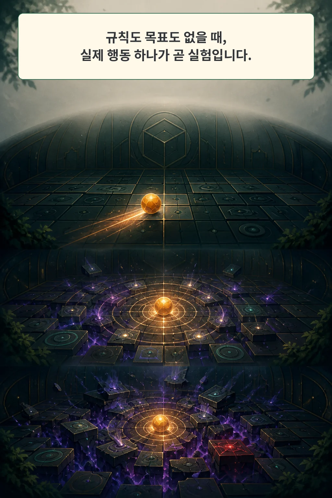
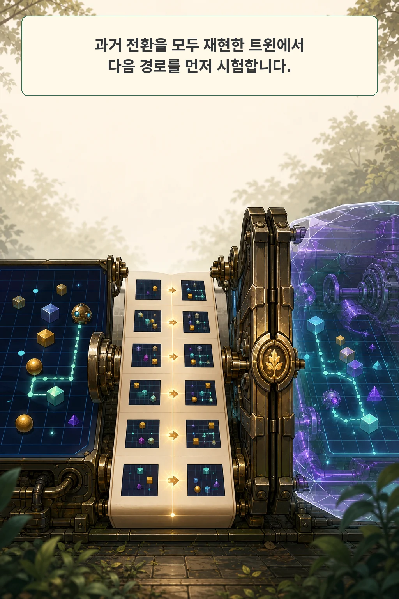
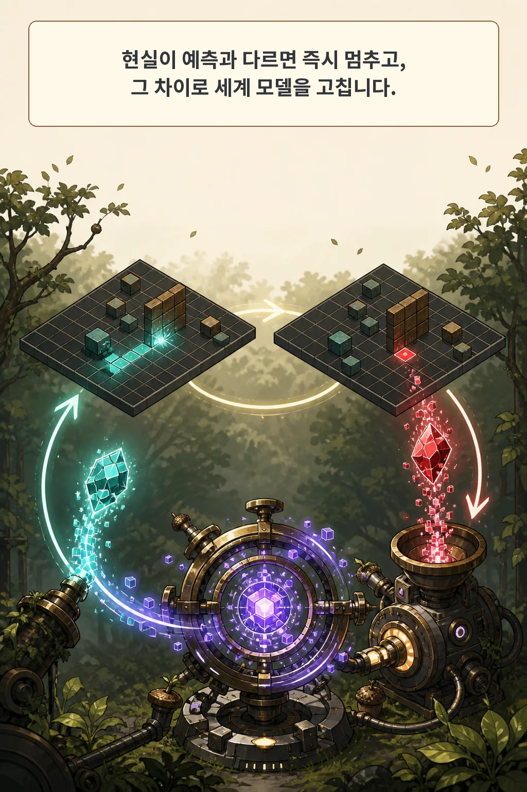
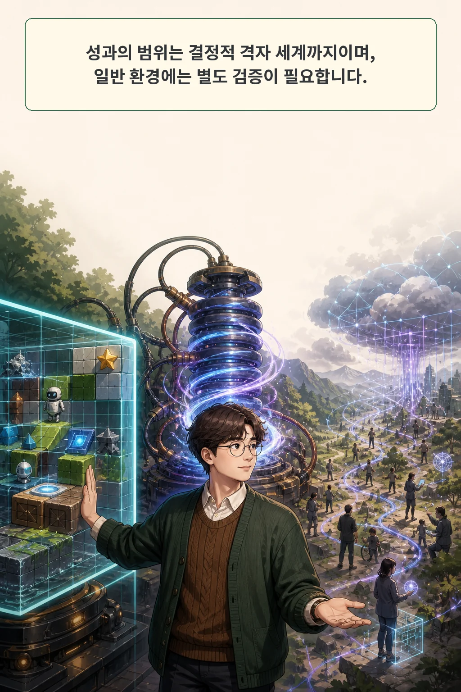

에이전트가 설명서도 목표도 없는 낯선 환경에 놓이면 첫 행동부터 막막해집니다. `Twin`은 정답을 추측하기보다 실행 가능한 게임 엔진을 먼저 작성하는 방법을 택했습니다. **「Twin: Playing an Unknown Game with a Test-Time Digital Twin」**은 관찰한 장면을 Python 코드로 복사해 과거를 모두 재현한 뒤 시뮬레이션 안에서 다음 수를 시험하면, 같은 기본 모델에서도 행동 효율이 크게 달라진다는 점을 보여 줍니다.

글·해설: 다메카솔

## 핵심 내용

- 관찰한 환경 전환을 실행 가능한 Python 모델(`step`, `goal_reached`)로 옮기고, 과거 전환이 한 셀이라도 어긋나면 실제 행동을 차단합니다.
- 같은 GPT-5.6 Sol 모델 비교에서 `Twin`은 93.3점(23/25 게임·179/183 레벨), Codex는 61.1점(13/25 게임·148/183 레벨)을 기록했습니다.
- 행동 효율 점수에는 25개 실행의 26억 처리 토큰과 91.4시간 추론 비용이 빠져 있으며, 검증 범위는 결정적인 $64 \times 64$ 이산 격자입니다.

## 규칙도 목표도 없는 환경에서 행동한다는 것



ARC-AGI-3의 $64 \times 64$ 색 격자 환경은 버튼 기능이나 승리 조건을 처음부터 감춰 둡니다. 에이전트는 현재 화면과 가능한 행동 목록만 받고, 실제 행동을 제출한 뒤에야 다음 화면과 레벨 완료 신호를 확인할 수 있죠.

이 벤치마크가 아끼는 자원은 실제 게임에 제출한 행동 횟수입니다. 첫 플레이 인간보다 적은 행동으로 레벨을 깰수록 점수가 올라가고, 코드 작성·추론·내부 시뮬레이션 비용은 점수 집계에서 빠지거든요. 그래서 `Twin`은 현실의 시행착오 대신 테스트타임 계산에 시간을 써서 한 번의 행동을 준비하고, 관찰 가능한 환경 동역학과 승리 전까지 예시가 없는 숨은 목표를 분리해 다룹니다.

## 실행 가능한 복사본을 만들고 과거를 재생한다



에이전트가 유지하는 디지털 트윈은 두 개의 Python 함수로 요약됩니다.

```python
step(grid, action) -> grid
goal_reached(grid) -> bool
```

`step`은 현재 격자와 행동을 받아 다음 격자를 예측하고, `goal_reached`는 특정 상태가 승리 목표인지 판정합니다. 예를 들어 한 번의 행동으로 화면의 특정 색 블록이 한 칸 이동했는데 초기 `step` 함수가 입력 격자를 그대로 돌려주었다면, 그 불일치가 곧바로 코드 수정의 반례가 됩니다. 처음에는 항등 함수에 가깝게 출발하지만, 실제 행동에서 반례가 쌓일 때마다 규칙을 덧붙여 실제 게임에 가까워지는 셈이죠.

여기서 하네스의 핵심 통제선이 `Validate` 단계입니다. 새 행동을 내기 전에 지금까지 기록한 모든 `이전 상태-행동-다음 상태` 쌍을 트윈으로 다시 계산해, 단 한 셀이라도 틀리면 코드가 수리될 때까지 실제 행동 제출을 막습니다([워크플로 판단과 실행 권한을 분리해 기록하는 방법](/posts/workflow-as-knowledge/)이 의미 계보에 초점을 둔다면, `Twin`은 실행 전 환경 재현을 기계적 문턱으로 둡니다). 과거 기록이 모두 맞으면 `Plan` 단계가 트윈 안에서 너비 우선 탐색(BFS, 기본 깊이 8·노드 2만 개, 목표 탐색 시 깊이 14·노드 3만 개)을 돌려 찾은 경로를 현실에 한 동작씩 제출하고, 예측과 실제 화면이 어긋나는 첫 순간 즉시 멈춰 코드를 다시 고칩니다.



과거는 정확히 재현하지만 목표까지의 경로를 찾지 못할 때는 `Explore` 단계가 작동합니다. 도달 가능한 상태 가운데 과거 프레임에서 이미 참이었던 후보(승리가 아님이 확인된 상태)를 걸러 내고, 실제 행동 비용이 가장 작은 후보를 임시 목표로 삼아 시험하거든요. 과거를 재현하지 못하는 **동역학 벽**은 코드 수리로, 목표 경로가 없는 **목표 벽**은 가설 탐색으로 푸는 이원화 구조입니다.

## 같은 기본 모델에서도 하네스가 결과를 바꿨다

ARC-AGI-3 공개 게임 25개(183개 레벨)에서 기본 모델(GPT-5.6 Sol), 파일 브리지, 샌드박스를 고정하고 `Twin` 하네스 유무만 비교한 결과를 아래 표에 정리했습니다.

| 시스템 | 행동 효율 점수 | 완료 게임 | 완료 레벨 | 처리 토큰 및 비용 비교 |
| --- | ---: | ---: | ---: | --- |
| 같은 기본 모델의 Codex 하네스 | 61.1 | 13/25 | 148/183 | 기준선 |
| **Twin 하네스** | **93.3** | **23/25** | **179/183** | 전체 토큰 2.4배, 행동당 토큰 4.7배 (총 26억 토큰·91.4시간) |

세부 분석을 보면 강점만큼이나 비용과 목표 판정의 한계도 분명하게 드러납니다.

- **인간 대비 행동 효율과 미관측 전환 예측**: 완료한 179개 레벨 중 158개에서 첫 플레이 인간보다 적은 행동을 썼고(완료 23개 게임 평균의 0.61배), 방문 상태의 미실행 행동 19,583개 쌍(순서 민감 게임 제외)을 사후 엔진과 대조했을 때 68.6%에서 다음 프레임 전체(exact frame)를 맞혔습니다.
- **목표 판정의 낮은 정밀도**: 완료된 179개 레벨 중 156개에서 첫 보상 전에 목표 가설을 맞혔지만, 매 행동 전 `goal_reached` 판정을 모두 세면 재현율(recall) 0.771에 정밀도(precision)는 0.214에 머물렀습니다. 거짓 양성 탓에 경로가 일찍 끊기며 추가 행동이 늘었고, 미완료 2개 게임(`sc25`, `sp80`) 역시 목표 추론의 난도를 드러냅니다.
- **막대한 테스트타임 계산 비용**: 25개 실행에 총 26억 처리 토큰(게임별 510만~6억 2,500만 토큰, 실제 행동 1회당 평균 약 22만 4천 토큰)과 벽시계 추론 시간 91.4시간이 들었습니다. 행동 효율이 높다고 운영 비용까지 저렴해지는 것은 아니죠.

## 결정적 격자의 경계와 다메카솔의 해석



과거 전환 완전 재생(exact replay)이 잘 작동한 이유는 $64 \times 64$ 이산 격자에서 셀 비교가 값싸고 결정적이기 때문입니다. 반면 긴 이력에만 남는 잠재 상태, 연속 센서, 확률적 API, 사람 개입 환경에는 그대로 적용하기 어렵고 고정된 BFS 예산 밖의 목표도 놓칠 수 있습니다.

그럼에도 운영 설계로 가져갈 핵심 원칙은 월드 모델 자체보다 **행동을 멈추게 하는 검증 경계**에 있습니다. 작고 결정적인 샌드박스라면 `Twin`처럼 과거 전환 전체를 재생하는 강한 문턱을 둘 수 있지만, 외부 API와 사람이 섞인 환경에서는 권한 제한, 멱등성(idempotency), 체크포인트, 롤백, 첫 불일치 시 즉시 중단 게이트를 단계별로 분리해 배치하는 편이 현실적이죠. 월드 모델은 후보를 좁히는 데만 쓰고, 실제 실행 허용 여부는 독립된 검증 게이트에 맡기는 설계입니다.

## 논문 정보

| 항목 | 내용 |
| --- | --- |
| 제목 | Twin: Playing an Unknown Game with a Test-Time Digital Twin |
| 저자 | Alexy Skoutnev, Kirill Acharya, Gaston Longhitano, Madeleine Udell, Kevin Ellis, Iddo Drori |
| arXiv v1 제출 | 2026-08-14 17:06:00 UTC (2026-08-17 cs.AI 목록 등장) |
| 분야 | Artificial Intelligence (cs.AI) |
| 이 글의 분류 | systems paper |

## 출처

- [Twin: Playing an Unknown Game with a Test-Time Digital Twin — arXiv:2608.14490](https://arxiv.org/abs/2608.14490)
- [공식 arXiv PDF](https://arxiv.org/pdf/2608.14490)
- [저자 프로젝트와 25개 실행 재생](https://arc-agi-3-twin.vercel.app/)
- [공식 MIT 코드 저장소](https://github.com/Alexyskoutnev/TWIN-ARC-AGI-3)

이 글의 본문과 이미지는 생성형 AI로 제작했습니다. 기획과 편집 기준은 다메카솔이 정했습니다. 논문 원문·TeX와 공식 MIT 코드 구조를 바탕으로 정리했으며, ARC-AGI-3 접근 및 호스팅 모델 제약으로 전체 실행은 독립 재현하지 않았고 논문 그림과 게임 화면도 복제하지 않았습니다.

Updated: 2026-08-17
