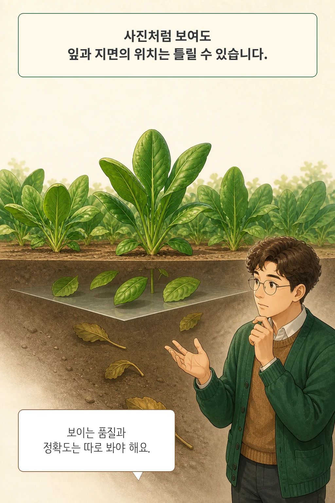
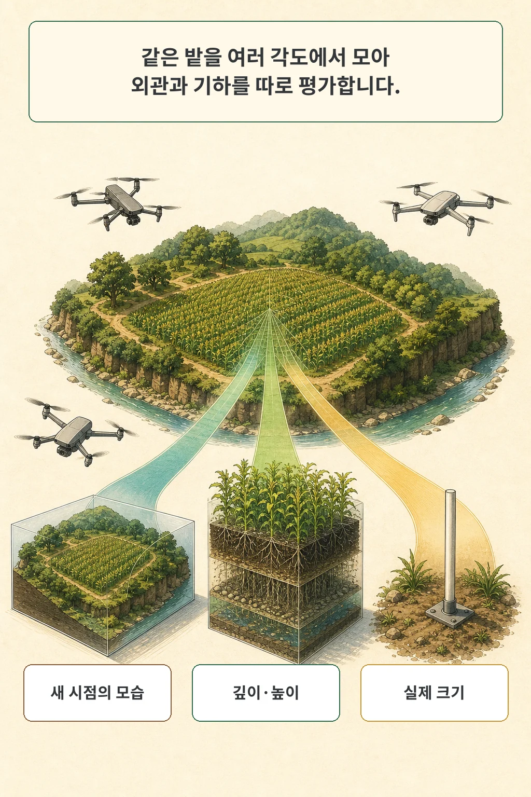
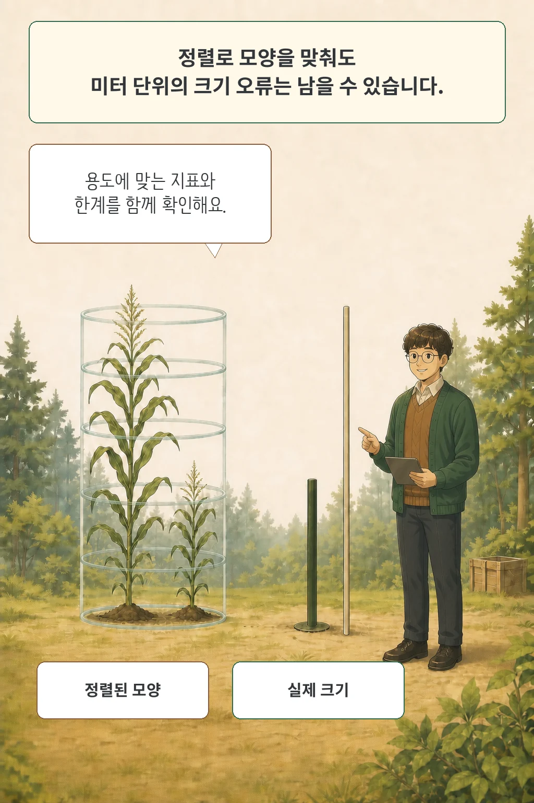

3D 복원 결과가 사진처럼 선명하면 지면과 잎의 위치도 정확할 것이라고 믿기 쉽습니다. 그러나 **「UAV3DCrop: Benchmarking 3D Reconstruction in Repeated Multi-Angle UAV Crop Surveys」**의 실험 결과는 이 통념을 깨뜨립니다. 같은 농경지를 외관, 깊이, 작물 높이, 실제 미터 크기로 나누어 평가해 보니 새 시점 이미지를 가장 선명하게 만든 방법과 깊이를 가장 정확히 복원한 방법이 서로 달랐고, 작물 높이에서는 또 다른 동률이 나왔습니다. 3D 모델의 품질은 “얼마나 그럴듯하게 보이는가”와 “실제로 어디에 있는가”를 분리해 읽어야 합니다.

글·해설: 다메카솔

## 핵심 내용

- **외관과 기하 정확도의 불일치**: 새 시점 이미지 품질 1위(`Splatfacto-big`, PSNR 19.40 dB)와 사진측량 기준 깊이 정확도 1위(`Scaffold-GS`, RMSE 0.722 m)가 서로 갈렸습니다.
- **작물 높이 측정 동률**: 현장 실측 작물 높이 오차(장면 매크로 MAE)에서는 `Scaffold-GS`(0.091 m)와 `Splatfacto`(0.092 m)가 사실상 동률이었고, 외관 1위인 `Splatfacto-big`은 0.156 m로 오차가 더 컸습니다.
- **정렬 전 미터 스케일 격차**: 미세조정 없는 범용 3D 모델 비교(Track B)에서 전용 metric-scale head를 가진 `MapAnything`만 정렬 전 스케일 오차(AbsRel 0.027)가 낮았고 나머지 세 모델은 0.890~0.965로 크게 어긋났습니다.
- **대규모 반복 관측 데이터**: 2023~2025년 미국 중서부 옥수수·대두·밀·귀리 밭 91개 장면(RGB 88,830장, 카메라 자세 88,413개, 깊이 자료 87,890개)을 CC BY 4.0으로 공개했습니다.

## 선명한 표면 아래에서 깊이가 어긋났다

연구진이 확인하려던 핵심 질문은 농경지에서 보기 좋은 3D 재구성이 실제 깊이와 작물 높이까지 정확한지였습니다. 실험 결과 새 시점 이미지 품질에서는 `Splatfacto-big`이 PSNR 19.40 dB로 선두였지만, 같은 장면의 사진측량 기준 깊이에서는 `Scaffold-GS`가 RMSE 0.722 m로 가장 낮았습니다(두 선두와 2위의 짝지은 95% 부트스트랩 구간은 모두 0을 제외했습니다).

Gaussian 예산을 더 크게 늘린다고 두 목표가 함께 좋아지지도 않았습니다. `Splatfacto-big`은 기본 `Splatfacto`보다 외관 PSNR을 0.35 dB 높였지만 처리량은 57% 줄었고, 깊이 오차는 옥수수·밀·귀리에서 오히려 더 커졌으며 대두에서만 소폭 나아졌습니다. 표면의 색과 질감을 잘 재현하는 능력이 올바른 3차원 위치를 보장하지 않은 것입니다.

## UAV3DCrop은 같은 밭을 네 가지 질문으로 나눴다

저자들은 2023년부터 2025년까지 미국 중서부 농경지(39개 촬영일, 8개 종단 시퀀스)에서 옥수수·대두·밀·귀리를 반복 촬영해 91개 장면, RGB 이미지 88,830장, 카메라 자세 88,413개, 사진측량 깊이 자료 87,890개를 구축했습니다. 평가는 두 트랙과 네 가지 측정 층위로 나뉩니다.

- **Track A (장면별 최적화, 2개 NeRF + 5개 3DGS 계열)**: 촬영 시점의 90%로 장면을 맞추고 결정적으로 고른 10%에서 보간(interpolation) 성능을 봅니다. (1) 새 시점 외관(PSNR·SSIM·LPIPS·처리량), (2) 같은 픽셀의 z-depth 오차, (3) 31개 장면·210개 현장 표본과 비교한 작물 높이를 각각 측정합니다.
- **Track B (미세조정 없는 피드포워드 모델, MASt3R·VGGT·Pi3·MapAnything)**: 장면마다 36장 부분집합을 140번 추출해 카메라 자세·점 지도·깊이·광선 방향·실제 크기를 평가하고 20,000회 짝지은 부트스트랩으로 불확실성을 계산했습니다.

## 겉모습·깊이·작물 높이·실제 크기의 선두가 모두 달랐다

평가 축별 주요 결과는 단일 평균 점수가 가리는 현장의 조건 차이를 선명하게 보여 줍니다.

| 평가 축 | 주요 결과 및 선두 모델 | 작물·설계별 세부 특징 |
| --- | --- | --- |
| **Track A: 작물 높이** | `Scaffold-GS`(MAE 0.091 m)와 `Splatfacto`(0.092 m) 동률 (`Splatfacto-big`은 0.156 m) | 옥수수는 깊이 오차가, 귀리는 높이 오차가 모든 방법에서 가장 컸음 (`Scaffold-GS`는 밀·귀리, `Splatfacto`는 옥수수·대두 우세) |
| **Track B: 자세·방향** | 8개 지표 중 7개에서 `MapAnything` 선두, 광선 방향 오차는 `Pi3` 선두 | 출력 목표에 따라 유리한 모델 구조가 갈림 |
| **Track B: 정렬 전 실제 크기** | `MapAnything` scale AbsRel **0.027** vs. 나머지 세 모델 **0.890~0.965** | `MapAnything`만 전용 metric-scale head를 보유해 사후 크기 정렬 없이 미터 단위를 복원함 |

특히 정렬 전 실제 크기(metric scale)의 격차가 결정적이었습니다. 다른 모델들도 예측된 3D 모양을 사후에 확대·축소하고 이동해 정답 기준과 겹치면 점 지도 구조가 그럴듯해 보였지만, 현장에서 작물 높이를 미터 단위로 바로 재야 할 때 사후 정렬을 쓰는 것은 필요한 답을 미리 컨닝하는 셈이 됩니다.

다만 이 벤치마크의 깊이 기준은 독립 레이저 스캔(LiDAR)이 아니라 SfM·사진측량으로 만들었고, 새 시점 평가가 촬영 범위 안의 보간이며 현장 작물 높이 실측치가 2025년에만 있다는 한계가 있습니다. 또한 2026년 8월 11일 확인 기준 공식 RGB(약 986.8 GB)와 depth(약 335.7 GB) 데이터셋은 CC BY 4.0으로 공개되어 있으나, 공식 GitHub 저장소(커밋 `0ef9998278fffcf88b72dc407f3691c6f93445b2`)에는 프로젝트 페이지와 경로 데이터·데모 자산만 있고 벤치마크 실행·학습·평가 코드는 아직 올라오지 않아 원문과 데이터 공개 구성을 교차 검토했습니다.

## 다메카솔의 해석: 용도를 고른 뒤 모델을 고른다

3D 재구성 모델을 도입할 때는 막연히 “최고 성능 모델”부터 묻지 말고 결과물로 무엇을 할 것인지부터 정해야 합니다. 사람이 보기에 선명한 새 시점 렌더링이 필요한지(외관 점수), 지표면까지의 정확한 표면 위치가 필요한지(깊이 오차), 수관과 지면의 높이 차이를 재야 하는지(작물 높이), 아니면 사후 정렬 없이 물리적 미터 단위를 바로 써야 하는지(정렬 전 스케일)에 따라 합격 기준이 전혀 달라집니다. 용도와 지표, 정렬 전 수치, 작물·시기별 실패를 차례로 짚어 봐야 “선명하니까 정확할 것”이라는 착시에서 벗어날 수 있습니다.

## 논문 정보

| 항목 | 내용 |
| --- | --- |
| 제목 | UAV3DCrop: Benchmarking 3D Reconstruction in Repeated Multi-Angle UAV Crop Surveys |
| 저자 | Junxiong Zhou 외 13명 |
| arXiv v1 제출 | 2026-08-03 03:17:42 UTC (2026-08-10 CS 신규 목록 공개) |
| 분야 | cs.CV, cs.LG |
| 상태 | arXiv preprint, 동료심사 채택 여부 미확인 |

## 출처

- [논문 초록과 메타데이터 - arXiv:2608.06404](https://arxiv.org/abs/2608.06404)
- [논문 원문 PDF](https://arxiv.org/pdf/2608.06404)
- [공식 UAV3DCrop 프로젝트](https://link-dev.github.io/UAV3DCrop/)
- [공식 GitHub 저장소](https://github.com/Link-dev/UAV3DCrop/tree/0ef9998278fffcf88b72dc407f3691c6f93445b2)
- [공식 RGB 데이터셋](https://huggingface.co/datasets/Link-Dev/UAV3DCrop)
- [공식 depth 데이터셋](https://huggingface.co/datasets/Link-Dev/UAV3DCrop_depth)
- [관련 글: AI 영상 평가가 점수 하나로 끝나면 안 되는 이유](/posts/videoargus-evidence-video-evaluation/)
- [관련 글: AI가 화면을 본다고 정말 더 잘 푸는 걸까](/posts/visual-tool-use-causal-audit/)

이 글의 본문과 이미지는 생성형 AI로 제작했습니다. 기획과 편집 기준은 다메카솔이 정했습니다.

Updated: 2026-08-11
