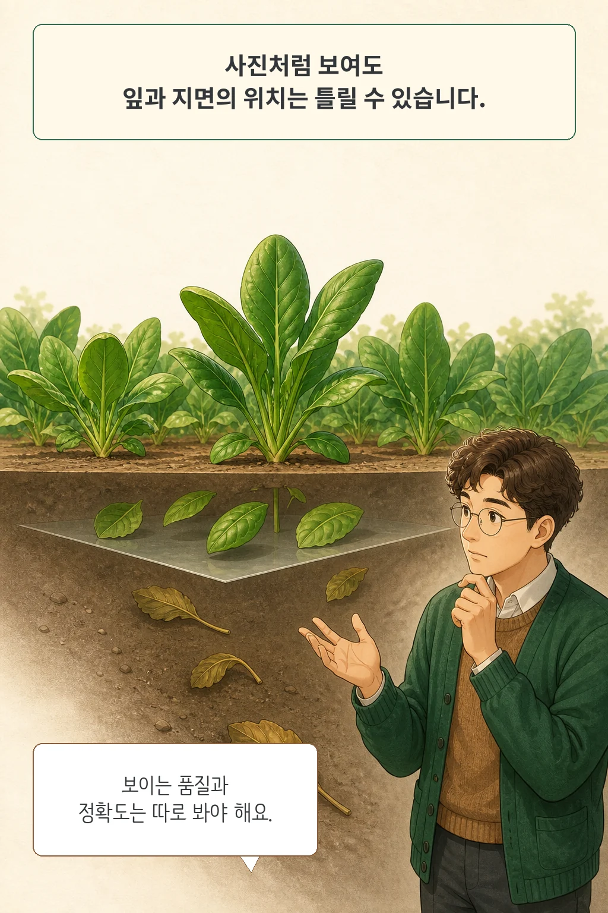
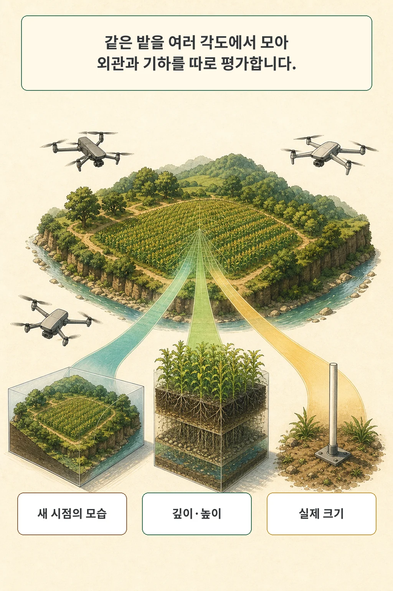
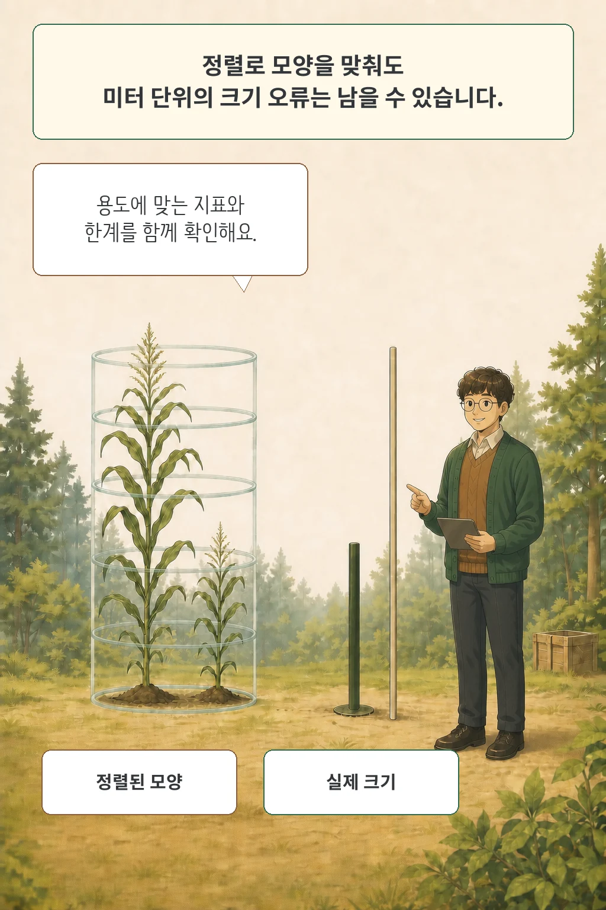

드론으로 촬영한 농경지 3D 모델이 사진처럼 선명하면 지면과 작물 잎의 위치도 정확할 것이라 믿기 쉽습니다. 하지만 여러 각도의 드론 영상을 반복 촬영해 검증한 **「UAV3DCrop」** 연구는 이 기대를 뒤집었는데요. 같은 밭을 외관·깊이·작물 높이·실제 미터 크기로 나누어 평가해 보니, 가장 보기 좋게 복원한 모델과 위치·크기를 정확히 맞힌 모델이 전혀 달랐습니다.

글·해설: 다메카솔

## 핵심 내용

- **외관·깊이 선두 불일치**: 새 시점 외관 1위(`Splatfacto-big`, PSNR 19.40 dB)와 사진측량 깊이 1위(`Scaffold-GS`, RMSE 0.722 m)가 갈렸습니다.
- **작물 높이 동률**: 실측 높이 오차(장면 매크로 MAE)는 `Scaffold-GS`(0.091 m)와 `Splatfacto`(0.092 m)가 동률인 반면, 외관 1위 `Splatfacto-big`은 0.156 m로 더 컸습니다.
- **정렬 전 스케일 격차**: Track B에서는 전용 metric-scale head를 갖춘 `MapAnything`만 AbsRel 0.027을 기록했고 나머지 세 모델은 0.890~0.965로 어긋났습니다.
- **반복 관측 데이터 공개**: 2023~2025년 옥수수·대두·밀·귀리 91개 장면(RGB 88,830장, 자세 88,413개, 깊이 87,890개)을 CC BY 4.0으로 공개했습니다.

## 선명한 표면 아래에서 깊이가 어긋났다

연구진은 농경지에서 보기 좋은 3차원 재구성이 실제 깊이와 작물 높이까지 정확한지 검증했습니다. 실험 결과 새 시점 이미지 품질은 `Splatfacto-big`이 선두였지만, 같은 장면의 사진측량 기준 깊이 정확도는 `Scaffold-GS`가 가장 높았거든요. 두 비교 모두 1위와 2위의 짝지은 부트스트랩 신뢰구간이 영(0)을 제외할 만큼 통계적 차이가 뚜렷했습니다.

예를 들어 드론 영상으로 농장 홍보용 가상 투어 화면을 띄울 때는 질감이 선명한 `Splatfacto-big`이 유리합니다. 반대로 물길이나 수관 표면을 분석하려고 정확한 3차원 좌표를 뽑아야 한다면 겉모습 점수만 보고 모델을 고를 때 낭패를 보기 쉽습니다. Gaussian 예산을 늘린 `Splatfacto-big`은 기본 `Splatfacto`보다 외관 PSNR을 소폭 높인 대신 처리량이 57% 줄었고, 깊이 오차 역시 대두에서만 조금 줄었을 뿐 옥수수·밀·귀리에서는 오히려 커졌거든요.

## UAV3DCrop은 같은 밭을 네 가지 질문으로 나눴다

저자들은 3년에 걸친 반복 촬영으로 대규모 농경지 벤치마크를 구축하고, 원시 RTK 위치가 노출되지 않도록 공개 카메라 기록에는 상대 자세와 내부 파라미터만 남겼습니다. 데이터 규모와 두 평가 트랙의 설계는 다음과 같이 정리할 수 있습니다.

| 구분 | 구성 및 평가 방식 | 측정 대상 및 규모 |
| --- | --- | --- |
| **데이터셋** | 2023~2025년 미국 중서부 39개 촬영일, 8개 종단 시퀀스 (옥수수·대두·밀·귀리) | 91개 장면, RGB 88,830장(약 986.8 GB), 자세 88,413개, 깊이 87,890개(약 335.7 GB) |
| **Track A** | 2개 NeRF + 5개 3DGS 계열 장면별 최적화 (시점 90% 학습, 결정적 10% 보간) | (1) 외관(PSNR·SSIM·LPIPS·처리량), (2) z-depth, (3) 31개 장면·210개 표본 작물 높이 |
| **Track B** | 미세조정 없는 피드포워드(`MASt3R`·`VGGT`·`Pi3`·`MapAnything`) | 장면당 36장 140회 추출, 자세·점 지도·깊이·광선 방향·실제 크기(20,000회 부트스트랩) |

## 겉모습·깊이·작물 높이·실제 크기의 선두가 모두 달랐다

평가 축별 결과를 나란히 놓아 보면 단일 평균 점수가 가리는 용도별 차이가 선명히 드러납니다.

| 평가 축 | 주요 결과 및 선두 모델 | 세부 특징 |
| --- | --- | --- |
| **Track A: 외관 vs. 깊이** | 외관 `Splatfacto-big`(PSNR 19.40 dB) vs. 깊이 `Scaffold-GS`(RMSE 0.722 m) | 두 비교 모두 1위·2위의 짝지은 95% 부트스트랩 구간이 0을 제외 |
| **Track A: 예산 증대** | `Splatfacto-big`이 기본 대비 PSNR +0.35 dB, 처리량 -57% | 깊이 오차는 대두만 소폭 개선, 옥수수·밀·귀리 3종에서는 악화 |
| **Track A: 작물 높이** | `Scaffold-GS`(0.091 m)와 `Splatfacto`(0.092 m) 동률 (`Splatfacto-big` 0.156 m) | 짝지은 구간 0 포함; 옥수수는 깊이, 귀리는 높이 오차 최대 (`Scaffold-GS` 밀·귀리, `Splatfacto` 옥수수·대두 우세) |
| **Track B: 자세·방향** | 8개 지표 중 7개 `MapAnything` 선두, 광선 방향은 `Pi3` 선두 | 출력 목표에 따라 유리한 구조 분화 |
| **Track B: 실제 크기** | `MapAnything` scale AbsRel **0.027** vs. 나머지 세 모델 **0.890~0.965** | `MapAnything`만 전용 metric-scale head로 정렬 없이 미터 단위 복원 |

특히 정렬 전 실제 크기(metric scale)의 격차가 결정적이었습니다. 다른 모델들도 예측한 3차원 모양을 사후에 확대·축소하고 이동해 정답과 겹치면 점 지도 구조가 그럴듯해 보였지만, 현장에서 작물 높이를 미터 단위로 바로 재야 한다면 사후 정렬은 답을 미리 빌려 오는 셈이죠. 가령 화면 위에서는 똑같이 반듯해 보이는 옥수수 밭 점 지도라도 한쪽은 실제 키가 두 배로 부풀려져 있을 수 있습니다.

이 벤치마크를 읽을 때는 실험 조건상의 한계도 함께 고려해야 합니다. 깊이 기준이 독립 레이저 스캔(LiDAR)이 아니라 SfM·사진측량 자료이며, 새 시점 평가가 촘촘한 촬영 범위 안의 보간에 국한되고, 현장 작물 높이 실측치도 2025년에만 존재하기 때문입니다. 또한 2026년 8월 확인 기준 공식 Hugging Face의 RGB와 depth 데이터셋은 비게이트 CC BY 4.0으로 공개되어 있으나, 공식 GitHub 저장소에는 프로젝트 페이지와 경로 데이터·데모 자산만 있고 벤치마크 실행·학습·평가 코드는 아직 올라와 있지 않습니다.

## 다메카솔의 해석: 용도를 고른 뒤 모델을 고른다

3D 재구성 모델을 고를 때는 막연히 “최고 성능 모델”부터 찾기보다 결과물로 무엇을 할지 먼저 정해야 합니다. 선명한 시각화가 목적이라면 외관 점수를, 지표면과 수관 위치를 계산해야 한다면 깊이 오차와 작물 높이 MAE를 우선 확인해야 하죠. 사후 크기 정렬 없이 물리적 미터 단위를 바로 쓰는 현장이라면 정렬 전 스케일 오차까지 반드시 점검해야 “선명하니까 정확할 것”이라는 착시에서 벗어날 수 있습니다.

## 논문 정보

| 항목 | 내용 |
| --- | --- |
| 제목 | UAV3DCrop: Benchmarking 3D Reconstruction in Repeated Multi-Angle UAV Crop Surveys |
| 저자 | Junxiong Zhou 외 13명 |
| arXiv v1 제출 | 2026-08-03 03:17:42 UTC (2026-08-10 CS 신규 목록 공개) |
| 분야 | cs.CV, cs.LG |
| 상태 | arXiv preprint, 동료심사 채택 여부 미확인 |

## 출처

- [논문 초록과 메타데이터 - arXiv:2608.06404](https://arxiv.org/abs/2608.06404)
- [논문 원문 PDF](https://arxiv.org/pdf/2608.06404)
- [공식 UAV3DCrop 프로젝트](https://link-dev.github.io/UAV3DCrop/)
- [공식 GitHub 저장소](https://github.com/Link-dev/UAV3DCrop/tree/0ef9998278fffcf88b72dc407f3691c6f93445b2)
- [공식 RGB 데이터셋](https://huggingface.co/datasets/Link-Dev/UAV3DCrop)
- [공식 depth 데이터셋](https://huggingface.co/datasets/Link-Dev/UAV3DCrop_depth)
- [관련 글: AI 영상 평가가 점수 하나로 끝나면 안 되는 이유](/posts/videoargus-evidence-video-evaluation/)
- [관련 글: AI가 화면을 본다고 정말 더 잘 푸는 걸까](/posts/visual-tool-use-causal-audit/)

이 글은 논문 원문과 공개 저장소·데이터셋 자료를 바탕으로 정리했으며, 별도 실행 측정은 포함하지 않았습니다.

이 글의 본문과 이미지는 생성형 AI로 제작했습니다. 기획과 편집 기준은 다메카솔이 정했습니다.

Updated: 2026-08-11
