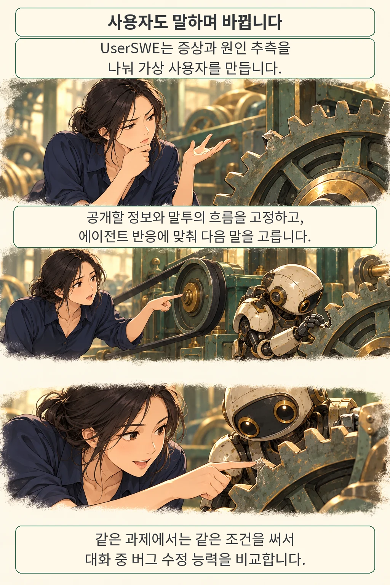
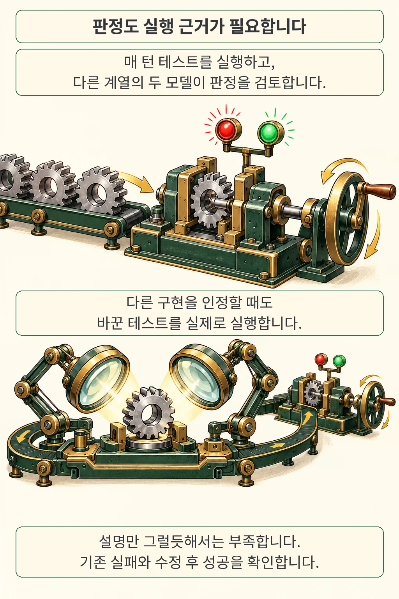
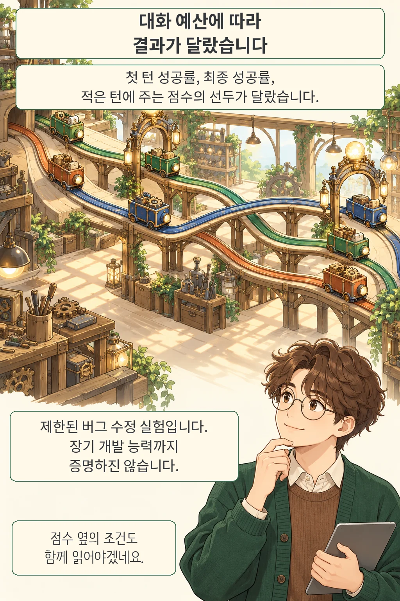

코딩 에이전트가 깔끔한 첫 요청에서 버그를 잘 고친다고 해서, 설명이 불완전한 대화를 여러 턴 이어 갈 때도 똑같이 잘 해결할까요? **UserSWE**는 사용자의 설명 방식이 도중에 바뀌는 환경을 만들고 매 턴 테스트를 실행해 이 차이를 평가합니다. 논문에서 첫 턴 해결률, 최종 해결률, 적은 턴에 높은 점수를 주는 지표의 선두는 각각 다른 에이전트가 차지했습니다.

글·해설: 다메카솔

2026년 10월 21일 제출된 「UserSWE: Evaluating Coding Agents in Multi-Turn Conversations with Dynamic Users」 v1은 단일 프롬프트 평가가 놓치기 쉬운 대화 조건을 다룹니다. 사용자 말투와 실행 판정, 대화 예산이 점수를 어떻게 바꾸는지 살펴볼까요?

## 사용자의 설명도 평가 조건입니다

실무에서 버그 리포트가 처음부터 완벽한 경우는 드뭅니다. 예를 들어 “특정 조건에서 결과가 어긋난다”처럼 증상만 모호하게 말했다가, 빗나간 원인을 추측해 넘기고, 대화가 오간 뒤에야 재현 단서를 꺼내는 흐름이 흔하죠. UserSWE는 이런 변화를 **증상의 명확성**(명확·모호 2종)과 **원인 견해**(견해 없음·올바른 견해·빗나간 추측·잘못된 단정 4종)를 조합한 여덟 가지 말투로 구성했습니다.

말투 분류와 발화 규칙은 저자들이 설계하고, 시작 분포와 턴 사이 전이는 내부 상용 코딩 도구의 20,859개 개발 세션(코드 변경 13,530개) 로그로 보정했습니다. 단일 내부 도구의 기록이라 전체 개발자의 소통 습관을 그대로 대표한다고 보기는 어렵습니다.

설계의 핵심은 **말할 수 있는 정보**와 **말하는 방식**을 분리한 점입니다. 과제별 정보 풀과 말투 흐름은 평가 전에 고정하지만, 매 턴 꺼낼 단서는 에이전트 응답과 테스트 결과에 맞춰 고르거든요. 직접 질문에는 먼저 답하고, 그렇지 않으면 아직 풀리지 않은 주요 증상을 전합니다. 출발점과 정보 범위, 말투 흐름을 맞추되 실제 대화는 에이전트 대응에 따라 이어집니다.

가상 사용자의 정보 제한 조건이 궁금하다면 [KnowSim의 정보 제한 방식](/posts/knowsim-information-calibration/)도 함께 볼 만합니다. UserSWE는 이 문제를 저장소 버그 수정과 매 턴 실행 판정에 연결했습니다.

## 고쳤다는 설명을 테스트로 확인합니다

에이전트가 고쳤다고 설명해도 실행해 보면 오류가 남거나 기존 기능이 깨질 수 있습니다. UserSWE는 그럴듯한 설명이 실행 결과를 대신하지 않도록 매 턴 수정 대상 테스트와 회귀 테스트를 함께 돌립니다. Judge가 실행 근거로 판정을 쓰면 다른 모델 계열의 Reviewer가 근거와 다음 발화를 검토하며, 실험에서는 Codex에서 실행한 GPT-5.6-Sol과 Claude Code에서 실행한 Claude Opus 5가 과제별로 역할을 바꿨거든요. 두 계열을 교차 배치해도 판정 오류 가능성을 완전히 지우기는 어렵지만 단일 모델 편향을 줄이려는 장치입니다.

테스트가 정답 패치의 함수 이름에 지나치게 묶여 있으면 같은 동작을 다른 이름으로 구현한 코드가 탈락합니다. 가령 내부 헬퍼 이름만 다르게 지은 정상 구현이 기존 테스트에서 실패할 수 있죠. 논문은 기대 입출력을 유지한 채 테스트를 고치고, 수정 전 코드 실패·후보 구현 성공·회귀 검사·Reviewer 승인을 모두 실제로 확인하는 제한적 **동등 통과 절차**를 둡니다.

## 몇 번까지 대화할지에 따라 점수가 달라집니다

저자들은 실제 저장소 버그 수정 과제를 성격에 따라 나누고, 과제 유형마다 대화 예산을 다르게 배정했습니다.

- **평가 규모**: 42개 저장소의 72개 과제, 11개 에이전트
- **단일 문제 (50개)**: 기존 단일 버그 수정 과제, 최대 5턴 허용
- **연쇄 문제 (22개)**: 저장소 이력에서 찾은 두 문제 연쇄 과제, 최대 8턴 허용

과제마다 허용 턴이 다르므로 모든 과제에 8턴을 준 조건과 구분해 읽어야 합니다. 아래 표는 논문 Table 3의 주요 결과와 부록의 LDPR 95% 재표집 구간을 정리한 값이며, ‘최종’은 과제별 예산 기준, 분모는 전체 72개 과제입니다. 모델명은 논문에 보고된 실행 틀과의 결합 구성을 가리킵니다.

| 논문 속 에이전트 | 첫 턴 해결률 | 최종 해결률 | LDPR | 95% 재표집 구간 |
| --- | ---: | ---: | ---: | ---: |
| Claude Opus 5 / Claude Code | 25.0% | 80.6% | 0.640 | 0.553~0.722 |
| Claude Fable 5.1 / Claude Code | 31.9% | 76.4% | 0.593 | 0.499~0.684 |
| GPT-6-Astra / Codex | 12.5% | 81.9% | 0.561 | 0.481~0.639 |

표에서 첫 턴 해결률은 Claude Fable 5.1이, 최종 해결률은 GPT-6-Astra가, **LDPR**은 Claude Opus 5가 각각 앞섰습니다. 참고로 Fable의 작업 거부 사례도 미해결로 집계됐습니다.

여기서 LDPR은 성공까지 쓴 턴이 적을수록 높은 점수를 주는 지표입니다. 코드 변경 없는 대화 턴은 0.5로 세고 예산 안에 못 풀면 0점을 부여하거든요. 시간이나 토큰 비용을 직접 재기보다 몇 번의 왕복 만에 고쳤는지 압축해 보여 주는 척도인 셈이죠.

점추정치 순서를 곧바로 확정적인 우열로 보기도 어렵습니다. 표의 LDPR 95% 재표집 구간이 서로 넓게 겹치기 때문이죠. 논문은 55개 에이전트 쌍의 대응 비교에 다중 비교 보정(BH 5% FDR)을 적용해 LDPR로 17쌍을 구분했다고 보고하지만, 이 총개수만으로 표 속 특정 두 모델의 차이가 유의하다고 단정하기는 이릅니다.

사용자가 항상 명확하고 올바르게 설명하는 조건과 동적 조건을 같은 50개 단일 문제에서 비교한 결과도 흥미롭습니다. 네 에이전트 중 셋은 동적 조건에서 LDPR이 낮아졌지만 Kimi-K3는 오히려 높아져, 사용자 조건의 영향이 에이전트마다 같지 않았음을 보여 줍니다.

## 이 실험이 다루지 않은 일

UserSWE는 한두 문제를 정해진 완료 조건까지 고치는 단기 유지보수 과제입니다. 빈 저장소에서 제품을 새로 만들거나 수개월 동안 운영하는 역량과는 결이 다르죠. 매 턴 실행과 검토 비용 탓에 과제 수가 72개에 한정됐고, 한 내부 도구 로그로 만든 시뮬레이션을 전체 개발자 행동으로 일반화하기도 어렵습니다.

원문의 재현성 설명은 데이터와 평가 도구를 앞으로 공개하겠다고 적습니다. 2026년 10월 22일 확인한 논문 원문과 arXiv 메타데이터에서는 공식 배포 URL이나 확정된 동료심사 근거를 찾지 못해, 공개 코드로 바로 재현할 단계까지는 아직 이릅니다.

## 다메카솔의 해석: 점수 옆의 조건을 읽습니다

이 연구에서 가져갈 질문은 ‘어느 모델이 최고인가’보다 구체적입니다. 팀의 작업 방식에 따라 유리한 에이전트가 달라지므로, 평가표를 볼 때 성공률 옆에 세 가지 조건을 함께 적어 두는 편이 유용합니다.

- **대화 예산과 사용자 단서**: 한 번의 요청으로 끝낼지, 모호한 증상에서 여러 턴 왕복 수정을 허용할지
- **판정 근거**: 모델의 설명이 아니라 테스트 실행과 회귀 검증에 성공 기준이 묶여 있는지
- **비용 척도**: 턴 효율(LDPR) 외에 실제 응답 시간과 토큰 비용을 함께 따질지

이런 조건을 맞춰 놓고 읽어야 외부 평가표의 숫자가 내 작업 환경에 얼마나 가까운지 가늠하기 수월해집니다.

## 출처

- [UserSWE v1 — 논문 정보와 제출 이력](https://arxiv.org/abs/2610.29822v1)
- [UserSWE 원문 PDF](https://arxiv.org/pdf/2610.29822v1): §4 평가 설계, Table 3·4 결과, §6 한계, 부록 D.2·Table 14 불확실성.
- [UserSWE HTML 원문](https://arxiv.org/html/2610.29822v1)

원문 확인일: 2026-10-22. 이 글은 논문 원문을 해설하며 실험을 독립 재현하지 않았고, 만화 속 작업장·부품·경로는 설명을 위해 새로 구성한 비유입니다.

이 글의 본문과 이미지는 생성형 AI로 제작했습니다. 기획과 편집 기준은 다메카솔이 정했습니다.
