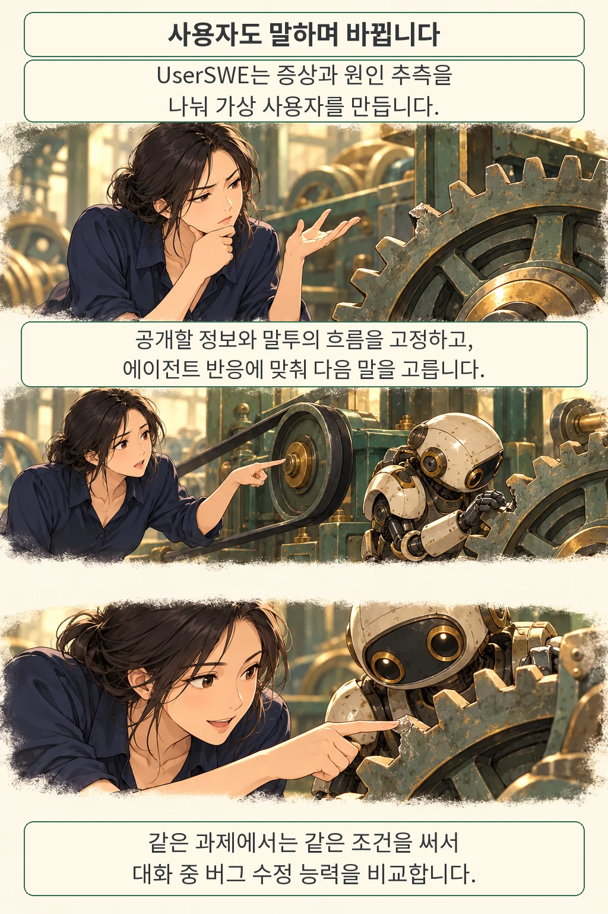
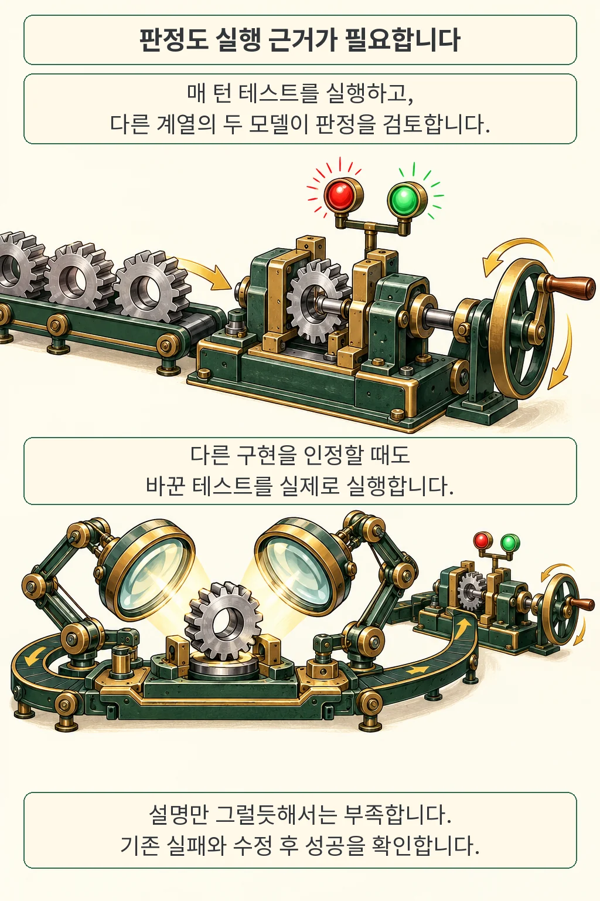

코딩 에이전트가 첫 요청에 버그를 고치는 능력과, 불완전한 설명을 듣고 여러 번 수정해 끝내 해결하는 능력은 같은 점수로 드러나지 않을 수 있습니다. UserSWE는 사용자의 설명 방식이 바뀌는 대화를 만들고 매 턴 테스트를 실행해 이 차이를 평가합니다. 논문에서 첫 턴 해결률, 최종 해결률, 적은 턴에 더 높은 점수를 주는 지표의 선두는 서로 달랐습니다.

글·해설: 다메카솔

2026년 10월 21일 제출된 「UserSWE: Evaluating Coding Agents in Multi-Turn Conversations with Dynamic Users」 v1을 읽었습니다. 아래 결과는 저자들의 제한된 버그 수정 실험입니다. 논문 원문을 검토했으며 평가를 독립 재현하지 않았습니다.

## 사용자의 설명도 평가 조건입니다

처음에는 증상을 막연하게 말하다가 나중에 재현 조건을 찾을 수 있습니다. 원인을 추측해 알려 줬지만 그 추측이 빗나갈 수도 있습니다. UserSWE는 이런 차이를 증상의 명확성과 원인에 대한 견해로 나눕니다. 명확하거나 모호한 증상에, 원인 견해 없음·올바른 견해·빗나간 추측·잘못된 단정을 조합해 여덟 가지 말투를 구성합니다.

저자들은 내부에 배포된 상용 코딩 도구의 20,859개 개발 세션에서 시작 분포와 턴 사이 전이를 측정했습니다. 그중 코드를 바꾼 세션은 13,530개입니다. 이 로그가 모든 개발자를 대표하는 것은 아닙니다. 말투의 분류와 발화 규칙은 저자들이 설계했고, 로그는 빈도와 전이를 보정하는 데 쓰였습니다.

말할 수 있는 정보와 말하는 방식을 분리한 것이 설계의 핵심입니다. 과제별 정보 풀과 말투의 흐름은 평가 전에 고정합니다. 그 안에서 다음에 꺼낼 내용은 에이전트의 응답과 테스트 결과에 맞춰 고릅니다. 직접 질문을 받으면 답을 먼저 하고, 그렇지 않으면 중요한 미해결 증상 등을 전달합니다. 따라서 모든 에이전트가 대화 전체를 똑같이 듣는다는 뜻은 아닙니다. 출발점과 정보의 범위, 말투의 흐름을 맞추되 실제 응답에 따라 대화가 이어집니다.

사용자 시뮬레이션의 정보 조건이 궁금하다면 [KnowSim의 정보 제한 방식](/posts/knowsim-information-calibration/)도 함께 읽을 수 있습니다. UserSWE는 이 문제를 저장소 버그 수정과 매 턴의 실행 판정에 연결합니다.

## 고쳤다는 설명을 테스트로 확인합니다

UserSWE는 매 턴 수정 대상의 테스트와 기존 동작을 지켜야 하는 회귀 테스트를 실행합니다. Judge가 판정을 작성하면 다른 모델 계열의 Reviewer가 근거와 다음 발화를 검토합니다. 실험에서는 Codex에서 실행한 GPT-5.6-Sol과 Claude Code에서 실행한 Claude Opus 5가 과제별로 역할을 바꿨습니다. 테스트가 말해 주는 결과를 모델의 그럴듯한 설명으로 대체하지 않도록 한 설계입니다. 두 모델을 쓴다고 판정 오류가 모두 사라진다는 뜻은 아닙니다.

테스트가 정답 패치의 함수 이름에 지나치게 묶여 있으면, 같은 동작을 다른 이름으로 구현한 코드가 탈락할 수 있습니다. 논문은 제한적인 동등 통과 절차를 둡니다. 기대한 입력과 출력은 유지한 채 테스트를 바꾸고, 그 테스트가 수정 전 코드에서는 실패하고 후보 구현에서는 성공하는지 실제로 실행합니다. 회귀 검사와 Reviewer 승인도 필요합니다. 테스트를 통과하지 못했는데 설명만 보고 성공으로 처리하는 절차가 아닙니다.

## 몇 번까지 대화할지에 따라 점수가 달라집니다

평가는 42개 저장소에서 가져온 72개 과제, 11개 에이전트를 대상으로 했습니다. 기존 단일 문제에서 구성한 50개 과제는 최대 5턴, 저장소 이력에서 찾은 두 문제의 연쇄 22개는 최대 8턴을 허용했습니다. 모든 과제에 8턴을 준 결과로 읽으면 안 됩니다.

아래는 논문 Table 3의 일부입니다. ‘최종’은 각 과제에 정해진 예산까지의 결과이며, 비율의 분모는 전체 72개 과제입니다. 모델 이름은 논문에 보고된 실행 조합을 가리킵니다.

| 논문 속 에이전트 | 첫 턴 해결률 | 최종 해결률 | LDPR |
| --- | ---: | ---: | ---: |
| Claude Opus 5 / Claude Code | 25.0% | 80.6% | 0.640 |
| Claude Fable 5.1 / Claude Code | 31.9% | 76.4% | 0.593 |
| GPT-6-Astra / Codex | 12.5% | 81.9% | 0.561 |

LDPR은 성공까지 사용한 턴이 적을수록 높은 점수를 주는 지표입니다. 코드 변경이 없는 턴은 0.5로 세고 예산 안에 해결하지 못하면 0점을 줍니다. 이 점수는 시간이나 토큰 비용을 직접 재는 값이 아닙니다. Fable의 작업 거부도 미해결로 포함됐습니다.

점추정치의 순서를 곧바로 확정적인 우열로 읽기도 어렵습니다. 과제를 재표집한 LDPR의 95% 구간은 Opus 5가 0.553~0.722, Fable 5.1이 0.499~0.684, Astra가 0.481~0.639였습니다. 논문은 55개 에이전트 쌍의 대응 비교에 다중 비교 보정을 적용해 LDPR로 17쌍을 구분했다고 보고합니다. 이 총개수만으로 표의 특정 두 모델 사이 차이가 유의하다고 말할 수는 없습니다.

사용자가 항상 명확하고 올바르게 설명하는 조건과 동적으로 바뀌는 조건도 비교했습니다. 같은 50개 단일 문제에서 살펴본 네 에이전트 중 셋은 동적 조건에서 LDPR이 낮아졌고 Kimi-K3는 오히려 높아졌습니다. 사용자 조건의 영향이 에이전트마다 같지 않았다는 결과입니다.

## 이 실험이 다루지 않은 일

UserSWE는 한두 문제를 정해진 완료 조건까지 고치는 유지보수 과제입니다. 빈 저장소에서 제품을 만들거나 수개월 동안 운영하는 능력을 측정하지 않았습니다. 매 턴 실행과 검토에 비용이 들고 과제 수도 72개에 한정됩니다. 한 내부 도구의 사용자 로그에서 만든 시뮬레이션을 실제 사용자 전체의 행동과 동일시할 수도 없습니다.

원문의 재현성 설명은 데이터와 평가 도구를 앞으로 공개하겠다고 적습니다. 2026년 10월 22일 검토한 논문·arXiv 메타데이터에서 공식 배포 URL이나 확정된 동료심사 근거는 확인하지 못했습니다. 현재 공개된 코드로 누구나 결과를 재현할 수 있다고 안내할 단계는 아닙니다.

## 다메카솔의 해석: 점수 옆의 조건을 읽습니다

이 연구에서 가져갈 질문은 ‘어느 모델이 최고인가’보다 구체적입니다. 한 번의 요청으로 끝낼 것인지, 추가 질문과 수정을 허용할 것인지, 사용자가 알고 있는 정보는 무엇인지, 성공 판정이 실행 결과에 묶여 있는지를 함께 봐야 합니다. 이런 조건을 적어 두면 평가표의 숫자가 내 작업에 얼마나 가까운지 판단하기 쉬워집니다. 이는 논문 결과에서 끌어낸 해석이며, 특정 도구를 채택하면 생산성이 높아진다는 실증 결과는 아닙니다.

## 출처

- [UserSWE v1 — 논문 정보와 제출 이력](https://arxiv.org/abs/2610.29822v1)
- [UserSWE 원문 PDF](https://arxiv.org/pdf/2610.29822v1): §4 평가 설계, Table 3·4 결과, §6 한계, 부록 D.2·Table 14 불확실성.
- [UserSWE HTML 원문](https://arxiv.org/html/2610.29822v1)

원문 확인일: 2026-10-22. 그림 속 작업장·부품·경로는 설명을 위한 비유이며 실제 사용자 기록이나 수치 그래프가 아닙니다.

이 글의 본문과 이미지는 생성형 AI로 제작했습니다. 기획과 편집 기준은 다메카솔이 정했습니다.
