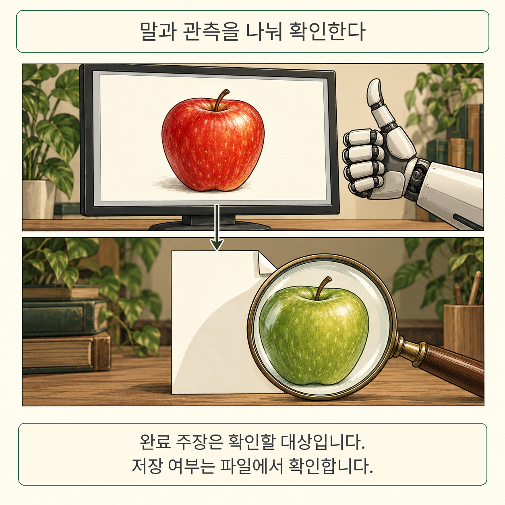
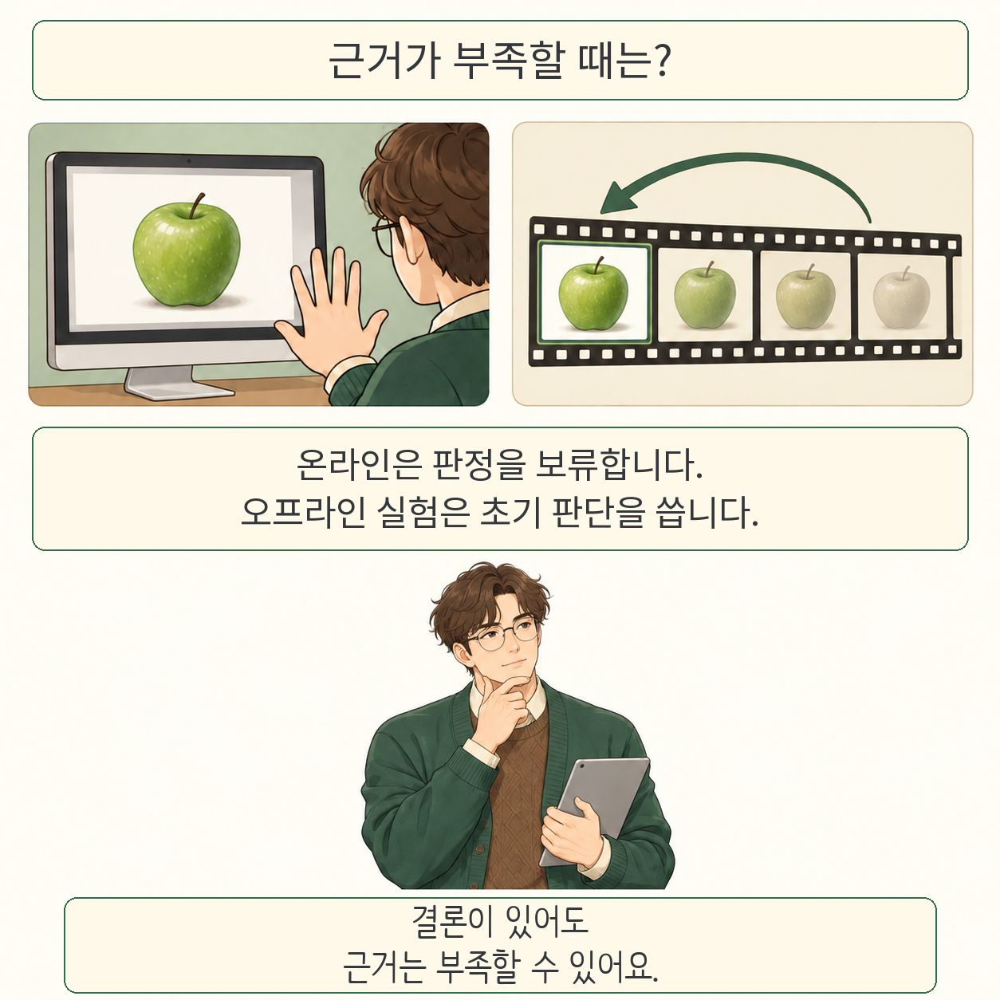

VeriCUA는 컴퓨터 사용 에이전트의 완료 보고를 검증할 때, 부족한 근거를 찾아 추가로 살펴보는 연구입니다. 화면·파일·앱 상태에서 얻은 관측을 요청의 세부 조건과 연결합니다. 특히 **결론을 내렸다는 사실과 그 결론을 뒷받침할 근거가 충분하다는 사실을 구별**합니다. 

글·해설: 다메카솔

이 글은 Qiushi Sun 외 연구진의 **VeriCUA: Verification as Agentic Exploration for Computer-Using Agents**, arXiv:2610.40578v1을 다룹니다. 2026년 10월 29일 제출됐으며 원문에는 진행 중인 연구라고 명시돼 있습니다. 같은 이름의 다른 연구와 혼동하지 않도록 제목과 논문 번호를 함께 확인해야 합니다. 

## 완료 메시지는 검사의 출발점입니다

그림 속 사과 색을 초록에서 빨강으로 바꾸고 저장하라는 요청을 생각해 보겠습니다. 화면에는 빨간 사과가 보이는데 저장 파일에는 여전히 초록 사과가 남을 수 있습니다. 이 사과 장면은 설명을 위해 만든 예시이며 논문의 실제 실험 화면이 아닙니다.

이 문제의 배경은 앞서 소개한 [화면 너머의 파일·앱 상태를 확인하는 IRA 연구](/posts/gui-agent-environment-state-verification/)에서도 다뤘습니다. 이번 논문에서 살펴볼 부분은 **어떤 출처의 관측을 어떤 조건의 근거로 인정하고, 끝내 확인하지 못하면 어떻게 결론을 낼 것인가**입니다. 두 논문의 성능을 직접 비교한 결과로 읽어서는 안 됩니다. 

## 환경을 살핀 뒤 검사할 조건을 만듭니다

VeriCUA는 실행 에이전트의 시도가 끝난 다음 검증을 시작합니다. 우선 접근할 수 있는 앱과 기록을 살펴 맥락을 파악하고, 요청을 확인 가능한 조건으로 나눕니다. 이어 아직 해결되지 않은 조건을 중심으로 화면 확대나 기록 탐색, 파일 읽기와 같은 검사를 고릅니다. 처음 정한 화면 몇 장만 보고 끝내는 구성과 차이가 있습니다. 

관측에는 출처와 시점도 붙습니다. 실행 에이전트가 완료했다고 말한 기록은 주장이고, 실행 뒤 화면이나 파일을 읽어 얻은 결과는 상태 관측이 될 수 있습니다. 클릭하기 전 화면은 클릭의 효과를 증명하지 못하며, 편집 중인 화면은 파일 저장까지 증명하지 못합니다. 근거가 해당 조건에 실제로 답하는지를 확인하는 규칙입니다. 

각 조건은 충족·미충족·미확인으로 남습니다. 모든 필수 조건을 충족하면 성공, 하나라도 미충족이면 실패입니다. 미충족은 없지만 미확인이 남은 경우에는 실행 환경별 정책이 적용됩니다. 판정 규칙이 고정돼 있어도 관측 해석이나 요구 조건 생성이 항상 정확하다는 보장은 아닙니다. 

## 미확인을 처리하는 두 방식

온라인은 실행이 끝난 실제 기계 상태를 읽을 수 있는 설정입니다. 논문 구성은 근거가 부족하면 판정을 보류합니다. 오프라인은 이미 남겨진 화면과 행동 기록을 다시 살피는 설정입니다. 기록에 없는 결과를 새로 관측할 수는 없습니다. 

여기에는 놓치기 쉬운 차이가 있습니다. **논문에 보고된 오프라인 구성은 해결되지 않은 과제에 대해 탐색 전의 초기 모델 판단을 최종 판정으로 사용합니다.** 이것은 새로운 관측 근거가 생겼다는 뜻이 아닙니다. 해당 조건은 계속 미확인으로 남습니다. 따라서 모든 출력이 탐색으로 입증된 판정이라고 설명하면 연구를 과장하게 됩니다. 

## 실험이 보여준 개선과 비용

저자들은 온라인 AndroidWorld·OSWorld·ScienceBoard에서 비교한 기준선보다 높은 정확도와 낮은 거짓 성공 판정 비율을 보고했습니다. 이 비교의 공통 모델은 gemini-3-flash-preview이고, 기준 정답은 각 벤치마크의 공식 평가기입니다. 보류를 실패로 계산했기 때문에, 확실하지 않은 성공을 걸러내는 대신 실제 성공을 놓치는 대가도 봐야 합니다. OSWorld와 ScienceBoard에서는 자동 생성 검증기의 성공 재현율이 더 높았습니다. 

오프라인 비교에서도 정확도와 균형 정확도 개선을 보고했습니다. 다만 비교 대상은 이 논문의 예산과 입력 조건으로 구현한 기준선입니다. 부록은 CUAJudge와 OS-Themis의 원래 절차를 단순화했음을 밝힙니다. 이 결과를 모든 구현과 비용 조건에 통하는 순위로 확대할 수는 없습니다. 

여러 번 모델과 도구를 호출하는 검증은 단일 호출 판단보다 비용이 큽니다. 저자들도 즉각적인 상호작용보다 학습 데이터 선별과 보상 판정에 더 적합하다고 설명합니다. 온라인 검증 역시 필요한 상태를 읽을 수 있는 환경이 전제입니다. 이 글에서는 실험을 독립 재현하지 않았으며, 논문 결과를 실서비스의 보장으로 제시하지 않습니다. 

## 다메카솔의 해석: 결론 옆에 근거 상태를 남깁니다

완료 여부를 기록하는 시스템이라면 최종 성공·실패 옆에 요구 조건, 관측 출처, 아직 확인하지 못한 항목을 함께 남기는 방식이 유용하겠습니다. 초기 판단으로 결론을 채웠다면 그 사실도 구별해야 검토자가 무엇을 다시 확인할지 알 수 있습니다. 이는 논문에서 도출한 설계 해석이며 직접 운영해 검증한 결과는 아닙니다. 

처음의 사과 예시로 돌아오면, 화면의 빨간 사과는 편집 결과를 보여주지만 저장 결과는 파일에서 확인해야 합니다. 그 파일을 읽지 못했다면, 완료 메시지를 한 번 더 받는 일만으로 빠진 근거가 채워지지는 않습니다. 

## 출처

- [논문 메타데이터와 v1 원문](https://arxiv.org/abs/2610.40578v1)
- [HTML 원문: 방법 §3, 실험 §4, 구현·평가 조건 부록 A·B, 한계 부록 E](https://arxiv.org/html/2610.40578v1)
- [PDF 원문](https://arxiv.org/pdf/2610.40578v1)

원문 확인일: 2026년 11월 1일. 이번 논문의 공식 구현 링크는 확인하지 못했습니다. 검색에 나타나는 [Jeffjeno/VeriCUA](https://github.com/Jeffjeno/VeriCUA)는 저자와 논문 번호가 다른 연구의 저장소입니다.

이 글의 본문과 이미지는 생성형 AI로 제작했습니다. 기획과 편집 기준은 다메카솔이 정했습니다.
