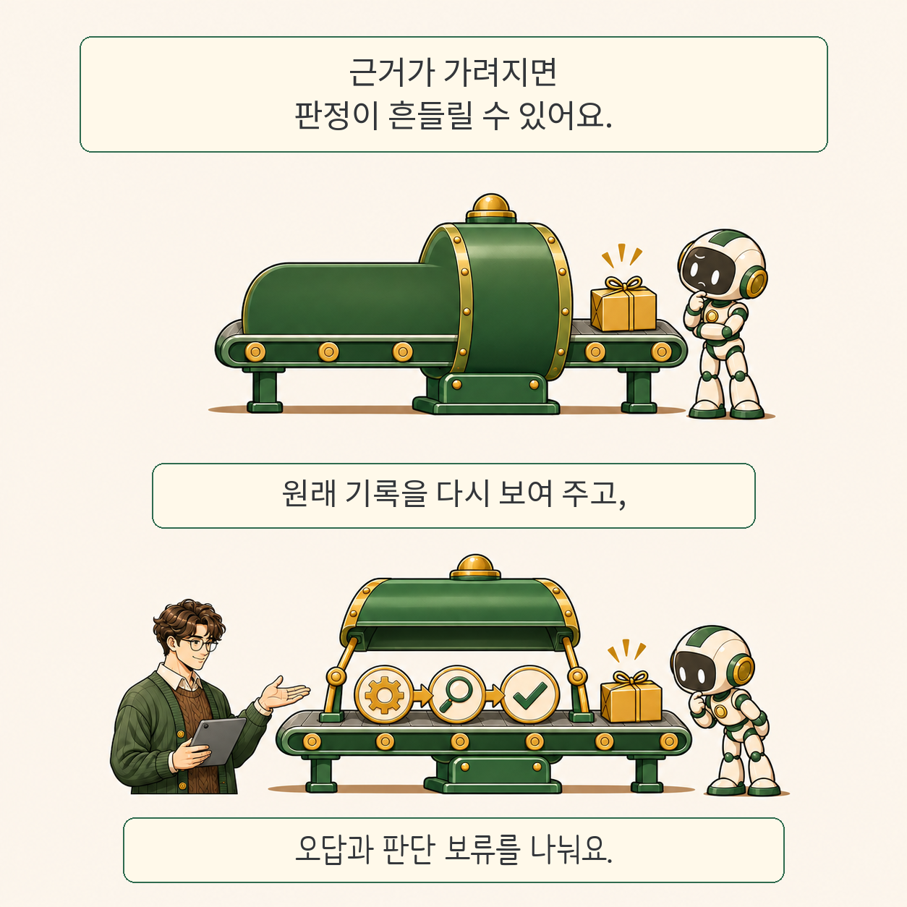

글·해설: 다메카솔

Verification Transport는 같은 실행도 검증자에게 보이는 근거가 바뀌면 판정이 유지되지 않을 수 있음을 조사합니다. Disha Sheshanarayana와 Sai Linisha Reddy Goli의 논문입니다. 

## 실행을 고정하고 근거만 바꿉니다

저자들은 원본 기록, 내부 과정이 가려진 기록, 원래 근거를 복원한 기록을 비교합니다. 작업·실행 결과·정답·검증자는 같습니다. 여러 동작을 하나로 묶기, 다른 에이전트에 위임하기, 과거 기록 줄이기를 시험했습니다. 

## 실패율의 분모를 확인하세요

네 벤치마크의 적격 사례는 APB 250건, ATBench 758건, PRB 비교 441건, AgentDojo 754건입니다. 일곱 모델·네 검증 방식에서 원본을 맞게 판정한 경우를 분모로 집계한 실패율은 동작 묶기 31.0%, 위임 30.9%, 기록 압축 20.3%였습니다. 전체 실행의 실패율이 아닙니다. 

실패에는 오답과 유효한 판정 부재가 모두 들어갑니다. 근거 부족으로 판단을 보류하는 것과 틀린 답을 내는 것은 구분해야 합니다. 

원래 근거를 되돌리자 추상화로 생긴 판정 실패 중 85.5%가 회복됐습니다. 반대로 추상화 후에도 맞았던 판정 중 5.2%는 나빠졌습니다. 실행 자체를 고친 결과가 아닙니다. 

## 실제 서비스에 옮길 때의 한계

고정 기록을 변환한 실험이므로 실제 실행 중의 요약 전체로 일반화할 수 없습니다. 원본 근거를 다시 꺼낼 수 있다는 전제도 필요합니다. 코드 링크는 확인 시 조회되지 않았으며 결과를 독립 재현하지 않았습니다. 

## 다메카솔의 해석

검증기에 전달하는 요약을 바꿀 때도 평가가 필요하다는 뜻으로 읽었습니다. 원본 실행을 보존하고, 오답과 판단 보류를 따로 세는 것이 출발점입니다. [WikiTrace의 근거 연결](/posts/wikitrace-evidence-linked-memory/)과 함께 보면 기록 보관과 검증자의 판단을 구분할 수 있습니다. 

자료 확인: 2026-11-17. [논문 원문](https://arxiv.org/abs/2611.18471v1). 원문 제출일은 2026-11-13입니다.

만화는 관측 근거가 가려지는 상황을 재작화한 비유이며 논문 그림을 복제하지 않았습니다.

이 글의 본문과 이미지는 생성형 AI로 제작했습니다. 기획과 편집 기준은 다메카솔이 정했습니다.
