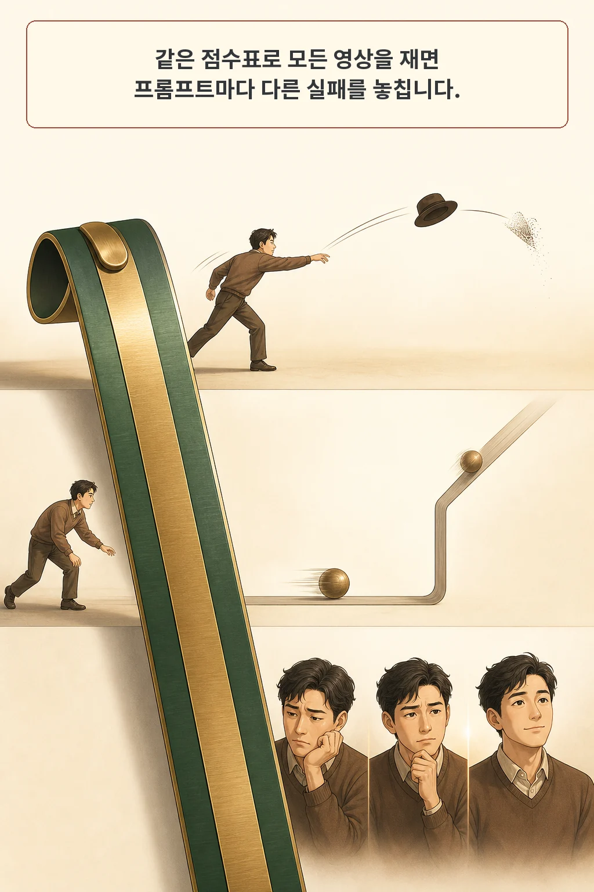
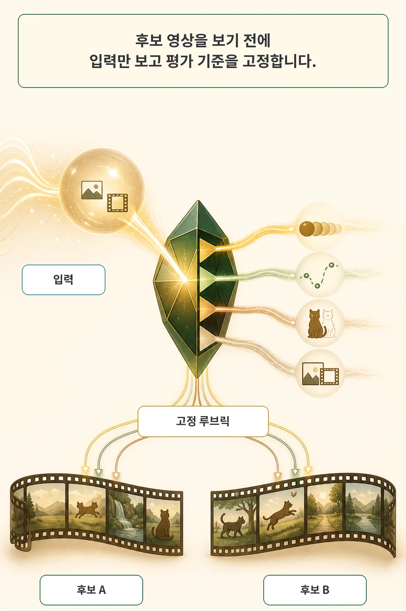
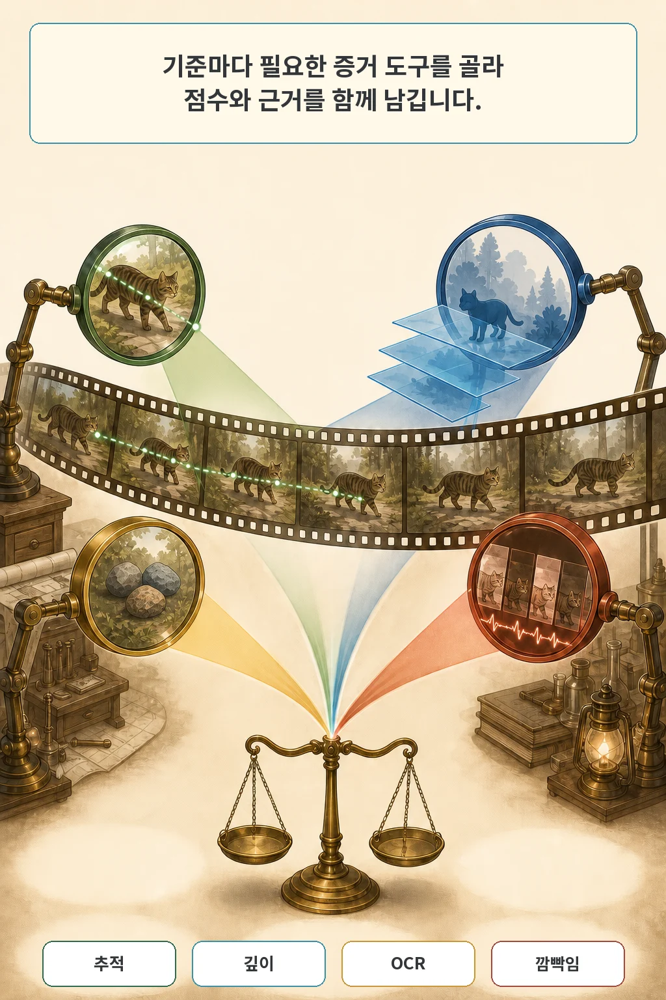
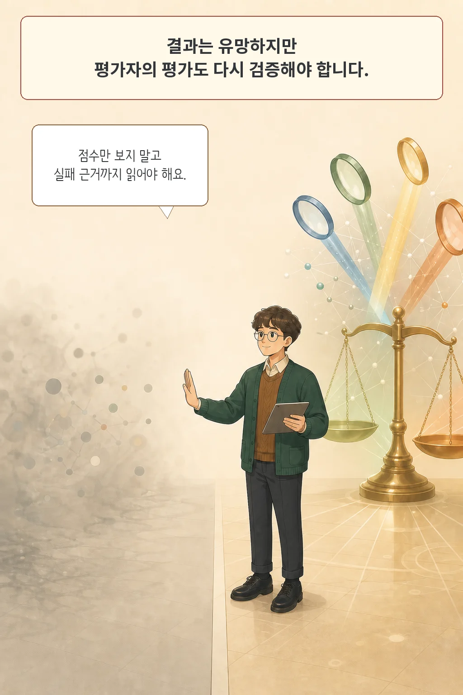

AI로 영상을 생성하거나 편집할 때 가장 먼저 던지는 질문은 “둘 중 어떤 영상이 더 좋은가?”입니다. 하지만 한 영상은 인물의 얼굴을 잘 보존한 대신 동작 순서가 틀리고, 다른 영상은 지시를 잘 따랐지만 중간에 물체가 사라질 수 있습니다. 평균 점수 하나로는 승자를 고를 수 있어도, 구체적으로 무엇이 왜 실패했고 어디를 고쳐야 하는지는 알기 어렵습니다.

2026년 8월 6일 공개된 프리프린트 **VideoArgus: Agentic Rubric-Grounded Unified Evaluation for Video Generation and Editing**은 이 문제를 입력별 맞춤형 평가 기준(루브릭)과 시각 증거 도구로 풀려는 연구입니다. 후보 영상을 보기 전에 프롬프트와 조건 이미지·영상만으로 루브릭을 먼저 고정(`output-blind`)하고, 같은 입력에서 나온 모든 후보 영상을 동일한 기준으로 검사합니다.

글·해설: 다메카솔

## 핵심 내용

- **출력 블라인드(Output-Blind) 루브릭 고정**: 후보 영상을 보기 전에 텍스트 지시, 첫 프레임, 참고 이미지, 원본 영상만으로 입력별 평가 루브릭(평균 11.9개 기준)을 생성·고정해 특정 후보에 유리하게 기준이 바뀌는 현상을 막습니다.
- **도구 기반 증거 수집과 진단**: 22개 의미 차원 중 해당 입력에 필요한 기준만 뽑아 객체 추적, 시각 유사도, 깊이 분석, OCR, 깜빡임(flicker) 탐지 등 전문 도구로 증거를 모으고, 평가 VLM이 기준별 점수(0~10점)와 실패 근거를 기록합니다.
- **인간 평가자 순위와의 높은 일치도**: 5개 생성·편집 작업(1,026개 입력, VideoArgus-Bench) 중 210개 입력·1,260개 영상에 대해 훈련된 평가자 15명의 순위와 비교한 결과, 다섯 작업 모두에서 기존 벤치마크 평가기보다 입력 내 Spearman·Kendall 순위 상관이 높았습니다(예: T2V Spearman 0.162 → 0.496, TI2V -0.060 → 0.605).

## 모든 영상에 같은 자를 대면 실패 이유가 사라진다

영상 생성과 편집은 입력 조건에 따라 다섯 가지 설정으로 나뉩니다. 텍스트만으로 만드는 **T2V**, 첫 프레임을 함께 주는 **TI2V**, 인물이나 사물 참고 이미지를 주는 **TS2V**, 원본 영상을 편집하는 **TV2V**, 참고 대상과 원본 영상을 함께 쓰는 **TSV2V**입니다.

입력 조건이 달라지면 핵심 실패 지점도 달라집니다. “모자를 던졌다가 받는다”는 프롬프트에서는 동작 순서와 물리 법칙이 중요하고, 참고 인물 사진을 준 편집에서는 얼굴과 의상 보존이 중요하며, 원본 영상 편집에서는 지시한 부분 외에 배경과 움직임이 그대로 유지됐는지가 핵심입니다.

기존 평가기는 특정 작업에만 갇혀 있거나 모든 입력에 획일적인 평가 차원을 적용하는 경우가 많았습니다. 좁은 지표는 객체 추적이나 화질 한 가지는 잘 재지만 프롬프트의 전체 요구를 놓치기 쉽고, 시각언어모델(VLM)이 한 번에 내린 총평은 무슨 근거로 점수가 깎였는지 역추적하기 어렵습니다. VideoArgus는 입력에서 관찰 가능한 요구사항을 먼저 분해해 루브릭으로 고정하는 방식을 택했습니다.

## 후보를 보기 전에 입력별 루브릭을 고정한다

VideoArgus는 텍스트 지시와 선택적인 첫 프레임, 참고 이미지, 원본 영상만 보고 루브릭을 한 번 만든 뒤, 후보 영상들을 평가할 때 그대로 재사용합니다. 후보 영상의 장점이나 결함을 미리 보고 기준을 맞추지 않는 `output-blind` 설계입니다.

루브릭의 각 기준에는 다음 항목이 구체적으로 명시됩니다.

- **관찰 대상과 채점 기준**: 무엇을 관찰할지, 0~10점을 어떤 기준으로 부여할지 정의합니다.
- **예상 실패와 중요도**: 어떤 실패가 예상되는지, 필수 조건인 `hard` 기준인지 선호에 가까운 `soft` 기준인지, 가중치(중요도)가 얼마인지 정합니다. 필수(`hard`) 기준이 낮은 점수를 받으면 최종 점수에 상한(hard cap)을 걸어 평균 점수 착시를 막습니다.
- **증거 도구 호출 순서**: 어떤 시각 도구를 어떤 순서로 실행해 증거를 수집할지 지정합니다.

논문은 객체·속성·개수, 공간·시간 관계, 행동, 움직임, 카메라, 물리적 타당성, 화질, 스타일, 첫 프레임 일치, 대상 정체성, 편집 지시 이행, 원본 보존 등 22개 의미 차원을 다루지만 모든 입력에 22개 점수를 억지로 붙이지 않습니다. 해당 입력에 실제로 필요한 차원에서만 0개, 1개 또는 여러 개의 구체적 기준을 생성합니다.

## 기준마다 다른 도구로 증거를 모은다

루브릭이 고정되면 각 기준에 맞는 전문 도구가 증거를 수집합니다.

| 검증 대상 | 활용하는 증거 도구 | 폴백(Fallback) 및 종합 방식 |
| --- | --- | --- |
| 인물·사물의 프레임 간 유지 | 객체 추적(Tracking) 도구 | 도구가 지원되지 않거나 증거 수집에 실패하면 기준별 VLM 질의로 전환. 이후 평가 VLM이 기준·수집 증거·대표 프레임을 함께 보고 점수와 이유를 기록한 뒤 중요도 가중 평균과 hard cap으로 총점 산출 |
| 참고 이미지와의 정체성 일치 | 시각 유사도(Visual similarity) | 〃 |
| 객체 간 앞뒤·배치 관계 | 깊이 분석(Depth analysis) | 〃 |
| 화면 내 텍스트 정확도 | 광학문자인식(OCR) | 〃 |
| 시간축 흔들림·번쩍임 | 깜빡임 탐지(Flicker probe) | 〃 |

이 구조의 강점은 “8.2점이라서 더 좋다”에서 끝나지 않는다는 점입니다. 어떤 대상이 몇 번째 프레임에서 사라졌는지, 바꾸지 말아야 할 배경이 얼마나 변형됐는지, 동작 순서가 어디서 끊겼는지가 진단 보고서에 남아 다음 생성이나 편집 단계의 피드백으로 바로 쓸 수 있습니다.

## 사람의 순위 판단에는 더 가까웠다

저자들은 다섯 가지 생성·편집 설정에 걸쳐 입력 1,026개(고유 이미지 653개, 고유 영상 416개)로 **VideoArgus-Bench**를 구축하고 55개 모델-작업 조합을 평가했습니다. 입력 하나의 고정 루브릭에는 평균 11.9개 기준이 들어갔습니다.

인간 판단과의 정렬 검증은 외부 벤치마크 입력 210개에서 입력마다 6개 모델 영상을 모아 총 1,260개 영상을 대상으로 진행했습니다. 훈련된 평가자 15명이 익명·무작위 순서로 0~10점을 매기고 동률을 순위화한 결과, VideoArgus-Full은 다섯 작업 모두에서 원본 벤치마크 평가기보다 입력 내(within-input) Spearman 및 Kendall 순위 상관이 높았습니다.

- **주요 작업별 입력 내 Spearman 상관**: T2V에서 원본 평가기 `0.162` 대비 VideoArgus-Full `0.496`, TI2V에서 원본 `-0.060` 대비 `0.605`로 큰 폭의 격차를 보였으며 나머지 세 작업도 같은 방향이었습니다.
- **루브릭 세밀도와 엄격성**: 자동 생성된 루브릭은 사람이 쓴 루브릭보다 기준 수가 평균 2.33배 많았지만, 점수 상한을 거는 `hard` 기준 수는 평균 2.09개 대 2.27개로 비슷해 단순히 기준을 가혹하게 만들어 상관도를 높인 것이 아님을 보였습니다.
- **전문 도구 절제(Ablation) 실험**: 전문 시각 도구를 빼고 VLM 질의로만 대체했을 때보다 전체 구성을 썼을 때 입력 내 Spearman은 5개 작업 모두에서, Kendall은 4개 작업에서 더 높았습니다. 다만 입력 구분 없이 전체 표본을 하나로 묶은(pooled) 상관은 결과가 혼재되어, 보완 도구의 이득은 주로 **같은 입력 내 후보 간 순위 복원**에서 뚜렷하게 나타났습니다.

## 다메카솔의 해석: 평균 점수보다 실패 근거를 먼저 읽는다

이 구조는 공개 리더보드 경쟁보다 내부 제작 파이프라인의 QA에 먼저 적용할 때 가치가 큽니다. 프롬프트를 확정할 때 필수 기준과 선호 기준을 나누어 후보 생성 전에 루브릭을 고정하고, 생성 후에는 총점보다 실패 프레임과 도구 증거를 먼저 확인하면 프롬프트·참고 이미지·편집 마스크·후처리 중 어디를 고쳐야 할지 빠르게 좁힐 수 있습니다.

물론 자동 평가가 인간의 최종 승인을 대체할 수는 없습니다. 인물의 초상권과 저작권, 위험 행동 묘사, 브랜드 톤앤매너 일관성, 그리고 루브릭 생성기나 평가 VLM이 미처 포착하지 못한 맥락적 요구는 여전히 별도의 사람 검토 게이트로 남겨 두어야 합니다.

## 실험 및 재현 시 참고할 한계

2026년 8월 6일 공개된 이 프리프린트(University of Rochester)를 실무에 참고할 때는 세 가지 경계를 함께 봐야 합니다.

1. **모델 의존성과 후보 범위**: 루브릭 생성에는 Claude Opus 4.8을, 기준별 질의와 최종 판단에는 로컬 Qwen3.6-27B를 사용했습니다. 루브릭 생성기를 바꿨을 때의 모델 순위 유사도는 평균 0.909, 평가 VLM 교체 시에는 0.931로 높았으나 이는 시험한 모델과 입력당 6개 후보 순위 안에서 확인된 결과입니다.
2. **부록 통계 미포함**: 인간 정렬 세트는 210개 입력·평가자 15명 규모이며, 본문에서 언급한 부트스트랩 신뢰구간과 쌍대 검정(paired test) 수치는 공개된 11쪽 PDF와 TeX 소스 번들에 부록이 빠져 있어 독립적으로 대조할 수 없었습니다.
3. **재현 데이터와 연산 비용**: 공식 코드와 고정 루브릭 데이터셋은 공개됐지만 평가 대상이 된 생성 후보 영상 자체는 포함되지 않아, 리더보드를 그대로 재실행하려면 각 모델 영상을 다시 생성해야 합니다. 비용은 루브릭 생성에 입력당 평균 0.231달러(일회성 API), 영상 1개 로컬 평가에 모델 로딩 제외 평균 H100 0.033 GPU 시간이 소요되었습니다.

## 실무 체크리스트

1. 후보 영상을 보기 전에 프롬프트별 필수(`hard`)·선호(`soft`) 기준을 먼저 고정했는가?
2. 얼굴 보존, 동작 순서, 물리 법칙, 화면 내 글자, 원본 배경 보존을 하나의 총평으로 뭉개지 않았는가?
3. 기준마다 가장 직접적인 증거 프레임과 측정 도구를 연결했는가?
4. 평균 점수와 함께 구체적인 실패 이유와 다음 수정 대상을 기록했는가?
5. 권리·안전·브랜드 적합성·최종 인간 승인을 자동 점수와 분리된 게이트로 두었는가?

## 논문 정보

| 항목 | 내용 |
| --- | --- |
| 제목 | VideoArgus: Agentic Rubric-Grounded Unified Evaluation for Video Generation and Editing |
| 저자 | Ziyun Zeng, Zixuan Wang, Yongsheng Yu, Hang Hua, Jiebo Luo |
| 소속 | University of Rochester |
| arXiv v1 제출 | 2026-08-06 00:28:38 UTC |
| 분야 | cs.CV |
| 유형 | empirical (arXiv preprint) |

## 출처

- [논문 초록과 메타데이터, arXiv:2608.05485](https://arxiv.org/abs/2608.05485)
- [논문 원문 PDF](https://arxiv.org/pdf/2608.05485)
- [VideoArgus 공식 프로젝트](https://zzzmyyzeng.github.io/VideoArgus/)
- [공식 코드 저장소](https://github.com/zzzmyyzeng/VideoArgus)
- [VideoArgusBench 공식 데이터셋](https://huggingface.co/datasets/zengziyun/VideoArgusBench)
- [관련 글: AI가 인용한 출처를 믿어도 될까](/posts/information-discernment-llm-sources/)
- [관련 글: AI가 논문 도표를 다시 그리지 않고 고치는 법](/posts/scidiagramedit-paper-figure-revision/)

이 글의 본문과 이미지는 생성형 AI로 제작했습니다. 기획과 편집 기준은 다메카솔이 정했습니다.
