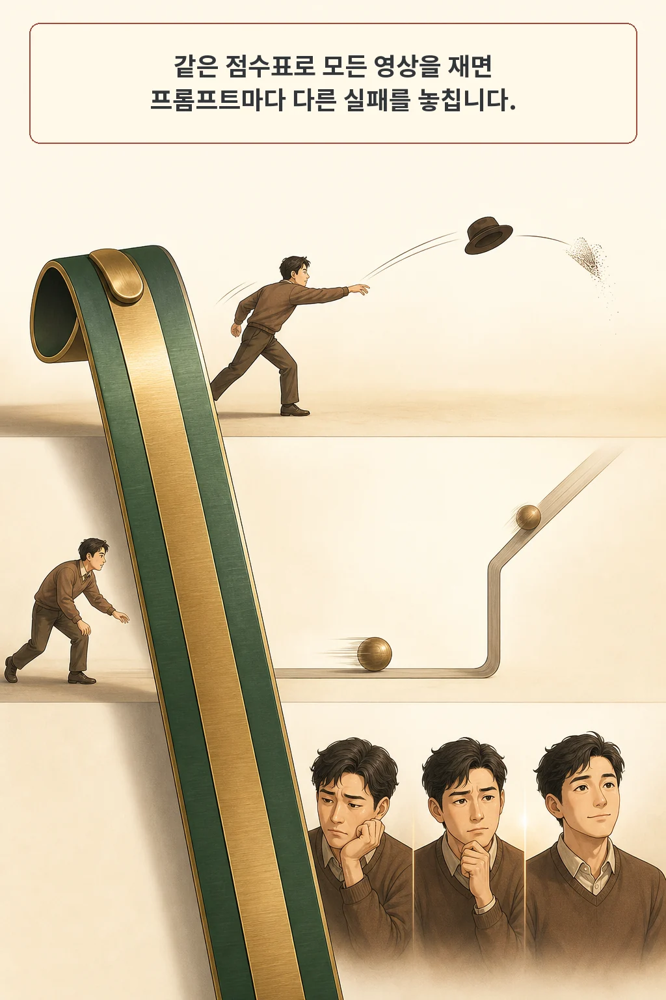
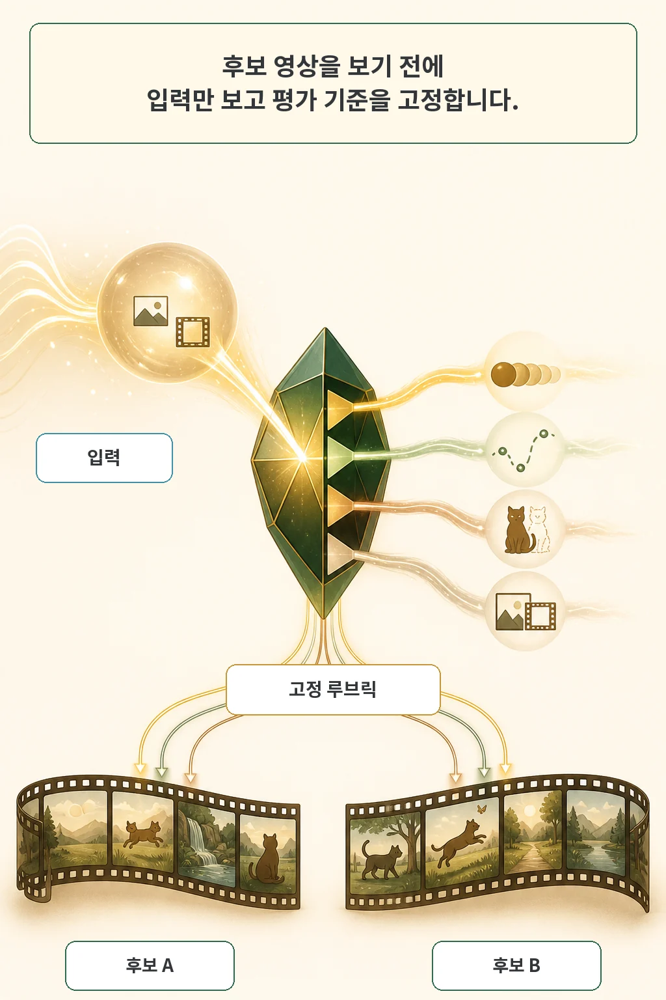
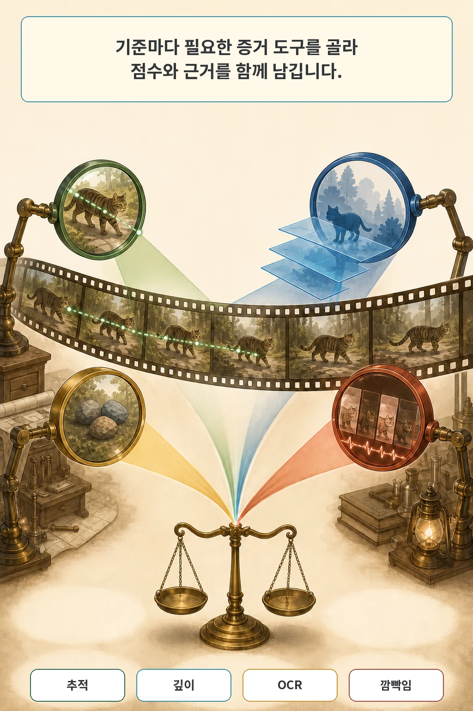
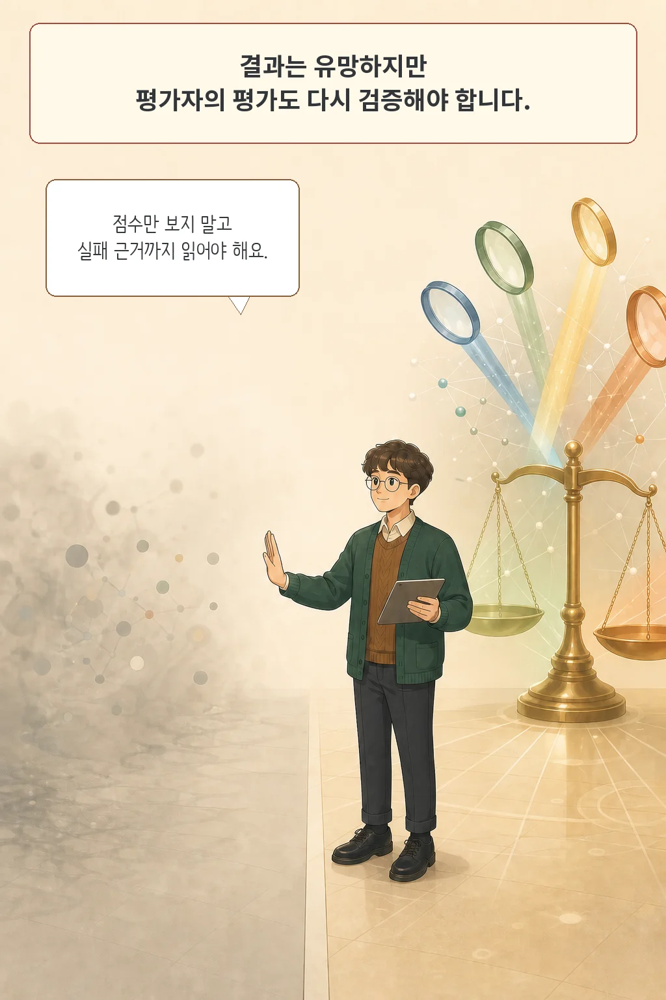

AI로 영상을 만들거나 편집해 보면 두 후보 중 무엇이 더 나은지 고르기 애매한 순간이 자주 옵니다. 한 영상은 인물 얼굴을 잘 지킨 대신 동작 순서가 꼬이고, 다른 영상은 지시를 잘 따랐는데 중간에 소품이 사라지기도 하거든요. 평균 점수 하나로는 승자를 뽑을 순 있어도 정확히 무엇이 왜 틀렸는지 짚어내려면 기준별 근거가 필요합니다.

2026년 8월 6일 공개된 프리프린트 **VideoArgus**는 후보 영상을 보기 전에 입력 조건만으로 루브릭을 먼저 고정하고, 추적·OCR·깊이 같은 시각 도구로 증거를 모아 채점하는 평가 프레임워크입니다.

글·해설: 다메카솔

## 모든 영상에 같은 자를 대면 실패 이유가 묻힌다

영상 생성과 편집은 입력 조건에 따라 핵심 실패 지점이 크게 달라집니다. 예를 들어 "모자를 던졌다가 받는다"는 프롬프트에서는 동작 순서와 물리 법칙이 핵심이고, 인물 사진을 준 편집에서는 얼굴·의상 보존, 원본 영상 편집에서는 지시 외 배경과 움직임 유지가 중요하죠. 반면 기존 평가기는 단일 지표에만 치중하거나 시각언어모델(VLM)이 총평만 내리는 편이라 점수가 깎인 원인을 역추적하기 어려웠습니다. VideoArgus는 다섯 가지 입력 조건별 요구사항을 먼저 분해·고정하는 방식으로 이 문제를 풀었습니다.

- **텍스트·첫 프레임 생성**: 텍스트만 쓰는 **T2V**, 첫 프레임을 함께 주는 **TI2V**
- **참고 대상·원본 편집**: 참고 이미지를 넣는 **TS2V**, 원본 영상을 고치는 **TV2V**, 참고 대상과 원본을 함께 쓰는 **TSV2V**

## 후보를 보기 전에 입력별 루브릭을 고정한다

VideoArgus의 핵심 원칙은 후보 영상을 보기 전에 기준을 확정하는 `output-blind` 설계입니다. 텍스트 지시와 첫 프레임, 참고 이미지, 원본 영상만 보고 루브릭을 한 번 만든 뒤, 같은 입력의 모든 후보에 똑같은 기준을 적용합니다. 특정 모델의 장단점에 맞춰 평가 잣대가 흔들리는 일을 막아 주는 셈이죠.

논문은 객체·속성·개수, 시공간 관계, 행동, 카메라, 물리 타당성, 화질, 스타일, 정체성, 편집 이행, 원본 보존 등 22개 의미 차원을 다루지만 입력마다 필요한 차원만 골라 아래 세 가지 명세를 담아 기준을 만듭니다.

- **관찰 대상과 채점 규칙**: 무엇을 확인하고 0~10점을 어떤 근거로 매길지 정합니다.
- **예상 실패와 `hard`/`soft` 구분**: 필수(`hard`)·선호(`soft`) 조건에 가중치를 두고, `hard` 기준이 낮으면 총점에 상한(`hard cap`)을 걸어 평균 착시를 막습니다.
- **증거 도구 호출 순서**: 기준 판별에 쓸 시각 분석 도구와 실행 순서를 지정합니다.

## 기준마다 다른 도구로 증거를 모은다

루브릭이 고정되면 기준별 전문 시각 도구가 프레임을 검사하며 증거를 수집합니다. 도구가 미지원이거나 추출에 실패하면 해당 기준만 VLM 질의로 전환하는 폴백 경로도 갖췄는데요. 이후 평가 VLM이 기준 명세와 도구 증거, 대표 프레임을 함께 보고 점수·근거를 기록하며, 가중 평균과 `hard cap`으로 총점을 산출합니다.

| 검증 대상 | 활용 증거 도구 | 종합·폴백 방식 |
| --- | --- | --- |
| 인물·사물 프레임 간 유지 | 객체 추적(Tracking) | 미지원·실패 시 VLM 질의로 폴백 후 평가 VLM이 종합 채점 |
| 참고 이미지와 정체성 일치 | 시각 유사도(Visual similarity) | 〃 |
| 객체 간 앞뒤·배치 관계 | 깊이 분석(Depth analysis) | 〃 |
| 화면 내 텍스트 정확도 | 광학문자인식(OCR) | 〃 |
| 시간축 흔들림·번쩍임 | 깜빡임 탐지(Flicker probe) | 〃 |

이 구조 덕분에 "총점 8점이라 더 낫다"는 결론 대신 몇 번째 프레임에서 대상이 사라졌는지, 보존할 배경이 얼마나 변했는지가 보고서에 남습니다. 다음 생성이나 편집을 고칠 구체적 단서가 생기는 겁니다.

## 사람의 순위 판단과 얼마나 맞았을까

저자들은 다섯 작업에 걸친 **VideoArgus-Bench**를 구축하고, 외부 데이터로 인간 정렬 검증과 도구 절제(ablation) 실험을 진행했습니다.

| 실험 항목 | 구성 및 비교 대상 | 주요 결과 |
| --- | --- | --- |
| 벤치마크 구축 | 5개 작업, 입력 1,026개(고유 이미지 653개·영상 416개), 55개 모델-작업 조합 | 입력당 평균 11.9개 고정 기준 생성 |
| 인간 순위 정렬 | 외부 입력 210개 × 6개 모델(1,260개 영상), 평가자 15명(0~10점) | 5개 작업 모두 기존 평가기보다 입력 내 순위 상관 상승(T2V Spearman `0.162→0.496`, TI2V `-0.060→0.605`) |
| 루브릭 세밀도 | 자동 생성 루브릭 vs 인간 작성 루브릭 | 기준 수는 평균 2.33배 많았으나 `hard` 기준 수는 `2.09개` vs `2.27개`로 유사 |
| 도구 절제(Ablation) | 전문 시각 도구 포함 vs VLM 질의 단독 | 입력 내 Spearman 5개·Kendall 4개 작업에서 전체 구성 우세(단, pooled 상관은 혼재) |

특히 도구 절제 실험을 보면 전체 영상을 입력 구분 없이 섞어 비교(pooled)했을 때는 결과가 엇갈렸지만, **같은 입력에서 나온 후보끼리 순위를 매길 때**는 전문 도구를 붙인 쪽이 일관되게 우세했거든요. 또한 `hard` 기준 개수가 사람이 짠 루브릭과 비슷해 단순히 채점을 가혹하게 굴어 상관을 높인 것이 아님을 뒷받침합니다.

## 다메카솔의 해석: 평균 점수보다 실패 근거를 먼저 읽는다

이 방식은 공개 리더보드 경쟁보다 내부 제작 파이프라인의 QA에 먼저 붙일 때 가치가 큽니다. 프롬프트 확정 시 필수(`hard`)·선호(`soft`) 기준을 먼저 고정해 두고, 생성 후에는 총점보다 실패 프레임과 도구 증거를 먼저 보면 프롬프트·참고 이미지·편집 마스크 중 어디를 고칠지 빠르게 좁힐 수 있습니다.

물론 자동 채점이 사람의 최종 승인을 대신하기에는 한계가 따릅니다. 초상권·저작권, 위험 행동 묘사, 브랜드 톤앤매너처럼 VLM이 놓치기 쉬운 맥락적 요구는 별도 인간 검토 게이트로 유지해야 합니다.

## 연구 경계와 재현·비용 참고사항

University of Rochester 연구진의 이 프리프린트를 참고할 때는 세 가지 경계를 함께 살펴야 합니다.

- **모델 의존성**: 루브릭 생성은 Claude Opus 4.8, 평가는 로컬 Qwen3.6-27B 기준이며, 생성기 교체 시 순위 유사도 평균 `0.909`, 평가 VLM 교체 시 `0.931`이었습니다(입력당 6개 후보 순위 내 결과).
- **부록 통계 미포함**: 인간 정렬은 210개 입력·평가자 15명 규모이며, 본문이 언급한 부트스트랩 신뢰구간과 쌍대 검정은 공개된 11쪽 PDF와 TeX 번들에 부록이 빠져 있어 대조 확인이 어렵습니다.
- **재현 데이터·비용**: 코드와 고정 루브릭은 공개됐으나 후보 영상은 빠져 재실행 시 새로 생성해야 합니다. 비용은 루브릭 생성 입력당 평균 `0.231달러`(일회성 API), 영상 1개 로컬 평가 시 모델 로딩 제외 평균 `H100 0.033 GPU 시간`입니다.

## 실무 QA 체크리스트

1. 후보 영상을 보기 전에 입력별 필수(`hard`)·선호(`soft`) 기준을 먼저 고정했는가?
2. 정체성·동작 순서·물리 법칙·텍스트·배경 보존을 총점 하나로 뭉개지 않았는가?
3. 기준별 증거 도구와 실패 프레임을 연결하고, 권리·안전·최종 승인은 별도 게이트로 두었는가?

## 출처

- [VideoArgus: Agentic Rubric-Grounded Unified Evaluation for Video Generation and Editing (arXiv:2608.05485)](https://arxiv.org/abs/2608.05485)
- [논문 원문 PDF](https://arxiv.org/pdf/2608.05485)
- [VideoArgus 공식 프로젝트](https://zzzmyyzeng.github.io/VideoArgus/)
- [공식 코드 저장소](https://github.com/zzzmyyzeng/VideoArgus)
- [VideoArgusBench 공식 데이터셋](https://huggingface.co/datasets/zengziyun/VideoArgusBench)
- [관련 글: AI가 인용한 출처를 믿어도 될까](/posts/information-discernment-llm-sources/)
- [관련 글: AI가 논문 도표를 다시 그리지 않고 고치는 법](/posts/scidiagramedit-paper-figure-revision/)

이 글은 논문 원문과 공개 저장소 자료를 바탕으로 정리했으며, 별도 실험 재현이나 벤치마크 실행은 포함하지 않았습니다.
이 글의 본문과 이미지는 생성형 AI로 제작했습니다. 기획과 편집 기준은 다메카솔이 정했습니다.
