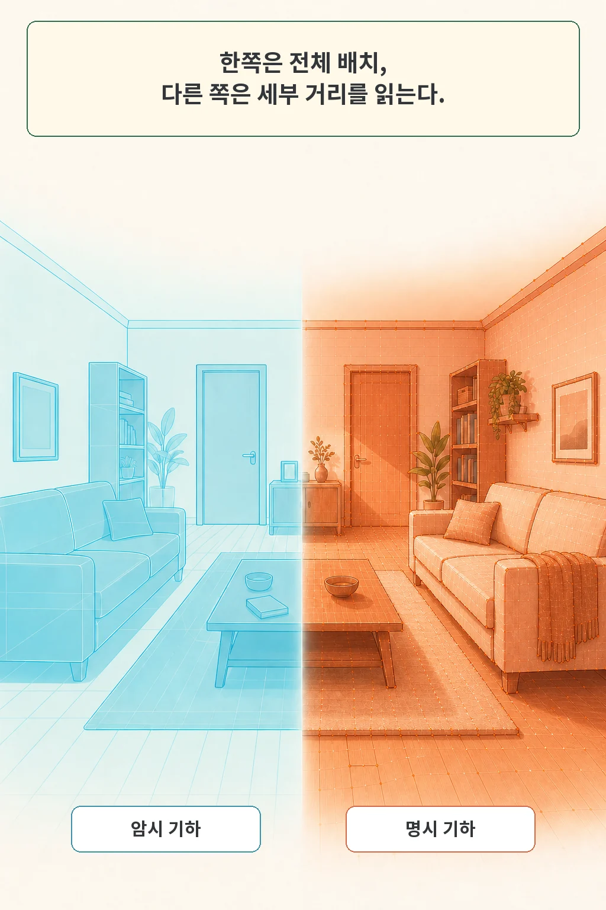
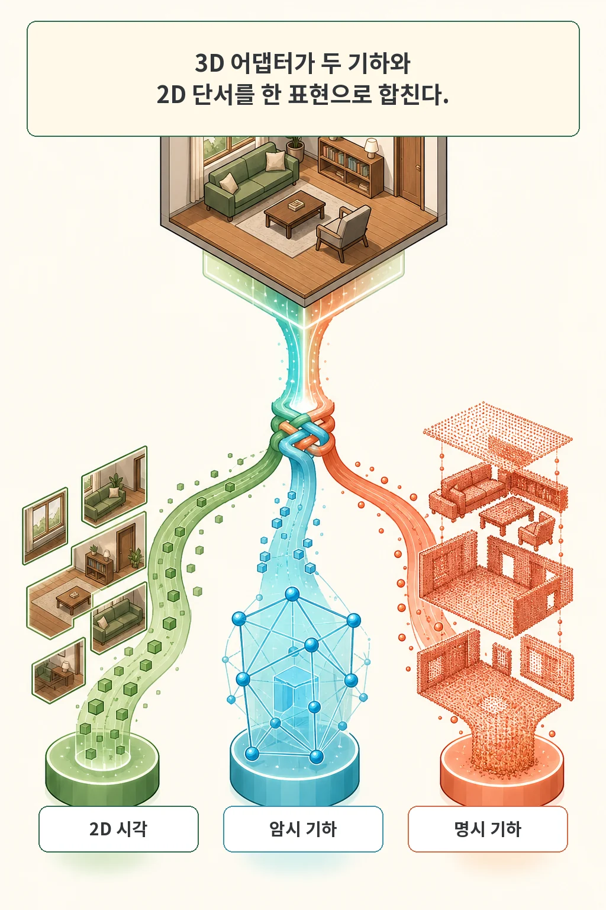
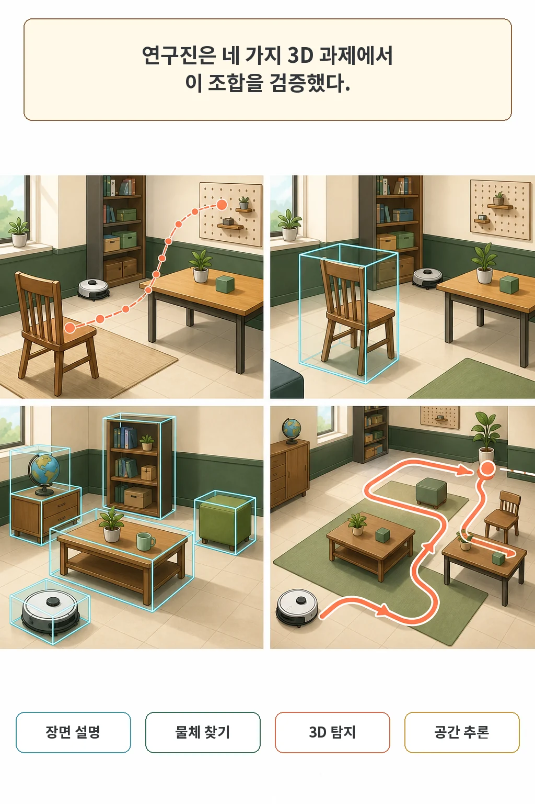
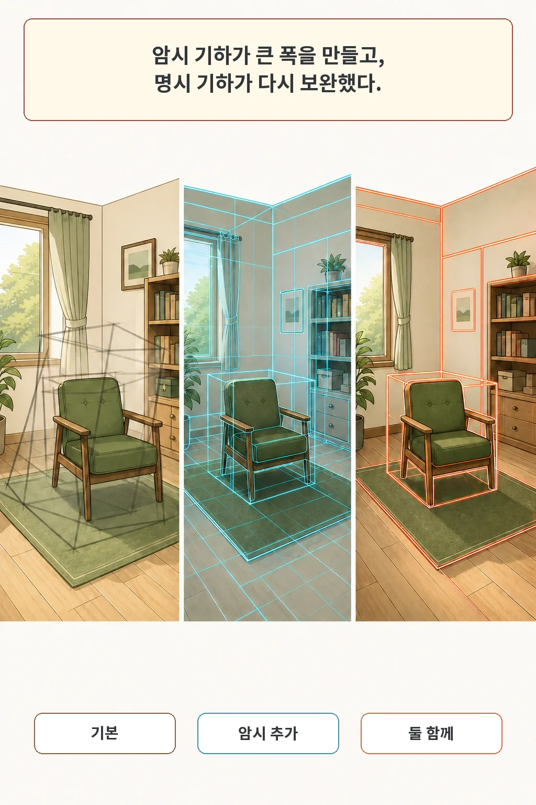

최신 비전-언어 모델(VLM)에게 실내 사진을 보여 주면 "책상 위에 노트북이 있고 뒤에 의자가 있다" 같은 객체 설명은 매끄럽게 해냅니다. 하지만 "책상과 의자 사이 거리가 몇 cm인지", "선반 위 상자의 입체 좌표가 어디인지"처럼 물리적 치수를 물으면 엉뚱한 답을 내놓는 경우가 많죠. 평면 이미지의 잠재 벡터만으로는 깊이감과 정량적 기하 구조를 꺼내 쓰기 어렵기 때문인데, ECCV 2026에 채택된 **VLM-IE3D**는 라이다(LiDAR) 같은 전용 센서 없이 일반 RGB 영상만으로 이 간극을 메우는 어댑터 구조를 제안했습니다.

글·해설: 다메카솔

## 왜 기존 공간 VLM도 정밀 좌표에 약할까

최근에는 포인트 클라우드 같은 별도 장비 없이 RGB 비디오에서 직접 공간 표현을 학습하는 시도가 늘고 있습니다. `VGGT`나 `AnySplat` 같은 기하 인코더를 붙여 모델에 입체 감각을 심어 주는 방식이 대표적입니다.

하지만 기존 기하 인코더의 암시적(Implicit) 표현은 방 전체의 대략적인 구도, 즉 인지 과학에서 말하는 '3D 인지 지도' 수준에 머무릅니다. 예를 들어 주방 영상에서 "냉장고 오른쪽 상단 수납장의 3D 경계 상자를 찾아 달라"고 요청하는 상황을 떠올려 봅시다. 암시적 잠재 벡터만으로는 가구의 대략적인 배치는 짐작하더라도, 압축된 벡터 속에 묻힌 수납장의 실제 폭이나 카메라와의 거리를 언어 모델이 정량적으로 읽어내기는 어렵거든요. 실제로 암시적 표현만 쓰는 베이스라인(`VG LLM`)은 바운딩 박스가 물체 크기를 벗어나거나 허공에 뜨는 오류가 잦았습니다.

## 전역 배치(IGT)와 정밀 깊이(EGT)의 2중 지도 결합

VLM-IE3D는 단일 인코더에 기대지 않고 성격이 다른 두 가지 기하 토큰을 나란히 생성합니다.

- **암시적 기하 토큰(IGT)**: `AnySplat`의 융합 디코더 출력에서 추출한 고수준 잠재 표현으로, 여러 프레임을 교차 분석해 방 전체 레이아웃과 객체 간 위상 관계를 담습니다.
- **명시적 기하 토큰(EGT)**: 같은 인코더의 예측 헤드가 복원한 깊이맵(Depth Map)을 가벼운 임베딩으로 변환한 토큰으로, 물체 표면 거리와 세부 윤곽 같은 정량적 치수를 직접 전달합니다.

흥미로운 점은 EGT 인코딩에 `DepthAnything V2` 같은 무거운 심층 신경망을 쓰지 않고, 단일 패치 임베딩과 두 층짜리 MLP로 단순화했다는 사실입니다. 연구진이 심층 인코더를 깊이맵에 다시 태워 본 결과, 입력을 과도하게 추상화해 IGT와 역할이 겹치면서 영상 탐지 F1 점수가 떨어졌거든요. 추가 파라미터 비중이 아주 작은 얕은 임베딩으로 좌표 감각을 날것 그대로 살려 둔 편이 훨씬 효과적이었습니다. 포인트맵이나 가우시안 스플랫 대신 깊이맵을 기본값으로 고른 이유도 성능은 비슷하면서 채널 부담이 가장 작기 때문입니다.

## 3D-Aware Adapter: 기하 정보와 2D 시각 토큰의 융합

세 갈래의 시각·기하 토큰은 **3D-Aware Adapter**를 거쳐 다음 세 단계로 통합됩니다.

1. **공간 압축**: 각 토큰 스트림에서 인접한 `2×2` 구역을 병합해 MLP에 통과시켜 프레임당 토큰 길이를 맞춥니다.
2. **암시-명시 교차 어텐션(IEA)**: 전역 맥락인 IGT를 Query로, 깊이 정보인 EGT를 Key와 Value로 두고 교차 어텐션을 수행한 뒤 잔차 연결로 묶습니다.
3. **시각 의미 합산**: 통합된 기하 토큰을 압축된 2D 시각 토큰과 원소별 합산으로 더해 언어 모델 백본에 전달합니다.

학습 시에는 기존의 2D 시각 인코더와 기하 인코더를 동결(Freeze)하고, 어댑터와 언어 모델 백본만 한 에폭 동안 미세 조정합니다. 거대 모델 전체를 처음부터 다시 학습하지 않고도 공간 추론 능력을 얹을 수 있는 구조입니다.

## 벤치마크와 절제 실험으로 확인한 성능

연구진은 실내 장면 이해와 공간 추론을 아우르는 네 가지 벤치마크에서 기존 모델과 성능을 비교했습니다.

| 평가 과제 (데이터셋) | 주요 지표 | Qwen2.5-VL-3B | VG LLM (암시 기하) | VLM-IE3D (IGT+EGT) |
| --- | --- | --- | --- | --- |
| 밀집 캡셔닝 (Scan2Cap) | C@0.5 / M@0.5 | 58.0 / 26.9 | 78.6 / 28.6 | **80.4 / 28.8** |
| 시각 근거 찾기 (ScanRefer) | Acc@0.25 / 0.50 | 34.0% / 10.6% | 36.4% / 11.8% | **43.2% / 16.9%** |
| 영상 객체 탐지 (EmbodiedScan) | P25 / R25 / F1 | 32.1 / 30.1 / 30.9 | 41.7 / 35.7 / 38.2 | **44.2 / 41.9 / 42.8** |
| 공간 추론 (VSI-Bench, 4B) | 전체 평균 | 30.6% | 47.3% | **47.6%** |

특히 후보 박스 후처리 보정 없이 진행한 ScanRefer 과제에서 암시 기하만 쓴 `VG LLM`을 크게 앞질렀고, VSI-Bench의 상대 거리 추론에서도 우위를 보였습니다.

각 토큰의 기여도를 따로 확인한 영상 탐지 절제 실험(Ablation) 결과도 두 지도의 결합 효과를 뒷받침합니다.

| 모델 구성 (영상 탐지) | 정밀도(P25) | 재현율(R25) | F1 점수 |
| --- | --- | --- | --- |
| 기본 2D VLM (Qwen2.5-VL-3B) | 32.1 | 30.1 | 30.9 |
| + EGT (깊이맵만 추가) | 36.1 | 33.7 | 34.7 |
| + IGT (전역 지도만 추가) | 41.8 | 39.7 | 40.5 |
| **+ IGT + EGT (IEA 결합)** | **44.2** | **41.9** | **42.8** |

전역 배치인 IGT만 추가해도 상승 폭이 크지만, 명시적 깊이 토큰인 EGT를 교차 어텐션으로 묶어야 정밀도와 재현율이 함께 최고치에 도달합니다. 인코더를 `VGGT`나 `π³`로 바꿔도 성능 개선이 유지돼, 향후 기하 인코더 발전에 맞춰 모듈만 교체하기도 수월한 편입니다.

## 다메카솔의 해석: 실무 적용 시 따져볼 점과 한계

이 구조는 고가의 라이다 장비 없이 일반 카메라만으로 공간 추론을 보강할 수 있다는 점에서 현장 활용도가 높습니다. 학습 가능 파라미터도 기존 암시 기하 베이스라인보다 소폭 늘어난 수준이라 모델 크기 부담이 적죠.

다만 실무에 도입하려면 연산량과 정밀도의 트레이드오프를 먼저 따져 보아야 합니다. RGB 영상만 입력받더라도 내부에서 기하 복원과 깊이 추출을 수행하기 때문에 추론 속도는 줄어드는데요. 단일 H100 GPU 기준 초당 프레임 처리 속도와 좌표 정밀도 차이를 항목별로 비교해 봅시다.

- **추론 속도 (FPS)**: Qwen2.5-VL-3B(14 FPS) → VG LLM(7 FPS) → VLM-IE3D(6 FPS)
- **정밀 좌표 격차**: ScanRefer 후처리 미적용 기준, 3D 입력을 직접 쓰는 Video-3D LLM(58.1%)과는 여전히 차이가 존재함

따라서 밀리초 단위 반응이 필수인 실시간 로봇 제어에 바로 투입하기보다는, 센서 비용 절감과 공간 맥락 이해가 우선인 실내 모니터링이나 오프라인 영상 분석 파이프라인부터 적용을 검토하는 편이 합리적입니다.

## 함께 읽을 AI 시스템 글

- [로봇이 긴 작업 기억을 보존하는 방법 (RoboTTT)](/posts/robottt-long-context-policies/)
- [컴퓨터 사용 AI 에이전트의 GUI 제어 아키텍처(Tactile)](/posts/tactile-computer-use-agents/)

## 출처

- [3D-Aware VLMs with Implicit and Explicit Geometries, arXiv:2607.21595 (ECCV 2026)](https://arxiv.org/abs/2607.21595)
- [VLM-IE3D Official GitHub Repository](https://github.com/Vegetebird/VLM-IE3D)

이 글은 논문 원문과 공식 공개 저장소 자료를 바탕으로 정리했으며, 학습·평가 실험을 별도로 재현하지는 않았습니다.
이 글의 본문과 이미지는 생성형 AI로 제작했습니다. 기획과 편집 기준은 다메카솔이 정했습니다.
