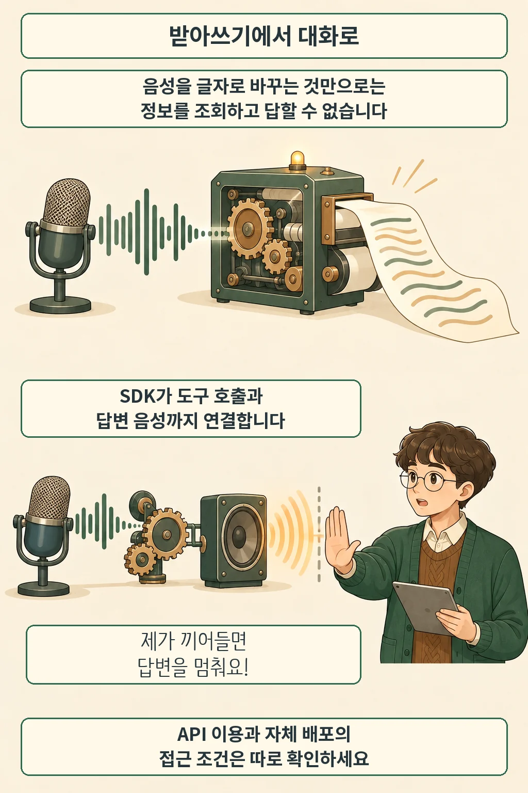

글·해설: 다메카솔

Mistral이 2026년 10월 20일 **Voxtral 3 음성 모델군과 음성 에이전트 SDK를 발표**했습니다. 새 SDK는 사용자의 말을 받아 적고, 언어 모델이 답이나 도구 호출을 결정하고, 그 결과를 음성으로 들려주는 흐름을 연결합니다. [공식 발표](https://mistral.ai/news/voxtral-3/)의 핵심은 음성 인식 성능뿐 아니라 이 전체 대화 과정을 묶었다는 점입니다. API는 제공 중이며, 전화 연결과 자체 배포에는 별도 이용 조건이 있습니다.

## 음성을 글자로 바꾼 다음에도 일이 남습니다

음성 인식은 말소리를 텍스트로 바꾸는 일입니다. 대화형 서비스는 여기서 더 나아가 질문의 뜻을 해석하고, 필요하면 정보를 조회한 뒤 답을 읽어 줘야 합니다. [음성 에이전트 문서](https://docs.mistral.ai/studio/audio/voice-agents/overview)는 이 과정을 세 단계로 나눕니다.

| 단계 | 맡는 일 |
| --- | --- |
| 음성 인식 | 발화를 텍스트로 바꾸고 사용자의 말이 끝났는지 감지 |
| 언어 모델 | 대화 내용을 읽어 답을 만들거나 필요한 도구를 호출 |
| 음성 합성 | 답변 텍스트를 선택한 목소리로 전달 |

SDK는 LiveKit을 기반으로 실시간 오디오 전달을 연결합니다. 개발자는 에이전트가 아는 정보, 호출할 수 있는 도구, 통화가 끝난 뒤의 처리를 설계합니다. 예를 들어 배송 조회 서비스라면 음성을 받아 적는 모델과 주문 정보를 조회하는 함수는 서로 다른 역할입니다. 이 예시는 구조를 설명하기 위한 것이며 실제 배송 시스템을 연결해 시험한 결과는 아닙니다.

사용자가 답변 도중 끼어들 수 있다는 점도 대화 기능의 일부입니다. 말이 끝났는지 판단하는 기능과 재생 중인 답을 중단하는 기능이 함께 있어야 자연스럽게 발언권을 주고받을 수 있습니다. Mistral은 발표에서 한 턴이 1초 안에 완료된다고 주장하지만, 개발 문서는 단계마다 대기 시간이 더해진다고 설명합니다. 도구 조회와 네트워크를 포함한 우리 서비스의 응답 시간은 따로 측정해야 합니다. 이 글에서 그 지연을 재현하지는 않았습니다.

## 파일 처리와 실시간 대화는 모델도 다릅니다

[오디오 개요 문서](https://docs.mistral.ai/studio/audio/overview)는 저장된 파일용 Mini·Small Transcribe, 실시간용 Mini Transcribe Realtime, 음성 출력용 TTS와 TTS Realtime을 구분합니다. 파일을 한 번 올려 변환하는 기능과 계속 들어오는 소리에 응답하는 기능은 같은 작업이 아닙니다.

지원 언어도 제품군 이름 하나로 판단하기 어렵습니다. 10월 21일 확인한 [언어 문서](https://docs.mistral.ai/studio/audio/specs-and-limits/languages)는 파일 전사 두 모델에 50개 언어, 실시간 전사에 45개 언어·방언, 음성 합성에 35개 언어와 50개 이상의 방언을 안내합니다. ‘50개 이상 언어 지원’이라는 소개를 모든 모드의 동일한 지원 범위로 읽으면 안 됩니다.

출시 상태에도 주의할 부분이 있습니다. **Small Transcribe 3의 모델 카드는 Public Preview로 표시**돼 있습니다. 모델 카드 소개에는 번역·요약 등의 기능도 나오지만 오디오 개요의 현재 표는 출시 시점에 전사만 제공한다고 적습니다. 기능 설명이 겹치지 않는 부분을 곧바로 구현 가능한 기능으로 가정하지 않고, 사용할 엔드포인트의 지원 범위를 확인하는 편이 안전합니다.

## API, 전화 연결, 자체 배포의 조건

발표는 Mistral API의 유럽·미국·글로벌 엔드포인트에서 이용할 수 있다고 안내하며, 온프레미스나 프라이빗 클라우드에서 전체 구성을 운영하려면 담당 팀에 문의하라고 적었습니다. 따라서 **자체 배포 가능이라는 설명만으로 공개 가중치의 자유로운 다운로드와 사용을 뜻한다고 볼 수는 없습니다**. 이 글은 가중치나 배포 라이선스의 별도 공개를 확인한 것이 아닙니다.

API를 연결하는 앱과 모델이 실행되는 위치도 구분해야 합니다. SDK 문서의 기본 경로에서는 모델이 Mistral에서 실행되고 앱은 음성을 입력·재생합니다. 로컬 PC에서 SDK 프로그램을 실행했다는 이유만으로 음성 처리가 전부 기기 안에서 끝나는 구조는 아닙니다.

전화용 SIP 연결은 출시 시점에 기업 고객이 계정 담당자를 통해 이용하는 경로입니다. 문서는 전화 통화에서는 앱 쪽 함수인 클라이언트 도구가 실패하므로 서버 쪽 도구를 쓰라고 명시합니다. 웹 앱 예제 역시 서버에서 세션을 생성해 API 키가 브라우저로 전달되지 않도록 하는 구조를 설명합니다. 같은 에이전트라도 웹과 전화의 연결 조건을 따로 확인해야 하는 이유입니다.

## 먼저 확인할 것은 한 번의 대화 흐름입니다

다메카솔은 도입 검토 때 대표 질문 하나로 **듣기 → 조회 → 답변 → 사용자 끼어들기**를 끝까지 확인할 것을 제안합니다. 배송 번호를 잘못 말했다가 바로 정정하는 상황처럼, 답변 생성 중 입력이 바뀌는 경우를 포함하면 각 단계가 제대로 연결되는지 보기 쉽습니다. 처리 위치와 도구 권한도 이 흐름에 맞춰 점검할 수 있습니다.

이번 발표와 문서만으로 한국어 실사용 정확도, 전체 통화 지연, 운영 비용까지 확정할 수는 없습니다. 사용할 모델과 모드를 정한 다음 같은 조건으로 비교하는 것이 다음 단계입니다. 모델 업데이트 뒤 실제 작업을 다시 확인하는 관점은 [DeepSeek Flash 1017 업데이트 해설](/posts/deepseek-flash-1017-stable-api-model-change/)에서도 다뤘습니다.

## 출처

- [Mistral Voxtral 3 발표, 2026-10-20](https://mistral.ai/news/voxtral-3/)
- [Voice agents: 구조와 연결 조건](https://docs.mistral.ai/studio/audio/voice-agents/overview)
- [Audio: 모델별 역할과 현재 기능](https://docs.mistral.ai/studio/audio/overview)
- [Languages: 모델별 언어 범위](https://docs.mistral.ai/studio/audio/specs-and-limits/languages)
- [Voxtral Small Transcribe 3 모델 카드](https://docs.mistral.ai/models/voxtral-small-transcribe-3-0)

문서는 2026년 10월 21일 확인했습니다. 출시·기능 설명은 Mistral 자료에 근거하며, 성능 주장은 독립 검증하지 않았습니다. 도입 점검 순서는 다메카솔의 제안입니다.

이 글의 본문과 이미지는 생성형 AI로 제작했습니다. 기획과 편집 기준은 다메카솔이 정했습니다.
