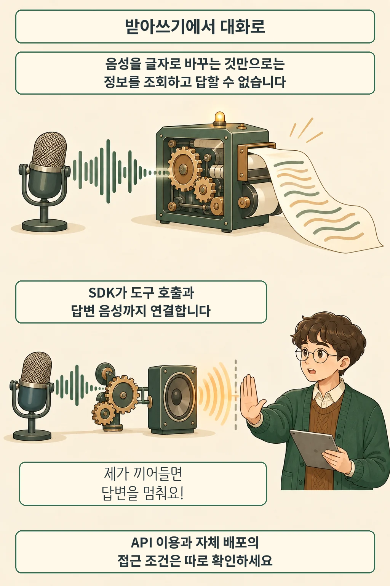

음성 기능을 앱에 붙일 때 정작 까다로운 대목은 받아쓰기보다 '말을 알아들은 다음'입니다. 질문 의도를 파악해 데이터를 조회하고, 답을 읽어 주다 사용자가 말을 끊으면 즉시 멈추는 흐름까지 맞물려야 자연스러운 대화가 되거든요. Mistral이 2026년 10월 20일 [공식 발표](https://mistral.ai/news/voxtral-3/)로 공개한 **Voxtral 3 음성 모델군과 음성 에이전트 SDK**는 이 대화 과정을 하나로 묶었으며, API는 바로 쓸 수 있지만 전화 연결과 자체 배포에는 별도 조건이 따릅니다.

글·해설: 다메카솔

## 음성을 글자로 바꾼 다음에도 일이 남습니다

음성 인식은 말소리를 텍스트로 옮기는 데서 끝나지만, 대화형 서비스는 질문 뜻을 해석해 정보를 찾고 답을 읽어 줘야 합니다. [음성 에이전트 문서](https://docs.mistral.ai/studio/audio/voice-agents/overview)는 이 흐름을 세 단계로 나눕니다.

| 단계 | 맡는 역할 |
| --- | --- |
| 음성 인식 | 발화를 텍스트로 바꾸고 말이 끝났는지 감지 |
| 언어 모델 | 맥락을 해석해 답하거나 필요한 도구를 호출 |
| 음성 합성 | 답변 텍스트를 지정한 목소리로 전달 |

SDK의 실시간 오디오 전달은 LiveKit을 기반으로 연결되며, 개발자는 에이전트가 참조할 정보와 호출할 도구, 통화 종료 뒤 후처리를 설계합니다. 예를 들어 배송 조회 서비스라면 말소리를 받아 적는 인식 모델과 주문 정보를 조회하는 함수가 각기 다른 역할을 맡는 셈이죠.

사용자가 답변 도중 끼어드는 상황도 대화 기능의 핵심입니다. 발화 종료 감지와 재생 중단 제어가 함께 돌아야 발언권을 자연스럽게 주고받을 수 있습니다. Mistral은 발표에서 한 턴이 1초 안에 완료된다고 강조하지만, 개발 문서는 단계마다 대기 시간이 차례로 더해지는 구조라고 설명합니다. 도구 조회와 네트워크 왕복 시간까지 겹치므로, 실제 서비스 응답 지연은 따로 측정해 확인해야 합니다.

## 파일 처리와 실시간 대화는 모델도 다릅니다

저장된 파일을 한 번 올려 변환하는 작업과 계속 들어오는 소리에 즉각 답하는 실시간 대화는 쓰는 모델부터 갈립니다. [오디오 개요 문서](https://docs.mistral.ai/studio/audio/overview)와 10월 21일 확인한 [언어 문서](https://docs.mistral.ai/studio/audio/specs-and-limits/languages)를 대조해 보면 용도별 모델과 언어 범위가 뚜렷하게 나뉘죠.

| 용도 | 모델 | 지원 범위 (2026-10-21) |
| --- | --- | --- |
| 파일 전사 | Mini·Small Transcribe | 50개 언어 |
| 실시간 전사 | Mini Transcribe Realtime | 45개 언어·방언 |
| 음성 합성 | TTS, TTS Realtime | 35개 언어, 50개 이상 방언 |

발표의 '50개 이상 언어 지원' 표현만으로 모든 모드의 범위를 같게 보면 설계가 어긋나기 쉽습니다. 실시간 대화처럼 전사와 합성을 함께 쓸 때는 두 모델이 공통으로 지원하는 언어부터 맞춰 보는 편이 안전합니다.

출시 상태에서도 문서 간 차이를 살펴볼 대목이 있습니다. **Small Transcribe 3의 [모델 카드](https://docs.mistral.ai/models/voxtral-small-transcribe-3-0)는 Public Preview로 표시**돼 있으며 본문에는 번역·요약 등의 기능도 언급되는데요. 반면 오디오 개요의 현재 기능 표는 **출시 시점에 전사만 제공**한다고 적고 있어, 실제 호출할 엔드포인트의 지원 범위를 먼저 확인해야 합니다.

## API, 전화 연결, 자체 배포의 조건

발표는 Mistral API의 유럽·미국·글로벌 엔드포인트 이용을 안내하면서, **온프레미스나 프라이빗 클라우드에서 전체 구성을 운영하려면 담당 팀에 문의**하라고 적었습니다. 공개 가중치 다운로드나 배포 라이선스 제공까지 확인되는 설명은 아니므로, 자체 배포 가능이라는 문구만으로 오픈 웨이트를 전제하기는 어렵죠.

같은 에이전트라도 실행 위치와 연결 채널에 따라 제약이 갈립니다. 공식 문서를 기준으로 개발 전에 짚어 둘 경계는 세 가지입니다.

- **실행 위치**: SDK 문서의 기본 경로에서는 모델이 Mistral에서 원격으로 실행되고 앱은 음성 입력·재생만 맡습니다. 로컬 PC에서 SDK를 실행해도 음성 처리가 기기 내부에서 끝나는 구조와는 다릅니다.
- **전화(SIP) 연결**: 출시 시점에 기업 고객이 계정 담당자를 통해 이용하는 경로입니다. 문서는 전화 통화에서 앱 쪽 함수인 **클라이언트 도구가 실패**하므로 서버 쪽 도구를 쓰라고 명시합니다.
- **웹 연결**: 웹 앱 예제는 **서버에서 세션을 생성**해 API 키가 브라우저로 노출되지 않도록 막는 구조를 안내합니다.

웹과 전화는 세션 발급부터 도구 실행 위치까지 조건이 다르기 때문에, 프로토타입 단계부터 목표 채널에 맞춰 구조를 잡아야 시행착오를 줄일 수 있습니다.

## 먼저 확인할 것은 한 번의 대화 흐름입니다

도입을 검토한다면 대표 질문 하나로 **듣기 → 조회 → 답변 → 사용자 끼어들기**를 끝까지 점검해 볼 만합니다. 가령 배송 번호를 잘못 말했다가 답변 도중 바로 정정하는 시나리오를 넣어 보면, 발화 중단과 도구 호출이 매끄럽게 맞물리는지 한눈에 드러나거든요. 음성 처리 위치와 도구 권한 경계도 이 흐름에 맞춰 함께 확인할 수 있습니다.

다만 이번 발표와 문서만으로 한국어 실사용 정확도나 전체 통화 지연, 운영 비용까지 확정하기는 어렵습니다. 사용할 모델과 모드를 정한 뒤 같은 조건으로 비교해 보는 단계가 뒤따라야 합니다. 모델 업데이트 뒤 실제 작업을 다시 검증하는 관점은 [DeepSeek Flash 1017 업데이트 해설](/posts/deepseek-flash-1017-stable-api-model-change/)에서도 다뤘습니다.

## 출처

- [Mistral Voxtral 3 발표, 2026-10-20](https://mistral.ai/news/voxtral-3/)
- [Voice agents: 구조와 연결 조건](https://docs.mistral.ai/studio/audio/voice-agents/overview)
- [Audio: 모델별 역할과 현재 기능](https://docs.mistral.ai/studio/audio/overview)
- [Languages: 모델별 언어 범위](https://docs.mistral.ai/studio/audio/specs-and-limits/languages)
- [Voxtral Small Transcribe 3 모델 카드](https://docs.mistral.ai/models/voxtral-small-transcribe-3-0)

2026년 10월 21일 확인한 Mistral 공식 발표와 문서를 바탕으로 정리했으며, 지연 시간이나 음성 성능의 독립 실행 측정은 포함하지 않았습니다.

이 글의 본문과 이미지는 생성형 AI로 제작했습니다. 기획과 편집 기준은 다메카솔이 정했습니다.
