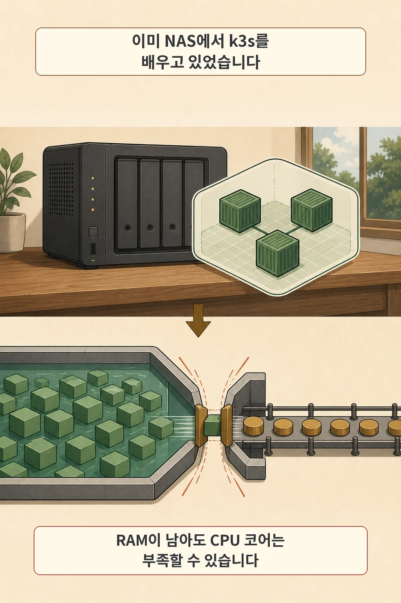
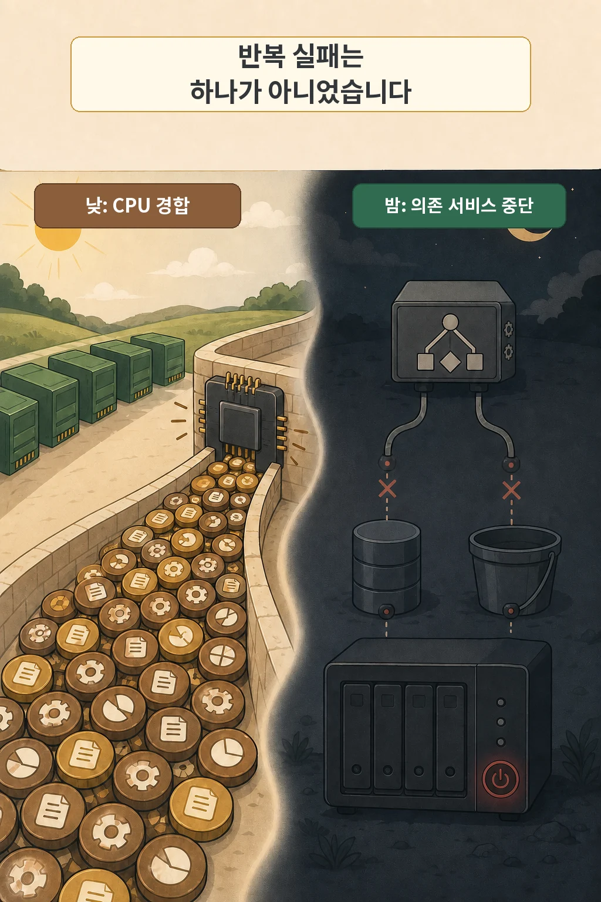
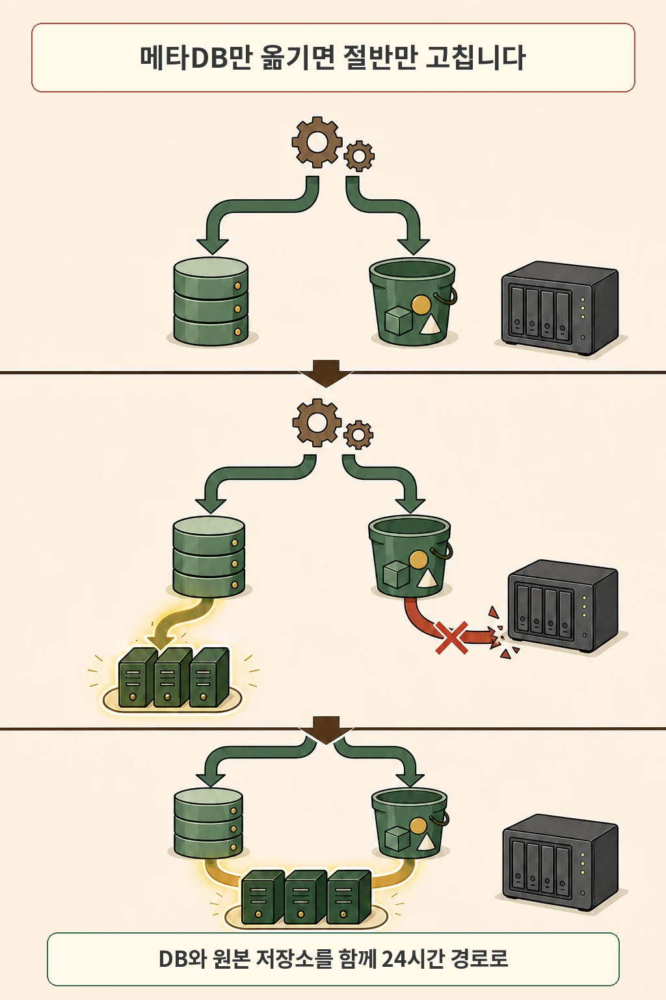

시놀로지 NAS에 RAM이 32GB나 꽂혀 있고 대시보드상 메모리 여유도 남아 있다면, 그 위에서 도는 Airflow DAG가 자꾸 실패할 때 선뜻 원인을 찾기 어렵습니다. 실제로 학습용 k3s 클러스터를 운영하던 NAS에서 메모리가 남는데도 작업이 계속 멈췄는데, 원인은 RAM 부족이 아니라 좁은 CPU 코어와 야간 전원 종료라는 두 가지 제약에 있었거든요. 새 홈랩 Kubernetes 환경은 이 계산 병목과 의존 서비스 중단을 분리해 해결하려고 세운 24시간 운영 계층입니다.

글·해설: 다메카솔

## 이미 NAS에서 k3s를 배우고 있었습니다

처음에는 별도의 미니 PC 클러스터 대신 시놀로지 NAS 한 대로 학습 환경을 꾸렸습니다. 제한된 장비 위에 k3s를 올려 배포, 스토리지, 네트워크, 복구 과정을 직접 겪어 보는 편이 설치 명령만 따라 하는 실습보다 운영 제약을 배우기에 낫다고 판단했습니다.

NAS에 탑재된 32GB RAM은 이 목적에 넉넉해 보였습니다. 모니터링 화면에서 남는 메모리가 확인되면 장비 전체에 여유가 있다고 착각하기 쉽죠. 하지만 메모리가 남는다는 사실과 CPU 코어에 여유가 있다는 사실은 전혀 다른 문제입니다.

## 32GB RAM이 CPU 병목을 가렸습니다

운영 당시에는 부족한 CPU 코어를 첫 번째 병목으로 판단했습니다. 동시에 실행되는 Airflow 작업과 k3s 시스템 구성요소가 적은 코어를 나눠 쓰다 보니, 메모리 부족 흔적 없이도 작업이 밀리는 현상이 나타났죠. 당시 CPU 지표와 Airflow 오류 로그는 남아 있지 않아, 개별 실패가 모두 CPU 경합에서 시작됐는지까지 사후에 다시 입증하기는 어렵습니다.

RAM과 CPU 코어가 맡는 역할은 분명히 다릅니다. RAM은 실행 중인 데이터와 프로세스를 올려 두는 공간에 가깝고, CPU 코어는 같은 시간에 처리할 수 있는 계산량과 동시성을 결정짓거든요. 32GB라는 메모리 총량만 보고 자원이 충분하다고 판단하면, 코어 앞에서 길어지는 실행 대기열은 눈에 띄지 않고 가려지기 마련입니다.

예를 들어 대시보드에서 메모리 사용률이 여유롭게 보이더라도, 같은 시각에 k3s 시스템 Pod와 여러 DAG 태스크가 겹치면 처리 관문이 좁아지며 작업이 지연됩니다. 그래서 문제 점검 질문도 단순 재시작 결과 확인에서 벗어나, 실패 시각의 CPU 사용률과 실행 대기 작업량, 같은 노드에 겹친 Pod 목록, 동시 실행 수를 줄였을 때의 완료 여부로 바꿨습니다.

## 반복 실패는 하나의 원인만 갖지 않았습니다

CPU 경합을 줄이더라도 NAS를 끄는 밤 시간에는 DAG가 정상 종료되기 어려웠습니다. 소음 때문에 NAS 전원을 야간에 내렸는데, 그 장비 안에 Airflow 메타데이터 데이터베이스와 원본 데이터를 기록하는 S3 호환 오브젝트 스토리지가 함께 들어 있었기 때문입니다. 계산을 돌릴 여력이 있더라도 작업이 기대는 상태 서비스 자체가 밤마다 사라진 셈이죠.

| 실패 시점 | 직접 제약 | 핵심 질문 |
| --- | --- | --- |
| 주간 실행 | 부족한 CPU 코어와 실행 대기 | 제한된 시간 안에 연산을 끝낼 수 있는가? |
| 야간 실행 | NAS 종료로 인한 의존 서비스 중단 | 필요한 시각에 DB와 저장소가 살아 있는가? |

오류가 모두 Airflow 화면에 찍힌다고 해서 두 문제를 한 원인으로 묶어 버리면, 한쪽만 손보고 장애를 그대로 남기게 됩니다.

## 메타데이터 DB만 옮기면 절반만 고칩니다

처음에는 Airflow 메타데이터 데이터베이스만 24시간 켜진 장비로 옮기면 야간 실패가 풀릴 줄 알았습니다. 그런데 실제 의존 경로를 따라가 보니 DAG는 수집한 원본 데이터도 NAS의 오브젝트 스토리지에 쓰고 있더군요. 가령 밤에 실행되도록 예약한 수집 DAG가 있다고 가정해 보면, DB 연결이 살아 있더라도 `boto3` 클라이언트가 꺼진 NAS 저장소에 접속하는 단계에서 다시 멈추고 맙니다.

결국 필요한 일은 DB 한 개만 따로 이사시키는 작업이 아니었습니다. 24시간 켜진 하드웨어, 상태 서비스를 올릴 컴퓨트와 스토리지, 데이터베이스 운영 계층, 오브젝트 스토리지를 한 묶음으로 설계해야 했죠. 이 요구에 Kubernetes 운영을 직접 익히려는 목표까지 겹치면서 3노드 k3s 구성이 유력한 선택지로 올라왔습니다.

선택할 수 있는 대안도 여러 가지였습니다. 각 선택지에는 저마다의 운영 대가가 따릅니다.

- **NAS 24시간 가동 유지**: 추가 장비 비용을 아끼는 대신 소음과 단일 장애점 부담이 남습니다.
- **미니 PC 1대 + Docker Compose**: 구성은 단순하지만 장비 정비 시 전체 서비스가 함께 멈춥니다.
- **퍼블릭 클라우드 이전**: 기반 인프라 관리를 줄일 수 있으나 지속적인 과금과 학습 범위 축소가 따릅니다.
- **3노드 k3s 클러스터**: 초기 설계 손이 많이 가지만 복제와 자동 복구, 선언적 운영을 직접 경험할 수 있습니다.

이 홈랩에서는 안정적인 야간 실행과 더불어 직접 부딪히며 배우는 학습 가치까지 고려해 k3s 클러스터를 골랐습니다.

## 24시간 서비스는 24시간 의존성 위에 둡니다

최종 역할 배치는 전원과 가동시간을 기준으로 깔끔하게 나눴습니다. 24시간 돌아야 하는 컴퓨트와 상태 서비스 계층은 상시 가동하는 미니 PC 클러스터로 옮기고, 밤에 끄는 NAS는 백업과 파일 서버처럼 주간 가동과 양립하는 역할에 집중시켰습니다.

2026년 7월 17일 새 클러스터 안에서 Airflow를 기동한 뒤 야간 DAG 실패가 사라진 운영 기록이 남아 있습니다. 다만 새 환경에서는 CPU 자원과 가동시간 조건을 동시에 바꿨기 때문에, 이 전후 비교만으로 두 원인의 기여도를 따로 떼어 증명하기에는 한계가 있습니다.

그 경험을 거친 뒤부터는 서버 사양을 볼 때 RAM 용량부터 확인하는 습관을 접었습니다. 작업이 어느 자원 앞에서 기다리는지, 그리고 밤에도 살아 있어야 할 의존성이 무엇인지부터 먼저 적는 편입니다. 이 홈랩에서 Kubernetes는 그 두 조건을 분리해 운영하고 실제 실패를 겪어 보기 위한 토대였습니다.

## 내 환경에 적용할 점검 질문

비슷한 실패를 겪고 있다면 장비를 늘리기 전에 아래 다섯 가지부터 차례로 점검해 볼까요?

1. 실패한 작업은 메모리, CPU, 디스크 I/O 가운데 어느 자원 앞에서 기다리고 있는가?
2. 실패 시각에 같은 노드에서 어떤 시스템 서비스와 다른 작업이 겹쳤는가?
3. 애플리케이션이 쓰는 DB, 오브젝트 스토리지, DNS, 인증 서비스는 필요한 시간에 모두 살아 있는가?
4. 첫 가설에서 옮기지 않고 남겨 둔 의존 경로가 하나라도 남아 있는가?
5. 동시 실행 수를 줄이거나 의존성을 옮긴 뒤 같은 작업이 반복해서 완료되는가?

다음 편에서는 미니PC 세 대를 고른 기준과, 새 클러스터를 점검하다 엉뚱한 `kubectl` 컨텍스트를 보고 있음을 알아차린 사건을 다룹니다. [홈랩 쿠버네티스 구축기 2편: 3노드여야 하는 이유, 그리고 빈 결과의 함정](/posts/three-node-etcd-quorum-context/)으로 이어지며, 이후 구축기에서도 DNS, 스토리지, 인증, GitOps, 네트워크 정책 문제를 하나씩 풀어 갑니다.

## 함께 읽을 개념 글

- [Kubernetes와 k3s는 무엇이 다른가](/posts/kubernetes-k3s-homelab/): 홈랩에서 오케스트레이션이 필요한 조건과 k3s가 줄이는 운영 부담을 설명합니다.
- [RAM은 남는데 작업이 실패할 때 보는 CPU 동시성](/posts/cpu-concurrency-run-queue/): CPU 사용률, 실행 대기열, Kubernetes 자원 제한과 Airflow 동시성을 구분합니다.
- [24시간 서비스의 가동시간과 의존성 설계](/posts/state-service-uptime-design/): DB와 오브젝트 스토리지를 포함한 전체 실행 경로를 점검합니다.

## 출처와 범위

- 개인 인프라 운영 기록: `왜 홈랩에 Kubernetes를 세웠나 — 야간에 꺼지는 NAS에 묶인 Airflow` (2026-07-20)
- 개인 아키텍처 결정 기록: `홈랩 코어·상태 계층 배치` (2026-07-07)
- CPU 코어 제약: 2026-07-21 작성자 직접 보정

이 글에서는 당시 운영 판단과 2026년 7월 시점에 확인 가능한 기록의 범위를 나눠 정리했으며, 내부 접속 정보와 사설 주소는 공개하지 않았습니다.

이 글의 본문과 이미지는 생성형 AI로 제작했습니다. 기획과 편집 기준은 다메카솔이 정했습니다. 만화 이미지는 텍스트 없는 원화에 결정적 레터링을 합성해 만들었습니다.
