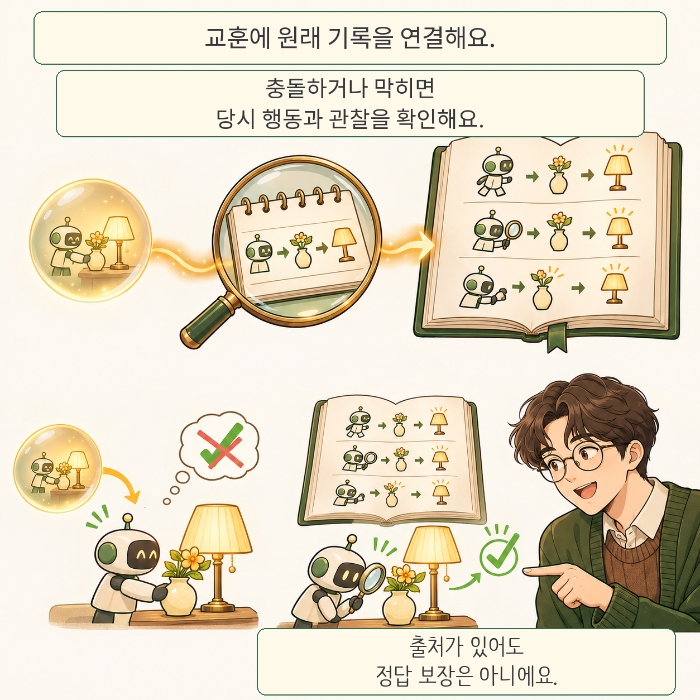

글·해설: 다메카솔

WikiTrace는 AI 에이전트의 기억에 원래 실행 기록으로 돌아가는 링크를 붙입니다. 요약된 교훈이 현재 상황에도 맞는지, 행동하기 전에 다시 살펴보려는 방법입니다. 2026년 11월 10일 공개된 심사 중 논문입니다. 

## 기억은 기록의 해석입니다

성공·실패 표시만으로 어느 행동이 결과를 만들었는지 알 수는 없습니다. WikiTrace는 교훈, 실행을 해석한 문서, 원래 행동·관찰 기록을 연결합니다. 교훈이 충돌하거나 세부 정보가 부족하면, 실패한 실행에서 나왔거나 행동이 막히면 원문을 찾아보도록 유도합니다. 메모리는 사전에 만들고 읽기 전용으로 유지합니다. 판단을 고치는 것과 저장 파일을 고치는 것은 다릅니다. 

## 새 성공과 새 실패를 함께 봅니다

주 실험은 DeepSeek-v4-flash의 high reasoning 설정으로 5개 벤치마크·8개 평가군에서 방법별 3회 시행했습니다. 저자가 보고한 평가군 평균 점수는 기억 없음 79.5, 같은 교훈만 제공 87.0, WikiTrace 90.2입니다. 각 벤치마크의 원래 지표를 평균했으므로 전체 과제를 합친 단일 성공률로 읽으면 안 됩니다. 

기억 없이 풀던 과제가 실패로 바뀌는 비율인 Regression도 봅니다. 기준 성공 여부는 기억 없는 실행 3회의 다수결로 정합니다. 평가군 평균은 교훈만 제공할 때 6.5%, WikiTrace에서 4.5%였습니다. 테스트 비용은 전자 대비 평균 1.17배였습니다. 여기서는 실험을 재현하지 않았습니다. 

## 연결된 근거도 확인이 필요합니다

출처 링크 자체가 교훈을 검증하지는 않습니다. 모든 교훈을 첫 입력에 넣으므로 기억이 커졌을 때 필요한 항목을 찾는 문제도 남습니다. 

다메카솔의 해석: 메모리를 설계한다면 적용 조건과 원래 기록으로 돌아갈 경로를 함께 남길 가치가 있습니다. [경험을 워크플로로 정리하는 접근](/posts/workflow-as-knowledge/)과 함께 보되, [검토의 효과를 평가하는 문제](/posts/agent-review-causal-effect/)는 별도로 다뤄야 합니다. 

## 출처

- [논문 원문과 제출 이력](https://arxiv.org/abs/2611.14320v1)
- [공식 코드와 실행 조건](https://github.com/yukyeongleee/wikitrace)

자료 확인: 2026-11-12. 만화의 램프 장면은 원리를 설명하는 재구성이며 논문 그림이나 실제 실행 화면이 아닙니다.

이 글의 본문과 이미지는 생성형 AI로 제작했습니다. 기획과 편집 기준은 다메카솔이 정했습니다.
