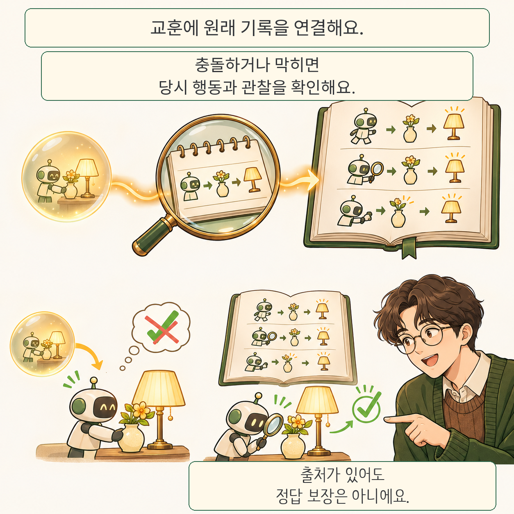

AI 에이전트에게 과거 경험에서 뽑아 둔 교훈을 넘겨줬는데, 기억 없이도 잘 풀던 과제까지 갑자기 틀린다면 어디서 어긋난 걸까요? 요약된 교훈만 주면 모델이 그 내용이 지금 상황에도 맞는지 확인할 길이 없거든요. 2026년 11월 10일 공개된 심사 중 논문 WikiTrace는 교훈마다 실행 해석 문서와 원래 실행 기록으로 돌아가는 링크를 붙여, 행동하기 전에 근거를 다시 확인하게 합니다.

글·해설: 다메카솔

## 요약된 교훈은 왜 원래 풀던 과제를 망칠까

과거 실행 기록에는 개별 행동이 아니라 과제 전체의 성공·실패 표시만 남습니다. 결과 라벨 하나만 보고 교훈을 요약하다 보면 어느 행동과 조건이 결과를 갈랐는지 추측하게 되고, 그 과정에서 잘못된 규칙이 섞이기 마련이죠. 실제로 저자들이 기억 없이 세 번 모두 통과한 과제에서 기억을 붙였을 때 실패한 355건을 살펴보니, 52%가 에이전트가 따른 메모리 항목과 이어졌고 그중 20%는 항목 자체가 틀린 경우였습니다.

예를 들어 가정 환경 시뮬레이션(ALFWorld)에서 기존 방식(ExpeL)은 "물건이 켜진 램프 옆에 놓이면 램프 과제가 끝난다"는 규칙을 뽑았습니다. 그런데 출처가 된 원래 성공 기록을 열어 보면 램프를 켠 뒤 연필을 직접 집어 들었을 때 과제가 끝났거든요. 이 빠진 조건을 모른 채 "램프 아래에서 꽃병 보기" 과제를 만나면, 기억 없는 에이전트는 꽃병을 집어 들어 성공하는 반면 잘못된 교훈을 따른 에이전트는 램프만 켜고 종료를 선언해 실패합니다.

## 교훈에서 원래 기록으로 내려가는 3계층 구조

WikiTrace는 요약과 원문을 세 층으로 묶어 위에서 아래로 내려갈 링크를 남깁니다. 과거 실행마다 독립적으로 최대 3개의 교훈을 뽑아 출처가 흐려지지 않게 유지합니다.

- **교훈(Insight)**: 할 행동, 적용 조건, 출처 실행 ID와 성공 여부를 간결하게 적습니다.
- **실행 해석(Compilation)**: 성공 실행의 핵심 결정이나 실패 실행의 추정 원인을 요약합니다.
- **원래 실행 기록(Raw trajectory)**: 과제 정보와 매 턴의 추론·행동·관찰을 변형 없이 보존합니다.

새 과제가 주어지면 에이전트는 모든 교훈과 가장 닮은 과거 실행 3건의 목록을 첫 입력으로 받습니다. 교훈에 세부 정보가 부족하거나 다른 교훈과 충돌할 때, 실패한 실행에서 나온 교훈이거나 실행 중 행동이 막혔을 때는 터미널 도구(`read`, `bash`)로 링크를 타고 내려가 원래 기록을 읽도록 유도하죠.

가령 마인크래프트 조합 과제(PlanCraft)에서 재료 하나를 올릴 때 뜨는 임시 미리보기를 두고 실패 출처 교훈은 포기하라 권하고 성공 출처 교훈은 계속 올리라 충돌합니다. WikiTrace는 양쪽 원래 기록을 대조해 미리보기가 완성품으로 바뀌는 관찰을 확인한 뒤 판단을 고쳐 과제를 끝냅니다. 다만 실험 메모리는 테스트 전 훈련 실행으로 사전에 구축한 뒤 실행 내내 읽기 전용으로 유지하므로, 실행 중 판단을 수정하는 일과 영구 파일을 수정하는 일은 다릅니다.

## 새 성공과 새 실패를 함께 본 실험 결과

저자들은 교훈 자체의 효과와 원문 확인의 효과를 가르려고, 같은 교훈만 주고 원래 기록 접근과 확인 지시를 뺀 ‘교훈만 제공(Insights Only)’ 대조군을 두었습니다.

- **주 실험 설정**: DeepSeek-v4-flash(high reasoning) 기반 Pi 터미널 에이전트로 5개 벤치마크 8개 평가군에서 방법별 3회 시행
- **평가군 구성**: 텍스트 환경(ALFWorld Seen·Unseen, ScienceWorld, PlanCraft Seen·Unseen)과 도구 환경(AppWorld Normal·Challenge, τ³-bench Retail)

| 방식 | 8개 평가군 평균 점수 | 평균 Regression | 특징 |
| --- | ---: | ---: | --- |
| 기억 없음 (No Memory) | 79.5 (±1.6) | 9.7% (재실행 기준선) | 메모리 미사용 |
| 기존 메모리 (ExpeL / AWM / ReasoningBank) | 80.3 / 81.6 / 81.7 | 재실행 기준선 수준 이상 | 일부 평가군에서 기억 없음 하회 |
| 교훈만 제공 (Insights Only) | 87.0 (±2.5) | 6.5% | 같은 교훈만 주입 |
| WikiTrace | 90.2 (±1.6) | 4.5% | 8개 평가군 전부 최고 점수 |

저자가 보고한 평가군 평균 점수는 WikiTrace가 90.2점으로 가장 높고, 같은 교훈만 제공했을 때 87.0점이었으며 기억을 쓰지 않았을 때는 79.5점으로 가장 낮은 성적에 머물렀습니다. ALFWorld·PlanCraft는 성공률, ScienceWorld는 평균 점수, AppWorld는 과제 목표 달성률(TGC), τ³-bench는 통과율처럼 원래 지표가 다르므로, 평가군 단위로 평균한 이 수치는 전체 과제를 합친 단일 성공률과 구분해 읽어야 합니다.

평균 점수만 보면 기억으로 새로 푼 과제(Gain)와 원래 풀던 과제가 망가진 경우(Regression)가 서로 상쇄돼 가려지거든요. 저자들은 기억 없는 실행 세 차례의 다수결을 기준 성공 여부로 삼아, 기준상 성공하던 과제가 실패로 바뀌는 비율인 Regression을 따로 집계했습니다. 그 결과 평가군 평균 Regression은 교훈만 제공할 때 6.5%에서 원문 확인을 더한 WikiTrace에서 4.5%까지 낮아지며 기억으로 인한 퇴행 폭을 줄였습니다.

원래 기록을 확인하는 데 드는 테스트 시점 과제당 비용은 교훈만 제공 대비 평가군 평균 1.17배로 보고돼, 추가 비용과 품질 개선의 균형을 가늠해 볼 수 있습니다. 텍스트 환경 추가 분석에서도 WikiTrace는 쉬운 과제보다 어려운 과제에서 원문을 두 배 가까이 자주 열어 보았고, 문제가 생겨 내려갔을 때 격차가 가장 컸습니다. 다른 기반 모델로 교차 검증한 GLM-5.3-flash 보조 실험에서도 교훈만 제공과 기억 없음을 앞서는 같은 흐름이 이어졌습니다.

## 출처 링크가 있어도 자동으로 검증되지는 않습니다

과거 실행에 이진 성공·실패만 붙는 구조는 그대로라 실행 해석 문서나 교훈 자체가 틀릴 수 있고, 링크는 에이전트가 원문과 대조할 통로만 열어 줄 뿐입니다. 출처 링크가 교훈의 진실을 보장하지는 않으며, 전체 교훈을 첫 입력에 넣는 방식은 기억이 커졌을 때 필요한 항목을 찾는 대규모 검색 문제를 미해결로 남겨 둡니다. 실패 원인과 하향 확인 계기 분석이 LLM 판정에 의존한다는 점과 논문이 심사 중인 원고라는 점도 함께 감안해야 합니다.

## 다메카솔의 해석: 교훈과 원래 기록을 한 묶음으로

실무에서 에이전트 메모리를 설계한다면 교훈 문장만 저장하기보다 적용 조건과 원래 실행 기록으로 돌아갈 경로를 함께 보존할 가치가 있습니다. 논문에서도 실패 실행에서 뽑은 교훈은 새 과제를 푸는 데 도움이 되지만, 원문 없이 요약만 넣으면 기존 성공 과제의 실패율도 함께 키우는 경향이 보였거든요. 요약본에 실행 ID와 로그 링크를 붙여 두고 조건이 애매하거나 행동이 막혔을 때 원문을 열어 확인하는 편이 안전합니다.

평가 단계에서도 평균 점수만 보지 말고 기억 도입 전 성공하던 과제가 얼마나 깨지는지 Regression을 따로 추적해 볼 만합니다. 경험을 재사용 가능한 절차로 정리하는 방향은 [경험을 워크플로로 정리하는 접근](/posts/workflow-as-knowledge/)과 함께 볼 수 있고, 확인 개입의 순수 효과를 가려내는 일은 [검토의 효과를 평가하는 문제](/posts/agent-review-causal-effect/)처럼 별도 평가 설계로 다뤄야 합니다.

## 출처

- Yukyeong Lee, Yumin Choi, Jinheon Baek, Sung Ju Hwang, [Don't Just Trust Your Memory: Evidence-Linked Memory Reduces Memory-Induced Degradation in LLM Agents (arXiv:2611.14320v1)](https://arxiv.org/abs/2611.14320v1), 2026-11-10 공개(심사 중)
- [WikiTrace 공식 코드와 실행 조건 (GitHub)](https://github.com/yukyeongleee/wikitrace)

자료 확인: 2026-11-12. 이 글은 논문 원문과 공식 저장소를 바탕으로 정리했으며 실험은 독립 재현하지 않았고, 만화의 램프 장면은 원리 설명을 위해 새로 구성했습니다.

이 글의 본문과 이미지는 생성형 AI로 제작했습니다. 기획과 편집 기준은 다메카솔이 정했습니다.
