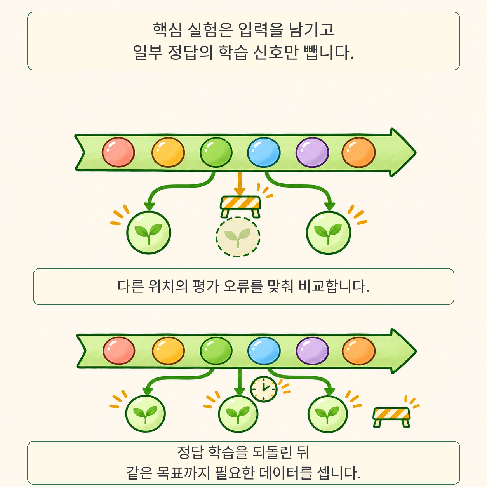

글·해설: 다메카솔

특정 내용을 덜 학습시켰다는 사실만으로, 나중에도 배우기 어렵다고 판단할 수 있을까요? 11월 18일 공개된 사전공개 논문은 **지금의 능력**과 **다시 학습하는 데 드는 데이터**를 나누어 살펴봅니다.

## 무엇을 빼고 비교했나

핵심 실험인 target thinning은 입력을 그대로 두고 특정 정답 위치의 예측 오차만 학습에서 제외합니다. 연구진은 제외하지 않은 위치의 평가 오류(background loss)를 맞춰 모델을 비교했습니다. 이후 정답 학습을 되돌리고, 같은 크기의 모델을 처음부터 학습할 때와 같은 목표 수준까지 필요한 토큰 수를 비교했습니다.

## 다른 학습이 남긴 바탕

체스·오델로·분자 문자열·괄호 언어·웹 텍스트를 다뤘습니다. 연구한 조건에서는 나머지 데이터 학습이 진전될수록 제외했던 능력을 나중에 얻는 데 필요한 데이터가 줄었습니다. 난도를 맞추려고 정답을 뒤섞은 대조군은 더 느리게 배웠습니다. 저자들은 이를 나머지 학습이 해당 능력의 바탕을 만든 결과로 해석합니다. [논문 2.3절](https://arxiv.org/html/2611.24844v1#S2.SS3)

## 어디까지 읽어야 하나

입력을 남기는 실험과 문서 자체를 거르는 실험은 다릅니다. 논문은 문서 필터링도 별도로 다루지만, 통제된 과제의 결과가 모든 위험한 능력의 회복을 입증하지는 않습니다.

[공식 코드](https://github.com/Mapika/progress-substitutes-data)는 공개돼 있습니다. 학습 모델·평가 출력과 일부 분석은 포함하지 않으며, GPU 실행과 전체 규모 재학습도 공개 코드 검증 범위 밖이라고 명시합니다. 이 글은 원문을 해설하며 실험을 독립적으로 재현하지 않았습니다.

## 다메카솔의 해석

평가표에 질문을 하나 더 넣어 보고 싶습니다. ‘현재 무엇을 못 하는가?’ 옆에 ‘어떤 추가 학습 뒤에 결과가 달라지는가?’를 두는 것입니다. 첫 질문에 대한 낮은 점수를 두 번째 질문의 답으로 그대로 옮기지 않아야 합니다.

[개선안을 만드는 능력과 고르는 능력을 구분한 앞선 글](/posts/resolution-hypothesis-selection/)도 평가 대상부터 나누어 보자는 이야기였습니다. 이번에는 관찰 시점을 나눕니다. 지금의 출력과 추가 학습 뒤의 출력은 서로 다른 관찰입니다. 필터를 유지할지 바꿀지 판단할 때도, 어느 조건에서 얻은 결과인지 함께 읽는 편이 좋겠습니다.

## 출처

- Mark Marosi, Peter Antal, [General progress substitutes for specific training data in language models](https://arxiv.org/abs/2611.24844v1), arXiv:2611.24844v1. 제출 2026-11-18, 확인 2026-11-19.
- [저자 코드와 재현 범위](https://github.com/Mapika/progress-substitutes-data).

이 글의 본문과 이미지는 생성형 AI로 제작했습니다. 기획과 편집 기준은 다메카솔이 정했습니다.
