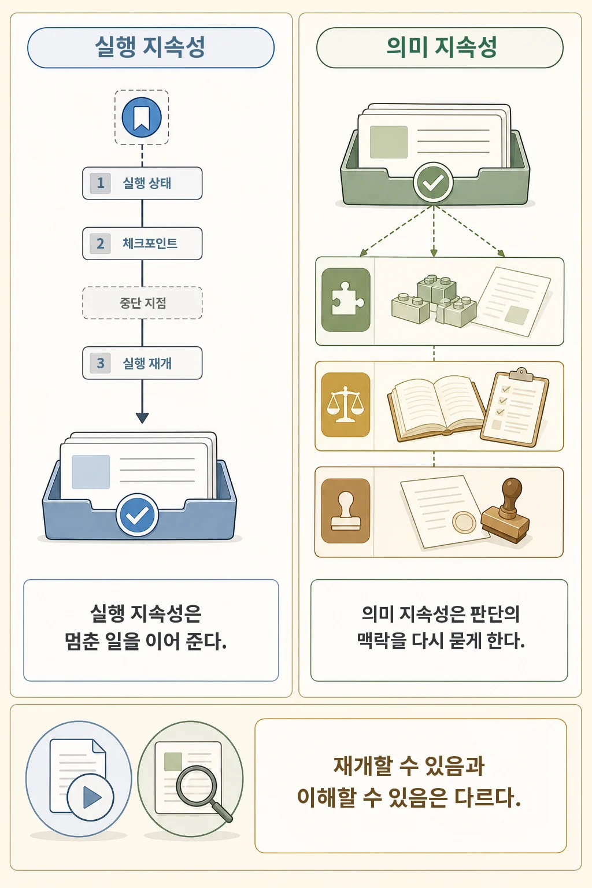
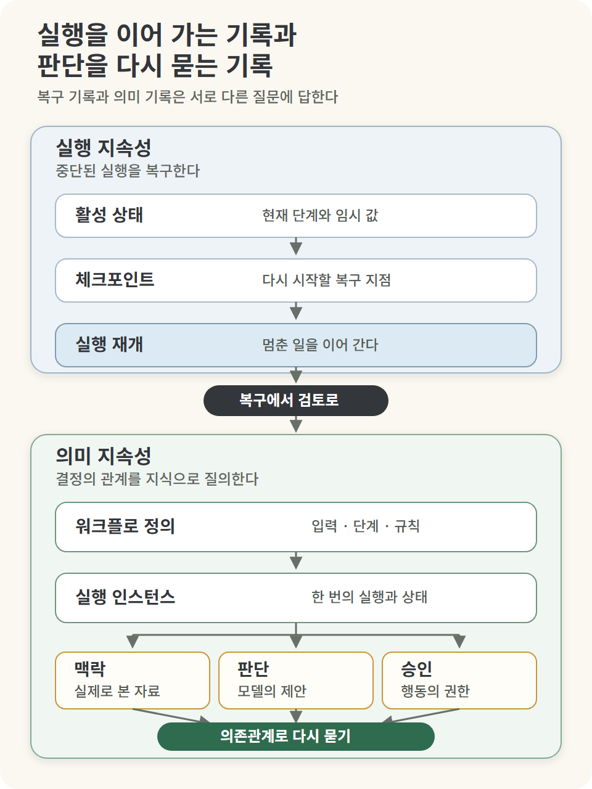
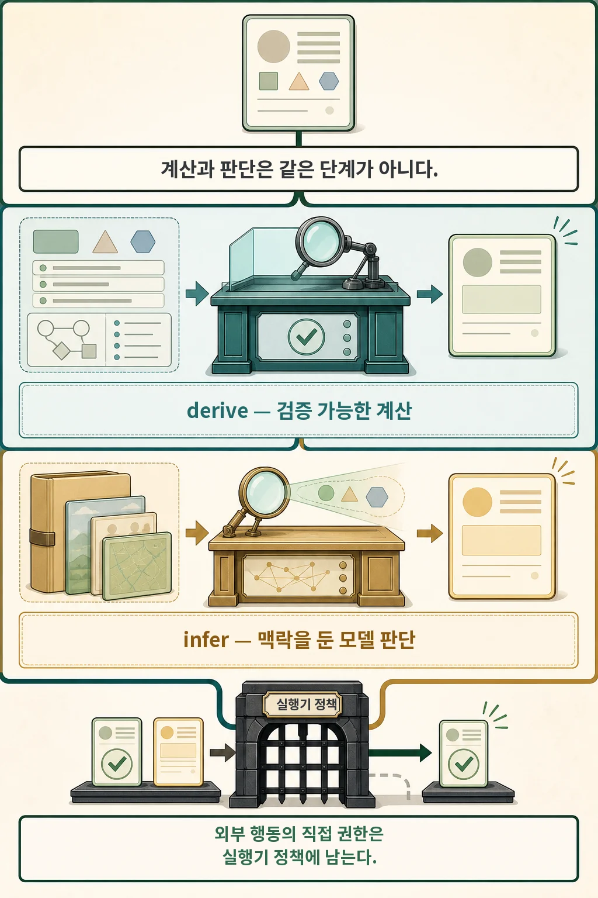
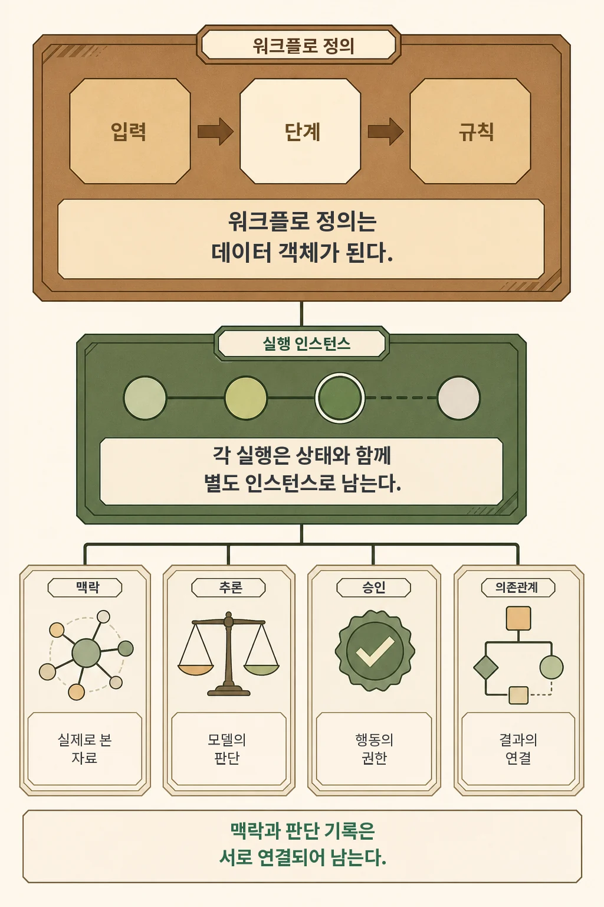

AI 에이전트가 여러 도구 호출과 담당자 승인을 거쳐 업무 결정을 내렸는데, 일주일 뒤 감사나 장애 대응에서 그 결론이 왜 나왔는지 역추적해야 할 때가 있습니다. 막상 CloudWatch나 데이터독 로그 창을 열어 보면 텍스트 기록은 수만 줄 쌓여 있지만, 당시 모델이 본 문서와 승인 맥락은 흩어져 있어 원인을 복원하기가 만만치 않죠. 포지션 논문 「Workflow as Knowledge」는 AI 워크플로를 일회성 스크립트가 아니라 정의·실행·추론·맥락·승인·의존관계가 연결된 지식 객체로 남기는 **의미 지속성(Semantic Persistence)**을 제안합니다.

글·해설: 다메카솔

## 실행 지속성과 의미 지속성, 무엇이 다를까

기존 워크플로 엔진도 실행 상태와 이력은 꼼꼼히 기록합니다. 다만 대부분은 중단된 작업을 이어 돌리는 **실행 지속성(Execution Persistence)**에 초점이 맞춰져 있거든요. 정의는 코드에, 상태는 체크포인트나 큐에, 모델 응답은 텍스트 로그에 따로 쌓이다 보니 시간이 지나면 연결 고리가 끊어집니다.

논문은 체크포인트를 대체하지 않고, 실행 이후에도 판단 근거와 의존관계를 질의하는 **의미 지속성(Semantic Persistence)** 층을 위에 얹자고 제안합니다. 두 관점의 차이는 아래 표로 비교할 수 있습니다.

| 구분 | 실행 지속성 | 의미 지속성 |
| --- | --- | --- |
| 목적 | 중단 지점에서 작업 재개(Resume) | 판단 근거·권한·인과관계 사후 질의 |
| 저장 대상 | 체크포인트, Celery·Airflow 큐, 로그 | 입력 스냅샷, 모델 추론, 승인, 의존 그래프 |
| 핵심 질문 | "어디서 멈췄고 재실행할 수 있는가?" | "무엇을 보고 왜 그 분기를 택했는가?" |

저자들이 말하는 공유 지식 기반은 특정 제품보다 접근 구조에 가깝습니다. 그래프 DB, RDF 저장소, 객체 저장소, 이벤트 로그, RDBMS 모두 구현 선택지이며, 핵심은 객체의 정체성과 맥락, 관계를 실행 경계 너머까지 유지하는 모델입니다.

## 결정적 계산(`derive`)과 모델 판단(`infer`)의 분리

논문에서 실무에 먼저 대입해 볼 원칙은 워크플로 단계를 `derive`와 `infer`로 나누는 설계입니다. 검증 가능한 계산과 확률적 모델 추론은 기록 방식과 권한 경계가 서로 다릅니다.

- **`derive` (결정론적 계산)**: 파싱, 스키마 검증, 단위 테스트, 정해진 비즈니스 규칙처럼 입력과 규칙을 명시하면 언제든 같은 결과를 재생하는 순수 로직입니다.
- **`infer` (확률적 LLM 추론)**: 요약, 의도 분류, 비정형 문서 해석처럼 선언된 맥락 안에서 모델이 확률적으로 내리는 판단입니다.

예를 들어 고객의 예외 할인 요청 워크플로를 떠올려 볼까요? 비정형 문의와 상담 이력을 요약해 예외 사유를 분류하는 일은 `infer`에 해당하지만, 등급별 할인 한도를 검증하고 금액을 계산하는 일은 `derive`로 분리해야 합니다. 둘을 한 로그에 섞어 두면 할인 금액이 잘못 나갔을 때 모델 해석이 틀렸는지 규칙이 바뀌었는지조차 가려내기 어렵죠.

외부 행동의 권한 경계 역시 이 구분을 따릅니다. `infer`는 선언된 자리에서 판단 후보를 만들 뿐이고, 실제 외부 시스템 쓰기(Write)와 상태 전이는 실행기 정책과 샌드박스가 통제합니다. 실행기는 프롬프트와 문서 스냅샷을 1급 객체로 묶어 반환 형식을 검증하고, 분기에 영향을 준 의존관계까지 기록합니다. 작업마다 코드와 모델의 경계는 달라지므로 그 선택을 정의 단계에 명시해 두는 점이 핵심입니다.

## 워크플로를 지식 객체로 묶는 6가지 요소와 승인 구조

의미 지속성 모델은 실행 중에만 쓰는 활성 상태와 장기 보존할 기록을 분리합니다. 결과에 영향을 준 핵심 흔적만 여섯 가지 지식 객체로 정의해 하나의 계보로 연결하는 구조입니다.

| 지식 객체 | 남기는 정보 | 사후에 답할 질문 |
| --- | --- | --- |
| **워크플로 정의 (Definition)** | 입력·자원·규칙과 정책 버전 | 어떤 절차와 버전이 적용됐는가? |
| **실행 인스턴스 (Instance)** | 특정 실행 트레이스와 현재 상태 | 어느 정의로 어디까지 진행됐는가? |
| **컨텍스트 스냅샷 (Context Snapshot)** | 판단 시점 모델·사람이 본 자료 | 당시 무엇을 보고 판단했는가? |
| **추론 기록 (Inference Record)** | LLM 판단 후보, 신뢰도, 검증 결과 | 어떤 추론이 분기를 바꿨는가? |
| **승인 기록 (Approval Record)** | 허용·거부·유예와 승인자 권한 | 누가 어느 행동을 허용했는가? |
| **의존관계 (Dependency Lineage)** | 결과가 기대는 자료와 앞선 판단 | 전제가 바뀌면 무엇을 재계산할까? |

사람이 개입하는 단계에서도 권한 행사와 숙의 과정은 성격이 다릅니다. 논문은 외부 행동을 허용·거부·유예하는 권한 행사를 **`approval`**로, 선택지와 찬반 근거·불확실성을 남기는 숙의를 **`panel`**로 구분하거든요. 가령 단순 "OK" 로그와 달리 숙의 기록이 연결되어 있으면, 며칠 뒤 다른 팀원도 어떤 대안을 비교해 예외를 승인했는지 맥락을 그대로 읽을 수 있습니다.

## 포지션 논문의 경계와 남은 과제

이 연구는 성능 향상을 입증한 벤치마크 논문이 아니라 개념 모델을 제안하는 **포지션 논문(position paper)**입니다. 저자들이 선별된 77개 워크플로 자료를 살핀 것도 어휘의 빈틈을 점검한 설계 피드백일 뿐, 대표 표본으로 중심 주장을 실증한 결과와는 성격이 다릅니다.

실제 운영에 적용하려면 `derive`·`infer`·승인의 형식 전이 규칙, 기존 체크포인트 엔진과의 비교 구현, 저장·색인 비용 측정, 감사 품질에 대한 사람 평가가 뒤따라야 합니다. 모든 중간 출력을 영구 저장하면 잡음과 비용만 커지므로, 저품질 출력이나 반박된 판단, 중복 스냅샷을 요약·대체·삭제할 수명주기 정책도 함께 설계해야 합니다.

## 다메카솔의 해석: '모두 저장'보다 '다시 물을 구조'

프레임워크를 통째로 바꾸기 전에, 현재 워크플로에서 계산과 모델 판단, 입력 맥락, 승인 주체, 의존관계를 따로 답할 수 있는지 점검해 볼 만합니다. 실무에서는 세 가지 원칙을 점진적으로 적용하는 편이 현실적입니다.

1. **로그와 의사결정 메타데이터 분리**: stdout 텍스트 로그에 모든 것을 흘리지 말고, 핵심 비즈니스 판단은 JSON 스키마나 RDBMS 같은 구조화된 레코드로 보존합니다.
2. **지식 계보(Lineage) 역추적 연결**: "이 가격 할인이 왜 적용됐는가?"를 물을 때 프롬프트 버전, 문서 스냅샷, 적용 규칙을 한 번에 따라가도록 식별자를 묶어 둡니다.
3. **승인 클릭과 판단 근거 분리**: 단순 "OK" 이력 대신 검토한 선택지와 선택 이유(Rationale)를 함께 남겨 정책 수정과 예외 대응에 재사용합니다.

모든 중간 토큰을 쌓아 두기보다, 사후에 다시 물을 핵심 분기와 외부 쓰기 지점부터 이 구조를 얹어 보는 것이 부담 없는 출발점입니다. 로그 양을 늘리는 일보다 결정의 인과관계를 질의할 최소 단위를 먼저 잡는 쪽이 운영 효율도 높거든요.

## 함께 읽을 AI 시스템 글

- [AI 에이전트의 숨은 저장 발자국과 복원력 평가](/posts/agentfootprint-storage-benchmark/)
- [OpenAI Presence: 기업용 에이전트 운영 통제 루프](/posts/openai-presence-agent-operations/)

## 출처

- [Emanuele Quinto, Carlo Andrea Rozzi, Francesco Zanitti, 「Workflow as Knowledge: Semantic Persistence for LLM-Mediated Workflows」, arXiv:2607.08740 (v1, 2026-07-09)](https://arxiv.org/abs/2607.08740)

이 글은 2026년 7월 9일 공개된 arXiv v1 포지션 논문 원문을 바탕으로 정리했으며, 별도 구현이나 성능 측정은 포함하지 않았고 만화와 개념 도식은 새로 구성했습니다.

이 글의 본문과 이미지는 생성형 AI로 제작했습니다. 기획과 편집 기준은 다메카솔이 정했습니다.
