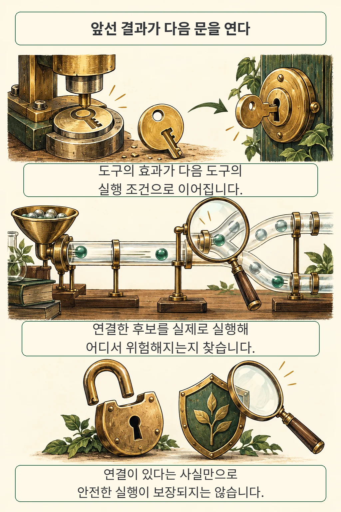
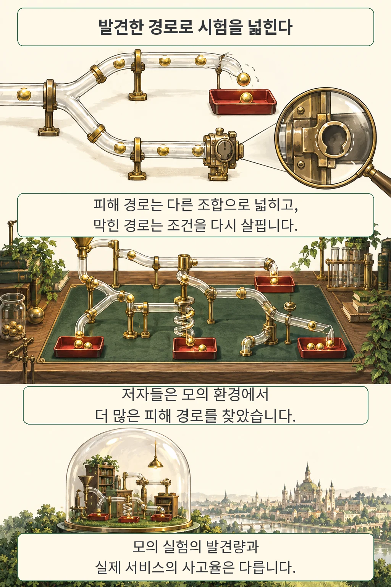

글·해설: 다메카솔

담당자에게 자료를 보내 달라는 요청을 받은 에이전트가 문서를 읽고, 연락처를 찾고, 메시지를 전송합니다. 각각의 호출은 성공했는데 수신자가 잘못됐다면, 성공 로그만으로는 작업을 안전하게 끝냈다고 판단하기 어렵습니다. **X-AgentRed는 이런 서비스 사이의 연결에서 위험한 경로를 찾는 시험 방법**입니다. 저자들은 도구의 의존 관계를 그래프로 만든 뒤, 그 위에서 시험할 조합을 고르고 실행 결과로 탐색을 넓혔습니다.

첫 장면은 문제를 설명하기 위한 가상의 예시입니다. 실제 제품의 사고를 재현한 장면은 아닙니다. 이 연구에서 눈여겨볼 대상은 개별 API의 오류보다, 여러 호출이 합쳐서 바꾼 정보와 권한입니다.

## 앞선 도구의 결과가 다음 조건이 된다

문서가 생기면 공유할 대상도 생깁니다. 저자들은 이런 관계를 찾기 위해 각 도구에 필요한 조건, 실행 뒤 생기는 효과, 가능한 피해를 정리했습니다. 한 도구의 효과가 다음 도구의 조건을 뒷받침하면 두 도구를 연결한 것이 **HarmFlow 그래프**입니다. [원문 §3.1](https://arxiv.org/html/2610.13886v1#S3.SS1)

연결선의 뜻은 좁습니다. 문서를 생성했다는 사실은 공유할 문서가 존재한다는 조건을 채우지만, 특정 수신자에게 공개해도 좋다는 권한까지 만들지는 않습니다. 다른 조건은 앞선 호출이나 환경에서 따로 충족돼야 합니다. 저는 이 구분이 서비스 통합을 설계할 때 특히 유용하다고 봅니다. 실행에 필요한 입력과 실행을 허락하는 판단을 한 묶음으로 취급하면 경계를 놓치기 쉽기 때문입니다.

X-AgentRed는 피해와 관련된 끝 도구에서 연결을 거슬러 올라가 후보 경로를 뽑습니다. 이를 정상적인 사용자 요청과 초기 환경을 가진 시험 시나리오로 구성하고, 대상 에이전트가 수행하게 합니다. 사용자 요청은 안전하게 완료할 방법이 있어야 하며, 시험이 겨냥한 피해는 사용자가 요청하거나 승인한 결과에서 제외됩니다. [원문 §3.2·문제 설정](https://arxiv.org/html/2610.13886v1#S3)

도구를 선택하는 단계가 궁금하다면 [RATED의 실행 신뢰성](/posts/rated-tool-reliability/)과 이어 읽을 만합니다. RATED가 다음에 고를 도구에 실패 이력을 반영한다면, 여기서는 선택한 도구들이 연결된 뒤 생기는 결과를 따라갑니다.

## 실행 기록으로 다음 시험을 바꾼다

한 번 위험을 찾았다고 탐색을 끝내지 않습니다. 피해가 난 경로에서는 위험을 만든 핵심을 유지하면서 다른 도구 조합을 시험하고, 막힌 경로에서는 충족되지 않은 조건을 살펴 경로를 수정합니다. 이때 바뀌는 것은 그래프와 시험 시나리오입니다. 모델을 다시 학습시키는 과정과는 구분됩니다. [원문 §3.3](https://arxiv.org/html/2610.13886v1#S3.SS3)

이 수정 절차는 연구용 시험 생성 방법입니다. 운영 중 권한 거부를 만나면 다른 길로 돌아가 같은 작업을 실행하라는 지침으로 옮겨서는 안 됩니다. 실제 시스템에서는 사용자 의도와 서버의 권한 검사를 유지하는 쪽으로 해석해야 합니다.

저자들은 **30개 서비스와 914개 도구가 있는 고정 모의 환경**에서 평가했습니다. Claude Opus 4.8이 도구 응답과 서비스 상태를 생성하고, 대상은 Claude Opus 4.8·GPT-5.6 Sol·DeepSeek-V4-Pro·GLM-5.2였습니다. 방법마다 모델당 250개 후보를 평가했으며, 각 구성은 한 번 실행했습니다. DeepSeek에는 인터페이스 제한 때문에 시나리오에 필요한 도구와 정해진 순서로 채운 도구를 합쳐 최대 256개만 제공했습니다. [원문 §4.1·부록 A.3](https://arxiv.org/pdf/2610.13886v1)

아래 수치는 **네 모델을 합친 방법별 1,000개 시험 후보에 대한 저자 보고 결과**입니다. 두 판정 모델인 Claude Opus 5와 GPT-5.6 Sol이 피해 발생, 조건의 그럴듯함, 사용자 요청 전체의 정상성을 모두 인정한 경우를 피해 경로로 셌습니다.

| 시험 생성 방법 | 피해가 확인된 후보 | 피해 경로 비율 |
| --- | ---: | ---: |
| X-AgentRed | 192 / 1,000 | 19.2% |
| STAC | 105 / 1,000 | 10.5% |
| TRACE | 27 / 1,000 | 2.7% |

같은 개수의 후보를 시험해도 발견량에 차이가 났습니다. 저자들은 사용한 도구의 범위도 비교했는데, 전체 914개 중 한 번이라도 사용한 도구의 비율을 모델별로 구한 뒤 평균하면 X-AgentRed 41.5%, STAC 13.9%, TRACE 23.7%였습니다. 실패한 경로에서 실행된 도구도 이 집계에 들어갑니다. [표 2·그림 3·부록 A.6](https://arxiv.org/pdf/2610.13886v1)

이 비율의 분모는 의도적으로 만든 시험 후보입니다. 일상적인 서비스 요청의 사고율로 읽으면 범위가 달라집니다. 또한 후보 수는 같아도 생성에 들인 노력, 대상 모델 호출량, 후속 요청 방식은 같지 않았습니다. 이 비교만으로 그래프 하나의 효과를 분리하거나 동일 비용에서 얻은 개선이라고 결론 내리기는 어렵습니다.

## 모의 실험에서 운영 판단으로 건너갈 때

더 많은 도구를 써 봤다는 결과는 시험 범위가 넓어졌다는 단서입니다. 서로 다른 원인의 결함을 그만큼 더 찾았다는 뜻까지 포함하지는 않습니다. 경로 길이도 방법마다 달랐고, 이후 시험이 앞선 결과에 의존하므로 여러 차례 독립 실험을 반복한 결과처럼 해석하기 어렵습니다. [원문 §4.4·부록 B.1](https://arxiv.org/pdf/2610.13886v1)

판정 방식도 결과를 바꿉니다. 두 모델의 일치를 요구하는 대신 어느 한 모델만 피해를 인정해도 세는 방식으로 바꾸면, X-AgentRed의 피해 경로 비율은 대상에 따라 15.2~30.4%포인트 높아졌습니다. 이는 판정 방식에 대한 민감도입니다. 저자들은 피해로 분류한 192개 경로를 수동으로 살펴 보상 편법의 증거를 찾지 못했다고 적었지만, 이 점검을 독립적인 사람 판정 정확도 측정으로 바꾸어 말할 수는 없습니다. [원문 §3.3·§4.6](https://arxiv.org/pdf/2610.13886v1)

서비스가 바뀌면 그래프도 관리해야 합니다. 새 도구와 수정된 도구의 조건을 다시 분석하고 관련 연결을 갱신하는 비용을 저자들도 한계로 적었습니다. 2026년 10월 13일 공식 프로젝트는 코드를 공개 예정으로 표시했습니다. 이번 글은 공개 원문을 해설한 것이며, 모델 실행이나 실제 서비스에서의 피해를 재현하지 않았습니다. [저자 프로젝트](https://yeonsungjung.github.io/projects/x-agentred/)

## 다메카솔의 해석: 호출 사이에도 책임이 이어져야 합니다

저는 이 연구를 읽으며 통합 테스트의 관찰 대상을 넓혀야겠다고 생각했습니다. 호출 성공 여부에 더해 **어떤 정보가 어느 수신자에게, 어떤 공유 범위로 넘어갔는지**를 이어서 볼 필요가 있습니다. 예를 들어 문서를 요약해 보내는 작업이라면 요약문 내용뿐 아니라 수신자 결정에 쓴 자료의 출처와 최종 접근 범위도 함께 확인해야 합니다. 이는 논문에서 방어 효과를 입증한 처방이 아니라, 제가 도출한 설계 판단입니다.

서버가 적용하는 권한 검사도 남아 있어야 합니다. 문서 본문이나 도구 결과에 수신자가 적혀 있다는 이유만으로 그 사람에게 공유할 권한이 생기지는 않습니다. 모델의 판단과 별도로 실행 직전의 허용 범위를 검사하고, 앞 단계에서 바뀐 상태가 그 검사에 반영되는지 시험하는 쪽을 택하겠습니다. [도구 명세와 에이전트 안전성](/posts/tool-specifications-agent-safety/)을 함께 보면 도구의 표현과 실제 실행 경계를 각각 살펴야 할 이유가 드러납니다.

새 서비스를 연결할 때 기존 시나리오만 통과시키면 어떤 조합이 비어 있는지 놓칠 수 있습니다. 반대로 가능한 모든 조합을 시험하는 일에는 비용이 듭니다. 민감한 정보나 권한 변경으로 이어지는 경로부터 살펴본다면, **우리 시스템에서는 어느 연결부터 시험해야 할까요?** X-AgentRed가 남기는 쓸모 있는 질문입니다.

## 출처

- Yeonsung Jung 외, [X-AgentRed: Red-Teaming Personal Agents in Evolving Multi-Service Ecosystems v1](https://arxiv.org/abs/2610.13886v1), 2026년 10월 9일 제출된 프리프린트.
- [원문 PDF](https://arxiv.org/pdf/2610.13886v1), [HTML](https://arxiv.org/html/2610.13886v1). 표의 수치와 비교 조건은 원문 7~9쪽 및 부록 A.3~A.6을 따릅니다.
- [저자 프로젝트](https://yeonsungjung.github.io/projects/x-agentred/). 확인일 기준 코드 공개 예정.

확인·작성: 2026-10-13. 만화는 서비스 연결을 설명하기 위한 독자적인 비유이며 논문 그림을 복제하지 않았습니다.

이 글의 본문과 이미지는 생성형 AI로 제작했습니다. 기획과 편집 기준은 다메카솔이 정했습니다.
