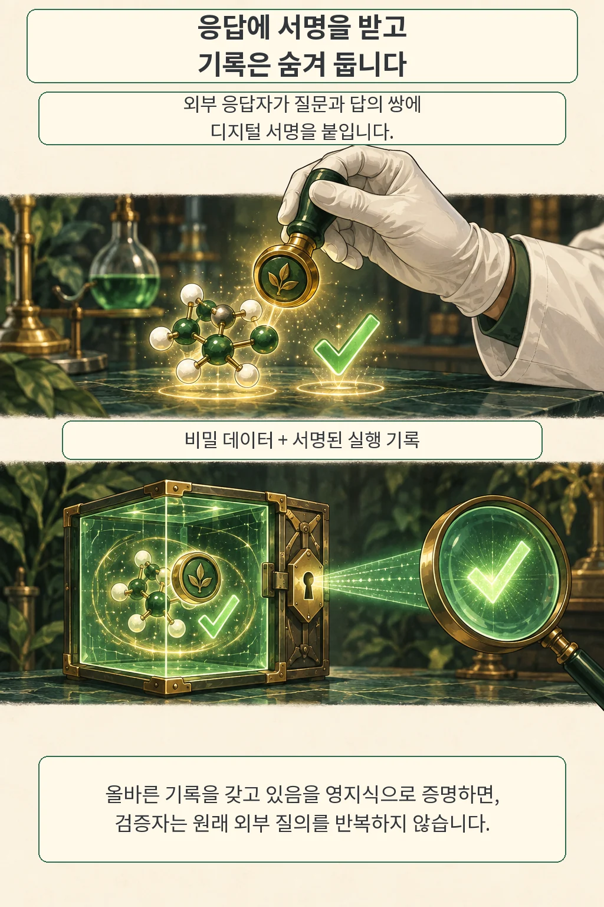

**검증자는 결과를 믿을 근거가 필요하고, 데이터 주인은 민감한 입력을 숨겨야 합니다.** 외부 실험 장비나 사람의 판단을 거치는 AI 작업에서는 이 두 요구를 동시에 만족시키기가 까다로운데, 검증자가 결과를 재확인하려면 질문에 담긴 비밀 입력까지 알아야 할 수 있기 때문입니다. 새 이론 논문은 이 충돌이 왜 발생하는지 수학적으로 분석하고, 외부 응답에 디지털 서명을 붙이는 조건에서 가능한 영지식 검증 구성을 제시합니다.

*글·해설: 다메카솔*

원문 확인·작성: 2026년 10월 3일 · 10월 2일 예정 회차

## 핵심 내용

- **외부 오라클 질의와 영지식(Zero Knowledge)의 충돌**: 외부 실험이나 사람 판정을 질의 가능한 함수(오라클)로 모델링했을 때, 무작위 오라클 모형에서는 검증 시간 제약을 풀더라도 비밀 입력(증인)을 노출하지 않고는 검증할 수 없는 계산이 존재함을 증명했습니다(토론 모형까지 불가능성 확장).
- **서명된 오라클(Signed Oracle)을 통한 해법**: 외부 응답자가 ‘질문과 답의 쌍’에 디지털 서명을 붙이고 충돌 저항 해시 함수가 존재한다고 가정하면, 증명자가 비밀 입력과 서명된 실행 기록을 숨긴 채 기록의 정당성과 서명 유효성만 영지식 논증으로 입증하는 간결한 검증이 가능해집니다.
- **신뢰 경계의 이동**: 검증자에게는 비밀 입력을 숨길 수 있지만, 서명하는 외부 오라클 주체는 여전히 질문 원문을 보며 정직하게 서명하고 개인키를 안전하게 지킨다는 신뢰 가정이 남습니다.

이번에 읽은 논문은 Alessandro Chiesa, Ziyi Guan, Burcu Yıldız의 **Can AI Oversight Be Zero Knowledge?**(2026년 10월 1일 제출 arXiv v1)입니다. 여기서 **영지식**은 검증자가 공개된 주장 자체에서 알 수 있는 내용을 넘어 비밀 입력에 관한 추가 정보를 얻지 못한다는 뜻입니다.

## 확인 질문에 비밀이 들어간다면

신약 후보 분자의 독성을 외부 실험실에 의뢰해 확인하는 상황을 떠올려 보면, 제3자 검증자가 똑같은 실험을 다시 요청해 결과를 대조하려면 결국 그 분자의 비공개 구조나 시료를 알아야 합니다. 논문은 이처럼 알고리즘 바깥의 실험이나 사람 판정을 **오라클(oracle)**이라는 함수로 모델링합니다.

저자들은 무작위 오라클 모형에서, 검증을 빠르게 끝내라는 효율성 요구를 완화하더라도 **비밀 증인(주장을 뒷받침하는 비밀 입력)을 숨긴 채 검증할 수 없는 계산이 존재한다**는 하한(불가능성)을 증명합니다. 증명 개요에서는 비밀 문자열이 가리키는 특정 행의 비트가 모두 0인지 검사하는 문제를 구성하는데, 검증자가 그 행을 직접 질의해 보지 않으면 조작 여부를 가려낼 수 없고 직접 질의하려면 행 위치를 뜻하는 비밀 문자열을 알아야 하는 딜레마가 생깁니다(이는 모든 AI 작업이 비밀을 누설한다는 뜻이 아니라, 임의의 외부 오라클 계산 전반에 무조건적인 영지식 보장을 줄 수 없다는 반례입니다). 저자들은 이 한계를 두 당사자가 판정자 앞에서 다투는 토론(debate) 모형으로도 확장했습니다.

## 서명은 재질의를 대신할 근거를 줍니다

검증자가 외부 오라클에 직접 재질의하지 않아도 되게 만들려면 어떻게 해야 할까요? 저자들은 외부 오라클이 **질문과 응답의 쌍에 디지털 서명을 붙여 주는 ‘서명된 오라클(signed oracle)’** 모델을 도입합니다.

서명된 기록을 검증자에게 그대로 건네면 질문 속에 들어 있는 비밀 입력까지 노출되므로, 증명자는 비밀 입력과 서명된 실행 기록을 직접 보내는 대신 **“내가 가진 실행 기록이 올바른 계산 과정을 따랐고, 포함된 오라클 서명들이 모두 공개키로 유효하게 검증된다”**는 사실만을 영지식 지식 논증(zero-knowledge argument of knowledge)으로 증명합니다. 충돌 저항 해시 함수가 존재한다는 암호학적 가정 아래, 저자들은 효율적인 증명자와 간결한 검증자를 갖춘 구성을 제시합니다(Theorem 4.1, 5.2).

## 다메카솔의 해석: 비밀을 보는 주체부터 나눕니다

이론적 결과를 백엔드·보안 아키텍처 관점으로 옮겨 보면 **신뢰의 위치가 어디로 이동했는지**가 또렷하게 보입니다. 영지식 논증 덕분에 최종 검증자에게는 비밀 입력을 숨길 수 있게 됐지만, 질문과 답에 서명하는 외부 오라클(실험 기관이나 심사자)은 여전히 질문 원문을 직접 보며 진짜 응답에만 서명하고 서명키를 안전하게 보관한다는 가정이 전제됩니다.

따라서 실제 감사·검증 시스템을 설계할 때는 세 가지 경계를 나누어 적어야 합니다.

1. **질문·응답 결합 무결성**: 어떤 질문에 대한 어떤 버전의 응답인지 위변조 없이 서명에 묶이는가
2. **열람 주체 분리**: 최종 검증자는 영지식 증명만 보더라도, 1차 서명 주체에게는 어느 범위의 민감 데이터가 노출되는가
3. **오라클 오류·키 유출 대응**: 서명이 유효하다는 사실은 ‘그 오라클이 답했다’는 출처 증빙일 뿐 오라클의 판정 자체가 무오류라는 뜻은 아니므로, 서명키 유출이나 오라클 오판 시의 철회·재검증 절차가 있는가

정해진 모델과 입력 범위 안에서 출력 성질을 보장하는 [NNV3의 입력 집합 검증](/posts/nnv3-verification-boundaries/)과 마찬가지로, 외부 판정이 결합된 영지식 감시에서도 **검증자에게 숨겨지는 정보와 서명자에게 맡기는 신뢰 가정**을 설계 문서에 나란히 명시해야 안전한 판단 기준이 됩니다.

## 출처

- Chiesa, Guan, Yıldız, [Can AI Oversight Be Zero Knowledge? — arXiv v1](https://arxiv.org/abs/2610.01995v1), 2026-10-01 제출.
- [원문 PDF](https://arxiv.org/pdf/2610.01995v1): §1.1의 정리와 신뢰 조건, §2.1의 하한 증명 개요, §2.2의 토론 모형, §2.3의 서명된 오라클 구성 및 Theorem 4.1·5.2를 확인했습니다(별도 코드·데이터 배포나 성능 실측은 없는 이론 논문입니다).

이 글의 본문과 이미지는 생성형 AI로 제작했습니다. 기획과 편집 기준은 다메카솔이 정했습니다.
